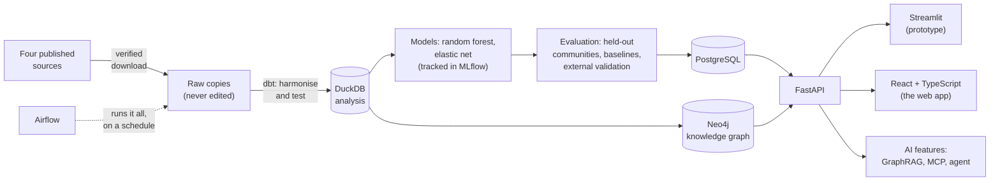

# RealSignal


**Version:** v0.1.0, and Phase 2 on top of it (2 of 18 phases done: the published data downloaded and verified, and the four other data layers fetched and checked) · **Interactive figures:** [`docs/interactive/`](docs/interactive/), or online once GitHub Pages is switched on ([how](docs/02-phase-1-data-acquisition.md#optional-publish-the-interactive-pages-with-github-pages))
· 


-informational)

Rebuilding a published machine-learning study about bacteria that protect plants, from its released data, in another language; checking its conclusion against evidence the model never saw; and turning it into a tool that helps decide which experiments are worth running. Built from scratch in public, with every step explained.

> **New here? Start with the [Handbook](docs/HANDBOOK.md).** It's one document that walks the whole journey from a blank laptop to the finished product, explains *why* at every step, and links to every specialised guide.
>
> Every term used anywhere in this repository, biological or technical, is defined in plain language in [`docs/GLOSSARY.md`](docs/GLOSSARY.md). If a word isn't there, that's a documentation bug.


---

## Contents

- [**The Handbook**](docs/HANDBOOK.md): the whole journey in one document (read this first)
- [What is a plant microbiome? (start here)](#what-is-a-plant-microbiome-start-here)
- [The problem this project tackles](#the-problem-this-project-tackles)
- [Reproduction, replication and extension](#reproduction-replication-and-extension)
- [How it works](#how-it-works)
- [The five data layers](#the-five-data-layers)
- [The product](#the-product), and [the part that generalises](#the-part-that-generalises)
- [Results, phase by phase](#results-phase-by-phase) (fills in as each phase is finished)
- [Build status](#build-status): all 18 phases, with their version tags
- [The tutorial, in order](#the-tutorial-in-order)
- [About the data: what it is and what it isn't](#about-the-data-what-it-is-and-what-it-isnt)
- [Repository map](#repository-map), with every file annotated
- [How to run](#how-to-run)
- [Changelog](CHANGELOG.md): what changed, version by version
- [How I work on this repository (branches)](#how-i-work-on-this-repository-branches)
- [Why the documentation is so detailed](#why-the-documentation-is-so-detailed)
- [Credits and licence](#credits-and-licence)

---

## What is a plant microbiome? (start here)

*No biology background needed.*

Look closely at the leaf of any plant growing outdoors. It looks clean, but every square centimetre carries millions of bacteria, most of them harmless and many of them useful. That resident population is the plant's **microbiome**.

Your own skin works the same way. It's covered in bacteria, most of which do nothing bad, and some help: by taking up the space and eating the food, they leave no room for harmful ones to move in.

Some bacteria do attack plants. They multiply inside the leaf, and the plant sickens and can die. A microbe that causes disease is a **pathogen**, and plant pathogens destroy a large share of the world's crops every year.

The usual answer is a chemical spray. The alternative scientists are working on: if some of the plant's own harmless residents already keep pathogens out, could we find those residents, grow them, and apply them to crops on purpose? That's called **biocontrol**.

A **strain** is one particular, named kind of bacterium kept alive in a laboratory freezer: one named breed, not "dog" in general. The strains in this project have names like `Leaf15` and `Leaf68`, because they were isolated from real leaves and numbered.

So the practical question is: **which strains actually protect the plant?**

---

## The problem this project tackles

### Bacteria don't act alone

Answering that is hard. Bacteria compete for food, hold each other back with chemicals, and sometimes help each other. A strain that protects a plant on its own in a clean laboratory dish may do nothing on a real leaf among thirty other kinds, and a strain that looks useless alone may matter a lot in company.

Suppose you run a 5-a-side football league and want to know which players win games. Testing a player alone against a wall tells you little, because football isn't played against a wall. So you form many random five-player teams, record every result, and work backwards: which players keep turning up in the teams that win?

That's the design of the study RealSignal rebuilds. Researchers at ETH Zurich took **35** harmless leaf bacteria, assembled **136 random five-strain communities**, put each one on its own set of plants, infected all of them with the same pathogen and measured how much pathogen grew. Then they used machine learning to work out which strains drove the good outcomes, tested the predictions on **70 more communities** kept back for the purpose, and went back to the laboratory to check.


Three strains, *Pseudomonas* Leaf15, *Rhizobium* Leaf68 and *Acidovorax* Leaf76, reduced the pathogen, and one of them hadn't been known as protective before.

### Why the design matters

Testing every possibility is out of reach. Thirty-five strains taken five at a time make **324,632** possible communities. At a hundred communities a year (an assumption; [`docs/interactive/combinations.html`](docs/interactive/combinations.html) lets you change it), testing them all would take over 3,000 years.


So the real question is which few communities to test, and how to learn the most from them. The study's answer, random communities plus machine learning, is a template for finding useful microbes without testing everything.

### Does the result reproduce?

A published result is a claim. Rebuilding it from the released data, by someone else, on another computer, in another language, is how a claim gets checked. Studies across many fields keep finding that a large share of published computational results are hard to rebuild: code goes missing, software versions drift, a manual step was never written down.

### What RealSignal does

An open, independent reproduction and extension, built from five data layers out of four published sources:

1. **Acquire** every source from its permanent public archive, verified by checksum.
2. **Harmonise** them onto one strain name with a tested, documented pipeline, because laboratories working years apart spell the same strain differently.
3. **Reproduce** the published machine learning in Python (the original is in R), judged on communities the model never saw.
4. **Compare** the numbers with the published ones, including where they disagree, and then **run the authors' own R code**, which ships with their data. That gives three results side by side (the paper, their code, the rebuild), which can tell a mistake in the rebuild apart from a gap in the original.
5. **Integrate** the genome and network layers: do the strains the model ranks highly carry more antibiotic-producing gene clusters?
6. **Validate** the ranking against a separate experiment that tested every strain *alone*, and measure how many communities were needed to reach the conclusion.
7. **Serve** it as a product: an API, a web app, a knowledge graph, and AI features that answer *why* with sources.

---

## Reproduction, replication and extension

Three words get used loosely. This project uses them carefully:

| Word | What it means | In the kitchen |
|---|---|---|
| **Reproduction** | same data, same question, analysis rebuilt | cooking a published recipe again in your own kitchen |
| **Replication** | new data from a new experiment, same question | growing your own tomatoes and cooking it again |
| **Extension** | same data, questions the original didn't ask | trying the recipe with half the cooking time |

RealSignal does **reproduction** and **extension**. Replication would need a growth chamber, thirty-five bacterial cultures and months of work, so it's out of scope.

The reproduction crosses languages. The authors worked in R; the rebuild uses Python (`scikit-learn`). The mathematics is the same, but default settings, random-number generators and small implementation choices differ, so expect the same conclusions and close numbers, not identical digits. Where the numbers differ, the job is to explain why, without adjusting settings until they match a number already known (a well-known way to fool yourself, called *hindsight fitting*).


---

## How it works



Download the published data and keep untouched copies; harmonise every source onto one strain name with a tested pipeline; store the result as tables and as a graph; train only on the training communities; judge the models on communities they never saw and against a separate experiment; serve the results through an API to a prototype, a web app and the AI features; and let an orchestrator run the whole chain. Every box, what it does and why it's there, is in [`docs/00-architecture.md`](docs/00-architecture.md).

---

## The five data layers

One dataset answers one question. Several linked datasets can answer questions none of them could alone. All of these describe the **same strain collection**, the *At*-LSPHERE, isolated from the leaves of wild *Arabidopsis* plants, and that shared collection is what makes joining them possible.


| # | Layer | What it adds | Source | Status |
|---|---|---|---|---|
| 1 | community make-up and pathogen outcome | 136 training and 70 test communities | Emmenegger *et al.* 2023, *Nat Commun* 14:7983; data and code on [Zenodo](https://doi.org/10.5281/zenodo.10118600), CC-BY 4.0 | ✅ downloaded and verified (Phase 1) |
| 2 | strain genomes | the genetic blueprint of each strain | Bai *et al.* 2015, *Nature* 528:364; the genomes from NCBI | ✅ 34 of 35 fetched and checked (Phase 2); Leaf21 has none listed |
| 3 | biosynthetic gene clusters | 1,053 predicted clusters for natural products such as antibiotics | Helfrich *et al.* 2018, *Nat Microbiol* 3:909, [doi:10.1038/s41564-018-0200-0](https://doi.org/10.1038/s41564-018-0200-0) | ✅ fetched and checked (Phase 2) |
| 4 | strain-against-strain inhibition | more than 50,000 pairings of 224 strains, 725 of them inhibitory | the same Helfrich *et al.* 2018 study | ✅ fetched and checked (Phase 2) |
| 5 | single-strain protection | 224 strains, each tested **alone** against the pathogen | Vogel *et al.* 2021, *Nat Microbiol* 6:1537, [doi:10.1038/s41564-021-00997-7](https://doi.org/10.1038/s41564-021-00997-7) | ✅ fetched and checked (Phase 2) |

**What each one is for.** Layer 1 asks *which communities protect?* Layers 2 and 3 ask *why*: genes encode the chemistry a strain can make, so if the highly ranked strains carry more antibiotic gene clusters, the statistical result gains a possible mechanism. Layer 4 asks *how they interact*. Layer 5 is the strongest check: the model learns which strains matter from communities only and never sees a strain tested alone, so comparing its ranking with Layer 5 tests the conclusion against evidence it never touched. (Layer 5 comes from the same research group, so it's an independent dataset, not an independent laboratory, and the validation guide says so.)

> **All five layers can be fetched and checked.** The genomes come from NCBI and are checked against the checksums NCBI publishes; the gene clusters, the interaction network and the single-strain results come from the two papers' supplementary workbooks, downloaded from the publisher's site and checked against checksums pinned on first use. `sources/register.csv` records where each one comes from, on what terms and when, and the one gap: Leaf21 has no genome listed, so it has no genome or gene-cluster data ([Phase 2 guide](docs/03-phase-2-more-sources.md)).

---

## The product

A system becomes a product when you can name its user and the decision it helps with.

- **User:** a scientist choosing which strain combinations to test next.
- **Problem:** each combination costs weeks of growth-chamber work, and there are hundreds of thousands of them.
- **Decision it supports:** which handful to test next.
- **Value:** ranking candidates before committing laboratory time turns an impossible search into a shortlist.
- **How success is measured:** the hit rate of recommended communities against randomly chosen ones, on communities the model never saw.

**What it doesn't claim.** The plants were grown sterile, in sealed boxes, with exactly five known bacteria. That simplification is what lets cause and effect be pinned down, but "Leaf76 protects *Arabidopsis* in a box" doesn't mean "Leaf76 will protect wheat in a field in July". The app says so on screen.

### The part that generalises

The trained model belongs to these 35 strains, this pathogen and this plant. The method underneath carries over.

The problem has a shape that has nothing to do with bacteria: you have N components, you can combine k of them, the number of combinations is far larger than what you can afford to test, and every test is slow and expensive. Which handful do you test next? The same shape turns up wherever combinations of living components are designed: protective mixtures in agriculture, multi-strain formulations in health, starter cultures in fermentation, production consortia in industrial biotechnology.

So the project is built to keep the method reusable:

- **Nothing hard-codes 35 strains, five per community, one pathogen or one measurement.** The strain library, the community size and the measured outcome are inputs to the data model, from Phase 3 on.
- **The useful loop is predict, test a shortlist, feed the results back, retrain, predict again.** The pipeline (Phase 12) is built so that a new file of results can go in and the models retrain from it.
- **It can run entirely on your own computer.** Containerised, with no outside service and nothing uploaded. (The online copy from Phase 7 is for trying it with the published data.) I chose that for reproducibility, and it's also what anyone with a confidential strain library would need.

Where a larger version could go, technology by technology, is in [`docs/PRODUCT_ROADMAP.md`](docs/PRODUCT_ROADMAP.md).

---

## Results, phase by phase

Results appear here as each phase is finished, including the published numbers beside the rebuilt ones and the places where they disagree.

| Phase | Result |
|---|---|
| 1 | the published archive (239,154,876 bytes) downloads and matches its published MD5 checksum. It holds 342 files: 53 data files the authors started from, 183 that their code wrote (results for eight random seeds and most of the supplementary tables), 22 R scripts and 76 figure PDFs ([details](docs/02-phase-1-data-acquisition.md#what-the-archive-holds)) |
| 2 | Layer 1's tables read: 136 training communities (rounds 1 and 2), 68 new test communities plus two reference communities grown in every round (round 3); 144 infected plants marked undecided after their boxes were dropped, and 16 left out. The authors' 12 per-plant machine-learning tables rebuild exactly from the plant file and keep the 120 undecided plants in five-strain communities. Layers 2 to 5 fetched: 34 genomes matching NCBI's published MD5, two workbooks pinned by SHA-256, 48.5 MB in all ([details](docs/03-phase-2-more-sources.md#5-step-1-open-layer-1s-tables)) |
| 3 onwards | not run yet |

---

## Build status

The full plan, with effort estimates and the reasons behind every tool chosen and left out, is in [`docs/ROADMAP.md`](docs/ROADMAP.md). Science and platform phases alternate, so there's always something working to show, and a first app arrives halfway through the science while there's still time to act on what it teaches. Stopping at any version tag leaves something complete.

| # | Phase | Track | Version | Status |
|---|---|---|---|---|
| 1 | Data acquisition: verified, logged, safe to re-run | Data | v0.1.0 | ✅ done |
| 2 | The other data layers, or a record of why not | Data | n/a | ✅ done |
| 3 | Harmonisation with dbt: one strain name, tested, documented | Data | v0.2.0 | ⬜ |
| 4 | Exploration: distributions, data quality, first figures | Data | n/a | ⬜ |
| 5 | Reproduction of the published models in Python, with MLflow | Science | v0.3.0 | ⬜ |
| 6 | **The original R analysis:** run the authors' code in R and RStudio; the three-way comparison | Science | v0.4.0 | ⬜ |
| 7 | Streamlit prototype, online | Product | v0.5.0 | ⬜ |
| 8 | Multi-omics integration: genome, gene-cluster and network features | Science | n/a | ⬜ |
| 9 | External validation and the data-efficiency curve | Science | v0.6.0 | ⬜ |
| 10 | PostgreSQL and FastAPI, the first container | Platform | n/a | ⬜ |
| 11 | React and TypeScript frontend | Platform | n/a | ⬜ |
| 12 | Orchestration: a plain runner, then Airflow | Platform | v0.7.0 | ⬜ |
| 13 | Knowledge graph and ontology (Neo4j) | AI | n/a | ⬜ |
| 14 | GraphRAG: answers with cited sources | AI | n/a | ⬜ |
| 15 | MCP server: the project's tools for AI assistant apps | AI | n/a | ⬜ |
| 16 | Recommendation agent | AI | v0.8.0 | ⬜ |
| 17 | The whole system in containers, Docker or Podman | Release | v0.9.0 | ⬜ |
| 18 | Tests on three operating systems, release 1.0 | Release | v1.0.0 | ⬜ |

**About 174 hours in all**, so at four to five hours a week, eight to ten months. The science is complete at v0.6.0, after Phase 9. [`docs/ROADMAP.md` section 5](docs/ROADMAP.md#5-effort-and-schedule) shows where the estimate comes from.

---

## The tutorial, in order

Every step from an empty laptop to a working system is taught in `docs/`, for someone with no programming and no biology background. Every term is defined and every command is shown with the output you should expect.

| # | Guide | What it teaches |
|---|---|---|
| ★ | [Handbook](docs/HANDBOOK.md) | the whole journey in one document: read it first |
| 00 | [Architecture](docs/00-architecture.md) | every part of the system, why it exists, and how data moves between them |
| 01 | [Setup](docs/01-setup.md) | blank laptop to working workshop: Python, Git, a virtual environment, GitHub and the safety gate, on Windows, macOS and RHEL 8 |
| 02 | [Phase 1: data acquisition](docs/02-phase-1-data-acquisition.md) | permanent archives, DOIs, checksums, read-only raw data, provenance |
| 03 | [Phase 2: the other data layers](docs/03-phase-2-more-sources.md) | reading tables you didn't write, a source register, free to read versus free to reuse, published and pinned checksums |
| 04 to 19 | the phase guides for Phases 3 to 18 | one guide per phase, added as each phase is built |
| n/a | [Git workflow](docs/GIT_WORKFLOW.md) | branches from zero, and the commands at the end of every phase |
| n/a | [Containers](docs/CONTAINERS.md) | what a container is, Docker and Podman, and running the whole system with one command |
| n/a | [Roadmap](docs/ROADMAP.md) | the 18 phases, the version tags, the effort, and the tools left out on purpose |
| n/a | [Product roadmap](docs/PRODUCT_ROADMAP.md) | beyond the repository: what a larger version adds, with a verdict for each technology |
| n/a | [Glossary](docs/GLOSSARY.md) | every term, biological and technical, in plain language |

---

## About the data: what it is and what it isn't

- **The data is real, published, and not mine.** Layer 1 was produced by Emmenegger, Massoni, Pestalozzi, Bortfeld-Miller, Maier and Vorholt at ETH Zurich and released under CC-BY 4.0, which allows reuse **as long as the creators are credited**. They're credited here, in the guides, in the code that downloads their archive, and from Phase 7 in the app. This project takes no credit for the data or for the original finding; what it adds is the independent rebuild, the further analyses and the teaching material.
- **Reproducing a study isn't a criticism of it.** The authors released their data and code publicly, permanently and under an open licence, which is what makes this project possible at all.
- **Cross-language differences are expected.** Close numbers support the finding; identical digits would be slightly surprising.
- **It's a controlled laboratory system, not a field.** A model trained here describes these 35 strains, this pathogen, this plant and this measurement. It isn't advice for growing crops.
- **The measurements are noisy, as living things are.** Plants vary, some bacterial counts couldn't be assigned to a single strain, boxes got dropped and a few plants were contaminated. The authors documented every decision in their files: of the 936 infected plants, 16 are left out and 144 marked undecided ([what Phase 2 found](docs/03-phase-2-more-sources.md#5-step-1-open-layer-1s-tables)). The harmonisation in Phase 3 handles each one in the open instead of dropping rows quietly.
- **The other layers aren't mine either.** The genomes come from Bai *et al.* 2015 through NCBI, and the workbooks behind Layers 3 to 5 from Helfrich *et al.* 2018 and Vogel *et al.* 2021, under their publisher's terms. The scripts download each file from its source; `sources/register.csv` records where from and on what terms, and the repository stores none of them.
- **Nothing here is a claim about any commercial product.**

---

## Repository map

The tree as it is today, plus the folders later phases fill (✅ exists, ⬜ arrives with a later phase). The [Handbook's file index](docs/HANDBOOK.md#every-file-in-the-repository-and-where-it-is-explained) says which guide explains each file.

```
realsignal/
├── README.md                          ← you are here                                        ✅
├── CHANGELOG.md                       ← what changed, version by version                    ✅
├── LICENSE                            ← MIT, for this project's code and documents          ✅
├── requirements.txt                   ← the Python packages, with version ranges            ✅
├── requirements.lock.txt              ← the exact versions on the computer it was built on  ✅
├── setup.sh / setup.ps1               ← one-command setup, macOS/Linux and Windows          ✅
├── check-public-safe.sh               ← the safety gate, run before every push              ✅
├── pytest.ini                         ← tells the tests where to look                       ✅
├── .gitignore                         ← what Git must never record                          ✅
├── compose.yaml                       ← every service, started together (Phase 17)          ⬜
├── container.sh / container.ps1       ← finds Docker or Podman and runs it (Phase 17)       ⬜
│
├── docs/                              ← the tutorial
│   ├── HANDBOOK.md                    ← the whole journey, day 0 to the product             ✅
│   ├── 00-architecture.md             ← how it all fits together                            ✅
│   ├── 01-setup.md                    ← blank laptop to working workshop                    ✅
│   ├── 02-phase-1-data-acquisition.md ← Phase 1: the verified download                      ✅
│   ├── 03-phase-2-more-sources.md     ← Phase 2: Layer 1 read, the other layers fetched     ✅
│   ├── 04 to 19                       ← one guide per phase, Phases 3 to 18                 ⬜
│   ├── GIT_WORKFLOW.md                ← branches and the end-of-phase ritual                ✅
│   ├── CONTAINERS.md                  ← containers from zero, Docker and Podman             ✅
│   ├── ROADMAP.md                     ← the 18 phases, tags, effort, tools left out         ✅
│   ├── PRODUCT_ROADMAP.md             ← beyond the repository                               ✅
│   ├── GLOSSARY.md                    ← every term, in plain language                       ✅
│   ├── img/                           ← logo, icon, wordmark and journey map (SVG)          ✅
│   ├── interactive/                   ← pages to click: journey, combinations, communities  ✅
│   └── index.html, .nojekyll          ← the front page of the optional GitHub Pages site    ✅
│
├── sources/
│   ├── register.csv                   ← the source register: every source, terms, status    ✅
│   └── files.csv                      ← every file to fetch, with its pinned checksum       ✅
├── scripts/
│   ├── check_env.py                   ← proves the setup works                              ✅
│   ├── fetch_data.py                  ← probe, download, verify, unpack, list, log          ✅
│   └── fetch_sources.py               ← the other layers: list, probe, fetch, check, pin    ✅
├── notebooks/
│   ├── explore_raw.py                 ← a first look at what the archive holds              ✅
│   ├── explore_layer1.py              ← what Layer 1's tables hold                          ✅
│   └── explore_sources.py             ← a first look at the fetched workbooks and genomes   ✅
├── figures/
│   ├── make_concept_figures.py        ← draws the concept pictures (PNG)                    ✅
│   ├── make_illustrations.py          ← draws the logo, journey map, journey page           ✅
│   ├── make_phase2_figures.py         ← draws the Phase 2 pictures, communities page        ✅
│   └── *.png                          ← the pictures themselves                             ✅
├── tests/
│   ├── test_fetch_data.py             ← the download script, offline                        ✅
│   ├── test_fetch_sources.py          ← the register and the fetcher, offline               ✅
│   ├── test_explore.py                ← the Phase 2 explorers, on made-up tables            ✅
│   ├── test_safety_gate.py            ← the safety gate refuses what it should              ✅
│   └── test_docs.py                   ← links work, no look-alike characters                ✅
├── src/realsignal/                    ← the reusable Python code (grows from Phase 3)       ✅
├── dbt/                               ← the harmonisation models (Phase 3)                  ⬜
├── R/                                 ← the authors' R analysis, run as published (Phase 6) ⬜
├── app/                               ← the Streamlit prototype (Phase 7)                   ⬜
├── api/                               ← the FastAPI backend (Phase 10)                      ⬜
├── frontend/                          ← the React and TypeScript web app (Phase 11)         ⬜
├── airflow/                           ← the orchestration (Phase 12)                        ⬜
├── mcp/                               ← the MCP server (Phase 15)                           ⬜
└── data/                              ← never in Git: rebuilt by the two fetch scripts
    └── raw/                           ← the downloaded archive, never edited
        └── sources/                   ← the other layers, one folder per source
```

**Why `data/` isn't in Git.** Version control is built for text you edit, not a 239 MB archive, and some of the layers come under their publisher's terms rather than an open licence. A script can rebuild the data instead: anyone who clones the repository runs two commands and gets the same bytes from the original sources, each file checked against a published or pinned checksum.

---

## How to run

**Quick start**, once Python 3.11 or newer and Git are installed:

```bash
git clone https://github.com/akannan2987/realsignal.git
cd realsignal
```

> **macOS / Linux**
> ```bash
> bash setup.sh
> source .venv/bin/activate
> ```

> **Windows PowerShell** (if it says running scripts is disabled, run `Set-ExecutionPolicy -ExecutionPolicy RemoteSigned -Scope CurrentUser` once, then try again)
> ```powershell
> .\setup.ps1
> .\.venv\Scripts\Activate.ps1
> ```

Then, on any system:

```bash
python scripts/check_env.py            # proves the workshop is ready
python scripts/fetch_data.py --probe   # what would be downloaded, without downloading
python scripts/fetch_data.py           # download once (about 239 MB), verified by checksum
python notebooks/explore_raw.py        # what the archive holds
python notebooks/explore_layer1.py     # what Layer 1's tables hold
python scripts/fetch_sources.py        # the other four layers, each one checked
python notebooks/explore_sources.py    # what they hold
pytest -q                              # the automated tests
```

If that looks like a foreign language, that's expected. **Start at the [Handbook](docs/HANDBOOK.md)** instead, which begins with a blank computer and explains every word, every command and every line of output, on Windows, macOS and Linux.

**Later, without installing anything but a container engine** (from Phase 17): the whole system, database, graph, API, apps and experiment tracking, starts with one command, using Docker or Podman, whichever you have. Red Hat doesn't ship Docker on RHEL 8 (Podman is its container engine), so supporting all three operating systems means supporting both. [`docs/CONTAINERS.md`](docs/CONTAINERS.md) explains containers from zero.

---

## How I work on this repository (branches)

Three branches; all work happens on `develop`:

- **`develop`**: where changes are made.
- **`beta`**: a checkpoint copy, what a tester would try.
- **`master`**: the published state.

Every phase ends the same way. First the checks, read before going on:

```bash
pytest -q                     # all tests pass
./check-public-safe.sh        # must end with: SAFE TO PUSH (Windows: bash check-public-safe.sh in Git Bash)
```

Then the save:

```bash
git switch develop
git add -A
git commit -m "feat: what this phase added"
git push origin develop develop:beta develop:master
## --tags is optional, only when required (a version tag was created in this phase)
## then switch back to local master and pull in the remote changes
git switch master
git pull --ff-only origin master
git switch develop
```

The push line sends `develop` to all three branches on GitHub at once; the last three lines bring the local `master` in step and return to `develop`. The safety gate runs first: it refuses the all-clear if a secret, downloaded data, a private note, a database file, a path from my own computer, a macOS `.DS_Store` file or a picture carrying hidden records is about to be published. Commands and commit messages use plain keyboard characters only, because look-alike characters can break a command pasted into a terminal ([why](docs/01-setup.md#14-copy-commands-safely)). Every line, and what to do when Git complains, is in [`docs/GIT_WORKFLOW.md`](docs/GIT_WORKFLOW.md).

---

## Why the documentation is so detailed

This project's subject is whether a result can be rebuilt by somebody who wasn't there. It would make little sense to study that and then publish something nobody else could rebuild. So the repository holds itself to the standard it applies to the study: **someone with a blank laptop and no programming or biology background should be able to clone it, follow the guides in order, and end up with the same working system and an understanding of why each part exists.**

Every command is shown with its expected output. Every term is in the glossary. Every file is explained somewhere, and the [Handbook](docs/HANDBOOK.md#every-file-in-the-repository-and-where-it-is-explained) says where. When something goes wrong during the build, it's written down in the phase guide's *Notes from the build*.

---

## Credits and licence

**The data and the original scientific work** belong to their authors. Layer 1:

> Emmenegger, B., Massoni, J., Pestalozzi, C. M., Bortfeld-Miller, M., Maier, B. A., & Vorholt, J. A. (2023). Identifying microbiota community patterns important for plant protection using synthetic communities and machine learning. *Nature Communications*, 14, 7983. <https://doi.org/10.1038/s41467-023-43793-z>
>
> Data and code: <https://doi.org/10.5281/zenodo.10118600> (CC-BY 4.0)

The further layers come from Bai *et al.* 2015 (*Nature*), Helfrich *et al.* 2018 (*Nature Microbiology*) and Vogel *et al.* 2021 (*Nature Microbiology*), each credited in full where it's used.

**This repository's code and documentation** are released under the [MIT licence](LICENSE). The authors' data keeps its own licence and isn't stored here: the scripts download it from the original archives, so everyone receives it from the source with its terms attached.
