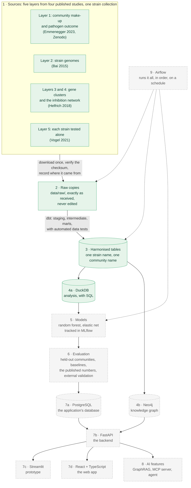
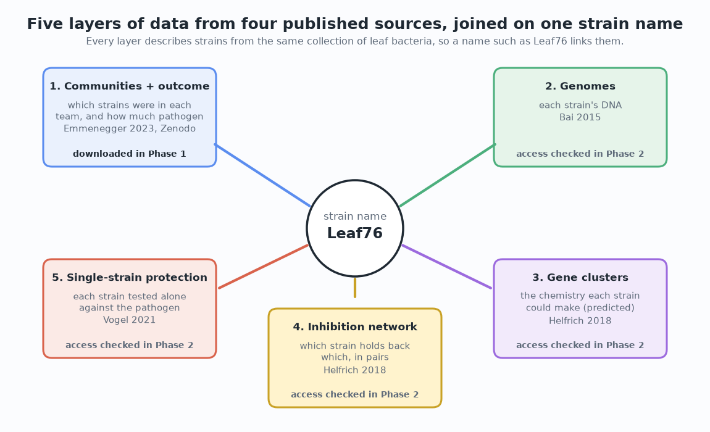

[Handbook](HANDBOOK.md) · [README](../README.md) · [Roadmap](ROADMAP.md) · [Product roadmap](PRODUCT_ROADMAP.md) · [Glossary](GLOSSARY.md)

# 00 · Architecture: how it all fits together

**Prerequisites:** none. Nothing needs to be installed, and no programming or biology background is assumed.

**Learning goal:** after reading this you'll be able to sketch the whole system from memory, name every part, say what it does and why it exists, and say what would go wrong without it. You'll also know *pipeline*, *database*, *backend*, *frontend*, *API*, *orchestration*, *model*, *knowledge graph* and *agent* well enough to use them in conversation.

**Time:** about 40 minutes to read. No commands.

**Where this sits:** Stage 0 of the [Handbook](HANDBOOK.md#stage-0-understand-what-you-are-building-and-why). Every term is also in the [Glossary](GLOSSARY.md); the order in which the parts get built is in the [Roadmap](ROADMAP.md).

---

## Contents

- [1. Why architecture comes before code](#1-why-architecture-comes-before-code)
- [2. The whole system on one page](#2-the-whole-system-on-one-page)
- [3. Box 1: the sources](#3-box-1-the-sources)
- [4. Box 2: the raw copies](#4-box-2-the-raw-copies)
- [5. Box 3: harmonisation, and what dbt is](#5-box-3-harmonisation-and-what-dbt-is)
- [6. Box 4: storage, and why there are two databases and a graph](#6-box-4-storage-and-why-there-are-two-databases-and-a-graph)
- [7. Box 5: the models](#7-box-5-the-models)
- [8. Box 6: evaluation, or how a model fools its maker](#8-box-6-evaluation-or-how-a-model-fools-its-maker)
- [9. Box 7: serving it, and three words explained](#9-box-7-serving-it-and-three-words-explained)
- [10. Box 8: the AI features](#10-box-8-the-ai-features)
- [11. Box 9: orchestration, and what Airflow is](#11-box-9-orchestration-and-what-airflow-is)
- [12. Who uses it, and for what](#12-who-uses-it-and-for-what)
- [13. Two ways to run everything](#13-two-ways-to-run-everything)
- [14. What lives where, and why](#14-what-lives-where-and-why)
- [15. Every tool, and why it was chosen](#15-every-tool-and-why-it-was-chosen)
- [16. Checkpoint](#16-checkpoint)

---

## 1. Why architecture comes before code

The usual way a data project starts is to open a file and start typing. A few months later there's a folder of `analysis.py`, `analysis_v2.py` and `analysis_final_REAL.py`, a spreadsheet edited by hand, and no way to say how any number was produced.

Nobody builds a house by buying bricks and starting at whichever corner feels right. Someone draws a plan first: where the walls go, where water comes in and where it drains. The plan takes a morning and saves discovering, six weeks in, that the bathroom has no drain.

This document is the plan. The idea that shapes it:

> **Data flows in one direction, through stages, and each stage has one job.**

That shape is called a **pipeline**. It works like an assembly line: raw material goes in at one end, each station does one thing and passes the result on, and nobody reaches back to change an earlier station's output. When a fault appears, you check station by station, and because each station does one job, you can find it.

---

## 2. The whole system on one page

This is the finished system. Boxes 1 to 3 and the analysis database (4a) exist today (Phases 1 to 3); the rest arrives phase by phase, as the [Roadmap](ROADMAP.md) sets out.



*Green: built. Dashed grey: planned.* Read as one sentence: take the published datasets about the same bacteria; keep untouched copies; harmonise them onto one strain name with a tested pipeline; store the result as tables for analysis and as a graph for relationships; train models on the training communities only; judge them on communities they never saw and against a separate experiment; serve the results through an API to a prototype, a web app and the AI features; and let an orchestrator run the whole chain.

The rest of this document walks the boxes one at a time.

---

## 3. Box 1: the sources

Five layers of data from four published studies, all describing the **same strain collection**, the *At*-LSPHERE: bacteria isolated from the leaves of wild *Arabidopsis* plants. The strain name (`Leaf15`, `Leaf76`) runs through all of them, and that's what makes joining them possible.

| Layer | What it holds | The question it answers |
|---|---|---|
| 1 | 136 training and 70 test communities, with the pathogen measured on every plant | which communities protect? |
| 2 | each strain's genome | what could each strain do? |
| 3 | 1,050 predicted gene clusters for natural products, listed one by one | what chemistry can each strain make? |
| 4 | more than 50,000 strain-against-strain pairings, 725 of them inhibitory | how do the strains affect each other? |
| 5 | 224 strains, each tested alone | does the ranking learned from communities hold up? |



**Why more than one source.** One dataset answers one question. The genome and gene-cluster layers can turn a statistical result into a possible mechanism: if the strains a model ranks highly also carry more antibiotic-producing gene clusters, the answer moves from *which* towards *why*. Following that chain from genome to chemistry to what happens on the leaf is what **multi-omics integration** means.

**What the project never does:** edit anything at the source, or keep other people's data in its own repository. The scripts download from the original archives, each identified by a **DOI**, a permanent address for research data ([`docs/02-phase-1-data-acquisition.md` section 2](02-phase-1-data-acquisition.md#2-meet-the-source) explains why that matters).

**Where each source is written down.** `sources/register.csv`, the *source register*, has one row per source: what it holds, the paper, where the files come from, the terms they come with, and whether they could be obtained, with a date. `sources/files.csv` lists every file to download, with the checksum to check it against. Both are part of the repository; the data files never are. [`docs/03-phase-2-more-sources.md`](03-phase-2-more-sources.md) builds them.

> All five layers can be fetched and checked (Phase 2). The one gap is Leaf21: no genome is listed for it, so it has no genome or gene-cluster data, and the register says so.

---

## 4. Box 2: the raw copies

**What it is.** `data/raw/`: every downloaded file exactly as it arrived, a list of what's inside the archive (`data/raw/manifest.csv`) and a log of where it came from and when (`data/raw/fetch_log.json`). The other layers sit in `data/raw/sources/`, one folder per source, with their own log (`data/raw/sources/fetch_log.json`).

**The rule:** nothing writes to `data/raw/` except the download scripts, and nothing ever edits what's there.

**Why.** It's the only part of the project that can't be rebuilt. Every other file can be produced again by running code; the raw copy is where that code starts. A photographer keeps the negatives and works on prints: spoil a print and you make another, but a scratched negative stays scratched.

**What a checksum is for.** A short code calculated from every byte of a file; change one byte and it changes completely. The archive publishes its checksum, the script calculates the checksum of what arrived, and a match proves you hold exactly the file that was deposited. A tamper-evident seal on a medicine bottle does the same job: it shows nobody opened it on the way, and says nothing about whether the medicine works. A checksum likewise says nothing about whether the data is right.

When a publisher gives no checksum, the first download's checksum is recorded and committed, and every later download is checked against that ("pinning"); where a second copy of a file exists, the two are compared. [`docs/03-phase-2-more-sources.md` section 3](03-phase-2-more-sources.md#3-three-ways-to-trust-a-download) explains all three kinds of check.

**Why the log matters.** In a year, "where did this come from?" needs a written answer that doesn't depend on anyone's memory. That written history is called **provenance**.

---

## 5. Box 3: harmonisation, and what dbt is

### The problem

Four studies, from different years and teams. The same strain is `Leaf73` in one column of a table and `73` in the next; two strain lists give different genus names for ten strains; two tables of one paper count a strain's gene clusters differently; tables have different shapes; some strains appear in one source and not another.

**Harmonisation** makes them agree: one name for each thing, one shape, and written rules for what to do when sources disagree. In multi-source work it's usually the largest single job, and it's often done out of sight, inside a script nobody checks.

Imagine three colleagues sending attendance lists for the same meeting, one with full names, one with initials, one with email addresses. Before anyone can count heads, someone has to decide who is who, and write those decisions down so the count can be checked.

### What dbt is

**dbt** turns a folder of SQL files (each one a *model*, meaning one table built from others) into a pipeline that knows its own order, tests its own output and documents itself. Three things it gives that a plain script doesn't:

1. **Lineage.** It knows where every table and column came from, and draws it as a diagram.
2. **Tests inside the pipeline.** *Every strain name is unique. No outcome is missing. Every community has the right number of members. Every strain named in a community exists in the strain table.* They run on every build, and a failure stops it.
3. **Documentation next to the code**, published as pages you can browse, so it can't drift away from what the code does.

An analysis of broken data rarely crashes. It produces confident, well-formatted, wrong answers, which is far worse than an error message, and that's the reason for testing data as carefully as code.

dbt Core is free and runs here against DuckDB. Most of the same SQL could point at a cloud warehouse through a second connection profile, an optional exercise ([Roadmap section 6](ROADMAP.md#6-tools-left-out-on-purpose-and-why)).

**Built in Phase 3.** `scripts/load_raw.py` loads every raw table into the warehouse, unchanged; dbt then builds 21 staging, 6 intermediate and 8 mart models from them, and 187 data tests check them on every build, including that the three sources of genome information agree and that every gene cluster sits inside its genome. The places where sources disagree are written down in a small table the tests compare with. [`docs/04-phase-3-harmonisation.md`](04-phase-3-harmonisation.md) builds it step by step.

---

## 6. Box 4: storage, and why there are two databases and a graph

### What a database is

An organised store of tables, built to answer questions quickly. Compare a filing cabinet, with every document in a labelled folder and an index at the front, with the same documents in a heap on the floor: both hold the same information, and only one can tell you in a minute how many invoices from March mention shipping.

**SQL** is the language for asking those questions:

```sql
SELECT strain_id, COUNT(*) AS communities
FROM marts.community_member
GROUP BY strain_id
ORDER BY communities DESC;
```

*For each strain, count the communities it appears in, most first.* You run this one, on the real warehouse, in [Phase 3](04-phase-3-harmonisation.md#your-first-sql-query).

### Three stores, three jobs

| Store | Its job | Like |
|---|---|---|
| **DuckDB** | analysis: scanning whole columns fast, for one person at a time | a library table with twenty open books spread across it |
| **PostgreSQL** | the application: many small reads and writes from many users at once | a pharmacy counter serving a queue |
| **Neo4j** | relationships: following chains of connections | a pinboard of photographs joined by string |

The first two jobs have names: **OLAP** (analytical processing, a few big questions) and **OLTP** (transaction processing, many small ones). One database asked to do both well tends to do neither.

**Why DuckDB for analysis?** It's a complete analytical database in a single file: no server, no account, no cost, and the same on all three operating systems.

**Why a graph at all?** Because one data layer is a network: tens of thousands of measured strain-against-strain pairings. In tables, a question such as *which strains hold back the pathogen's close relatives and also carry antibiotic gene clusters?* needs several awkward joins. In a graph it's a short walk along connections.

---

## 7. Box 5: the models

**What a model is.** A pattern learned from examples, in a form that can make predictions about new cases. You recognise a friend's handwriting without anyone giving you rules; you've seen enough of it.

**What these models do.** Given a five-strain community, predict the outcome: as a category (protected or not) or as a number (how much pathogen grew).

### Two kinds of model, and why both

**Random forest.** Hundreds of decision trees, each trained on a slightly different sample of the data, voting together. Like asking a hundred reasonably informed people instead of one expert, their individual mistakes tend to cancel. It picks up interactions between strains by itself, which matters here because the whole point is that strains behave differently in company.

**Elastic net.** A straight-line model with a penalty that pushes the weights of unhelpful features to zero, much as a strict baggage allowance makes you leave behind everything you don't really need. It gives a short, readable list of which strains matter and in which direction.

The original study used both, and so does the rebuild. When a flexible model and a strict one point at the same strains, that agreement says more than either alone.

### Three kinds of feature

A **feature** is one input the model gets about each community. Phase 8 is where three kinds meet:

1. **Composition:** which strains are present (35 columns of 1s and 0s).
2. **Genome:** what chemistry those strains could make (counts of gene clusters by type).
3. **Network:** how much the members hold each other back, and how strongly they hold back the pathogen's relatives.

Whether 2 and 3 improve on 1 is an open question. The original study found that composition alone predicted well, so they may add nothing, and that would be reported as a result.

**MLflow** records every training run's settings, scores and model, so "which settings gave that number?" always has an answer.

---

## 8. Box 6: evaluation, or how a model fools its maker

This is where many projects go wrong without noticing, so it gets the longest section.

### The trap

Train a model, ask it to predict the data it was trained on, and it scores 99 %. That number means nothing: it's like setting an exam from the exact questions the students already have the answers to. A model that has memorised its training data, noise and all, instead of learning the pattern is **overfitting**.

### The defences

1. **A held-out test set.** The original study ran a *separate experiment* with 70 new communities. They're kept aside and used once, at the end. That's stronger than splitting one dataset in two, because a split still shares every quirk of a single experimental run. Keeping them aside starts before any model: while the data is explored (Phase 4), the test plants are counted but no value measured on one is read, and a test checks it, so no choice made along the way can have been shaped by them.
2. **Cross-validation while developing.** Split the training data into five parts, train on four, test on the fifth, and rotate, like sitting five practice papers before the real exam.
3. **Keeping groups together.** Several plants received the same community. If plants of one community landed on both sides of a split, the model would be tested on something it had in effect already seen, a mistake called **data leakage**. The rebuild keeps every community's plants together, and a test fails if that's ever broken.
4. **Baselines.** Every score is reported next to what a trivial strategy achieves. "84 % accurate" is impressive if guessing gives 50 % and poor if guessing gives 83 %.
5. **Several random seeds.** Random choices make results wobble from run to run. Reporting the best of eight runs flatters the model; reporting all of them doesn't.
6. **Intervals.** Seventy test communities isn't many, so every score comes with a range showing how uncertain it is.

### Then three comparisons

- **With the published numbers** (Phase 5): the rebuilt scores beside the paper's, disagreements included.
- **With the authors' own R code** (Phase 6): their scripts ship with the data, so they can be run. With only two results that disagree, there's no telling which is off; the third settles it. [`docs/ROADMAP.md`, Phase 6](ROADMAP.md#phase-6-the-original-r-analysis-and-the-three-way-comparison) has the full reasoning.
- **With a separate experiment** (Phase 9): the model learns which strains matter from communities only, never seeing a strain tested alone. Layer 5 measured exactly that, so comparing the two rankings tests the conclusion against evidence the model never touched.


---

## 9. Box 7: serving it, and three words explained

### Frontend, backend, database

A restaurant has three parts:

- The **frontend** is the dining room: what the customer sees and touches. In software, the buttons, charts and text on screen.
- The **backend** is the kitchen: where the work happens, out of sight. In software, the code that loads the model, runs the prediction and does the arithmetic.
- The **database** is the pantry: where everything is stored between services, organised so the kitchen finds it fast.

Customers never walk into the kitchen or rummage in the pantry. They order from a menu and a plate arrives. Keeping the three apart is why the dining room can be redecorated without closing the kitchen, and the oven replaced without reprinting the menus.

### What an API is

An **API** (application programming interface) is a defined set of addresses another program can call to ask the system for something. In the restaurant it's the serving hatch: orders go in, plates come out, through one opening with clear rules.

**FastAPI** is the Python framework used to build it (Phase 10). It checks every incoming request against a declared shape, so a malformed request gets a clear refusal instead of failing somewhere deep inside, and it writes interactive documentation for every address automatically.

### Three ways in, one engine

| Way in | For whom | Built in |
|---|---|---|
| **Streamlit** | the analyst: a quick prototype | Phase 7 |
| **React + TypeScript** | everyone else: the web app | Phase 11 |
| **MCP server** | an AI assistant app | Phase 15 |

All three call the same backend, which calls the same tested functions in `src/realsignal/`. There's no second copy of the logic, so a demo version can never drift away from the real one.

**Why Streamlit first, then React?** Streamlit turns a Python script into a web page with controls in an afternoon, with no web development. That gets a working tool early (Phase 7), which keeps the project asking who would use it and for what. React takes more work and gives far more control over what users see.

**What TypeScript adds to JavaScript:** types, which work like seatbelts. JavaScript lets you add a number to a sentence and find out when the program runs; TypeScript stops you in the editor.

### Containers

A **container** packages a program with everything it needs to run (the language, system libraries, the code and the start-up instructions), so it behaves the same on any computer. The virtual environment from [`docs/01-setup.md`](01-setup.md) seals the Python packages; a container also seals Python itself and separate programs such as PostgreSQL and Neo4j.

Without containers, the setup guide would need instructions for installing PostgreSQL, Neo4j, Node.js and Airflow on three operating systems. With them, one command starts every service, already connected (Phase 17), with **Docker or Podman**. Both read the same files; Podman runs as an ordinary user without a background service, and it's the engine Red Hat supports on RHEL 8, where Docker isn't shipped. [`docs/CONTAINERS.md`](CONTAINERS.md) explains all of it from zero.

---

## 10. Box 8: the AI features

Four features, each building on the one before.

### Ontology and knowledge graph (Phase 13)

An **ontology** is an agreed vocabulary for a domain: which kinds of thing exist and how they may relate, a family tree for concepts. Here: a **strain** CARRIES a **gene cluster**; a gene cluster PRODUCES a **compound class**; a strain INHIBITS a strain; a **community** CONTAINS strains and is TESTED ON a **plant**.

Writing that down forces agreement on what a "strain" is across four studies that describe it differently, and it lets questions about relationships be answered by following links instead of writing longer and longer joins. The **knowledge graph** is the data stored in that shape, in Neo4j.

### GraphRAG: answers with sources (Phase 14)

A language model answering from memory gives fluent answers that are sometimes invented. **RAG** (retrieval-augmented generation) makes it look things up in the project's own data first, like a colleague who checks the file before answering. **GraphRAG** walks the knowledge graph as part of the lookup, so *"why might Leaf76 protect?"* can be answered by following the chain (this strain carries these clusters, which make these compounds, and it holds back these relatives of the pathogen) with every step citing its source. In science an answer without a source can't be checked, so the citations are the point.

### The MCP server (Phase 15)

The **Model Context Protocol** is a shared standard for plugging tools and data into AI assistant apps, much as USB gave every device the same socket. RealSignal's MCP server offers predictions, data queries and graph lookups as read-only tools with checked inputs and a log of every call. Once the API exists, it's a thin layer on top.

### The agent (Phase 16)

A chatbot answers; an agent takes steps. It plans, calls tools, looks at the results and decides what to do next, until the task is done, the way a research assistant sent off with a question comes back with a shortlist where a librarian would give you an answer. This one has a narrow job ("suggest three untested communities most likely to protect"), a fixed set of read-only tools, a limit on steps and a full log of every action, so anyone can check how a shortlist was reached.

---

## 11. Box 9: orchestration, and what Airflow is

Until Phase 12, every step is a command someone types. That works until a step is forgotten, two are run in the wrong order, or the person who knows the order is away.

**Airflow** is an alarm clock crossed with a checklist that understands which tasks depend on which. A railway timetable with signals is a fair picture: trains run in a fixed order at set times, and a signal holds the next train if the line ahead isn't clear. It gives four things a script doesn't:

1. **Order:** dependencies written down, not remembered.
2. **A schedule:** it runs by itself.
3. **Retries:** a failed download is tried again before anyone is bothered.
4. **Visibility:** a page showing what ran, when, and what failed.

Phase 12 starts with a plain Python runner that calls every step in order, so you know exactly what Airflow takes over before you meet it. The pipeline also takes new results: a new file of measured communities goes in and the models retrain.

---

## 12. Who uses it, and for what

A system becomes a product when you can name its user and the decision it supports. Here, the user is a scientist deciding which strain combinations to test next, where each one costs weeks of growth-chamber time and there are hundreds of thousands to choose from. Success is measured on held-out data: how often the recommended communities protect, compared with communities chosen at random.

The README's [product section](../README.md#the-product) covers what it does and doesn't claim, and [`docs/PRODUCT_ROADMAP.md`](PRODUCT_ROADMAP.md) covers what a larger version for a research team would add.

---

## 13. Two ways to run everything

Every capability runs two ways, on purpose.

**By hand, one step at a time.** Run a script, read the output, look at the files it wrote. This is how you learn what each step does.

```bash
python scripts/fetch_data.py --probe
python scripts/fetch_data.py
python notebooks/explore_raw.py
python notebooks/explore_layer1.py
python scripts/fetch_sources.py --probe
python scripts/fetch_sources.py
python scripts/load_raw.py
cd dbt
dbt build
cd ..
python notebooks/explore_warehouse.py
python notebooks/explore_marts.py
python scripts/make_quality_report.py
```

**In one go.** By the end, one command (a Python runner, then Airflow) runs the whole pipeline in the right order, with the tests as the last step. This is how the project gets used, and it proves the parts fit together.

Both call the same functions.

---

## 14. What lives where, and why

```
realsignal/
├── docs/            ← the guides, the Handbook first, and reports/ written by scripts
├── sources/         ← the source register: what is fetched, from where, on what terms
├── scripts/         ← programs you run by hand, one job each
├── src/realsignal/  ← reusable, tested functions that scripts and apps import
├── notebooks/       ← exploration, kept apart from the reusable code
├── tests/           ← automated checks
├── figures/         ← the scripts that draw every picture, and the pictures
├── dbt/             ← the harmonisation models          (Phase 3)
├── R/               ← the authors' R analysis, run as published (Phase 6)
├── app/             ← the Streamlit prototype           (Phase 7)
├── api/             ← the FastAPI backend               (Phase 10)
├── frontend/        ← the React and TypeScript web app  (Phase 11)
├── airflow/         ← the orchestration                 (Phase 12)
├── mcp/             ← the MCP server                    (Phase 15)
└── data/            ← never in Git; rebuilt by the download scripts
```

Folders for later phases already exist, each holding an empty `.gitkeep` file, because Git only records folders that contain something. The README's [repository map](../README.md#repository-map) lists every file.

**Why `src/` and `scripts/` are separate.** Code in `src/realsignal/` is written to be *imported*: small functions with one job each, which tests can call directly. Code in `scripts/` is written to be *run*: it reads options, prints progress, and calls functions. A 400-line script is hard to test; a 12-line function isn't. Phase 3 started it: the small helpers the two download scripts had each carried (sizes, paths, banners, checksums, CSV tables) moved into `src/realsignal/helpers.py` when a third program, the loader, needed them too. Phase 4 added `src/realsignal/exploration.py`, whose seven questions feed three programs (the explorer, the report and the pictures), so the three can't disagree.

**Why `notebooks/` is separate.** Exploration is messy by nature. Jupyter notebooks in particular can be run out of order and give results nobody can repeat, so this project keeps its exploration as plain scripts (`notebooks/explore_raw.py` and `notebooks/explore_layer1.py` are two) that run top to bottom, and anything worth keeping moves into `src/realsignal/` with a test. `notebooks/explore_marts.py` from Phase 4 shows where that leads: the questions moved into `src/realsignal/exploration.py`, and the script only prints the answers.

**Why `data/` isn't in Git.** Git is built for text you edit, not large archives. And if a script can rebuild the data, the script working is the proof: anyone can clone the repository, run one command, and get the same bytes, verified by checksum.

---

## 15. Every tool, and why it was chosen

Everything is free, open source, and runs on Windows, macOS and Linux.

| Tool | What it is | Why it's here | What else was considered |
|---|---|---|---|
| **Python 3.11 or newer** | the main language | the standard for machine learning, and the same on every system | R, which the original used; rebuilding in another language is a stronger test |
| **pandas, NumPy** | tables and fast arithmetic | every step recorded and repeatable | a spreadsheet: edits by hand leave no trace |
| **R, RStudio, renv** | a language built for statistics, its editor, and its package locker | the original analysis is in R; running it makes the three-way comparison possible | reading the R code without running it, which means guessing |
| **dbt Core** | SQL files made into a tested, documented pipeline | harmonising several sources is its job | a home-made script: it works, and nobody can check it |
| **DuckDB** | a database in one file | SQL with no setup, built for analysis | SQLite (built for small transactions); a cloud warehouse (accounts, cost, far bigger than needed) |
| **PostgreSQL** | the application's database | many small operations at once, which an API needs | DuckDB for everything: the wrong shape for serving |
| **Neo4j** | a graph database | one data layer is a network | relationships forced into ever-longer SQL joins |
| **scikit-learn** | the machine-learning library | models and evaluation tools in one package | deep learning: far too little data |
| **MLflow** | experiment tracking | every run's settings and scores recorded | a hand-kept spreadsheet of results |
| **FastAPI** | the backend framework | checks requests, documents itself | Flask (less checking), Django (far more than needed) |
| **Streamlit** | a Python script made into a web app | a working tool in an afternoon | n/a |
| **React, TypeScript** | the web app | the usual shape of a real application; types catch mistakes early | plain JavaScript |
| **Airflow** | orchestration | order, schedule, retries, visibility | cron (no dependencies, no overview), which Phase 12 starts from on purpose; Prefect (simpler to set up) |
| **Docker, Podman** | container engines | the same behaviour on all three systems; Podman is the supported engine on RHEL 8 | separate install instructions for each system; Kubernetes (built for fleets) |
| **pytest** | automated tests | catches mistakes before anyone else does | checking by hand, which works until you're tired |
| **Git, GitHub** | version control and its online home | every change recorded and shareable | n/a |

The tools left out (Spark, Databricks, Kubernetes, deep learning, and Snowflake except as an optional exercise) and the reasons are in [`docs/ROADMAP.md` section 6](ROADMAP.md#6-tools-left-out-on-purpose-and-why).

---

## 16. Checkpoint

You've finished this document when you can answer these without scrolling up:

1. What are the nine boxes, in order?
2. Why five data layers instead of one?
3. Why must `data/raw/` never be edited?
4. What does a checksum prove, and what doesn't it prove?
5. What does dbt give that a transformation script doesn't?
6. Why two databases, plus a graph?
7. In the restaurant: which is the frontend, the backend and the database, and where does the API fit?
8. Why is scoring a model on its own training data meaningless?
9. Why does a score need a baseline next to it?
10. Why is the comparison with single-strain results (Layer 5) a stronger check than matching the published numbers?
11. What's the difference between a chatbot and an agent?
12. Who is the user, and what decision does the product support?

If an answer is shaky, reread its section now; it'll cost far more time later.

---

**Next:** back to the [Handbook](HANDBOOK.md#stage-0-understand-what-you-are-building-and-why), Stage 0, then [`docs/ROADMAP.md`](ROADMAP.md) for the order the boxes are built in.
