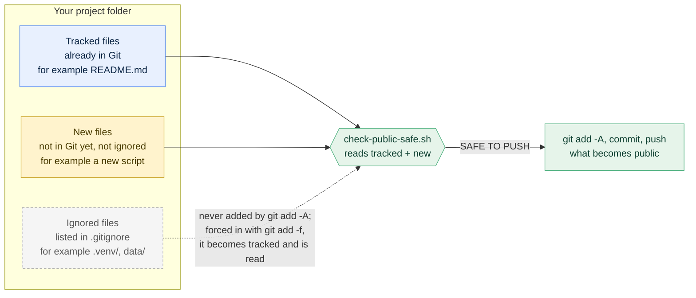

[Handbook](HANDBOOK.md) · [README](../README.md) · [Glossary](GLOSSARY.md) · [Git workflow](GIT_WORKFLOW.md)

# 01 · Setup: from a blank laptop to a working workshop

**Prerequisites:** a computer running Windows 10 or 11, macOS, or Linux (RHEL 8 is covered step by step, and Ubuntu and Fedora get their own commands), an internet connection, and permission to install software. **No programming experience is assumed.** If you've never opened a terminal, start here and skip nothing.

**Learning goal:** by the end you'll have Python, Git, a code editor, a GitHub account, a sealed project environment and a safety check that runs before every upload. You'll also know *what each one is for*, so when something breaks you can reason about it instead of searching blindly.

**Time:** 60 to 90 minutes the first time, once per computer. After that, starting work takes ten seconds.

**Where this sits:** Stages 1 and 2 of the [Handbook](HANDBOOK.md). Every term is defined in the [Glossary](GLOSSARY.md).

---

## Contents

- [0. How to read this document](#0-how-to-read-this-document)
- [1. What we are installing, and why](#1-what-we-are-installing-and-why)
- [2. Open a terminal](#2-open-a-terminal)
- [3. Install Python](#3-install-python)
- [4. Install Git](#4-install-git)
- [5. Install a code editor (recommended)](#5-install-a-code-editor-recommended)
- [6. Create a GitHub account and an empty repository](#6-create-a-github-account-and-an-empty-repository)
- [7. Create the project folder](#7-create-the-project-folder)
- [8. Create the virtual environment](#8-create-the-virtual-environment)
- [9. Install the project's packages](#9-install-the-projects-packages)
- [10. Verify everything works](#10-verify-everything-works)
- [11. Keep things out of Git with `.gitignore`](#11-keep-things-out-of-git-with-gitignore)
- [12. Connect to GitHub and create the three branches](#12-connect-to-github-and-create-the-three-branches)
- [13. The safety gate](#13-the-safety-gate)
- [14. Copy commands safely](#14-copy-commands-safely)
- [15. Checkpoint](#15-checkpoint)
- [16. Starting work on any later day](#16-starting-work-on-any-later-day)
- [17. Troubleshooting](#17-troubleshooting)

---

## 0. How to read this document

**Commands are shown one per box.** Copy the whole line, paste it into your terminal and press Enter. Commands are shown *without* the prompt symbol (`$`, `>`, `PS>`), so what you see is exactly what you type.

**Most commands are followed by "You should see".** Compare what you get with it. It rarely matches word for word (version numbers and folder names differ between computers), but it should match in shape. If it doesn't, [section 17](#17-troubleshooting) covers what to do.

**Platform blocks look like this:**

> **Windows**: instructions for PowerShell
> **macOS**: instructions for Terminal
> **Linux**: instructions for bash (RHEL 8, Ubuntu, Fedora)

Do only your own platform's block. Everything outside these blocks is the same on all three.

**One rule above all:** don't skip a check because an installer "looked fine". A check takes five seconds; tracking down a quietly broken setup three phases later takes an evening.

---

## 1. What we are installing, and why

Five things. Here's what each is for, before you install anything.

| # | Thing | What it is | In everyday terms |
|---|---|---|---|
| 1 | **Python** | the programming language every script here is written in | the language the recipes are written in |
| 2 | **Git** | records every change to your files, permanently | an undo history that never forgets, with a note on every step |
| 3 | **A code editor** (VS Code) | a comfortable place to read and write code | a word processor, but for code |
| 4 | **A GitHub account** | an online home for the project | a shared shelf where other people can see your work |
| 5 | **A virtual environment** | a sealed box of Python packages for this project only | your own pencil case, so nobody borrows your pens |

The fifth is the one people skip and the one that saves the most trouble. [Section 8](#8-create-the-virtual-environment) explains why.

---

## 2. Open a terminal

The **terminal** is a window where you give the computer instructions by typing instead of clicking. It's slower to learn and much more precise afterwards, and it has one big advantage for a guide like this: every instruction can be written down exactly.

> **Windows**: press the Windows key, type `powershell`, and click **Windows PowerShell**. (Not "Command Prompt": PowerShell is the newer one and this guide assumes it.)
> **macOS**: press `Cmd + Space`, type `terminal`, press Enter.
> **Linux**: press `Ctrl + Alt + T`, or find "Terminal" among your applications. On a server or virtual machine you are usually in one already.

**Your first command** asks "which folder am I in?". It changes nothing and can't break anything.

> **Windows**
> ```powershell
> Get-Location
> ```
> You should see something like `C:\Users\<you>`.

> **macOS / Linux**
> ```bash
> pwd
> ```
> You should see something like `/Users/<you>` (macOS) or `/home/<you>` (Linux).

That folder is your **home folder**, your personal space on the computer. Four more commands are enough terminal for this whole project:

| Purpose | Windows PowerShell | macOS / Linux |
|---|---|---|
| list what's in this folder | `ls` | `ls` |
| go into a folder | `cd foldername` | `cd foldername` |
| go up one folder | `cd ..` | `cd ..` |
| go back home | `cd ~` | `cd ~` |

### macOS only: let the terminal skip the notes in commands

Command blocks in these guides carry short notes after a `#`, such as `pytest -q   # all tests pass`. Terminals normally ignore everything from `#` to the end of the line. Whether yours does depends on the **shell**, the program inside the terminal that reads your commands. Macs come with two:

- If your prompt ends with **`$`**, the shell is **bash**. It already skips the notes: nothing to do.
- If your prompt ends with **`%`**, the shell is **zsh** (the default on Macs set up since 2019). zsh doesn't skip notes in commands you type or paste, unless told to once:

  ```bash
  echo 'setopt interactivecomments' >> ~/.zshrc
  ```

  Then close the terminal window and open a new one. `~/.zshrc` is a settings file zsh reads each time a terminal opens, and `>>` adds the line to its end.

Not sure which you have? `echo $0` prints the shell's name (`-bash` or `-zsh`). To check the result either way, `echo hello   # a note` should print just `hello`. Windows PowerShell and Linux terminals need nothing.

---

## 3. Install Python

**What it is:** the programming language this project is written in. It's free and open source, and it's the most widely used language for data work and machine learning.

**Which version:** **3.11 or newer.** The project was built on Python 3.14.

### First, check whether you already have it

> **macOS / Linux**
> ```bash
> python3 --version
> ```

> **Windows** (Windows names it differently, so try both)
> ```powershell
> python --version
> py --version
> ```

**You should see** something like `Python 3.14.7`. If the number is 3.11 or higher, skip to [section 4](#4-install-git). If it's lower, or you get "command not found", install it below.

> **A trap on macOS and Linux.** These systems often come with a Python that the operating system itself uses, and it's usually old (RHEL 8 ships 3.6). Don't remove it, don't upgrade it, and don't install project packages into it, because parts of the system rely on it. Install a newer Python *next to* it, which is what the steps below do.

### Install it

> **Windows**
> 1. Go to <https://www.python.org/downloads/> and click the yellow **Download Python 3.x** button.
> 2. Run the installer.
> 3. **On the first screen, tick "Add python.exe to PATH".** This is the most important click in this guide. Without it, Windows can't find Python when you type `python`. (PATH is the list of folders Windows searches when you type a command: the program can be installed and still unknown if its folder isn't on that list.)
> 4. Click **Install Now** and wait.
> 5. **Close PowerShell completely and open a new one.** PATH changes only reach windows opened afterwards; this catches almost everybody.
> 6. Check: `python --version`

> **macOS**
> - The installer (simplest): download it from <https://www.python.org/downloads/>, run it with the default answers, open a *new* Terminal window, and check with `python3 --version`. Then run, once, the certificate command the installer puts in your Applications folder (its last screen mentions it). The folder is named after the version, so change `3.14` if yours is different:
>   ```bash
>   sh "/Applications/Python 3.14/Install Certificates.command"
>   ```
>   Its last line is ` -- update complete`. This Python brings its own copy of the code that checks secure (`https://`) connections, and that copy doesn't use the certificates macOS keeps, so until the command has run it can't confirm that a website is the one it asked for. pip carries its own list and works without it, which is why the problem can stay hidden until a package downloads part of itself while installing (dbt does, in Phase 3).
> - Or, if you already use Homebrew: `brew install python@3.12`, then `python3 --version`. Homebrew's Python uses Homebrew's certificates and needs no extra step.

> **Linux: RHEL 8, Rocky, AlmaLinux**
>
> RHEL 8's own Python is 3.6, too old for this project. Install a newer one from Red Hat's standard repositories; it sits *next to* the system Python without disturbing it. Try 3.12 first:
> ```bash
> sudo dnf install -y python3.12 python3.12-pip
> ```
> If that says "No match for argument", your system's repositories don't have it yet; 3.11 works just as well:
> ```bash
> sudo dnf install -y python3.11 python3.11-pip
> ```
> `sudo` means "run this as administrator". It asks for your password, and nothing appears on screen while you type it (that's normal).
>
> Check, naming the version explicitly (on RHEL, plain `python3` still means the old 3.6, on purpose, so system tools keep working):
> ```bash
> python3.12 --version
> ```
> **Without `sudo` rights** (common on a company virtual machine), ask whoever runs the machine to install `python3.12` or `python3.11`, and later `git`. Everything after installation works without special rights.

> **Linux: Ubuntu, Debian**
> ```bash
> sudo apt update
> sudo apt install -y python3 python3-venv python3-pip
> python3 --version
> ```
> If that's older than 3.11, add the deadsnakes package archive and install 3.12:
> ```bash
> sudo add-apt-repository ppa:deadsnakes/ppa
> sudo apt update
> sudo apt install -y python3.12 python3.12-venv
> ```

> **Linux: Fedora**
> ```bash
> sudo dnf install -y python3
> python3 --version
> ```

### Remember your Python command

Until [section 8](#8-create-the-virtual-environment), this guide writes `python3`. Use whatever worked on your computer:

| Your computer | Your command |
|---|---|
| Windows | `python` |
| macOS | `python3` |
| RHEL 8 | `python3.12` (or `python3.11`) |
| Ubuntu with an added version | `python3.12` |

Once the virtual environment is active, plain `python` means the right one everywhere, and this difference disappears.

---

## 4. Install Git

**What it is:** the program that records every change to your files. [`docs/GIT_WORKFLOW.md`](GIT_WORKFLOW.md) explains it properly; for now, install it.

Check first:

```bash
git --version
```

**You should see** something like `git version 2.39.3` (any 2.x is fine). If it's missing:

> **Windows**: download it from <https://git-scm.com/download/win> and run the installer. **Accept every default answer**: they're sensible, and the option screens are confusing on a first visit. It also installs *Git Bash*, a small terminal you'll use for the safety gate in [section 13](#13-the-safety-gate). Close and reopen PowerShell afterwards.
> **macOS**: type `git --version`. If Git is missing, macOS offers to install the command-line developer tools. Click **Install** and wait; that's all.
> **Linux (RHEL 8, Rocky, Fedora)**: `sudo dnf install -y git`
> **Linux (Ubuntu, Debian)**: `sudo apt install -y git`

### Tell Git who you are

Once per computer. Every save Git makes records who made it, which is why it asks.

```bash
git config --global user.name "Your Name"
git config --global user.email "your-email@example.com"
```

Use the email address you'll register on GitHub with, so your work is linked to your account. Check:

```bash
git config --global --list
```

**You should see** your two lines among the output:

```
user.name=Your Name
user.email=your-email@example.com
```

---

## 5. Install a code editor (recommended)

Everything here works in any text editor, but a proper code editor colours your code, points out mistakes as you type, and has a terminal built in, so you aren't switching windows all the time.

**VS Code** (Visual Studio Code) is free and behaves the same on all three systems.

1. Download it from <https://code.visualstudio.com/> and install it with the default answers. On Windows, tick **"Add to PATH"** if offered.
2. Open it, click the **Extensions** icon in the left bar (four small squares), search for **Python**, and install the one published by Microsoft.
3. To open the project later: **File, Open Folder**, then pick the project folder. VS Code finds the virtual environment by itself.

---

## 6. Create a GitHub account and an empty repository

**What GitHub is:** a website that keeps a copy of your project online, backed up and visible to anyone you send the link to.

### The account

1. Go to <https://github.com/signup> and sign up with the email address from [section 4](#4-install-git).
2. Choose a username you'd be happy to see in every link to your work.
3. Confirm your email address.

### The repository

1. Signed in, click **+** at the top right, then **New repository**.
2. Fill in:
   - **Repository name:** `realsignal`
   - **Description:** `Independent reproduction and extension of a published machine-learning study on plant-protective bacteria`
   - **Public**
   - **Don't** tick "Add a README file", and **don't** add a `.gitignore` or a licence here.
3. Click **Create repository**, and leave the page open: [section 12](#12-connect-to-github-and-create-the-three-branches) needs the address it shows (`https://github.com/<you>/realsignal.git`).

> **Why empty?** The project is built on your computer first and connected afterwards. If GitHub also creates files, both sides have a history the other doesn't know about, and the first upload fails with an error about "unrelated histories". Starting empty avoids a confusing problem you'd otherwise meet before you know enough Git to solve it.

---

## 7. Create the project folder

> **Rebuilding this project from its repository instead of from nothing?** Then the folder, the files and the history already exist, and one command fetches them all. In the folder where you keep projects:
> ```bash
> git clone https://github.com/akannan2987/realsignal.git
> cd realsignal
> ```
> Skip the rest of this section and section 6, carry on at [section 8](#8-create-the-virtual-environment), and in [section 12](#12-connect-to-github-and-create-the-three-branches) only run the step that creates your local `develop` branch.

Pick a sensible home for your projects:

> **Windows**
> ```powershell
> cd $HOME
> mkdir projects -Force
> cd projects
> mkdir realsignal
> cd realsignal
> ```

> **macOS / Linux**
> ```bash
> cd ~
> mkdir -p projects
> cd projects
> mkdir realsignal
> cd realsignal
> ```

Check where you are (every later command assumes you're inside `realsignal`): `Get-Location` on Windows, `pwd` on macOS and Linux. **You should see** a path ending in `projects/realsignal` (Windows: `projects\realsignal`). Any folder works, by the way; the project was built in `~/Documents/Work/projects/realsignal`.

> **Avoid cloud-synced folders** such as OneDrive, Dropbox, iCloud Drive or Google Drive. They copy files in the background while Git and the virtual environment are changing them, which causes baffling errors. Git already gives you a backup on GitHub.

### The folder structure

These are the folders described in [`docs/00-architecture.md` section 14](00-architecture.md#14-what-lives-where-and-why). The ones for later phases start empty.

> **Windows**
> ```powershell
> mkdir docs, scripts, notebooks, tests, figures, src\realsignal, R, dbt, api, app, frontend, airflow, mcp
> mkdir data\raw, data\processed
> ```

> **macOS / Linux**
> ```bash
> mkdir -p docs scripts notebooks tests figures src/realsignal R dbt api app frontend airflow mcp data/raw data/processed
> ```

Git keeps track of files, not folders, so an empty folder would vanish from the repository. A tiny empty file called `.gitkeep` holds each one in place (the name is a habit, not a Git feature):

> **Windows**
> ```powershell
> foreach ($d in "R","dbt","api","app","frontend","airflow","mcp") { New-Item -ItemType File "$d\.gitkeep" -Force }
> New-Item -ItemType File src\realsignal\__init__.py -Force
> ```

> **macOS / Linux**
> ```bash
> for d in R dbt api app frontend airflow mcp; do touch "$d/.gitkeep"; done
> touch src/realsignal/__init__.py
> ```

`__init__.py` tells Python "this folder is a package you can import from". It holds a short description and a version number, and the reusable code grows next to it, starting with `src/realsignal/helpers.py` in Phase 3.

**Then put the project's files in place:** `README.md`, `LICENSE`, `.gitignore`, `requirements.txt`, `pytest.ini`, `check-public-safe.sh`, `setup.sh` and `setup.ps1` in the project folder, the guides in `docs/`, the scripts in `scripts/`, and so on. The [Handbook's file index](HANDBOOK.md#every-file-in-the-repository-and-where-it-is-explained) lists every file and its folder.

---

## 8. Create the virtual environment

### The problem it solves

You install a package for this project. A month later another project needs an older version of the same package, and you install that. **The first project now breaks**, often without a clear message: results shift slightly, or something crashes in a place that used to work.

Picture a shared stationery cupboard where everyone takes and swaps pens: sooner or later the red pen you rely on is gone or replaced with a different red.

### The fix

A **virtual environment** is a private copy of Python with its own packages, belonging to one project. Projects can't interfere with each other, and the exact contents can be written down and rebuilt by somebody else, which is what makes the project reproducible. This project's lives in a folder called `.venv` inside the project folder.

### Create it

Inside the `realsignal` folder, with your Python command from [section 3](#3-install-python):

> **Windows**: `python -m venv .venv`
> **macOS**: `python3 -m venv .venv`
> **RHEL 8**: `python3.12 -m venv .venv` (or `python3.11`). If it fails with a message about `ensurepip`, run `sudo dnf install -y python3.12-devel` and try again.

It prints nothing and takes a few seconds. Check that the folder exists: `ls -Force` on Windows (`-Force` shows hidden items), `ls -a` on macOS and Linux. You should see `.venv` in the list. (The leading dot hides it on macOS and Linux, and tools such as VS Code look for that exact name, so keep it.)

### Activate it

Creating the environment isn't the same as using it. **Activating** tells this terminal window: "from now on, `python` means this project's Python".

> **Windows PowerShell**
> ```powershell
> .\.venv\Scripts\Activate.ps1
> ```
> If you get a red error about *execution policies*, Windows is blocking scripts. Allow scripts you wrote yourself, for your account only:
> ```powershell
> Set-ExecutionPolicy -ExecutionPolicy RemoteSigned -Scope CurrentUser
> ```
> Answer `Y`, then activate again.

> **macOS / Linux**
> ```bash
> source .venv/bin/activate
> ```

**How you know it worked:** your prompt now starts with `(.venv)`. (In some terminal setups, such as the one this project was built in, it appears on a line of its own after the command.) **That marker is your most useful status light.** Without it, packages install in the wrong place and imports fail in confusing ways. Whenever something behaves oddly, look at the prompt first.

Check where Python now comes from:

> **Windows**: `where.exe python` should show a path ending in `realsignal\.venv\Scripts\python.exe`.
> **macOS / Linux**: `which python` should show a path ending in `realsignal/.venv/bin/python`.

> **Activate again in every new terminal window.** It's a choice per window, not a setting for the whole computer. `deactivate` leaves the environment, which you'll rarely need.

---

## 9. Install the project's packages

**pip** is Python's package installer: it fetches libraries from **PyPI**, the public warehouse of Python packages. The project lists what it needs in `requirements.txt`, so anyone can rebuild the same toolbox with one command. It looks like this:

```
pandas>=2.2,<4.0          # tables of data, driven by code
numpy>=1.24,<3.0          # fast arithmetic underneath everything else
openpyxl>=3.1,<4.0        # lets pandas read .xlsx files (the published data)
duckdb>=1.0,<2.0          # a complete SQL database in a single file
dbt-core>=1.10,<2.0       # turns a folder of SQL files into a tested pipeline (Phase 3)
dbt-duckdb>=1.9,<2.0      # lets dbt build its tables in DuckDB (Phase 3)
scikit-learn>=1.4,<2.0    # the machine-learning models and evaluation tools
scipy>=1.11,<2.0          # statistics used for confidence intervals
matplotlib>=3.8,<4.0      # charts, saved as image files by code
requests>=2.31,<3.0       # downloading files over the internet
streamlit>=1.36,<2.0      # turns a Python script into a clickable web app
pytest>=8.0,<9.0          # automated tests
```

> **Why ranges, not exact versions?** An exact version can fail to install on a system where that precise build doesn't exist, which matters for a project that has to work on Windows, macOS and RHEL 8. So the file gives a range that works, and after installing you record what you actually got in a second file. The ranges make the install work; the record makes it repeatable.

With `(.venv)` in your prompt:

```bash
python -m pip install --upgrade pip
python -m pip install -r requirements.txt
```

**You should see** a few minutes of downloads, ending with a line that starts `Successfully installed` and lists the packages with their versions.

> **Why `python -m pip` instead of `pip`?** It guarantees you use the pip that belongs to the Python you're running. On a computer with several Pythons, a bare `pip` can belong to another one, and then packages install "successfully" and still can't be imported.

Now record exactly what you got:

```bash
python -m pip freeze > requirements.lock.txt
```

`requirements.lock.txt` lists every installed package with its exact version. Commit it. If something breaks in a year, it tells you what a working setup looked like.

---

## 10. Verify everything works

The repository includes `scripts/check_env.py`. It checks the Python version, whether the virtual environment is active, and imports each of the twelve packages, then gives one verdict. Read it first; it's short and its comments explain every check.

```bash
python scripts/check_env.py
```

**You should see** (this is the output on the MacBook Pro the project was built on; your version numbers and operating system will differ):

```
====================================================================
RealSignal: environment check
====================================================================
Operating system: Darwin 24.6.0
--------------------------------------------------------------------
[OK  ] Python 3.14 (need 3.11 or newer)
[OK  ] Virtual environment: active
       Python program in use: .venv/bin/python3
--------------------------------------------------------------------
[OK  ] pandas       3.0.5       tables of data
[OK  ] numpy        2.5.2       fast arithmetic
[OK  ] openpyxl     3.1.5       reading Excel files
[OK  ] duckdb       1.5.5       the local SQL database
[OK  ] dbt-core     1.12.5      the harmonisation pipeline
[OK  ] dbt-duckdb   1.11.0      lets dbt work with DuckDB
[OK  ] scikit-learn 1.9.0       machine learning
[OK  ] scipy        1.18.1      statistics
[OK  ] matplotlib   3.11.1      charts
[OK  ] requests     2.34.2      downloading the dataset
[OK  ] streamlit    1.62.0      the interactive app
[OK  ] pytest       8.4.2       automated tests
====================================================================
ALL CHECKS PASSED. Your workshop is ready.
Next: docs/HANDBOOK.md, the stage after the one you are on.
```

(`Darwin` is the name macOS gives its core; Windows shows `Windows 11`, RHEL shows `Linux` and a version.)

If you see that, stop for a moment: you've installed a programming language, a version-control system, an isolated environment and twelve libraries, and you've *proved* it works rather than assumed it.

---

## 11. Keep things out of Git with `.gitignore`

Before the first save in Git, decide what must never go into it. It's far easier to keep something out of the history than to remove it afterwards.

`.gitignore` (in the project folder) lists what Git must never record. The project's file, with the reason for each part:

```gitignore
# The virtual environment: hundreds of megabytes, specific to one computer,
# and rebuilt from requirements.txt in minutes.
.venv/
venv/
env/

# Downloaded and generated data. scripts/fetch_data.py rebuilds it and checks
# its checksum, so the script working is the proof the project works.
data/

# R's package library is rebuilt from renv.lock, the way .venv is rebuilt
# from requirements.txt. renv.lock itself is committed.
renv/library/
renv/staging/
.Rhistory
.RData
.Rproj.user/

# Files Python and pytest generate by themselves.
__pycache__/
*.py[cod]
*.egg-info/
.pytest_cache/
.ipynb_checkpoints/

# What dbt writes each time it runs (compiled SQL, results, the docs site,
# its log). dbt makes all of it again from the models.
dbt/target/
dbt/logs/
dbt/dbt_packages/

# Secrets. This project needs none so far, but the rule stays: anything
# committed once stays in the history for good.
.env
*.env.local
*.key
secrets.*
.container-data/

# Logs and personal working notes.
*.log
.local-notes/

# Operating-system clutter.
.DS_Store
Thumbs.db
desktop.ini

# Personal editor settings.
.vscode/
.idea/
*.swp
```

> **On Windows, check the file's name.** Notepad likes to save it as `.gitignore.txt`, which Git ignores entirely. Create or edit it in VS Code, which keeps the exact name.

---

## 12. Connect to GitHub and create the three branches

Now the folder becomes a repository with three branches. [`docs/GIT_WORKFLOW.md`](GIT_WORKFLOW.md) explains what a branch is and why there are three; this section is the one-time setup.

**Step 1.** Start tracking the folder:

```bash
git init
```

You should see `Initialized empty Git repository in` followed by your folder's path.

**Step 2.** Name the first branch `master`:

```bash
git branch -M master
```

**Step 3.** Check what Git is about to record. Read this output carefully; it's the moment to catch a `.gitignore` mistake:

```bash
git status
```

You should see `README.md`, `requirements.txt`, `.gitignore`, `docs/`, `scripts/` and the other files and folders. **You must not see `.venv/` or `data/`.** If you do, `.gitignore` isn't in the project folder or has the wrong name; fix that before going on.

**Step 4.** The first commit (a permanent, labelled save):

```bash
git add -A
git commit -m "chore: initial project structure, documentation and environment"
```

You should see a line starting `[master (root-commit)` and a count of files changed.

**Step 5.** Connect the folder to your GitHub repository, with the address from [section 6](#6-create-a-github-account-and-an-empty-repository):

```bash
git remote add origin https://github.com/<you>/realsignal.git
git remote -v
```

You should see that address twice, once marked `(fetch)` and once `(push)`. `origin` is the usual nickname for "my repository on GitHub".

**Step 6.** Upload `master`:

```bash
git push -u origin master
```

> **You'll be asked to sign in.** GitHub doesn't accept your account password here. On Windows and macOS a browser window usually opens: sign in and approve. On Linux, or if no window appears, create a **personal access token**: on GitHub, your picture at the top right, **Settings**, **Developer settings**, **Personal access tokens**, **Tokens (classic)**, **Generate new token**; tick the `repo` box, choose an expiry date, and copy the token. Paste it when the terminal asks for your *password*, and keep it in a password manager: GitHub shows it only once.

**Step 7.** Create `beta` and `develop` from `master`, and upload them:

```bash
git branch beta
git branch develop
git push -u origin beta
git push -u origin develop
```

(If you cloned the repository in section 7, the branches already exist on GitHub, and this one command creates your local `develop` from them instead: `git switch -c develop --track origin/develop`.)

**Step 8.** Move to the working branch, where all your work happens from now on:

```bash
git switch develop
```

You should see `Switched to branch 'develop'` and `Your branch is up to date with 'origin/develop'.`

**Step 9.** Check that all three exist, here and on GitHub:

```bash
git branch -a
```

```
  beta
* develop
  master
  remotes/origin/beta
  remotes/origin/develop
  remotes/origin/master
```

The `*` marks the branch you're on. **Step 10:** open `https://github.com/<you>/realsignal` in a browser. Your README shows on the front page, and the branch menu offers all three.

---

## 13. The safety gate

The repository is **public**: the moment you upload, anyone can read it. `.gitignore` stops accidents with whole files, but it can't stop a file someone adds on purpose with `git add -f`, or a password pasted into a guide. So the project has a small script, `check-public-safe.sh` (in the project folder), that you run **before every push**. It looks at everything your next commit could publish and refuses to give the all-clear if something private is among it.

Think of airport security: the airline's rules say what may go in your bag, and the scanner checks the bag anyway, because rules get forgotten.

**Which files it reads.** Every file in your project folder is one of three kinds, and the gate reads the two kinds that can become public:



**What it checks** (always for tracked and new files):

1. **Folders and files that must stay private**: `.venv`, `renv/library`, `.env`, `.local-notes`, and anything under `data/`.
2. **File types** that hold secrets, databases or downloads, anywhere: `.key`, `.pem`, `.duckdb`, `.sqlite`, `.zip`, `.part`, `.rds` and similar. (The downloaded archive belongs in `data/raw/`, where Git never looks.)
3. **Text shaped like a real credential**: the actual formats of keys (`sk-...`, `ghp_...`, `AKIA...`, private-key blocks). It matches formats, not the word "key", so documents that talk about keys don't set it off.
4. **Paths from one particular computer**, such as `/Users/<name>/`, `/home/<name>/` or `C:\Users\<name>\`. They reveal your machine and break the project for everyone else. Examples in the guides use `<you>`, which the gate accepts.
5. **Operating-system clutter**: macOS `.DS_Store` files and Windows `Thumbs.db` and `desktop.ini`. They can list the names of files nearby and mean nothing to anyone else.
6. **Hidden records inside pictures**: image files can carry information nobody sees on screen, such as the GPS position where a photo was taken, or a record left by the program that last edited or exported the file (called *content credentials*, or C2PA). This project's pictures are drawn by its own scripts, so a flagged picture is redrawn by running the script again.
7. **Large files** over 5 MB (a warning only).
8. **Your name and GitHub handle**: listed for information, so you can see they appear only where intended (the licence, links to the repository).

**Set it up once (macOS and Linux):** a downloaded or copied file loses its "allowed to run" mark, so give it back:

```bash
chmod +x check-public-safe.sh
```

**Run it:**

```bash
./check-public-safe.sh
```

**You should see** this shape (the counts and the list in item 8 depend on your files):

```
Checking whether this checkout is safe to publish...
Scanning 40 tracked file(s) and 0 new file(s) that 'git add -A' would add.

1. Environments, data, private notes and secrets
   ✓ none

2. Secret, database and archive file types
   ✓ none

3. Credential-shaped text
   ✓ none found

4. Paths from one particular computer
   ✓ none found

5. Operating-system clutter
   ✓ none

6. Hidden records inside images
   ✓ none

7. Large files (information only)
   ✓ nothing oversized

8. Name and handle (information only; fine where intended)
     LICENSE:3:Copyright (c) 2026 Abhilash Kannan
     ...

✓ SAFE TO PUSH to the public repository
```

> **On Windows**, run it in **Git Bash**, the small terminal that came with Git ([section 4](#4-install-git)). Right-click in the project folder in File Explorer, choose **Open Git Bash here**, and run `bash check-public-safe.sh`. No `chmod` is needed there.

**If it flags something,** read the flagged line first: most "false alarms" turn out to be real (an example path that names a real home folder, a test key that looks too real). The fix is to change the content, for example writing `<you>` in a path, never to weaken the check. The message for item 5 names the command that takes a clutter file out of Git without deleting it: `git rm --cached <file>`.

**The gate has tests of its own**, in `tests/test_safety_gate.py`: each test builds a small throw-away repository, plants one thing that must stay private (a key-shaped string, a forced data file, a real-looking home path, a `.DS_Store`, a picture with a hidden record) and checks that the gate refuses. They run with every `pytest -q`; on Windows they run only when pytest is started from Git Bash, and are skipped from PowerShell.

---

## 14. Copy commands safely

Every command, commit message and tag message in this project's documentation uses **only characters you can type on a plain keyboard** (letters, digits and the usual punctuation; the technical name is *ASCII*).

Text from word processors, web pages and chat often contains *look-alike* characters: a long dash instead of a hyphen, curly quotes instead of straight ones. A person reads them the same way; a terminal may not, and a pasted command can fail or a commit message can arrive garbled.

| Looks like | Type this instead | Name |
|---|---|---|
| &mdash; or &ndash; | `-` | long dash, en dash: use a hyphen |
| &ldquo; &rdquo; | `"` | curly double quotes: use straight quotes |
| &lsquo; &rsquo; | `'` | curly single quotes: use an apostrophe |
| &hellip; | `...` | one ellipsis character: use three dots |

**The rule for your own commands and messages:** type them, or copy them only from code blocks in this repository, which follow the rule (`tests/test_docs.py` checks every file for these characters). In "You should see" blocks, the program's own ticks (`✓`, `✗`) are fine: you read those, you never paste them.

---

## 15. Checkpoint

Tick these off:

- [ ] `python --version` (inside the environment) reports 3.11 or newer
- [ ] `git config --global --list` shows your name and email
- [ ] the project folder has the structure from [section 7](#7-create-the-project-folder)
- [ ] your prompt shows `(.venv)` after activating
- [ ] `which python` (Windows: `where.exe python`) points inside `.venv`
- [ ] `python scripts/check_env.py` prints **ALL CHECKS PASSED**
- [ ] `git status` does **not** list `.venv/` or `data/`
- [ ] `git branch -a` shows all three branches here and on `origin`
- [ ] `./check-public-safe.sh` ends with **SAFE TO PUSH**
- [ ] your README shows on GitHub

**Save the checkpoint** with the ritual you'll use at the end of every stage, once every box above is ticked (the safety gate included). Every line is explained in [`docs/GIT_WORKFLOW.md` section 6](GIT_WORKFLOW.md#6-the-end-of-phase-ritual).

```bash
git switch develop
git add -A
git commit -m "chore: verified environment setup on this machine"
git push origin develop develop:beta develop:master

## --tags is optional, only when required: none for the setup

## then switch back to local master and pull in the remote changes
git switch master
git pull --ff-only origin master
git switch develop
```

---

## 16. Starting work on any later day

Three commands and one check:

> **Windows PowerShell**
> ```powershell
> cd $HOME\projects\realsignal
> .\.venv\Scripts\Activate.ps1
> git switch develop
> git status
> ```

> **macOS / Linux**
> ```bash
> cd ~/projects/realsignal
> source .venv/bin/activate
> git switch develop
> git status
> ```

(Use the path of your own project folder in the first line.)

### Setting up a second computer

Once you've done this guide by hand at least once and know what each step does, two scripts in the project folder do sections 8 to 10 in one go on a new computer, after Python and Git are installed and the repository is cloned:

> **macOS / Linux**: `bash setup.sh`
> **Windows PowerShell**: `.\setup.ps1`

Each one finds a Python that is new enough, creates `.venv` if it doesn't exist, installs the packages, writes `requirements.lock.txt` and runs `scripts/check_env.py`. Then activate the environment as in [section 8](#activate-it).

---

## 17. Troubleshooting

**`python: command not found`, or `'python' is not recognized`.** Python isn't installed, or its folder isn't on the PATH. On Windows, the "Add python.exe to PATH" box was probably missed: run the installer again, choose **Modify**, make sure the box is ticked, then open a **new** PowerShell window. On macOS and Linux, try `python3`; on RHEL 8, `python3.12` or `python3.11`.

**`pip: command not found`.** Use `python -m pip` instead of `pip`. It always works, because it asks the Python you're running for its own pip.

**PowerShell: "running scripts is disabled on this system".** Run `Set-ExecutionPolicy -ExecutionPolicy RemoteSigned -Scope CurrentUser`, answer `Y`, and activate again.

**No `(.venv)` after activating.** Check you're in the project folder (`Get-Location` or `pwd`) and that `.venv` exists (`ls -Force` or `ls -a`). Windows uses `\` and `Scripts`, macOS and Linux use `/` and `bin`; they aren't interchangeable. If `.venv` is broken, delete it and make it again, which is always safe because it's rebuilt from `requirements.txt`:

> **macOS / Linux**: `rm -rf .venv`
> **Windows PowerShell**: `Remove-Item -Recurse -Force .venv`

Then repeat sections 8 and 9.

**`ModuleNotFoundError: No module named 'pandas'`** (or another package). Almost always the environment, not the package: check the prompt for `(.venv)`, activate, run `python -m pip install -r requirements.txt`, then `python scripts/check_env.py`.

**`SSL: CERTIFICATE_VERIFY_FAILED` during an install.** Read the lines just above it. If they show a `urlopen error` while a package is `Preparing metadata`, that package is downloading part of itself, and on a Mac with Python from python.org it means the certificate command of [section 3](#install-it) hasn't run yet: run `sh "/Applications/Python 3.14/Install Certificates.command"` (with your version), then install again. pip stops before installing anything, so there's nothing to undo first. Otherwise it's usually a company network that inspects traffic: ask your IT team for the company's certificate bundle; they'll have dealt with it before. Either way, don't switch certificate checking off: it's what proves the packages really come from where they say.

**`Permission denied` on Linux.** You're writing somewhere you don't own. Work inside your home folder, and never use `sudo pip install`, which installs into the system Python that the virtual environment exists to protect.

**RHEL 8: `python3.12 -m venv` fails and mentions `ensurepip`.** Run `sudo dnf install -y python3.12-devel` (or the `3.11` version) and try again.

**Git asks for a password and rejects the right one.** GitHub needs a personal access token instead of your password: see [section 12, step 6](#12-connect-to-github-and-create-the-three-branches).

**`git push` is rejected with "Updates were rejected".** GitHub has commits your computer doesn't, usually because a file was edited on the website. Run `git pull --ff-only origin develop`, then push again. Never add `--force` to make the message go away: it overwrites history on GitHub for good.

**`.gitignore` seems to be ignored.** Either the name is wrong (on Windows, check for `.gitignore.txt` with `ls -Force`), or the file was already committed before it was ignored: `.gitignore` only affects files Git doesn't track yet. Take it out of Git without deleting it from your disk, for example for `data/`:

```bash
git rm -r --cached data/
git commit -m "chore: stop tracking the data folder"
```

**`./check-public-safe.sh: Permission denied`.** Run `chmod +x check-public-safe.sh` once (macOS and Linux). On Windows, use `bash check-public-safe.sh` in Git Bash.

**The safety gate lists `.DS_Store` files.** macOS created them, and they reached Git before `.gitignore` was in place. `git rm --cached <path>` for each file the gate names; they stay on your disk, and `.gitignore` keeps them out from then on.

---

**Next:** [`docs/02-phase-1-data-acquisition.md`](02-phase-1-data-acquisition.md), downloading the published dataset and proving you hold exactly the authors' bytes. The [Handbook](HANDBOOK.md) shows where that sits in the journey.
