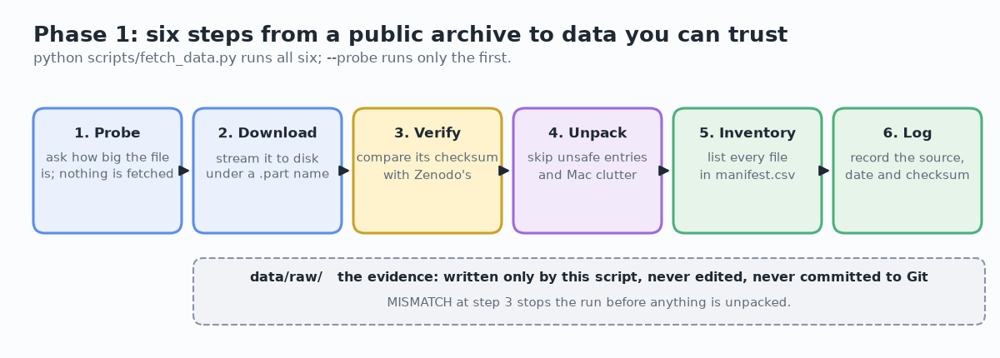
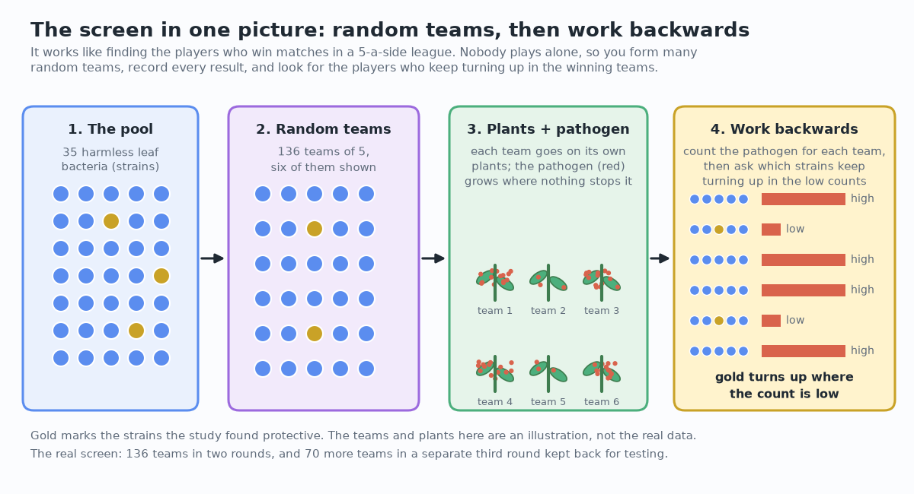
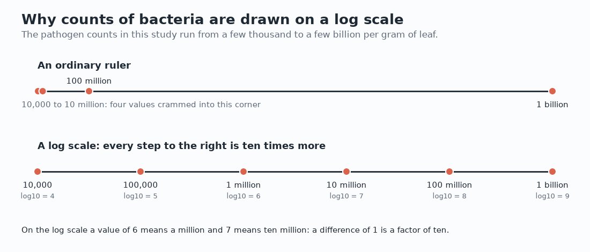
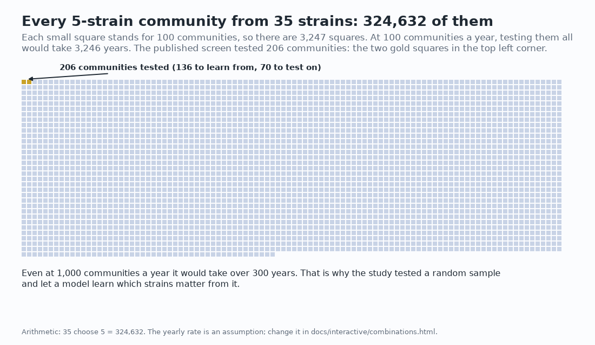

[Handbook](HANDBOOK.md) · [README](../README.md) · [Glossary](GLOSSARY.md) · [Architecture](00-architecture.md) · [Roadmap](ROADMAP.md)

# 02 · Phase 1: get the real data, verified

**Prerequisites:** [`docs/01-setup.md`](01-setup.md) done, with `python scripts/check_env.py` ending in **ALL CHECKS PASSED**. You're in the project folder, `(.venv)` shows in your prompt, and `git status` says you're on `develop`.

**Learning goal:** after this phase you'll know what a permanent research archive is and why it exists, what a checksum proves (and what it doesn't), why raw data is never edited, and how provenance gets recorded without effort. You'll have the published, peer-reviewed dataset on your computer, verified, and you'll know what's inside it.

**Time:** about an hour, much of it reading while the download runs. **Download:** about 239 MB, once. **Disk space:** about 700 MB free.

**Where this sits:** Stage 3 of the [Handbook](HANDBOOK.md#stage-3-phase-1-get-the-real-data-verified).

---

## Contents

- [1. The ideas behind this phase](#1-the-ideas-behind-this-phase)
- [2. Meet the source](#2-meet-the-source)
- [3. What's in the dataset: the science](#3-whats-in-the-dataset-the-science)
- [4. Three ideas to hold before running anything](#4-three-ideas-to-hold-before-running-anything)
- [5. The files for this phase](#5-the-files-for-this-phase)
- [6. Step 1: probe before you fetch](#6-step-1-probe-before-you-fetch)
- [7. Step 2: download, verify, unpack, list](#7-step-2-download-verify-unpack-list)
- [8. Step 3: look at what you got](#8-step-3-look-at-what-you-got)
- [9. See it: the figures and the interactive pages](#9-see-it-the-figures-and-the-interactive-pages)
- [10. Checkpoint: did the phase work?](#10-checkpoint-did-the-phase-work)
- [11. Notes from the build](#11-notes-from-the-build)
- [12. The tests](#12-the-tests)
- [13. Two ways to run everything](#13-two-ways-to-run-everything)
- [14. Same task, different language (optional, 10 minutes)](#14-same-task-different-language-optional-10-minutes)
- [15. What could go wrong (mini-FAQ)](#15-what-could-go-wrong-mini-faq)
- [16. Save your work](#16-save-your-work)
- [17. What you learned, and what's next](#17-what-you-learned-and-whats-next)

---

## 1. The ideas behind this phase

"Getting the data" sounds like a chore to get through before the real work starts. A surprising share of projects go wrong right here, without anyone noticing:

- A download stops at 94 %. The file opens fine and is missing a fifth of its rows. Nothing complains, and every number afterwards is wrong.
- Someone opens a data file in a spreadsheet program "just to look". The program turns a strain name into a date, the file gets saved on the way out, and the original is gone.
- Six months later someone asks where a number came from, and the answer is "a spreadsheet on my old laptop".

Each of those is ordinary, and each one destroys trust in a result. This phase builds three habits that prevent them:

1. **Verify what you downloaded** against the checksum the authors published.
2. **Never edit raw data.** The downloaded copy is read-only from the moment it arrives.
3. **Write down where it came from**, automatically, at download time.

A hospital laboratory receiving a blood sample works the same way: check the label against the form, log the sample number and the date, store it, and only then start testing. The paperwork feels slow until the day a result looks odd and the log is the only way to find out why.



---

## 2. Meet the source

### The study

> Emmenegger, B., Massoni, J., Pestalozzi, C. M., Bortfeld-Miller, M., Maier, B. A., & Vorholt, J. A. (2023). Identifying microbiota community patterns important for plant protection using synthetic communities and machine learning. *Nature Communications*, **14**, 7983. <https://doi.org/10.1038/s41467-023-43793-z>

The article is open access, so anyone can read it for free; the figures are worth a look before you go on. The work was done at the Institute of Microbiology at ETH Zurich.

### The data deposit

> <https://doi.org/10.5281/zenodo.10118600>: the data and the authors' original R code, under a CC-BY 4.0 licence.

**Zenodo** is a free, permanent public archive for research data and software, run by CERN. Researchers upload their files and get a **DOI**, a permanent address.

**Why a DOI rather than an ordinary link?** Links rot. Laboratories move, universities redesign their websites, hosting contracts end, and a link in an old paper often leads nowhere. A DOI comes with a promise to keep pointing at the same object, the way a book's ISBN identifies it no matter which shop has it in stock.

**What the licence means.** CC-BY 4.0 allows anyone to reuse the work, including changing it and using it commercially, **as long as the creators are credited**. This project credits them in the README, in every guide, in the code that downloads their archive and in the log it writes. Reusing CC-BY data with credit is exactly what the licence is for.

**What this project doesn't do:** keep a copy of their data in its own repository. `scripts/fetch_data.py` downloads it from the original archive, so everyone gets it from the source, with the licence and the authors' names attached.

**Reproducing a study isn't a criticism of it.** These authors made reproduction possible in the first place by releasing their data and code publicly, permanently and under an open licence, which many studies still don't.

---

## 3. What's in the dataset: the science

No biology background is needed. Here's the whole experiment.

**The question.** Plant leaves are covered in harmless bacteria, and some of them protect the plant against disease-causing ones. *Which ones?* The catch is that bacteria don't act alone: they compete, hold each other back and sometimes help each other. A strain that protects a plant on its own in a clean dish may do nothing on a real leaf among thirty other kinds.

**The design.** So the researchers never relied on testing one strain at a time. They assembled random teams and worked backwards from the results, as the picture below shows.



| Part of the experiment | What it was |
|---|---|
| the pool | **35 strains** of harmless leaf bacteria |
| a team | **5 strains** applied together (the paper calls one a "Mini5SynCom") |
| the screen | **136 teams**, each on its own set of plants, in two rounds |
| the opponent | *Pseudomonas syringae* DC3000, a bacterium that causes leaf disease |
| the plants | sterile *Arabidopsis thaliana* (thale cress) seedlings in sealed boxes |
| the result | how much pathogen grew on each plant, 14 days after infection |
| the test set | **70 more teams** in a separate third round, kept back to test the models |

The plants were also weighed, and the harmless bacteria counted too, so the data records more than the final result.

**Some words, in plain terms** (all of them are in the [Glossary](GLOSSARY.md#group-1-the-biology)):

- A **strain** is one particular, named kind of bacterium kept in a laboratory freezer. The ones in this study are named after the leaves they came from and numbered: `Leaf15`, `Leaf76` and so on.
- A **SynCom** (synthetic community) is a team of known strains put together on purpose. *Synthetic* here means "assembled by people from known parts", not artificial.
- A **pathogen** is a microbe that causes disease.
- A **CFU** (colony-forming unit) is how live bacteria get counted: spread a diluted sample on a nutrient jelly, let each living bacterium grow into a visible dot, count the dots and scale back up.
- **CFU per gram** divides the count by the plant's weight, so a big plant isn't counted as "more infected" just for offering more surface.

**One thing that looks strange in the numbers.** The pathogen counts run from about ten thousand to about a billion per gram. That isn't a mistake: bacterial populations really do span that range. It's why biologists read these counts on a **log scale**, where 10,000 is 4 and 1,000,000,000 is 9, and each step of 1 means ten times more. A column of values between about 4 and 9 is what to expect.



**What they found.** Three strains, *Pseudomonas* Leaf15, *Rhizobium* Leaf68 and *Acidovorax* Leaf76, reduced the pathogen, and direct laboratory tests confirmed it afterwards. One of the three hadn't been known as protective before. **This project doesn't take that on trust:** Phase 5 trains its own models in a different language, and Phase 6 runs the authors' own code, to see whether the same three come out on top.

---

## 4. Three ideas to hold before running anything

### A checksum, and what it proves

A **checksum** is a short code calculated from every byte of a file, a fingerprint for the file. Change one byte and the code changes completely. **MD5** is the name of the method Zenodo uses. Zenodo publishes the archive's checksum, `f8061f230b621703f0f11be454c5167e`, and the script calculates the checksum of what you downloaded and compares the two.

**What a match proves:** you hold exactly the file the authors deposited, not cut short, not damaged, not a different version.

**What it doesn't prove:** that the data is right, or that the science holds. A fingerprint on a document shows who handled it, not whether what it says is true. Checks get oversold all the time, so it pays to know exactly what each one does and doesn't tell you.

### Raw data is read-only

Once downloaded, nothing ever changes `data/raw/`. Every other file in the project can be rebuilt by running code; the raw copy can't, because it's the starting point. A museum keeps the original manuscript in a vault and lets visitors read copies, for the same reason.

**In practice:** don't open the unpacked files in a spreadsheet program and save them. If you want to look, close without saving, or better, look with code, which can't overwrite anything by accident.

### Provenance

**Provenance** is the written history of a piece of data: where it came from, when, and what has been done to it since. The script writes `data/raw/fetch_log.json` with the source, the DOI, the date, the checksum and the number of files. It costs nothing at download time and it's the only way to answer "where did this come from?" next year. An art dealer would put it this way: two identical paintings, one with documented ownership and one "found in an attic", are not worth the same.

---

## 5. The files for this phase

They're already in the repository, so there's nothing to type in:

| File | What it does |
|---|---|
| `scripts/fetch_data.py` | probes, downloads, verifies, unpacks, lists and logs the archive |
| `notebooks/explore_raw.py` | summarises what the archive contains |
| `tests/test_fetch_data.py` | checks the download script without the internet ([section 12](#12-the-tests)) |
| `figures/make_concept_figures.py` | draws this guide's pictures and the combinations page ([section 9](#9-see-it-the-figures-and-the-interactive-pages)) |
| `figures/make_illustrations.py` | draws the logo, the journey map and the interactive journey page |
| `check-public-safe.sh` | the safety gate, run before every push ([`docs/01-setup.md` section 13](01-setup.md#13-the-safety-gate)) |
| `pytest.ini` | tells the tests where to look |
| `tests/test_safety_gate.py`, `tests/test_docs.py` | check the safety gate, and the documentation's links and characters |
| `docs/index.html`, `docs/.nojekyll` | the front page of the optional GitHub Pages site ([section 9](#optional-publish-the-interactive-pages-with-github-pages)) |

**Read `scripts/fetch_data.py` before you run it.** Every decision in it is explained in a comment next to the code, and three of them are worth stopping at:

- **Streaming.** `requests.get(..., stream=True)` reads the download a megabyte at a time instead of loading all 239 MB into memory. Any time a file is bigger than is comfortable, process it in pieces.
- **The `.part` file.** The download is saved as `Mini5SynCom_Repository.zip.part` and renamed only when it's complete. If the connection drops, what's left is obviously unfinished, never something that looks like a complete download.
- **The zip-slip guard.** A zip file can contain names like `../../.bashrc` that, unpacked carelessly, land outside the intended folder and overwrite files elsewhere (`.bashrc` is a settings file a Linux terminal runs every time it opens, so overwriting it could make the terminal do anything). This archive comes from a trusted source, and the check costs two lines. The script also skips the `__MACOSX` folders and `.DS_Store` files that macOS adds to zip files made on a Mac.

---

## 6. Step 1: probe before you fetch

Make sure `(.venv)` shows in your prompt. If not:

> **macOS / Linux**: `source .venv/bin/activate`
> **Windows PowerShell**: `.\.venv\Scripts\Activate.ps1`

Then:

```bash
python scripts/fetch_data.py --probe
```

**You should see:**

```
======================================================================
PROBE: what would be downloaded
======================================================================
Source record : https://zenodo.org/records/10118600
File          : Mini5SynCom_Repository.zip
Published size: about 239.2 MB
Published MD5 : f8061f230b621703f0f11be454c5167e
Licence       : CC-BY 4.0 (reuse allowed, with credit to the authors)
Destination   : data/raw/Mini5SynCom_Repository.zip

Server reports: 239.2 MB
Reachable     : yes

Nothing has been downloaded. To go ahead:
    python scripts/fetch_data.py
```

**What happened.** The script sent an HTTP `HEAD` request, which means "send me the headers, not the body". It takes a moment and almost no data. It catches the two most common failures (no internet, or the file has moved) in a second instead of after a five-minute download. If this step fails, don't go on: [section 15](#15-what-could-go-wrong-mini-faq) says what to do.

---

## 7. Step 2: download, verify, unpack, list

```bash
python scripts/fetch_data.py
```

It takes several minutes; the progress bar updates on one line. **You should see** this (the two long lists are shortened here with `...`):

```
======================================================================
DOWNLOAD
======================================================================
From: https://zenodo.org/records/10118600/files/Mini5SynCom_Repository.zip?download=1
To  : data/raw/Mini5SynCom_Repository.zip
This is a large file. Expect several minutes on a typical connection.

  [########################################] 100.0%  239.2 MB / 239.2 MB
Download complete: 239.2 MB

======================================================================
VERIFY: is this exactly the file the authors deposited?
======================================================================
Computing the checksum (a few seconds)...
  Expected: f8061f230b621703f0f11be454c5167e
  Actual  : f8061f230b621703f0f11be454c5167e

MATCH. This is the published archive, byte for byte.

======================================================================
EXTRACT
======================================================================
Entries in the archive : 368
macOS clutter skipped  : 0
Unpacking              : 368
Unpacked into data/raw/extracted/

======================================================================
INVENTORY: what is actually inside
======================================================================
Files: 342

Type          Count   Total size
--------------------------------
.txt            141       3.9 MB
.pdf             76     153.6 MB
.rdata           32      30.0 MB
.tsv             32     775.0 KB
.r               22     342.9 KB
.rds             19      62.6 MB
.xlsx            12     418.3 KB
.tre              3      10.0 KB
(none)            1        0.0 B
.png              1      83.6 KB
.sh               1      156.0 B
.tree             1       3.5 MB
.tree-table       1       5.7 MB

Likely data files (236):
----------------------------------------------------------------------
     37.8 KB  Data/CleanData/2023-01-16Mini5SynComScreen_CommentsFile.txt
    222.1 KB  Data/CleanData/2023-01-16Mini5SynComScreen_IndividualStrainColonization.txt
...
  ... and 211 more (all of them are in data/raw/manifest.csv)

The authors' R code (22):
----------------------------------------------------------------------
     24.6 KB  Rscripts/Analysis_CommunityPropCorrelations.R
     41.1 KB  Rscripts/Analysis_MachineLearning.R
...

Full list written to data/raw/manifest.csv
Provenance log written to data/raw/fetch_log.json

======================================================================
DONE
======================================================================
The published dataset is on this computer, verified.

  data/raw/Mini5SynCom_Repository.zip   the archive (never edit it)
  data/raw/extracted/                   its contents, unpacked
  data/raw/manifest.csv                 a list of every file inside
  data/raw/fetch_log.json               where it came from, and when

Next: docs/02-phase-1-data-acquisition.md, section 8 (look at what you got).
```

**Reading it.** The archive has 368 entries but 342 files: zip archives list folders as entries too, and 26 of these entries are folders. Nothing was skipped (no macOS clutter, nothing unsafe). The `MATCH` line is worth stopping at. It shows you hold the same bytes the authors deposited on 13 November 2023, which is more than "it downloaded and seemed fine". Everything later in the project rests on it.

### Run it again

```bash
python scripts/fetch_data.py
```

**You should see** it check instead of download:

```
The archive is already here: data/raw/Mini5SynCom_Repository.zip
Checking it instead of downloading again (add --force to download anyway).
...
MATCH. This is the published archive, byte for byte.
...
Already unpacked in data/raw/extracted/, skipping.
(Delete that folder and run the script again for a clean unpack.)
...
```

The inventory, the two "written to" lines and the DONE block follow, as before. The log keeps the date of the download and adds the date of this check (`downloaded_at_utc` and `last_verified_utc` in `data/raw/fetch_log.json`).

A script that's safe to run again and again is called **idempotent**. Pressing a lift button twice doesn't call two lifts, and it doesn't break anything either. It matters because people re-run a pipeline they trust not to break anything, and re-running is how mistakes get caught.

---

## 8. Step 3: look at what you got

```bash
python notebooks/explore_raw.py
```

It reads `data/raw/manifest.csv` and summarises the archive four ways: files by type, files per folder, and then the two lists that matter most, the files that probably hold data and the authors' R code. **You should see** (long lists shortened with `...`):

```
Files in the archive : 342
Total size unpacked  : 260.9 MB

Files by type:
  .txt            141      3.9 MB
  .pdf             76    153.6 MB
  .rdata           32     30.0 MB
  .tsv             32    775.0 KB
  .r               22    342.9 KB
  .rds             19     62.6 MB
  .xlsx            12    418.3 KB
  ...

Files per folder (first two levels):
  Output/MachineLearning                        102
  Output/PropCommCorrelations                    63
  Output/ValidationExperimentsAnalysis           22
  Rscripts                                       22
  Data/MetaData                                  18
  Output/MachineLearning_PerformanceOutput       18
  Data/EditedData                                16
  Data/CleanData                                 13
  Data/RawData                                   12
  ...

Files that probably hold data: 236
  in Data/, what the authors started from (53):
     37.8 KB  Data/CleanData/2023-01-16Mini5SynComScreen_CommentsFile.txt
    222.1 KB  Data/CleanData/2023-01-16Mini5SynComScreen_IndividualStrainColonization.txt
  ...
  in Output/, what the authors' code wrote: 183 files
  (results, tables and saved models; all listed in data/raw/manifest.csv)

The authors' R code (22 files):
     24.6 KB  Rscripts/Analysis_CommunityPropCorrelations.R
  ...
```

**Then read the output properly**, and write your own answers down before reading mine below. A good place is a file in `.local-notes/`, a folder `.gitignore` keeps out of Git, so your notes stay private (in VS Code: **File, New File**, then save it as `.local-notes/phase-1.md` in the project folder). A plain-text editor is better than a word processor here, because word processors swap in curly quotes.

1. **How many files, of what types?** An archive that's mostly `.R` files is a code deposit with data attached; one that's mostly tables is the reverse.
2. **Which files probably hold the 136 communities and their results?** Look at names, folders and sizes: a few hundred kilobytes is about right for a few hundred rows; tens of megabytes is something else.
3. **Where's the authors' R code?** Phase 6 runs it, so note the folder.
4. **Is anything missing, or more there than you expected,** compared with what the paper's Methods section describes?

**Why do this by hand?** Phase 2 writes code that reads particular files, and that code can only be written once you know which files exist and what they hold. Code written around guessed file names tends to break quietly on someone else's computer.

### What the archive holds

Read from the file names and folders only; Phase 2 opens the files ([its guide, section 5](03-phase-2-more-sources.md#5-step-1-open-layer-1s-tables)). The authors' R code stays closed until Phase 6, so the Python rebuild in Phase 5 is written from the paper alone.

| Folder | Files | What the names suggest |
|---|---|---|
| `Data/RawData/` | 12 | the measurements as first recorded: pathogen and strain counts (CFU) and plant weights, for the screen, the pilot experiment and two validation experiments |
| `Data/CleanData/` | 13 | the same measurements after the authors' cleaning, plus comment files, a tree of the strains and a small shell script |
| `Data/EditedData/` | 16 | `ML_DataInput/`: the tables the machine-learning step read, in several versions (strain presence, categories or counts; per plant or median; classification or regression) |
| `Data/MetaData/` | 18 | which strains went into which community (`..._Mixes.txt`), which box each plant sat in, harvest comments, and information about the strain collection |
| `Output/` | 260 | what the authors' code wrote: model results for each random seed, most of the paper's supplementary tables (file names starting `TableS`), saved models, and 76 figure PDFs |
| `Rscripts/` | 22 | the analysis: data preparation, one script per figure, a shared `RFunctions.R`, and `sessioninfo.R` |

The answers to the four questions, from this run:

1. **342 files.** Mostly tables (141 `.txt`, 32 `.tsv`, 12 `.xlsx`) and R's own data files (32 `.rdata`, 19 `.rds`). The 76 PDFs are figures and make up more than half the size (153.6 of 260.9 MB). It's a data deposit with the code that analysed it.
2. **The screen** is in `Data/RawData/Mini5SynComScreen/` (as recorded) and `Data/CleanData/2023-01-16Mini5SynComScreen_*.txt` (cleaned), with the community make-up in `Data/MetaData/Mini5SynComScreen/20200828_Mixes.txt`. Where the 70 test communities sit isn't clear from the names alone: `Output/TestData/` holds only figures of them, so the table behind those figures is somewhere else. Finding it, by opening the data files, was the first job of Phase 2: the test communities turned out to be round 3 of the same files ([Phase 2 guide, section 5](03-phase-2-more-sources.md#5-step-1-open-layer-1s-tables)).
3. **The R code** is in `Rscripts/`. Two more things for Phase 6: `Rscripts/sessioninfo.R` and an image `Output/StrainSelection/20230911_SessionInfo_LaptopWorkstation.PNG` probably record the R version and packages the authors used.
4. **More than expected.** The authors also deposited everything their code produced. File names such as `Output/MachineLearning/RFClassOverall_seed5_2023-06-21.txt` show results for eight random seeds, and `Output/MachineLearning_PerformanceOutput/TableS6_ClassificationPerformance.tsv` holds published performance numbers as a table, which the comparisons in Phases 5 and 6 can read directly. And `Data/MetaData/AtSPHERE/` holds a file called `41564_2021_997_MOESM3_ESM (1).xlsx`: by its name, a supplementary file of the 2021 *Nature Microbiology* paper behind Layer 5 (each strain tested alone). Phase 2 confirmed it and checked it against the publisher's copy ([Phase 2 guide, section 3](03-phase-2-more-sources.md#3-a-second-copy)).

One practical detail: that last file name contains spaces and brackets, so anything that reads it has to keep the name in one piece: quotes around it in a terminal, a `Path` in Python ([Phase 2 guide, section 15](03-phase-2-more-sources.md#15-same-task-different-language-optional-10-minutes)).

### The paper's Source Data, an alternative route

The article also publishes **Source Data**, the numbers behind each figure, as spreadsheet files on the article page (<https://doi.org/10.1038/s41467-023-43793-z>, in the "Source data" section). They're much smaller than the full archive. If the Zenodo download is impractical on your connection, they're a workable route to the same measurements; if you take it, say so in the README, because the point is that choices get written down.

---

## 9. See it: the figures and the interactive pages

```bash
python figures/make_concept_figures.py
python figures/make_illustrations.py
```

**You should see:**

```
  drew figures/combinations.png
  drew figures/screening_design.png
  drew figures/three_way.png
  drew figures/data_layers.png
  drew figures/fetch_pipeline.png
  drew figures/log_scale.png
  wrote docs/interactive/combinations.html
```

and, from the second script:

```
  drew docs/img/realsignal_logo.svg
  drew docs/img/realsignal_icon.svg
  drew docs/img/realsignal_wordmark.svg
  drew docs/img/journey_map.svg
  wrote docs/interactive/journey.html (22 stages, read from docs/HANDBOOK.md)
```

These pictures explain ideas, so they need no data. The one most worth a minute is the combinations picture: 35 strains in teams of five make 324,632 possible communities, and the study tested 206 of them.



`docs/interactive/combinations.html` is the same arithmetic with sliders (pool size, team size, communities tested per year). Open it by double-clicking the file in your file browser; it works offline.

### Optional: publish the interactive pages with GitHub Pages

GitHub can serve the `docs/` folder as a small website, so the interactive pages open from a link instead of a download. Once, in a browser:

1. Open your repository on GitHub, then **Settings**, then **Pages** (in the left-hand list).
2. Under **Build and deployment**, set **Source** to **Deploy from a branch**.
3. Set **Branch** to `master` and the folder to `/docs`, then **Save**.
4. After a minute or two the page shows the site's address, `https://<you>.github.io/realsignal/`.

`docs/index.html` is the front page; `docs/.nojekyll` tells GitHub to publish the folder as it is. From then on every push to `master` updates the site.

---

## 10. Checkpoint: did the phase work?

- [ ] `python scripts/fetch_data.py --probe` reports `Reachable     : yes`
- [ ] the download ended with **MATCH**, and the inventory says `Files: 342`
- [ ] `data/raw/extracted/` holds the unpacked files
- [ ] `data/raw/manifest.csv` and `data/raw/fetch_log.json` exist
- [ ] a second run checks the archive instead of downloading it again
- [ ] `python notebooks/explore_raw.py` prints its summary, and you've written down where the community table, the results and the R code are
- [ ] `pytest -q` passes (19 tests)
- [ ] `git status` shows **nothing** under `data/`

That last one matters most. Check it explicitly:

```bash
git status
```

If anything under `data/` appears, `.gitignore` isn't working: go back to [`docs/01-setup.md` section 11](01-setup.md#11-keep-things-out-of-git-with-gitignore) before you commit anything, because a 239 MB file committed once stays in the history for good.

---

## 11. Notes from the build

Things that really happened while this phase was built, kept because they teach something:

- **The scripts' first output wasn't safe to quote.** The first versions of `scripts/fetch_data.py` and `scripts/check_env.py` printed long dashes and the full path of the project folder, including the home folder's name. Before this guide quoted their output, both were changed to print plain characters and paths from the project folder (`data/raw/...`), so the output is the same on every computer and safe to paste. A test now checks the download script's output.
- **The safety gate's first run found two files that shouldn't be public.** Two macOS `.DS_Store` files had reached Git in the project's second commit. The gate flagged them, and this phase's commit takes them out of Git (`git rm --cached`) without deleting them from the disk.
- **It also flagged the guides themselves.** Twelve example paths in the earlier versions of three guides used made-up home-folder names (`yourname`, `you`, `me`) that the gate can't tell apart from real ones. They now write the name as `<you>`, which the gate accepts and nobody can mistake for a real folder.
- **Pictures with a hidden record.** When the drawings were first copied into the project folder, the copying step added a hidden "content credentials" record to each SVG file. Nothing showed on screen, and the record would have been published with them. The safety gate gained a check for hidden records in pictures (item 6 of its output), and the pictures are now always drawn by the project's own scripts on the computer that commits them ([section 9](#9-see-it-the-figures-and-the-interactive-pages)).
- **Megabytes of two sizes.** Before the first real run, a read through the code showed the script dividing by 1,024 where Zenodo divides by 1,000. The archive is 239,154,876 bytes: 239.2 MB on Zenodo's scale, 228.1 on the other, so the probe would have printed a size that looked wrong next to the published one. The script now uses Zenodo's units, and the first probe printed `Server reports: 239.2 MB`.
- **The credential check found nothing on a Mac.** On the first run on a Mac, one of the 19 tests failed: the safety gate missed a fake key the test had planted. Its pattern used two regular-expression features, `{20,}` ("twenty or more") and `^` inside a group, that regex engines treat differently from system to system, and there it matched nothing. The check now writes the twenty characters out in full and lets Git test the word boundaries (`git grep -w`), and a test also makes sure a link anchor such as `#task-...` isn't taken for a key.
- **The second run blanked two numbers.** Reading `data/raw/fetch_log.json` after the first real run showed `null` for the macOS clutter and unsafe entries: the second run skips unpacking, so it had nothing to count, and it overwrote the first run's zeros. It now keeps the numbers from the run that unpacked, and a test checks it.
- **A line too long for the terminal.** The lines under DONE were 85 characters long; an 80-character terminal wrapped them, and the copied text ran "never" and "edit" together. They're shorter now.
- **A script that only existed on the page.** The first version of this guide asked you to type `notebooks/explore_raw.py` in from the page. It's now a file in the repository, so what you run is exactly what the guide describes.

---

## 12. The tests

```bash
pytest -q
```

**You should see:**

```
..................                                                       [100%]
19 passed in 1.86s
```

(The time varies. Run from Windows PowerShell, it says `12 passed, 7 skipped` with a line giving the reason: the safety-gate tests need bash, so on Windows they run only when pytest is started from Git Bash.) `pytest.ini` tells pytest to look only in `tests/`, so it never wanders into `data/`.

**Why the tests don't need the internet.** The real archive is 239 MB on someone else's server, and a test that downloads it would be slow, would fail whenever the network does, and would put load on Zenodo every time. So `tests/test_fetch_data.py` builds a tiny stand-in archive in a temporary folder, with two traps in it (an entry trying to land outside the folder, and macOS clutter), and checks the parts that protect us: the zip-slip guard, the checksum against Python's own MD5, the unpacking, the inventory, that a second run checks instead of downloading, that a wrong checksum stops the run before anything is unpacked, and that the output holds no home-folder paths or look-alike characters.

`tests/test_safety_gate.py` checks the gate ([`docs/01-setup.md` section 13](01-setup.md#13-the-safety-gate)), and `tests/test_docs.py` checks the documentation: every link between the guides leads somewhere, no file contains long dashes or curly quotes, and the Handbook's stage table agrees with the journey map.

---

## 13. Two ways to run everything

| Capability | By hand, one step at a time | In one go |
|---|---|---|
| look before downloading | `python scripts/fetch_data.py --probe` | n/a |
| download, verify, unpack, list, log | the functions in `scripts/fetch_data.py`, one by one, from a Python session | `python scripts/fetch_data.py` |
| check the checksum yourself | your operating system's own tool ([section 14](#14-same-task-different-language-optional-10-minutes)) | part of the command above |
| summarise the archive | `notebooks/explore_raw.py`, line by line in VS Code | `python notebooks/explore_raw.py` |

### Running the steps by hand

A **Python session** is Python waiting for instructions one line at a time. Start one from the project folder with `python`; the prompt changes to `>>>`, which means Python, not the terminal, is reading what you type. Then:

```python
import sys
sys.path.insert(0, "scripts")   # scripts/ isn't a package, so tell Python where to look
import fetch_data
fetch_data.probe()              # the same as: python scripts/fetch_data.py --probe
fetch_data.verify()             # recompute and compare the checksum
exit()
```

`exit()` takes you back to the terminal. Each function prints what it does, so you can stop and look between steps.

Later phases add a third way: Phase 12 runs every step in order with one command, and later through Airflow.

---

## 14. Same task, different language (optional, 10 minutes)

The script calculates the MD5 checksum in Python. Every operating system can do the same with its own tool, and getting the same fingerprint four ways shows that a checksum depends only on the file's bytes.

**Python**, what the script does (start a Python session with `python` in the project folder, paste the lines at the `>>>` prompt, then `exit()`):

```python
import hashlib
from pathlib import Path

digest = hashlib.md5()
with open(Path("data/raw/Mini5SynCom_Repository.zip"), "rb") as handle:
    for piece in iter(lambda: handle.read(1024 * 1024), b""):
        digest.update(piece)
print(digest.hexdigest())
```

**macOS:**

```bash
md5 data/raw/Mini5SynCom_Repository.zip
```

**Linux (including RHEL 8):**

```bash
md5sum data/raw/Mini5SynCom_Repository.zip
```

**Windows PowerShell:**

```powershell
Get-FileHash data\raw\Mini5SynCom_Repository.zip -Algorithm MD5
```

All four show `f8061f230b621703f0f11be454c5167e` (PowerShell writes it in capital letters, `F8061F23...`; it's the same number). The one-line tools are quicker for a single check; the Python version wins inside a program, where the result has to be compared, logged and acted on.

---

## 15. What could go wrong (mini-FAQ)

**The probe says `Could not reach the archive`.** Check the internet connection by opening any website. On a company network, a proxy may block the request: try another network, and if that works, ask your IT team. Zenodo also goes down for maintenance now and then: open <https://zenodo.org> in a browser, and if it's down, wait and try again.

**The download stops partway.** Run the same command again; the `.part` file is replaced. If it keeps stopping at the same place, the connection is dropping: try a wired connection or another network.

**`MISMATCH` after the download.** Nearly always a download that was cut short. Delete the archive and run the script again:

> **macOS / Linux**: `rm data/raw/Mini5SynCom_Repository.zip`
> **Windows PowerShell**: `Remove-Item data\raw\Mini5SynCom_Repository.zip`

If a second clean download gives the same mismatch, the authors may have updated the archive. The record page shows the current checksum next to the file; write the difference down in the README, so anyone using the project knows the source changed.

**`ModuleNotFoundError: No module named 'requests'`.** The virtual environment isn't active: look for `(.venv)`, activate it, run again.

**"No space left on device".** You need about 700 MB: the archive plus its unpacked contents. Free some space and run again; nothing is lost.

**Unpacking is very slow.** Normal on an older disk or a network drive. If it's extremely slow, check the project isn't inside a cloud-synced folder ([`docs/01-setup.md` section 7](01-setup.md#7-create-the-project-folder)).

**Windows: "The filename or extension is too long".** Windows has an old limit of 260 characters per path, and deeply nested archives can pass it. Either move the project closer to the drive's top level (`C:\projects\realsignal`), or switch long paths on, in PowerShell **run as administrator**:

```powershell
New-ItemProperty -Path "HKLM:\SYSTEM\CurrentControlSet\Control\FileSystem" -Name "LongPathsEnabled" -Value 1 -PropertyType DWORD -Force
```

Restart the computer, then run the script again.

**`notebooks/explore_raw.py` says the manifest doesn't exist yet.** The download hasn't run, or it stopped before the inventory: run `python scripts/fetch_data.py`.

**`pytest -q` fails in `tests/test_docs.py`.** It names the file and line: a link to a heading that was renamed, or a long dash or curly quote that came in with pasted text. Fix that line.

---

## 16. Save your work

This phase completes the project's first version, **v0.1.0**, so it gets a tag. Three blocks, in order; read the result of each before going on.

**1. Two one-off steps,** because this is the commit that adds the safety gate: take the two `.DS_Store` files out of Git (they stay on your disk), and record the gate and the setup script as runnable.

> **macOS / Linux**
> ```bash
> git switch develop
> git rm --cached --ignore-unmatch .DS_Store src/.DS_Store
> chmod +x check-public-safe.sh setup.sh
> ```

> **Windows PowerShell**
> ```powershell
> git switch develop
> git rm --cached --ignore-unmatch .DS_Store src/.DS_Store
> git update-index --chmod=+x check-public-safe.sh setup.sh
> ```

(`--ignore-unmatch` keeps `git rm` quiet if the files aren't in Git, which is the case in any copy made after this commit.)

**2. Check.** Stop here if either one fails:

```bash
pytest -q                     # 19 passed
./check-public-safe.sh        # must end with: SAFE TO PUSH (Windows: bash check-public-safe.sh in Git Bash)
```

**3. Save,** with the ritual from [`docs/GIT_WORKFLOW.md` section 6](GIT_WORKFLOW.md#6-the-end-of-phase-ritual):

```bash
git switch develop
git add -A
git commit -m "feat: verified download of the published dataset, Handbook, safety gate and illustrations"
git push origin develop develop:beta develop:master
## --tags is optional, only when required: this phase completes v0.1.0
git tag -a v0.1.0 -m "v0.1.0: verified data, documentation and a reproducible setup"
git push origin develop develop:beta develop:master --tags
## then switch back to local master and pull in the remote changes
git switch master
git pull --ff-only origin master
git switch develop
```

**Check it worked:**

```bash
git log --oneline -1
```

You should see your commit with branch names beside it, something like `(HEAD -> develop, tag: v0.1.0, origin/master, origin/develop, origin/beta, master)`. All of them on one line means every branch points at the same commit, which is what the push was for. (Your local `beta` isn't in the list, because you never work on it; `origin/HEAD` may appear too.)

---

## 17. What you learned, and what's next

- What a permanent research archive is, and why DOIs exist
- What a checksum proves, and what it doesn't
- Why raw data is read-only, and what goes wrong otherwise
- What provenance is, and how little it costs to record
- Why a large file is processed in pieces, and what idempotent means
- How to approach data you didn't create: look first, never guess
- Why tests that protect the download don't need the download

**Next: Phase 2, the other data layers** ([`docs/03-phase-2-more-sources.md`](03-phase-2-more-sources.md)). It opens Layer 1's tables first, then fetches four more layers (the strains' genomes, their predicted gene clusters, the network of which strain holds back which, and every strain tested alone) from three more papers, and records in a source register where each one came from and on what terms. See [Stage 4 in the Handbook](HANDBOOK.md#stage-4-phase-2-the-other-four-layers-or-a-record-of-why-not).
