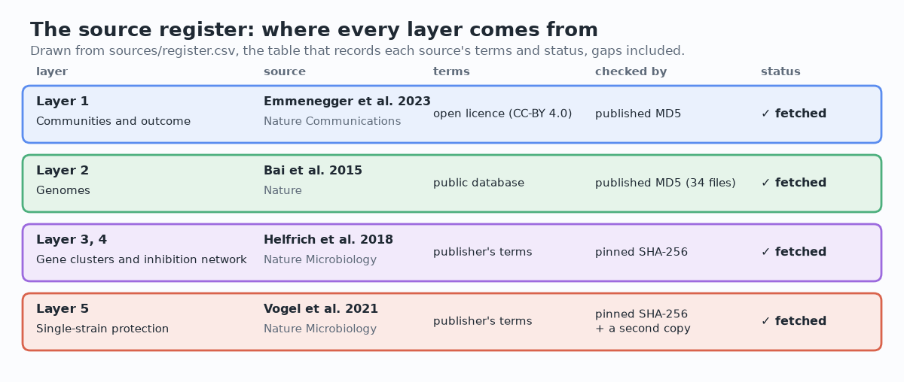
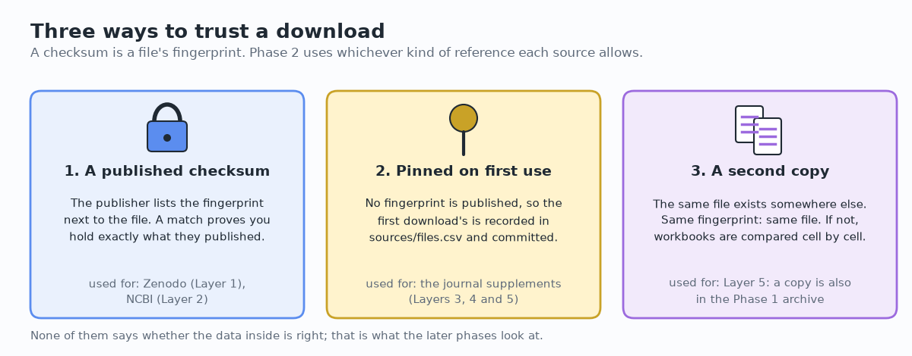
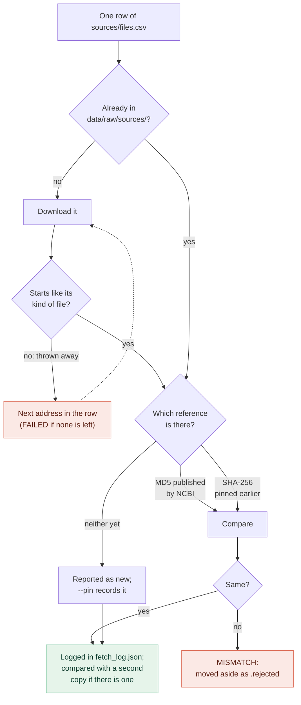
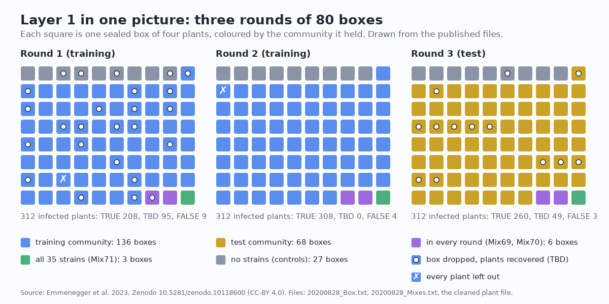

[Handbook](HANDBOOK.md) · [README](../README.md) · [Glossary](GLOSSARY.md) · [Architecture](00-architecture.md) · [Roadmap](ROADMAP.md)

# 03 · Phase 2: the other four layers, or a record of why not

**Prerequisites:** Phase 1 done ([`docs/02-phase-1-data-acquisition.md`](02-phase-1-data-acquisition.md)), so `data/raw/extracted/` holds the unpacked archive. You're in the project folder, `(.venv)` shows in your prompt, and `git status` says you're on `develop`.

**Learning goal:** after this phase you'll be able to open data tables someone else wrote and say what each one holds, and you'll know how to collect data from several places without losing track of it: a register of sources, the difference between *free to read* and *free to reuse*, and three ways to check a download depending on how much help the publisher gives. You'll have Layers 2 to 5 on your computer, each one checked, and a written record of anything that couldn't be had.

**Time:** about an hour and a half, most of it reading. **Download:** 48.5 MB, once (34 genomes and two workbooks). **Disk space:** about 100 MB free.

**Where this sits:** Stage 4 of the [Handbook](HANDBOOK.md#stage-4-phase-2-the-other-four-layers-or-a-record-of-why-not).

---

## Contents

- [1. The ideas behind this phase](#1-the-ideas-behind-this-phase)
- [2. Five layers, four papers, three kinds of terms](#2-five-layers-four-papers-three-kinds-of-terms)
- [3. Three ways to trust a download](#3-three-ways-to-trust-a-download)
- [4. The files for this phase](#4-the-files-for-this-phase)
- [5. Step 1: open Layer 1's tables](#5-step-1-open-layer-1s-tables)
- [6. Step 2: read the source register](#6-step-2-read-the-source-register)
- [7. Step 3: probe every file](#7-step-3-probe-every-file)
- [8. Step 4: fetch, check and record](#8-step-4-fetch-check-and-record)
- [9. Step 5: look at what arrived](#9-step-5-look-at-what-arrived)
- [10. See it: the figures and the interactive page](#10-see-it-the-figures-and-the-interactive-page)
- [11. Checkpoint: did the phase work?](#11-checkpoint-did-the-phase-work)
- [12. Notes from the build](#12-notes-from-the-build)
- [13. The tests](#13-the-tests)
- [14. Two ways to run everything](#14-two-ways-to-run-everything)
- [15. Same task, different language (optional, 10 minutes)](#15-same-task-different-language-optional-10-minutes)
- [16. What could go wrong (mini-FAQ)](#16-what-could-go-wrong-mini-faq)
- [17. Save your work](#17-save-your-work)
- [18. What you learned, and what's next](#18-what-you-learned-and-whats-next)

---

## 1. The ideas behind this phase

Phase 1 was easy in one respect: one archive, one address, a checksum printed next to the file, and an open licence. The other four layers come from three more papers and two different kinds of website, and none of those conveniences can be taken for granted:

- Each source comes with its own terms. Some data may be reused freely; some comes with fewer rights.
- Some websites publish a checksum for their files. Others don't.
- A file can move, disappear behind a login, or arrive as a web page instead of the file.

And before any of that, Layer 1 still has open questions. Phase 1 listed its files by name without opening them, so where the 70 test communities are, and what the columns mean, is still unknown.

This phase does four things, in this order:

1. **Open Layer 1's tables** and find out what they hold.
2. **Write down every source** in a *source register*: what it holds, where it comes from, under which terms, and whether it could be obtained.
3. **Fetch each file once and check it**, as thoroughly as the source allows.
4. **Record the outcome**, failures included.

On a building site, the materials list does this job. Each item has a supplier, an order number and a delivery note, and the list shows at a glance what arrived, what's late and what had to be replaced. Nobody can hold that in their head for forty items.



---

## 2. Five layers, four papers, three kinds of terms

| Layer | What it holds | Paper | Where the files are | Terms | Used in |
|---|---|---|---|---|---|
| 1 | the community screen: which strains went into each community, pathogen counts, plant weights | Emmenegger *et al.* 2023 | Zenodo (fetched in Phase 1) | CC-BY 4.0 | every phase |
| 2 | each strain's genome | Bai *et al.* 2015 | NCBI | no restrictions from NCBI | Phase 8 |
| 3 | predicted gene clusters: the chemistry a strain could make | Helfrich *et al.* 2018 | the article page (one workbook) | the publisher's | Phases 8 and 13 |
| 4 | which strain holds back which, tested in the laboratory | the same paper | the same workbook | the publisher's | Phases 8 and 13 |
| 5 | every strain tested alone against the pathogen | Vogel *et al.* 2021 | the article page, and a copy in the Phase 1 archive | the publisher's | Phase 9 |

The full citations, DOIs and addresses are in `sources/register.csv` and `sources/files.csv`, and section 6 prints them.

### Where a paper says its data is

Most papers have a short section called **Data availability**, usually near the end. It says where the data behind the paper can be found: an archive with a DOI (Layer 1's paper points to Zenodo, which is how Phase 1 found the archive), a public database such as NCBI, or the paper's supplementary information. It's the first thing to read when you want to reuse someone's data.

**Supplementary information** is where journals put material too big for the article itself: extra files on the article's web page, usually spreadsheets and PDFs. The publisher of *Nature Microbiology* calls them *electronic supplementary material* (ESM), which explains the odd file names: `41564_2018_200_MOESM3_ESM.xlsx` is the journal's code (41564), the article (2018, number 200) and the third piece of supplementary material.

### Free to read and free to reuse are two different things

They get mixed up all the time. **Open access** means anyone can read the article without paying. An **open licence**, such as CC-BY, means anyone may also copy, change and share the material, under the licence's conditions. A library lets you read any book in its reading room; that doesn't make the book yours to photocopy and hand out.

The four sources fall into three groups:

- **Layer 1: an open licence.** CC-BY 4.0 allows reuse with credit, as Phase 1 explained.
- **Layer 2: a public database.** NCBI says it places no restrictions on the use or distribution of the GenBank data these records are built from, and adds that some submitters may claim rights in what they submitted. The register's terms column records both points.
- **Layers 3, 4 and 5: the publisher's terms.** The supplementary files can be downloaded from the article pages, but no open licence comes with them.

The project handles all three the same way: **no data file is ever stored in this repository.** The repository holds the register (addresses, terms and checksums). The scripts download each file from its source onto your computer, into `data/raw/sources/`, which Git ignores. What later phases publish is what's computed from the data, such as scores and figures, with every source cited.

### Genomes, accessions and RefSeq

A **genome** is a strain's complete DNA, written as a long string of four letters (A, C, G and T). **NCBI**, the US National Center for Biotechnology Information, keeps one of the world's main public collections of DNA sequences. Every genome assembly in it has an **accession**, a permanent ID such as `GCF_001422065.1`:

- `GCF` means the assembly is in **RefSeq**, NCBI's curated collection with one reference record per assembly (`GCA` would be the record as originally submitted);
- `001422065` identifies the assembly;
- `.1` is its version. A corrected assembly gets `.2`, and the old version stays available.

A car's registration number works much like it: it names exactly one car, and it stays with that car.

The genomes were sequenced by Bai *et al.* 2015, the paper that described this strain collection. Where to find each strain's accession took some looking: Layer 5's supplementary workbook (Supplementary Table 12) lists the strains with their accessions. Of the 35 strains in the screen, 34 have one there and Leaf21 has none, so the register lists 34 genomes and says in its notes why the 35th is missing.

Each genome arrives as a file ending in `_genomic.fna.gz`: a **FASTA** file (plain text, where a line starting with `>` names a piece of sequence and the lines after it hold the letters), compressed with **gzip**.

---

## 3. Three ways to trust a download

Phase 1 had one way to check a download: compare its checksum with the one Zenodo published. In Phase 2, some sources publish a checksum and some don't, so the script uses whichever kind of reference each source allows.



### First, a quick look: does it start like the file it claims to be?

Every kind of file starts with the same few bytes, called its **file signature**. Every `.xlsx` workbook starts with the letters `PK` (inside, it's a zip archive), and every `.gz` file starts with two bytes that programmers write as `1f 8b`. Websites sometimes answer a download with a web page (a cookie notice, a login form) and still report success. Without this check, that page would be saved as `tables.xlsx`, given a checksum, and recorded as the reference. So `scripts/fetch_sources.py` looks at the first bytes of every download, throws away anything that doesn't start the right way, and tries the next address on its list.

### 1. A published checksum

NCBI publishes a file called `md5checksums.txt` in every genome's folder, listing the MD5 checksum of each file. The script reads it and checks each genome exactly as Phase 1 checked the archive. This is the strongest of the three: the reference comes from the publisher.

### 2. Pinned on first use

Journals don't publish checksums for supplementary files. So the first download becomes the reference. Its checksum is written into `sources/files.csv`, in the column `pinned_sha256`, and committed with the phase. From then on, every download of that file, on any computer, is checked against it. This is called **pinning**, and the idea behind it is **trust on first use**.

Tenants do something similar on moving-in day: they photograph every wall and floor of the flat. Nobody certifies that the photos show the flat as it should be; they're the starting point everyone agrees to compare with, and any later damage stands out against them. Because the first download isn't checked against anything outside, the phase checks it in two other ways: with a second copy where one exists, and by opening it in step 5 and seeing that it holds what the paper describes.

**Why SHA-256 here, when Phase 1 used MD5?** MD5 is old. It still catches accidental damage, but people can now make two different files with the same MD5 on purpose. When checking against a publisher, you use what the publisher publishes (Zenodo and NCBI publish MD5). For the project's own pins I chose **SHA-256**, a newer method with no such known weakness. The script calculates both for every file and logs both.

### 3. A second copy

Layer 5's workbook is also in the Phase 1 archive, in `Data/MetaData/AtSPHERE/`, under a slightly different name: `41564_2021_997_MOESM3_ESM (1).xlsx` (a browser adds ` (1)` when a file of the same name was downloaded before). The script compares the two. If their SHA-256 checksums match, they're the same file, whatever their names say. Two keys with every notch in the same place open the same lock, whichever ring they hang on. If the checksums differ and both files are workbooks, the script also compares them cell by cell, because a workbook that was only opened and saved again changes its bytes and keeps its data. That's what happened here ([section 8](#8-step-4-fetch-check-and-record)).

None of the three says anything about whether the data inside is right, as Phase 1 said about checksums.

### What the script does with each file



Every file takes one path through this picture on every run, and the log records which.

---

## 4. The files for this phase

They're already in the repository:

| File | What it does |
|---|---|
| `sources/register.csv` | the source register: one row per source, with its layer, citation, DOI, where the files come from, terms, status and date |
| `sources/files.csv` | one row per file to download: its address or accession, the name to save it under, the checksum pinned for it, and a copy to compare it with |
| `scripts/fetch_sources.py` | lists the register, probes, fetches, checks and logs every file, and records the outcome |
| `notebooks/explore_layer1.py` | opens Layer 1's tables and answers the questions Phase 1 left open ([section 5](#5-step-1-open-layer-1s-tables)) |
| `notebooks/explore_sources.py` | opens the files this phase fetches and describes them ([section 9](#9-step-5-look-at-what-arrived)) |
| `figures/make_phase2_figures.py` | draws this guide's three pictures and builds `docs/interactive/communities.html` ([section 10](#10-see-it-the-figures-and-the-interactive-page)) |
| `tests/test_fetch_sources.py`, `tests/test_explore.py` | check the register, the fetcher and both explorers without the internet ([section 13](#13-the-tests)) |

**The two tables, column by column.** `sources/register.csv` is the record a person reads:

| Column | Holds |
|---|---|
| `source_id` | a short name for the source, used everywhere else (`vogel2021_supplement`) |
| `layer`, `layer_name` | which data layer it provides |
| `what_it_holds` | in a sentence |
| `citation`, `doi` | the paper, and the DOI of what is downloaded (for Layer 1 the Zenodo archive, for the others the paper) |
| `where_from` | where the files are |
| `terms` | the terms they come with, in the publisher's words where possible |
| `status` | `fetched`, `partly fetched`, `to fetch` or `not available` |
| `checked_on` | the date the status last changed |
| `notes` | anything else worth knowing, such as a missing strain |

`sources/files.csv` is what the script works through:

| Column | Holds |
|---|---|
| `file_id`, `source_id` | the file's short name, and the source it belongs to |
| `kind` | `url` for an ordinary web address, `ncbi_assembly` for a genome |
| `location` | the address (several, separated by ` \| `, tried in order) or the NCBI accession |
| `target` | the name to save the file under, in `data/raw/sources/<source_id>/` |
| `published_md5` | a checksum the publisher published, if it was typed in |
| `pinned_sha256` | the checksum pinned after the first download (empty until then) |
| `same_as` | a copy of the same file inside the Phase 1 archive, to compare with |
| `strain` | for genomes, which strain it belongs to |

**Read `scripts/fetch_sources.py` before you run it.** A few decisions in it are worth knowing:

- **The register is data, not code.** Adding a source means adding rows to the two tables. The script doesn't change.
- **Second addresses.** The journal files list two addresses for the same file. If the first one fails, or sends something that isn't the file, the script tries the next. A second address like that is called a **mirror**.
- **Going easy on NCBI.** The script pauses 0.4 seconds after every request to NCBI. NCBI allows scripts three requests a second on its programming interface when they don't use an API key (a password-like code NCBI gives out on request), and its download site gets the same pace here.
- **Habits from Phase 1, kept.** Every download is written to a `.part` file first and renamed when it's complete. A file that's already here is checked, not downloaded again. And every file gets a line in the log, `data/raw/sources/fetch_log.json`, with its address, size, both checksums, what it was checked against and when.

---

## 5. Step 1: open Layer 1's tables

Phase 1 left one question open: where are the 70 test communities? This step answers it, from the data files alone. (The authors' R code stays closed until Phase 6, so the rebuild in Phase 5 is written from the paper alone.)

```bash
python notebooks/explore_layer1.py
```

It reads the files by the names Phase 1 found: the design (which strains are in which community), the plant file (one row per plant; despite its name, `2023-01-16Mini5SynComScreen_CommentsFile.txt` is the plant file), the comments file behind every plant that was set aside (`20201130_Comments.txt`), and the tables the authors' machine learning read. **You should see:**

```
LAYER 1: the community screen, as its files describe it

The design
  file: Data/MetaData/Mini5SynComScreen/20200828_Mixes.txt
  strains in the pool        : 35
  five-strain communities    : 206
  all strains together       : 1 (Mix71)
  no strains from the pool   : 1 (axenic)
  communities per strain     : 19 to 37 (average 29.4) across all 206

The plants
  file: Data/CleanData/2023-01-16Mini5SynComScreen_CommentsFile.txt
  round   plants  infected  five-strain     kept  undecided  left out
                            communities
  Exp1       320       312           70      208         95         9
  Exp2       320       312           70      308          0         4
  Exp3       320       312           70      260         49         3
  (kept = TRUE, undecided = TBD, left out = FALSE in the file's
   IncludedAnalysis column; counts for infected plants)

Training and test
  grown in more than one round : Mix69, Mix70
  labelled in the plant file   : Mix69 SynCom-High, Mix70 SynCom-Low
  rounds 1 and 2 only          : 136 communities (training)
  round 3 only                 : 68 communities (testing)
  round 3 in all               : 70 (68 new, plus Mix69, Mix70)
  communities per strain, training only: 13 to 24 (average 19.4)

Why plants were left out or undecided
  file: Data/MetaData/Mini5SynComScreen/20201130_Comments.txt
  reason                 plants   marked in the 2023 file:  TBD  FALSE
  box dropped               150                             144      6
  fungal contamination        8                               0      8
  missing plant               2                               0      2
  plants whose status differs between the two files: 6
  communities with every plant left out: Mix54 (Exp1), Mix73 (Exp2)

The machine-learning input tables
  folder: Data/EditedData/ML_DataInput/
  tables: 16 (12 with one row per plant, 4 with one row per community)
  the per-plant tables all hold the same plants: yes

  in detail: MLData_DF_Ind_TRUE_CommPresence.txt
  plants      : 808 (Exp1 263, Exp2 268, Exp3 277)
  communities : 204 (Exp1 67, Exp2 67, Exp3 70)
  Mix69 appears as : Exp3 only
  Mix70 appears as : Exp3 only
  classes     : NotProtected 540, Protected 268
  columns     : Uid, Mix, Experiment, IncludedAnalysis, PathCFU, Class,
                then one per strain (35)
  rebuilt from the plant file : 808 plants, the same ones: yes
    (infected plants in five-strain communities, minus those marked
     FALSE, with Mix69, Mix70 from round 3 only)
  undecided (TBD) plants in it: 120
```

### Reading it, part by part

**The design.** 35 strains and 206 five-strain communities, plus two others: `Mix71` holds all 35 strains at once, and `axenic` holds none of them. Both are controls, there to compare the communities against. Across all 206 communities each strain turns up 19 to 37 times.

**The plants.** Each round grew 320 plants, in 80 sealed boxes of four. 312 per round received the pathogen: 280 in the 70 five-strain communities, 4 with all 35 strains (`Mix71`) and 28 with no strains at all, which shows what an unprotected infection does. The other 8 got neither strains nor pathogen, which shows what a healthy plant looks like. Each plant carries one of three marks in the file's `IncludedAnalysis` column: `TRUE` (kept), `FALSE` (left out) or `TBD` ("to be decided").

**Training and test.** This answers Phase 1's question. Rounds 1 and 2 (`Exp1`, `Exp2` in the files) hold 136 communities that appear nowhere else: the training set. Round 3 (`Exp3`) holds 68 new ones. Two of the five-strain communities, `Mix69` and `Mix70`, were grown in all three rounds (as were the controls, `Mix71` and the plants with no strains), and the plant file labels them `SynCom-High` and `SynCom-Low`. A laboratory that runs the same reference sample with every batch of tests can tell a drifting machine from a real difference between samples; two reference communities in every round allow the same comparison between rounds. So the paper's 70 test communities are the 68 new ones plus these two.

In the training set alone, each strain appears in 13 to 24 communities (19.4 on average), which is about the 20 the design aimed for ([the Glossary](GLOSSARY.md#group-2-the-experiment) explains why).

**Why plants were set aside.** The comments file gives a reason for 160 plants. The biggest group, 150 plants, sat in boxes that were dropped; the comments say the plants were recovered. Most boxes fell three days after infection, some before it and a few later. All 150 were marked `TBD` in that file, and in the later plant file 144 of them are still `TBD` while 6 became `FALSE`. Eight plants had a fungal contamination and two were missing; those ten are `FALSE` in both files. Two communities, `Mix54` in round 1 and `Mix73` in round 2, have no plant left at all.

**The machine-learning tables.** The folder holds 16 versions of the input: 12 with one row per plant (strains given as present or absent, as a category or as a count) and 4 with one row per community. All 12 per-plant tables hold the same plants. Which versions the models used is a question for Phase 6, when the authors' code is opened. The one shown in detail has 808 plants from 204 communities. Here `Mix69` and `Mix70` appear in round 3 only, with their rounds 1 and 2 plants left out, and `Mix54` and `Mix73` aren't there (67 training communities in each training round). The last lines check a guess about how the table was made: take every infected plant in a five-strain community, drop the ones marked `FALSE`, and keep `Mix69` and `Mix70` from round 3 only. That rule gives exactly the same 808 plants. So every per-plant version of the input includes the 120 undecided (`TBD`) plants, which Phase 3 took into account when it decided what to do with them.

### What this settles, and what it leaves for later

The screen is now understood well enough to write code against: the training set is rounds 1 and 2, the test set is round 3, and the two reference communities count as test communities. Three choices remain, and each one is made in the open in Phase 3 rather than buried in a script ([its section 8](04-phase-3-harmonisation.md#8-the-three-layer-1-choices) has the decisions and the reasons):

- whether the rebuild keeps the `TBD` plants (the authors' table does);
- how `Mix69` and `Mix70` are used (the authors' table keeps them in round 3 only);
- what to do about the two communities with no plants left (they can't be used, but they still count towards the 136 the design made).

Phase 6 then checks each choice against the authors' R code.



---

## 6. Step 2: read the source register

```bash
python scripts/fetch_sources.py --list
```

**You should see:**

```
======================================================================
SOURCE REGISTER: sources/register.csv
======================================================================
Layer 1: Communities and outcome (emmenegger2023_archive)
  holds  : the community screen: which strains went into each community,
           pathogen counts, plant weights; also the authors' R code and
           outputs
  from   : Emmenegger et al. 2023, Nature Communications 14:7983,
           doi:10.5281/zenodo.10118600
  terms  : CC-BY 4.0: reuse allowed, with credit to the authors
  status : fetched (checked 2026-10-12); Zenodo record 10118600, fetched by
           scripts/fetch_data.py

Layer 2: Genomes (refseq_genomes)
  holds  : the genome sequence of each strain in the screen
  from   : Bai et al. 2015, Nature 528:364, doi:10.1038/nature16192
  terms  : NCBI places no restrictions on the use or distribution of GenBank
           data, from which these RefSeq records are built (some submitters
           may claim rights)
  status : fetched (checked 2026-10-12); 34 files in sources/files.csv

Layer 3, 4: Gene clusters and inhibition network (helfrich2018_supplement)
  holds  : Supplementary Tables 1-26: Table 1 the strain-against-strain
           screen; Tables 9-11 the predicted gene clusters
  from   : Helfrich et al. 2018, Nature Microbiology 3:909,
           doi:10.1038/s41564-018-0200-0
  terms  : publisher's terms, not an open licence: downloaded from the source
           for analysis, never stored in this repository
  status : fetched (checked 2026-10-12); 1 file in sources/files.csv

Layer 5: Single-strain protection (vogel2021_supplement)
  holds  : Supplementary Tables 1-14: Table 1 every strain's protection score
           when tested alone; Table 12 the strain list with genome accessions
  from   : Vogel et al. 2021, Nature Microbiology 6:1537,
           doi:10.1038/s41564-021-00997-7
  terms  : publisher's terms, not an open licence: downloaded from the source
           for analysis, never stored in this repository
  status : fetched (checked 2026-10-12); 1 file in sources/files.csv
```

Every source has a status and the date it last changed. The statuses already say `fetched` because the repository holds the outcome of the first run, made on the computer this project was built on; step 4 checks that your downloads match it. (Before that first run, the three new sources said `to fetch`.)

---

## 7. Step 3: probe every file

```bash
python scripts/fetch_sources.py --probe
```

As in Phase 1, this asks each website about each file (a `HEAD` request, "send me the details, not the file") and downloads nothing. For a genome it first reads NCBI's folder for that accession to find the file's exact name. **You should see** (the genome lines are shortened here with `...`):

```
======================================================================
PROBE: can every file be reached?
======================================================================
  helfrich2018_tables    reachable       3.5 MB
  vogel2021_tables       reachable     247.5 KB
  Leaf15                 reachable       1.9 MB
  Leaf32                 reachable       1.1 MB
  Leaf68                 reachable       1.4 MB
  ...
  Leaf466                reachable       1.2 MB

36 of 36 files reachable. Nothing has been downloaded.
```

All 36 files answered. For each genome the script first read NCBI's folder for that accession to find the exact file name (Leaf76's folder, for example, is `GCF_001422065.1_Leaf76`); the sizes are what the servers reported. Both workbooks answered at the first address on their row, so the mirrors weren't needed.

---

## 8. Step 4: fetch, check and record

```bash
python scripts/fetch_sources.py
```

It takes a few minutes: 34 genomes, three requests to NCBI each, with a short pause after every one. **You should see** (shortened with `...`):

```
======================================================================
FETCH: download once, then check
======================================================================
helfrich2018_supplement:
  helfrich2018_tables        3.5 MB  downloaded   SHA-256 matches the pin
vogel2021_supplement:
  vogel2021_tables         247.5 KB  downloaded   SHA-256 matches the pin
    cross-check: not the same bytes as the Phase 1 archive copy, but
    every cell of all 14 sheets holds the same value
refseq_genomes:
  Leaf15                     1.9 MB  downloaded   MD5 matches the publisher
  Leaf32                     1.1 MB  downloaded   MD5 matches the publisher
  Leaf68                     1.4 MB  downloaded   MD5 matches the publisher
  ...
  Leaf466                    1.2 MB  downloaded   MD5 matches the publisher

======================================================================
SUMMARY
======================================================================
Files checked          : 36 of 36 (48.5 MB)
Match a published MD5  : 34
Match a pinned SHA-256 : 2
New, not pinned yet    : 0
Failed or mismatched   : 0
Provenance log written to data/raw/sources/fetch_log.json
```

**Reading it.** Every genome matches the MD5 that NCBI publishes for it, and both workbooks match the checksums pinned in `sources/files.csv`. So your files are the same, byte for byte, as the ones this project was built with: 48.5 MB in all.

The two lines under Layer 5's workbook need a closer look. The downloaded workbook and the copy in the Phase 1 archive aren't the same bytes, and yet every cell of all 14 sheets holds the same value. An `.xlsx` file is a zip archive of text files, so the two copies can be unpacked and compared file by file. Only three things differ: the date the workbook was last saved (the archive copy two months after the publisher's), the folder it was saved from, and which cell was selected at the time. Somebody opened the workbook and saved it again before it went into the archive. That changes the file without touching the data, so the two copies hold the same tables, and the project reads the publisher's.

### Run it again

```bash
python scripts/fetch_sources.py
```

Nothing is downloaded the second time. Every file is already here, so the script checks it against the reference it has: the genomes against the MD5 that NCBI published (kept in the log), the workbooks against their pins. **You should see** each file's line say `already here`, then its check, and the same summary as before.

### How the outcome was recorded: `--pin`

The pins and statuses your download was just checked against were written by one command, run once after the very first fetch:

```bash
python scripts/fetch_sources.py --pin
```

On that first run the two workbooks had no pin yet, so the fetch reported them as `new: SHA-256 not pinned yet`, and the register still said `to fetch`. `--pin` printed this (it now gives each checksum a line of its own, so nothing is wider than 80 characters):

```
======================================================================
PIN: record the checksums and the status of each source
======================================================================
  helfrich2018_tables    3d4e55e548c960bd0444c7eb51179e91f5518560f078861fe9e1ad47547c3a0b
  vogel2021_tables       8f4321a87b74982d7e1d59c745e730580620cd09ac48e3f554474944c5ec2b83
2 checksums pinned in sources/files.csv

  refseq_genomes           to fetch -> fetched
  helfrich2018_supplement  to fetch -> fetched
  vogel2021_supplement     to fetch -> fetched
3 statuses updated in sources/register.csv

Commit the changed tables with the phase.
```

It wrote the two checksums into `sources/files.csv` and the statuses, with the date, into `sources/register.csv`, and both files were committed with the phase, which is how they reached you. Run it yourself now and it finds nothing to record:

```
======================================================================
PIN: record the checksums and the status of each source
======================================================================
0 checksums pinned in sources/files.csv

0 statuses updated in sources/register.csv
```

You'll need it again if you add a source of your own (a row in each table), or if a publisher replaces a file and you decide to accept the new version ([section 16](#16-what-could-go-wrong-mini-faq)). Afterwards, see exactly what it changed:

```bash
git diff sources/
```

Git shows each changed line twice: the old version starting with `-` and the new one with `+`. (Press `q` if it waits with a `:` at the bottom of the screen.)

---

## 9. Step 5: look at what arrived

```bash
python notebooks/explore_sources.py
```

It opens each workbook and lists its sheets: their titles, their size, and how many of the screen's 35 strains each sheet mentions (strains are written `Leaf15` in some tables and as a bare number, `15`, in others, so it looks for both). For the genomes it counts the pieces each one is in, its length and its share of the letters G and C. **You should see** (shortened with `...`):

```
helfrich2018_supplement: 41564_2018_200_MOESM3_ESM.xlsx
  26 sheets
  sheet       rows  cols  strains  title
  Table_S1     728    16    32/35  Supplementary Table 1: Table of strong a
  Table_S2     201     9    32/35  Supplementary Table 2: Number of inhibit
  Table_S3      30     7     5/35  Supplementary Table 3: Number of differe
  Table_S4     228    62    35/35  Supplementary Table 4: Inhibitory intera
  Table_S5       8     6     0/35  Supplementary Table 5: Overlap of identi
  Table_S6      54    13     0/35  Supplementary Table 6: Interactions obse
  Table_S7      31    12     0/35  Supplementary Table 7: Genera, families
  Table_S8      16     2     0/35  Supplementary Table 8: At-LSPHERE isolat
  Table_S9     215    11    34/35  Supplementary Table 9: Number of detecte
  Table_S10     43     3     0/35  Supplementary Table 10: Association of B
  Table_S11   1053     9    34/35  Supplementary Table 11: BGCs identified
  Table_S12  19318    18     0/35  Supplementary Table 12: Network output o
  Table_S13     29     7     0/35  Supplementary Table 13: Number of BGCs n
  Table_S14    432     6    34/35  Supplementary Table 14: Presence of gene
  Table_S15     48     8     0/35  Supplementary Table 15: NMR data for str
  Table_S16     18     5     0/35  Supplementary Table 16: Proteins encoded
  Table_S17     25     8     2/35  Supplementary Table 17: Bioactivities te
  Table_S18     11     3     0/35  Supplementary Table 18: Novel streptocid
  Table_S19     23     3     0/35  Supplementary Table 19: NMR data for pho
  Table_S20     40     4     0/35  Supplementary Table 20: NMR data for mar
  Table_S21     26     5     0/35  Supplementary Table 21: Deduced proteins
  Table_S22     18     6     0/35  Supplementary Table 22: Proteins encoded
  Table_S23     31     6     0/35  Supplementary Table 23: NMR chemical shi
  Table_S24    230     4    35/35  Supplementary Table S24: Growth conditio
  Table_S25     13     2     0/35  Supplementary Table S25: Strains used as
  Table_S26     24     3     0/35  Supplementary Table 26: Oligonucleotides
  sheets that name all but a few strains, and the strains they leave out:
    Table_S1  Leaf168, Leaf371, Leaf454
    Table_S2  Leaf168, Leaf371, Leaf454
    Table_S9  Leaf21
    Table_S11 Leaf21
    Table_S14 Leaf21

vogel2021_supplement: 41564_2021_997_MOESM3_ESM.xlsx
  14 sheets
  sheet       rows  cols  strains  title
  ST1          231    11    35/35  Supplementary Table 1: Overview of prote
  ST2          395    24    35/35  Supplementary Table 2: Overview results
  ST3           77    11     2/35  Supplementary Table 3: Plant protection
  ST4           54    21     0/35  Supplementary Table 4: Protection agains
  ST5           64    39     0/35  Supplementary Table 5: Plant protection
  ST6           42    25     0/35  Supplementary Table 6: Plant protection
  ST7           47    22     0/35  Supplementary Table 7: Protection by Syn
  ST8           45    20     3/35  Supplementary Table 8: Protection by thr
  ST9           56    27    10/35  Supplementary Table 9: Effect of At-LSPH
  ST10          74    19    10/35  Supplementary Table 10: Disease score of
  ST11          41    16     2/35  Supplementary Table 11: Cluster of ortho
  ST12         229     9    35/35  Supplementary Table 12: List and phyloge
  ST13           3     1     0/35  Supplementary Table 13: Average nucleoti
  ST14          11     3     0/35  Supplementary Table 14: Primers used in

refseq_genomes: 34 genomes listed for the 35 screen strains
  no genome listed : Leaf21
  strain    contigs   length (Mb)   GC %
  Leaf15         37          6.56   60.2
  Leaf32         14          3.95   66.9
  Leaf68         15          4.78   58.3
  ...
  Leaf466        36          4.30   69.7
  34 genomes: 2.94 to 6.85 Mb, GC 33.4 to 74.2 %
```

Two words in that output first. A **contig** is one continuous piece of assembled sequence. Sequencing machines read DNA in short fragments, and a computer puts them back together like a jigsaw; where it can't be sure how two stretches join, the genome stays in several pieces. **GC content** is the share of the letters G and C in the sequence. Each kind of bacterium has a typical value, rather like an accent, so a value far from its relatives' would be worth a second look.

**Reading it.** Each line is one sheet, and the `strains` column counts how many of the screen's 35 strains it names. Four things stand out:

- **The sheets later phases need name (nearly) every strain.** In the 2018 workbook, Table S1 lists every inhibition seen between two strains (725 rows below its headings), Table S11 every predicted gene cluster, one per row, and Table S9 the number of clusters per strain. In the 2021 workbook, ST1 holds each strain's protection score when tested alone and ST12 the strain list with the genome accessions; all three name all 35.
- **A missing strain isn't always missing data.** Leaf168, Leaf371 and Leaf454 aren't in Table S1, which lists only the interactions that were seen, or in Table S2, whose title says it shows only strains with at least one. Tables S4 and S24 show that all three were part of that screen. So for these three, no row means no interaction was seen: zero, not unknown, and Phase 3 records it that way. Leaf21 is different. It really has no data in the gene-cluster tables, because it has no genome.
- **Two counts that don't agree.** The Total row of Table S9 counts 1,053 gene clusters; Table S11, which lists them one by one, has 1,050 rows. Three are unaccounted for. Phase 3's data tests found where: one cluster each for Leaf61, Leaf130 and Leaf182, and the difference is written down there rather than settled by picking one number ([Phase 3, section 9](04-phase-3-harmonisation.md#what-phase-2-asked-this-phase-to-settle)).
- **The genomes look like bacterial genomes.** 2.94 to 6.85 million letters each, in 3 to 98 pieces, with GC content from 33.4 % to 74.2 %. 26 of the 34 are above 60 %, and seven are below 50 %, three of them (Leaf82, Leaf405 and Leaf176) below 40 %. Bacteria from different groups differ as much as that.

This step describes the files and stops there. The protection scores in Layer 5, for example, wait until Phase 9 so that they can't influence the models built before then.

---

## 10. See it: the figures and the interactive page

```bash
python figures/make_phase2_figures.py
```

**You should see:**

```
  drew figures/three_checks.png
  drew figures/source_register.png
  drew figures/layer1_rounds.png
  wrote docs/interactive/communities.html (206 communities)
```

- `figures/three_checks.png` is the picture in [section 3](#3-three-ways-to-trust-a-download).
- `figures/source_register.png` is drawn from `sources/register.csv`, so it shows whatever the register says and changes when the register does. `figures/make_concept_figures.py` reads the same table for the statuses under the five layers in `figures/data_layers.png`.
- `figures/layer1_rounds.png` draws every box of the three rounds from the Layer 1 files ([section 5](#5-step-1-open-layer-1s-tables)).
- `docs/interactive/communities.html` lists all 206 communities. Click one or more strains, and the page shows which training and test communities hold all of them; click a community to see its strains and its plants. Picking the three strains the paper found protective, Leaf15, Leaf68 and Leaf76, shows that a single five-strain community held all three: `Mix88`, in round 2. Open it by double-clicking the file; it works offline, and once GitHub Pages is on it's linked from the site's front page, `docs/index.html`.

The picture and the page that read Layer 1 need the Phase 1 download. Without it, the script draws the other two pictures and says what it skipped.

---

## 11. Checkpoint: did the phase work?

- [ ] `python notebooks/explore_layer1.py` reports 136 training and 68 new test communities, and `rebuilt from the plant file : 808 plants, the same ones: yes`
- [ ] `python scripts/fetch_sources.py --probe` reaches all 36 files
- [ ] the fetch ends with `Match a published MD5  : 34`, `Match a pinned SHA-256 : 2` and `Failed or mismatched   : 0`
- [ ] the cross-check under Layer 5's workbook says every cell of all 14 sheets holds the same value
- [ ] `python scripts/fetch_sources.py --list` shows all four sources as `fetched`, and `--pin` finds nothing new to record
- [ ] a second fetch downloads nothing and checks everything
- [ ] `python notebooks/explore_sources.py` describes both workbooks (26 and 14 sheets) and all 34 genomes
- [ ] `pytest -q` passes (36 tests)
- [ ] `git status` shows **nothing** under `data/`

---

## 12. Notes from the build

Things that really happened while this phase was built:

- **The Layer 5 file was already here.** Phase 1 noticed a workbook in `Data/MetaData/AtSPHERE/` whose name pointed to the 2021 paper. Opening it in this phase confirmed it: its 14 sheets are that paper's supplementary tables, and Table 12 lists the strains with their genome accessions, which is where the list of 34 genomes came from. The fetcher still downloads the workbook from the publisher and compares the two copies, so the archive copy is confirmed by the publisher's own file instead of being taken on trust.
- **Leaf21 has no genome accession.** It's the only one of the 35 strains without an accession in that table, so the register says 34 genomes and the reason, and Phase 8 will have to treat Leaf21 as a strain without genome features.
- **A web page could have been pinned.** Before the first real run, a read through the fetcher showed a gap: a website answering with a web page and the normal "success" code would have had that page saved as the workbook, and `--pin` would then have made it the reference for everyone. The first-bytes check ([section 3](#3-three-ways-to-trust-a-download)) was added before the script ever talked to a real server.
- **The status column was typed by hand.** The first version of `--pin` recorded checksums only, so the register's status would have had to be edited by hand after each fetch, and a typed status can say `fetched` about a file nobody checked. `--pin` now sets each status from the log.
- **A column that changed type.** The tests' made-up plant file had no `TBD` values, so pandas read the `IncludedAnalysis` column as true/false values instead of text, and the comparisons with the word `TRUE` stopped matching. The tests caught it. The real file contains `TBD` and reads as text, so the script worked on the real data and would have gone wrong on any version without undecided plants. It now turns the column into the same three words whatever pandas decides (the function `statuses()` in `notebooks/explore_layer1.py`).
- **Empty cells in pandas 3.** In pandas 3, turning a column with empty cells into text leaves the empty cells as missing values instead of the word `nan`, and the strain search in `notebooks/explore_sources.py` stopped with an error at the first empty cell of the Layer 5 workbook. It now reads the cells one at a time and skips the empty ones.
- **The picture said more than the file.** The first draft of `figures/layer1_rounds.png` called the undecided boxes "dropped early". The comments file says "box dropped, plants recovered", mostly three days after infection, some before it and a few later, so the picture now uses the file's own words.
- **Two copies with different fingerprints and the same tables.** On the first real run, the cross-check said `DIFFERENT from the copy in the Phase 1 archive`. Unpacking both workbooks showed why ([section 8](#8-step-4-fetch-check-and-record)): the archive copy had been saved again, and nothing else had changed. A cross-check that stops at the bytes can't tell that apart from a changed table, so when two workbooks' bytes differ the script now compares them cell by cell, and says which of the two it found. The register's notes record the result.
- **A test that ran before the pictures existed.** On the Mac, the first `pytest -q` after the guide arrived failed in `tests/test_docs.py`: the guide and the Handbook link to `figures/three_checks.png` and the other two new pictures, and they hadn't been drawn on that computer yet. The test was right to fail. The pictures come first ([section 10](#10-see-it-the-figures-and-the-interactive-page)), the checks after, and the mini-FAQ now has the message.
- **A line of 89 characters.** The first `--pin` printed each checksum on the same line as the file's name, 89 characters in all, which an 80-character terminal wraps. Each checksum now gets a line of its own, and the test that keeps the output plain covers `--pin` too.

---

## 13. The tests

```bash
pytest -q
```

**You should see:**

```
..................................                                       [100%]
36 passed in 10.84s
```

(The time varies. From Windows PowerShell it's `29 passed, 7 skipped`, for the reason given in [Phase 1](02-phase-1-data-acquisition.md#12-the-tests).) This phase adds 17 tests in two files.

`tests/test_fetch_sources.py` checks the register as committed (every source has terms, a known status, a date and a DOI; every file belongs to a source and has a proper HTTPS address or a well-formed accession), and then the fetcher, **without the internet**. For the length of each fetcher test, a small web server runs on your own computer, serving a stand-in for an NCBI genome folder (with its `md5checksums.txt`) and a stand-in journal file. Python's built-in web server shows a folder as a page of links, as NCBI's does, so the script finds the genome folder the same way it does for real. The tests check that the probe downloads nothing; that the genome is checked against the published MD5; that a mirror is used when the first address fails; that a web page sent instead of a workbook is thrown away; that `--pin` records the checksum and the status; that a second run downloads nothing; that a file changed after pinning is moved aside; that the cross-check notices a different copy and tells a workbook that was only saved again from one with different values; and that the output stays plain and no wider than 80 characters.

`tests/test_explore.py` gives `notebooks/explore_layer1.py` tiny made-up tables with the real files' columns (three rounds, a community grown in every round, one whose plants were all set aside) and checks its counts. For `notebooks/explore_sources.py` it checks the parts that do the work: the genome numbers for a genome in two pieces, the strain search on a sheet that names strains both ways, and the description of a two-sheet workbook with an empty cell in it.

---

## 14. Two ways to run everything

| Capability | By hand, one step at a time | In one go |
|---|---|---|
| read Layer 1's tables | open `notebooks/explore_layer1.py` in VS Code and read it section by section: each numbered section prints one block of the output | `python notebooks/explore_layer1.py` |
| see the register | open `sources/register.csv` in VS Code | `python scripts/fetch_sources.py --list` |
| check every file can be reached | the functions in `scripts/fetch_sources.py`, from a Python session | `python scripts/fetch_sources.py --probe` |
| fetch and check one source | the same | `python scripts/fetch_sources.py --only vogel2021_supplement` |
| fetch and check everything | the same | `python scripts/fetch_sources.py` |
| check one file's checksum yourself | your operating system's own tool ([section 15](#15-same-task-different-language-optional-10-minutes)) | part of the fetch |
| record checksums and statuses | edit the two tables by hand (not recommended) | `python scripts/fetch_sources.py --pin` |
| describe the fetched files | its functions `describe_workbook()` and `genome_stats()`, from a Python session | `python notebooks/explore_sources.py` |

**A word about opening `sources/register.csv`.** View it in VS Code or with `--list`. A spreadsheet program may change it when saving (dates turn into another format, quotes appear or vanish), and then `git diff` shows changes you never made.

### Running the steps by hand

Start a Python session from the project folder with `python` (the prompt becomes `>>>`), then:

```python
import sys
sys.path.insert(0, "scripts")
import fetch_sources
import requests
session = requests.Session()
fetch_sources.ncbi_folder_url("GCF_001422065.1")         # where Leaf76's genome folder is
fetch_sources.resolve_ncbi("GCF_001422065.1", session)   # its exact address, and NCBI's MD5
rows = fetch_sources.read_files("vogel2021_supplement")
fetch_sources.probe(rows, session)                        # can it be reached?
sys.path.insert(0, "notebooks")
import explore_sources
book = explore_sources.SOURCES / "vogel2021_supplement" / "41564_2021_997_MOESM3_ESM.xlsx"
explore_sources.describe_workbook(book, explore_sources.screen_strains())
exit()
```

Each function prints or returns what it found, so you can stop and look between steps. `--only` does the same from the command line for one source at a time.

---

## 15. Same task, different language (optional, 10 minutes)

The pins are SHA-256 checksums calculated in Python. Every operating system can calculate the same number with its own tool. Try it on Layer 5's workbook and compare the result with the `pinned_sha256` value on the `vogel2021_tables` line of `sources/files.csv`.

**Python** (start a Python session with `python`, paste the lines at the `>>>` prompt, then `exit()`):

```python
import hashlib
from pathlib import Path

path = Path("data/raw/sources/vogel2021_supplement/41564_2021_997_MOESM3_ESM.xlsx")
print(hashlib.sha256(path.read_bytes()).hexdigest())
```

(`read_bytes()` reads the whole file at once, which is fine for a small workbook. The script reads a megabyte at a time, as Phase 1's did, because some files are large.)

**macOS:**

```bash
shasum -a 256 data/raw/sources/vogel2021_supplement/41564_2021_997_MOESM3_ESM.xlsx
```

**Linux (including RHEL 8):**

```bash
sha256sum data/raw/sources/vogel2021_supplement/41564_2021_997_MOESM3_ESM.xlsx
```

**Windows PowerShell:**

```powershell
Get-FileHash data\raw\sources\vogel2021_supplement\41564_2021_997_MOESM3_ESM.xlsx -Algorithm SHA256
```

All four print `8f4321a87b74982d7e1d59c745e730580620cd09ac48e3f554474944c5ec2b83` (PowerShell in capital letters), the pin in `sources/files.csv`. Now try the copy in the Phase 1 archive. The quotes around its name are needed because of the space and the brackets:

```bash
shasum -a 256 "data/raw/extracted/Data/MetaData/AtSPHERE/41564_2021_997_MOESM3_ESM (1).xlsx"
```

On Linux use `sha256sum` instead of `shasum -a 256`. In PowerShell the brackets would be read as a pattern, so `-LiteralPath` tells it to take the name as written:

```powershell
Get-FileHash -LiteralPath "data\raw\extracted\Data\MetaData\AtSPHERE\41564_2021_997_MOESM3_ESM (1).xlsx" -Algorithm SHA256
```

This one gives `4748677302374eb3faaf9d89dcab96cb265eddbda52ed6b9e0a00d77b4e6aef2`, a different number for the same tables, for the reason in [section 8](#8-step-4-fetch-check-and-record). A checksum speaks about bytes only. For one file, the one-line tools are quickest. The script uses Python because it does something with every result: compares it, logs it, and moves a mismatching file aside.

---

## 16. What could go wrong (mini-FAQ)

**The probe says `NOT REACHED  HTTP 403` for a journal file.** Some publishers refuse requests from scripts while serving the same file to a browser. Download it by hand instead:

1. Open the paper's DOI in a browser (it's in `sources/register.csv`, or in the `--list` output) and find the **Supplementary information** section.
2. Download the workbook (the `MOESM3` file).
3. Move it into `data/raw/sources/<source_id>/`, for example `data/raw/sources/helfrich2018_supplement/` (create the folder if it isn't there), and give it exactly the name in the `target` column of `sources/files.csv`. (If your browser added ` (1)` to the name, take it off.)
4. Run `python scripts/fetch_sources.py`. It finds the file, says `already here`, and checks it as usual.

Write in the notes column of `sources/register.csv` that the file was downloaded by hand, so the record says how it arrived. Edit it in VS Code. If your note contains a comma, put the whole cell in double quotes, as the other cells with commas are, or the comma starts a new column.

**`FAILED: the server sent something else (a web page?)`** The website answered with a page instead of the file at every address listed. The same manual download works.

**A genome line says `FAILED`.** Usually a hiccup in the connection or a busy NCBI. Run the script again: files already here are checked, not downloaded, so only the missing ones are fetched. If the message says `no folder for GCF_...`, the accession may have been replaced by a newer version; search for it on <https://www.ncbi.nlm.nih.gov/datasets/genome/> and write what you find in the register's notes.

**`MISMATCH with published MD5`.** The genome file was damaged on the way. The script has already moved it aside as `...fna.gz.rejected`; delete that file and run the script again:

> **macOS / Linux**: `rm data/raw/sources/refseq_genomes/*.rejected`
> **Windows PowerShell**: `Remove-Item data\raw\sources\refseq_genomes\*.rejected`

**`MISMATCH with pinned SHA-256`.** The workbook isn't the one that was pinned. Either it was damaged, or the publisher has replaced the file. Download it once more (delete the `.rejected` file and run the script). If the mismatch stays, the publisher's file has changed: open both versions and compare them before doing anything else. To accept the new version, empty its `pinned_sha256` cell in `sources/files.csv`, fetch and `--pin` again, and say why in `CHANGELOG.md`. Never re-pin just to make the message go away; the pin exists to catch exactly this.

**`cross-check: DIFFERENT from the copy in the Phase 1 archive`.** The two copies of Layer 5's workbook aren't identical. The publisher may have updated the file after the archive was made. Both can still be opened; `notebooks/explore_sources.py` reads the downloaded one. Write the difference down in the register's notes.

**`pytest -q` fails in `tests/test_docs.py` with `missing file ../figures/...png`.** The guides link to pictures that `figures/make_phase2_figures.py` draws, and they haven't been drawn on this computer yet. Run `python figures/make_phase2_figures.py` (and the other two figure scripts from [section 10](#10-see-it-the-figures-and-the-interactive-page)), then the tests again.

**`notebooks/explore_layer1.py` says `Layer 1 isn't unpacked yet`.** Phase 1's download hasn't run on this computer: `python scripts/fetch_data.py`.

**`notebooks/explore_sources.py` says `Nothing fetched yet`.** Run `python scripts/fetch_sources.py` first.

**`ModuleNotFoundError: No module named 'openpyxl'`.** pandas needs `openpyxl` to read `.xlsx` files. Activate the virtual environment, then `python -m pip install -r requirements.txt`.

**A company network blocks NCBI or the journal.** Try another network. If only one source is blocked, `--only` fetches the others: `python scripts/fetch_sources.py --only refseq_genomes`.

---

## 17. Save your work

This phase gets no version tag of its own: v0.2.0 comes with Phase 3. Two blocks, in order.

**1. Check.** Stop here if either one fails:

```bash
pytest -q                     # 36 passed
./check-public-safe.sh        # must end with: SAFE TO PUSH (Windows: bash check-public-safe.sh in Git Bash)
```

**2. Save,** with the ritual from [`docs/GIT_WORKFLOW.md` section 6](GIT_WORKFLOW.md#6-the-end-of-phase-ritual):

```bash
git switch develop
git add -A
git commit -m "feat: add the source register and fetchers for the remaining data layers"
git push origin develop develop:beta develop:master
## --tags is optional, only when required: not this time, v0.2.0 comes with Phase 3
## then switch back to local master and pull in the remote changes
git switch master
git pull --ff-only origin master
git switch develop
```

**Check it worked:** `git log --oneline -1` shows your commit with `origin/master`, `origin/develop` and `origin/beta` beside it.

---

## 18. What you learned, and what's next

- How to read tables you didn't write: one question at a time, by the files' real names, and checking a guess against the data (the 808-plant rule)
- What a source register is for, and why the sources you couldn't get belong in it too
- The difference between open access and an open licence, and why no data file goes into this repository
- Three ways to trust a download, and the quick look that comes before them
- What pinning is, why the first download needs checking in other ways, and why SHA-256 is used for pins
- What an accession, RefSeq, a FASTA file, a contig and GC content are
- How to test a program that downloads files, without downloading anything

**Next: Phase 3, harmonisation with dbt** ([`docs/04-phase-3-harmonisation.md`](04-phase-3-harmonisation.md)). Five layers from four papers spell strains differently and shape their tables differently. Phase 3 joins them onto one strain name and one community name in a tested set of SQL models, and settles, in the open, the three choices [section 5](#what-this-settles-and-what-it-leaves-for-later) left for it. It earns version v0.2.0. See [Stage 5 in the Handbook](HANDBOOK.md#stage-5-phase-3-harmonise-everything-with-dbt).
