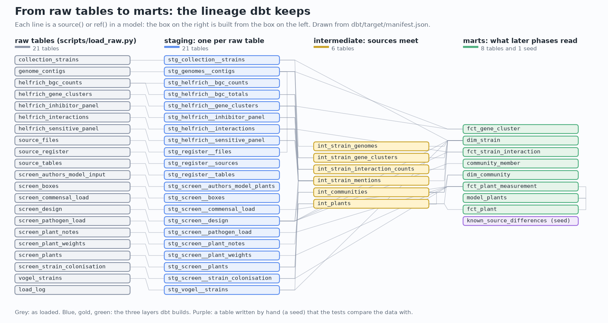
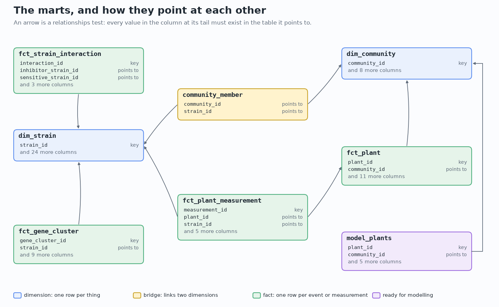

[Handbook](HANDBOOK.md) · [README](../README.md) · [Glossary](GLOSSARY.md) · [Architecture](00-architecture.md) · [Roadmap](ROADMAP.md)

# 04 · Phase 3: harmonise everything with dbt

**Prerequisites:** Phases 1 and 2 done ([`docs/02-phase-1-data-acquisition.md`](02-phase-1-data-acquisition.md), [`docs/03-phase-2-more-sources.md`](03-phase-2-more-sources.md)), so `data/raw/extracted/` holds the unpacked archive and `data/raw/sources/` the other four layers. You're in the project folder, `(.venv)` shows in your prompt, and `git status` says you're on `develop`.

**Learning goal:** after this phase you'll be able to explain what harmonising data means and why it belongs in the open; load tables into a database without changing them; read and write dbt models in three layers; write data tests and say what each kind catches; read a lineage graph; and turn a decision about data into a setting with a written reason. You'll have one warehouse in which all five layers meet on one strain name and one community name, checked by 187 tests on every build.

**Time:** two to three hours, most of it reading SQL files. **Download:** two Python packages and what they need, a few minutes. **Disk space:** about 20 MB for the warehouse, and some more for the packages.

**Where this sits:** Stage 5 of the [Handbook](HANDBOOK.md#stage-5-phase-3-harmonise-everything-with-dbt).

---

## Contents

- [1. The ideas behind this phase](#1-the-ideas-behind-this-phase)
- [2. What dbt is, from zero](#2-what-dbt-is-from-zero)
- [3. One strain name, one community name](#3-one-strain-name-one-community-name)
- [4. The files for this phase](#4-the-files-for-this-phase)
- [5. Step 1: install dbt and check the workshop](#5-step-1-install-dbt-and-check-the-workshop)
- [6. Step 2: load the raw tables](#6-step-2-load-the-raw-tables)
- [7. Step 3: the dbt project, file by file](#7-step-3-the-dbt-project-file-by-file)
- [8. The three Layer 1 choices](#8-the-three-layer-1-choices)
- [9. Step 4: build and test everything](#9-step-4-build-and-test-everything)
- [10. Step 5: look at what was built](#10-step-5-look-at-what-was-built)
- [11. See it: the lineage, the data model and dbt's own pages](#11-see-it-the-lineage-the-data-model-and-dbts-own-pages)
- [12. Try it: change a choice, break a test](#12-try-it-change-a-choice-break-a-test)
- [13. Checkpoint: did the phase work?](#13-checkpoint-did-the-phase-work)
- [14. Notes from the build](#14-notes-from-the-build)
- [15. The tests](#15-the-tests)
- [16. Two ways to run everything](#16-two-ways-to-run-everything)
- [17. Same task, different language (optional, 10 minutes)](#17-same-task-different-language-optional-10-minutes)
- [18. What could go wrong (mini-FAQ)](#18-what-could-go-wrong-mini-faq)
- [19. Save your work](#19-save-your-work)
- [20. What you learned, and what's next](#20-what-you-learned-and-whats-next)

---

## 1. The ideas behind this phase

Phases 1 and 2 brought every source home and changed nothing, on purpose: `data/raw/` is the untouched copy. But the files don't agree with each other yet, and Phase 2 already met the disagreements:

- The same strain is `Leaf73` in one column of Vogel *et al.* 2021's strain list and `73` in the next.
- Supplementary Table 9 of Helfrich *et al.* 2018 (Table S9 from here on: S for supplementary) counts 1,053 gene clusters; Table S11, which lists them one by one, has 1,050.
- Table S1 of the same workbook lists only the inhibitions that were seen. For a strain that was tested and has no row, the right answer is zero, and nothing in the file says so.
- Layer 1 leaves three decisions open: the undecided (`TBD`) plants, the two communities grown in every round, and the two communities with no plants left.

**Harmonising** means making the sources agree: one name for each thing, one shape for each kind of table, and a written rule for every disagreement. Moving your contacts to a new phone is a small version of it. One old phone saved a friend as "Sam Ortiz", the other as "Samuel O.", and before the new phone can show one card for Sam, something has to decide they're the same person. If that decision happens silently, nobody can check it later.

### Load first, then transform

There are two ways to organise this work, and they have names:

- **ETL** (extract, transform, load): reshape the data in a program, then store the result.
- **ELT** (extract, load, transform): store the data first, exactly as it is, then reshape it inside the database.

This project works the ELT way. Phases 1 and 2 were the extract. This phase **loads** every raw table into a database without changing a single value (`scripts/load_raw.py`), then **transforms** them with dbt, in SQL files that live in the repository. The raw tables stay in the database next to everything built from them, so any number can be traced back and compared.

### The database: a warehouse in one file

The database is DuckDB, the one `scripts/check_env.py` has checked since Stage 1. Here it becomes the project's **warehouse**: a database built for analysis, holding everything in one place. It's a single file, `data/warehouse/realsignal.duckdb`, inside `data/`, so Git ignores it like the rest of the data. Anyone can rebuild it from the raw files in about a minute.

### One rule for everything that follows

Nothing in the models knows that there are 35 strains, five strains per community, one pathogen or one measurement. The pool of strains is whatever the design file lists; the size of a community is counted from it; the outcome later phases predict is a setting. [Section 15](#15-the-tests) shows how that's tested: the whole pipeline runs on a made-up screen of four strains in communities of two, and gets it right.

---

## 2. What dbt is, from zero

**dbt** (data build tool) turns a folder of SQL files into a pipeline. This project uses **dbt Core**, the free, open-source program you run from the terminal. The architecture guide introduced it in [section 5](00-architecture.md#5-box-3-harmonisation-and-what-dbt-is); here are the pieces you'll meet in this phase.

**A model** is one SQL file holding one `select` statement. dbt runs it and stores the result under the file's name: `models/marts/dim_strain.sql` becomes the table `marts.dim_strain` (`marts` is the schema it goes into, [below](#the-layers)). You write what the table should contain; dbt writes the `create table` around it.

**`ref()` and `source()`.** Inside a model you never type another table's name directly. You write `{{ ref('stg_screen__plants') }}` for another model and `{{ source('raw', 'screen_plants') }}` for a raw table. dbt fills in the real name, and because it now knows which model reads which, it works out the order to build them in and can draw the whole chain as a diagram. That chain, which table is built from which, is called the **lineage**.

**Jinja.** The parts in `{{ }}` and `` are a template language called Jinja, filled in before the SQL runs. A **macro** is a reusable piece of it; this project has four, in three files in `dbt/macros/`, such as `strain_id()` ([section 3](#3-one-strain-name-one-community-name)).

**Views and tables.** A model can be stored as a **view**, a saved query that runs again each time something reads it, or as a **table**, whose rows are computed once and kept. Here the small steps are views and the final tables are tables (it's set once, in `dbt/dbt_project.yml`). A recipe card and a cooked dish in the fridge: the card costs nothing to keep and always reflects the current ingredients; the dish is ready to eat.

**Tests.** A dbt data test is a query that looks for rows breaking a rule. No rows means the test passes. They come in two forms:

- **Generic tests**, written as one line in a `.yml` file next to the model. Four kinds come with dbt (`unique`, `not_null`, `accepted_values` and `relationships`), and this project adds a fifth, `accepted_range` (`dbt/tests/generic/accepted_range.sql`).
- **Singular tests**, a whole SQL file of their own in `dbt/tests/`, for rules too big for one line, most of them across tables, such as "Layer 3's gene clusters sit inside Layer 2's contigs".

**Seeds.** A small CSV table you write yourself and commit, kept in `dbt/seeds/`. dbt loads it like any other table. This project has one: the list of places where two sources disagree ([section 9](#9-step-4-build-and-test-everything)).

**Documentation.** Every model and column has a description in the `.yml` files, and `dbt docs generate` turns them into pages you can browse ([section 11](#11-see-it-the-lineage-the-data-model-and-dbts-own-pages)).

**`dbt build`** does everything in order: loads the seed, builds each model, and runs that model's tests before anything that depends on it is built. A model whose test fails stops there, and the models after it are skipped, so a problem can't travel further down the chain.

### The layers

The warehouse is organised in five schemas (a **schema** is a named group of tables inside a database, like a folder):

| Schema | What it holds | Built by | Stored as |
|---|---|---|---|
| `raw` | every source table, unchanged, every value as text | `scripts/load_raw.py` | tables |
| `staging` | one model per raw table (Table S9 gives two: its class counts and its totals), renamed, typed, one spelling for every strain | dbt | views |
| `intermediate` | where sources meet, and where the three Layer 1 choices are applied | dbt | views |
| `marts` | the tables later phases read | dbt | tables |
| `reference` | the hand-written list of known disagreements (the seed) | dbt | table |

A library taking in donated books works in the same order. Each donation is catalogued as it arrives, every book given a label in the library's own format whatever the donor wrote inside the cover (staging). Then books from different donors are brought together by subject (intermediate). Finally a few shelves are set out in the reading room for visitors (marts).



---

## 3. One strain name, one community name

### How the sources write a strain

| Source | Where the strain is | Written as |
|---|---|---|
| Layer 1, the design (`20200828_Mixes.txt`) | the column headings | `Leaf15` |
| Layer 1, the strain counts on each plant | `Strain_ID` | `Leaf15` |
| Layer 1 archive, the strain list (`dataAtLSPHERE.txt`) | `Strain_ID` | `Leaf15` |
| Layer 2, the genomes | the file name, via `sources/files.csv` | `Leaf15` |
| Layers 3 and 4, Helfrich *et al.* 2018 | `Strain`, `Inhibitor`, `Sensitive` | `Leaf15` |
| Layer 5, Vogel *et al.* 2021, Supplementary Table 12 | `Strain` and `Strain_ID` | `Leaf15` and `15` |

So most sources already agree, and one writes a bare number. A rule that works today and also covers the spellings a new source might bring is cheap, so `dbt/macros/strain_id.sql` turns all of these into one form:

```
15, 15.0         -> Leaf15    (a bare number is a Leaf strain in these sources)
leaf15, Leaf 15  -> Leaf15    (any capitalisation, with a space, _ or - between)
Leaf15           -> Leaf15
Fr1              -> Fr1       (anything else stays as written, trimmed)
```

Every staging model that holds a strain wraps its strain column in the macro, for example `{{ strain_id('"Strain"') }} as strain_id`, so the rule lives in one file. A test checks that Supplementary Table 12's two columns give the same name on every row after it (`assert_vogel_strain_columns_agree`).

The same file has a second macro, `looks_like_strain()`. The journal sheets have footnotes under their tables, a `Total` row, and in one case the heading row repeated at the bottom. A row counts as a strain only when its first cell looks like a strain name (letters, then digits, or a bare number), so those rows stay in `raw` and never reach staging.

### The strains, all together

`intermediate.int_strain_mentions` lists every strain every staging model names, and `marts.dim_strain` has one row for each: 285 strains. They're the 284 strains of the Layer 1 archive's strain list (the 224 strains of the *At*-LSPHERE collection and 60 more, in groups the list calls `extended`, `control` and `other`), plus `Fr1`, a strain from outside the collection that Vogel *et al.* 2021 used as a positive control. The column `in_screen_library` marks the 35 strains of the community screen. It's computed from the design, never typed in.

### Communities

Communities have one name already: `Mix1` to `Mix207` (206 communities of five strains, and `Mix71`, which holds all 35), plus `axenic` (none). That name is `community_id` everywhere. The plant file also gives a label for figures (`SynCom-High` for `Mix69`, `SynCom-Low` for `Mix70`, `SynCom-35` for `Mix71`), which `dim_community` keeps as `label`.

---

## 4. The files for this phase

New:

| File | What it does |
|---|---|
| `sources/tables.csv` | every raw table to load: its source, file, sheet and heading row |
| `scripts/load_raw.py` | loads them into the warehouse unchanged ([section 6](#6-step-2-load-the-raw-tables)) |
| `src/realsignal/helpers.py` | the small helpers three programs share ([below](#the-shared-helpers-move-into-srcrealsignal)) |
| `dbt/dbt_project.yml`, `dbt/profiles.yml` | the dbt project's settings, and where its database is ([section 7](#7-step-3-the-dbt-project-file-by-file)) |
| `dbt/models/staging/` | 21 staging models in six folders, one per source, with a `.yml` file each |
| `dbt/models/intermediate/` | 6 intermediate models and their `.yml` |
| `dbt/models/marts/` | 8 marts and their `.yml` |
| `dbt/models/overview.md` | the front page of dbt's documentation pages |
| `dbt/macros/` | `strain_id.sql`, `in_list.sql`, `generate_schema_name.sql` |
| `dbt/seeds/` | `known_source_differences.csv` and its `.yml` |
| `dbt/tests/` | 17 singular tests, and `generic/accepted_range.sql` |
| `dbt/README.md` | a short map of the dbt folder |
| `notebooks/explore_warehouse.py` | what the warehouse holds, from queries ([section 10](#10-step-5-look-at-what-was-built)) |
| `figures/make_phase3_figures.py` | draws `figures/lineage.png`, `figures/data_model.png` and `figures/plant_choices.png` ([section 11](#11-see-it-the-lineage-the-data-model-and-dbts-own-pages)) |
| `tests/test_helpers.py`, `tests/test_load_raw.py`, `tests/test_warehouse.py` | 18 more tests ([section 15](#15-the-tests)) |

Changed: `requirements.txt` (two new packages) and `requirements.lock.txt` (written again after installing them, [section 5](#5-step-1-install-dbt-and-check-the-workshop)), `scripts/check_env.py` (checks them too), `scripts/fetch_data.py` and `scripts/fetch_sources.py` (their helpers moved), `src/realsignal/__init__.py` (its description), `pytest.ini` (tests can import from `src/`), `.gitignore` (what dbt writes when it runs), `tests/test_docs.py` (it now also checks `.sql` and `.csv` files for look-alike characters), `figures/make_illustrations.py` (Stage 5 done on the journey map), and the Handbook, README, roadmaps, glossary, changelog and earlier guides, which describe the phase. The empty file `dbt/.gitkeep` is gone, because the folder now has files of its own.

### `sources/tables.csv`, column by column

Phase 2's `sources/files.csv` says which files to fetch. This table says which tables inside them to load, so adding a table means adding a row, and `scripts/load_raw.py` doesn't change.

| Column | Holds |
|---|---|
| `table_name` | its name in the `raw` schema (`screen_plants`) |
| `source_id` | the source in `sources/register.csv` it comes from |
| `format` | `tsv`, `xlsx` or `fasta_gz` |
| `path` | the file, from the project folder; for genomes, a pattern (`*_genomic.fna.gz`) |
| `sheet` | for a workbook, the sheet |
| `header_row` | the row holding the headings, numbered as a spreadsheet numbers it (the journal sheets have a title and a blank row above, so it's 3, and 4 for Table S4, [section 6](#reading-it)) |
| `what_it_holds` | in a sentence |

Layer 5's protection scores (Supplementary Table 1 of Vogel *et al.* 2021) aren't in the list on purpose: they wait for Phase 9, so they can't influence the models built before then. Only that workbook's strain list is loaded.

### The dbt folder

```
dbt/
├── dbt_project.yml          settings: layers, schemas and the choices (vars)
├── profiles.yml             where the database is
├── README.md                a map of this folder
├── macros/                  strain_id(), looks_like_strain(), in_list(), schema names
├── models/
│   ├── overview.md          the front page of the documentation pages
│   ├── staging/
│   │   ├── _sources.yml     the raw tables dbt starts from
│   │   ├── register/        sources/register.csv, files.csv, tables.csv
│   │   ├── screen/          Layer 1: design, boxes, plants, measurements
│   │   ├── collection/      Layer 1 archive: the strain list
│   │   ├── helfrich2018/    Layers 3 and 4
│   │   ├── vogel2021/       Layer 5: the strain list only
│   │   └── genomes/         Layer 2
│   ├── intermediate/        where the sources meet
│   └── marts/               what later phases read
├── seeds/                   known_source_differences.csv
└── tests/                   17 singular tests, and generic/accepted_range.sql
```

Model names follow a pattern that says where each one sits: `stg_<source>__<what>` for staging (two underscores between source and table), `int_` for intermediate, and in the marts `dim_` for a **dimension** (one row per thing: a strain, a community), `fct_` for a **fact** (one row per event or measurement: a plant, a weight, an inhibition), plus `community_member`, a **bridge table** that links the two dimensions (a community holds several strains, and a strain is in many communities), and `model_plants`, the table Phase 5 starts from. Each dimension has a **key**, the column that names each row once (`strain_id`, `community_id`), and the other tables point at it.

### The shared helpers move into `src/realsignal/`

Phase 2's fetcher repeated a few small helpers from Phase 1's (sizes in megabytes, paths shown from the project folder, section banners, checksums, reading and writing CSV tables), and said they'd move once a third program needed them. `scripts/load_raw.py` is that program, so they now live in `src/realsignal/helpers.py`, with their own tests, and all three scripts import them.

`scripts/` isn't a Python package, so each script first tells Python where the package is:

```python
PROJECT_ROOT = Path(__file__).resolve().parents[1]
sys.path.insert(0, str(PROJECT_ROOT / "src"))     # so Python finds src/realsignal/
from realsignal import helpers
```

`sys.path` is the list of folders Python searches for `import`; the line puts `src/` at the front. The tests get the same through a setting in `pytest.ini` (`pythonpath = src`). When the modelling code arrives in Phase 5, the package can become installable instead, and these lines go.

---

## 5. Step 1: install dbt and check the workshop

`requirements.txt` has two new lines:

```
dbt-core>=1.10,<2.0       # turns a folder of SQL files into a tested pipeline
dbt-duckdb>=1.9,<2.0      # lets dbt build its tables in DuckDB
```

`dbt-core` is dbt itself; `dbt-duckdb` is an **adapter**, the part that knows how to talk to one particular database. dbt has adapters for many databases, and this is the only line that would change for another one.

1. Install them, with `(.venv)` in your prompt:

   ```bash
   python -m pip install -r requirements.txt
   ```

   **You should see** a minute or two of downloads (dbt brings a few dozen packages of its own), ending with a line that starts `Successfully installed` and includes `dbt-core-1.12.5` and `dbt-duckdb-1.11.0` (or newer versions in the same range).

   On a Mac with Python from python.org, the install can stop instead, at a package called `dbt-core-experimental-parser`, with `CERTIFICATE_VERIFY_FAILED`. The fix takes one command ([mini-FAQ](#18-what-could-go-wrong-mini-faq)).

2. Record what you got, as after every install:

   ```bash
   python -m pip freeze > requirements.lock.txt
   ```

3. Check the workshop:

   ```bash
   python scripts/check_env.py
   ```

   **You should see** twelve packages where there were ten. The check now shows each package under the name pip installs it by, with the version pip recorded (this is the MacBook Pro the project was built on; your operating system line and version numbers will differ):

   ```
   ====================================================================
   RealSignal: environment check
   ====================================================================
   Operating system: Darwin 24.6.0
   --------------------------------------------------------------------
   [OK  ] Python 3.14 (need 3.11 or newer)
   [OK  ] Virtual environment: active
          Python program in use: .venv/bin/python3
   --------------------------------------------------------------------
   [OK  ] pandas       3.0.5       tables of data
   [OK  ] numpy        2.5.2       fast arithmetic
   [OK  ] openpyxl     3.1.5       reading Excel files
   [OK  ] duckdb       1.5.5       the local SQL database
   [OK  ] dbt-core     1.12.5      the harmonisation pipeline
   [OK  ] dbt-duckdb   1.11.0      lets dbt work with DuckDB
   [OK  ] scikit-learn 1.9.0       machine learning
   [OK  ] scipy        1.18.1      statistics
   [OK  ] matplotlib   3.11.1      charts
   [OK  ] requests     2.34.2      downloading the dataset
   [OK  ] streamlit    1.62.0      the interactive app
   [OK  ] pytest       8.4.2       automated tests
   ====================================================================
   ALL CHECKS PASSED. Your workshop is ready.
   Next: docs/HANDBOOK.md, the stage after the one you are on.
   ```

4. Ask dbt itself:

   ```bash
   dbt --version
   ```

   **You should see:**

   ```
   Core:
     - installed: 1.12.5
     - latest:    1.12.5 - Up to date!

   Plugins:
     - duckdb: 1.11.0 - Up to date!
   ```

   `Plugins` is dbt's word for the adapters you have. (It looks the latest versions up online, so without a connection those lines say it couldn't check; that's harmless.)

---

## 6. Step 2: load the raw tables

1. See what will be loaded, without loading anything (from the project folder):

```bash
python scripts/load_raw.py --list
```

**You should see** every row of `sources/tables.csv`: each table's name, where it comes from, and what it holds (shortened here with `...`):

```
======================================================================
RAW TABLES: sources/tables.csv
======================================================================
emmenegger2023_archive (files in data/raw/extracted/Data/):
  screen_design
    MetaData/Mini5SynComScreen/20200828_Mixes.txt
    the design: one row per community, one column per strain, 1 if the strain
    is in it
  ...
helfrich2018_supplement:
  helfrich_interactions
    41564_2018_200_MOESM3_ESM.xlsx, sheet Table_S1, headings in row 3
    every inhibition seen in the strain-against-strain screen, strong or weak
  ...
refseq_genomes:
  genome_contigs
    data/raw/sources/refseq_genomes/*_genomic.fna.gz
    one row per contig of every genome: its name, its length and how many of
    its letters are G or C

17 tables, plus the three tables in sources/. Nothing has been loaded.
```

2. Load them:

```bash
python scripts/load_raw.py
```

It takes a few seconds, most of it counting the letters of 34 genomes. **You should see:**

```
======================================================================
LOAD: the raw tables, exactly as the sources wrote them
======================================================================
Into data/warehouse/realsignal.duckdb, schema raw
the registers in sources/:
  source_register                  4 rows  11 columns
  source_files                    36 rows   9 columns
  source_tables                   17 rows   7 columns
emmenegger2023_archive:
  screen_design                  208 rows  36 columns
  screen_boxes                   240 rows   8 columns
  screen_plants                  960 rows   8 columns
  screen_plant_notes             960 rows   9 columns
  screen_pathogen_load           934 rows   4 columns
  screen_plant_weights           960 rows   3 columns
  screen_commensal_load          850 rows   3 columns
  screen_strain_colonisation    4120 rows   5 columns
  screen_authors_model_input     808 rows  41 columns
  collection_strains             284 rows  18 columns
helfrich2018_supplement:
  helfrich_interactions          725 rows  16 columns  Table_S1
  helfrich_inhibitor_panel       224 rows  62 columns  Table_S4
  helfrich_sensitive_panel       227 rows   4 columns  Table_S24
  helfrich_bgc_counts            210 rows  11 columns  Table_S9
  helfrich_gene_clusters        1050 rows   9 columns  Table_S11
vogel2021_supplement:
  vogel_strains                  226 rows   9 columns  ST12
refseq_genomes:
  genome_contigs                 865 rows   5 columns  34 files

======================================================================
SUMMARY
======================================================================
Tables loaded : 20 (17 from sources/tables.csv, 3 from sources/)
Rows loaded   : 13,908
Load log      : raw.load_log
Next          : cd dbt, then dbt build
```

### Reading it

**Every value is loaded as text**, exactly as the file has it. A plant's mark stays the word `TRUE`, a count of `007` would stay `007`, and only an empty cell becomes a missing value (written `NULL` in a database). A workbook stores a number such as twelve as a number, and the loader writes it the way the spreadsheet shows it, `12`. The column counts in the output are the file's own; the loader's `_row` comes on top. Deciding that a column holds numbers, dates or yes/no values is a transformation, so it happens in dbt, in a file you can read.

**The journal sheets keep everything below their headings.** Look at three counts. `helfrich_sensitive_panel` has 227 rows: 224 strains and three footnotes. `helfrich_bgc_counts` has 210: 207 strains, the `Total` row, the heading row repeated below it, and a lone average at the bottom. `vogel_strains` has 226: the 224 strains, `Fr1`, and the table's footnote. Staging sets those rows aside with `looks_like_strain()` (for Table 12 of Vogel *et al.*, by keeping only rows with a `Strain_ID`), where you can see it happen. Table S4 has its headings in row 4 (row 3 names the ten sensitive strains above them), and since each growth medium appears once per sensitive strain, the loader numbers the repeats: `R2A+M`, then `R2A+M_2`, and so on.

**One extra column, `_row`,** is the row number a spreadsheet program shows for that line. Any value in the warehouse can be found in its file in seconds: row 1053 of Table S11 is `_row = 1053` in `raw.helfrich_gene_clusters`.

**A genome isn't a table,** so for Layer 2 the loader writes one row per contig: the file, the contig's name (the first word after `>`), the rest of that line, its number of letters and how many of them are G or C. 865 contigs over 34 genomes. That's the one place the loader counts anything, and it's the least a FASTA file can be turned into.

**`raw.load_log`** records what was loaded: rows, columns, the file and, for a table read from one file, its SHA-256. A dbt test compares the two workbooks' checksums with the pins Phase 2 wrote in `sources/files.csv` ([section 9](#9-step-4-build-and-test-everything)), so the journal tables come from exactly the files Phase 2 checked. The genomes are one row for 34 files, without a checksum; Phase 2 checked each of them against NCBI's.

**Nothing is loaded unless every file is there,** and the whole load happens in one **transaction** (a group of changes the database applies all together or not at all), so a failed run never leaves a half-filled warehouse. Run it again and every table is replaced, never added to.

---

## 7. Step 3: the dbt project, file by file

From here until [section 10](#10-step-5-look-at-what-was-built), every dbt command runs **from inside the `dbt` folder**, because that's where dbt looks for its two settings files.

1. Go into it (the same on every system):

   ```bash
   cd dbt
   ```

   Your prompt now ends in `dbt`. You'll come back with `cd ..` in [section 10](#10-step-5-look-at-what-was-built).

### `dbt/dbt_project.yml`

Open it in VS Code. It names the project (`realsignal`), says which connection to use (`profile: realsignal`), where each kind of file lives, and how each layer is stored (`+materialized: view` for staging and intermediate, `table` for the marts, and `+schema:` for the schema each goes into). Two blocks deserve a closer look.

```yaml
flags:
  send_anonymous_usage_stats: false
```

dbt Core sends anonymous usage statistics to the company that makes it unless told not to. This project keeps everything on your computer, so it's off.

```yaml
vars:
  keep_undecided_plants: true
  test_rounds: ["Exp3"]
  no_pathogen_code: "NI"
  outcome_measurement: "pathogen_log10_cfu_per_g"
```

**Vars** (variables) are settings the models read with `var('keep_undecided_plants')`. Each one is a decision someone may want to change, so it sits here with its reason instead of inside a SQL file. The first is Choice 1 of [section 8](#8-the-three-layer-1-choices). `test_rounds` says which round's new communities are kept back for testing; `no_pathogen_code` is how the plant file writes "no pathogen given"; `outcome_measurement` names the measurement later phases predict. A var can be changed for one run without editing the file, which [section 12](#12-try-it-change-a-choice-break-a-test) does.

### `dbt/profiles.yml`

```yaml
realsignal:
  target: local
  outputs:
    local:
      type: duckdb
      path: ../data/warehouse/realsignal.duckdb
      threads: 4
```

A **profile** is a connection: which kind of database and where. This one is a DuckDB file, so there's no server, password or account. The path starts with `../` because dbt reads it from the folder it runs in (`dbt/`), and the warehouse is one level up, in the project folder's `data/warehouse/`. `threads: 4` lets dbt build up to four models at once when none depends on another.

Many dbt projects keep `profiles.yml` in a hidden folder in the user's home folder, because a cloud warehouse's profile holds a password. This one holds only a path, so it lives in the repository and works for everyone who clones it. A file holding real passwords would never be committed; `.gitignore` and the safety gate guard against that.

### `dbt/macros/generate_schema_name.sql`

On its own, dbt would call the staging schema `main_staging` (the default schema's name, then the custom one). This five-line macro uses the custom name as it is, so queries read `marts.dim_strain`.

2. Check that dbt can find both files and reach the database:

   ```bash
   dbt debug
   ```

   **You should see** a list of checks ending in `All checks passed!`. The lines that matter (yours start with the time, and show your own folders where this shows `...`):

   ```
   Running with dbt=1.12.5
   dbt version: 1.12.5
   python version: 3.14.7
   ...
   Using profiles.yml file at .../realsignal/dbt/profiles.yml
   Using dbt_project.yml file at .../realsignal/dbt/dbt_project.yml
   adapter type: duckdb
   adapter version: 1.11.0
   Configuration:
     profiles.yml file [OK found and valid]
     dbt_project.yml file [OK found and valid]
   Required dependencies:
    - git [OK found]

   Connection:
     database: realsignal
     schema: main
     path: ../data/warehouse/realsignal.duckdb
     ...
     Connection test: [OK connection ok]

   All checks passed!
   ```

### The same models on another database (not built here)

Because every model reaches its tables through `ref()` and `source()`, pointing them at another database means adding a second output to `profiles.yml` and choosing it with `--target`. Most of the SQL would carry over, but not all of it: a few DuckDB conveniences used here (`UNPIVOT ... ON COLUMNS(* EXCLUDE ...)`, `regexp_full_match`, `string_agg` with `order by`) would need their equivalents. [The roadmap](ROADMAP.md#6-tools-left-out-on-purpose-and-why) keeps a cloud warehouse as an optional exercise, and this phase doesn't build it.

---

## 8. The three Layer 1 choices

Phase 2 ([section 5](03-phase-2-more-sources.md#what-this-settles-and-what-it-leaves-for-later)) left three questions that have to be settled before any model is trained. Each one is settled here, in a named place, with its reason and a test.


### Choice 1: the undecided (`TBD`) plants are kept

**The question.** 144 infected plants are marked `TBD`, "to be decided". The 2020 notes say why: their boxes were dropped (most three days after infection) and the plants recovered. 120 of them are in communities that later phases use.

**What the files say.** The plants were recovered, and nothing in the 2023 plant file decides against them. The authors' own machine-learning tables keep all 120 (Phase 2 rebuilt their choice of plants exactly).

**What leaving them out would cost.** A dropped box takes all four plants of a community in that round with it. Leaving out the `TBD` plants leaves 688 plants instead of 808, and leaves 22 training and 12 test communities with no plants at all, against 2 now. (The setting below lets you see this for yourself in [section 12](#12-try-it-change-a-choice-break-a-test).)

**What I chose.** Keep them, which is what the authors' tables do, because a rebuild has to start from the same plants before it can say anything about them. I made it a setting, `keep_undecided_plants: true` in `dbt/dbt_project.yml`, so Phase 5 can rerun with `false` and report whether the conclusion depends on these plants.

**The test.** `assert_model_plants_match_authors_table` compares `marts.model_plants` with the authors' table plant by plant. With the setting at `true` they must be identical; at `false`, ours must be theirs minus the `TBD` plants.

### Choice 2: the two reference communities are test communities, from round 3 only

**The question.** `Mix69` (`SynCom-High`) and `Mix70` (`SynCom-Low`) were grown in all three rounds, so they appear in rounds that otherwise hold training communities.

**What the paper says.** The test set is 70 new random communities, none of which had a composition present in the training sets ([Emmenegger *et al.* 2023](https://doi.org/10.1038/s41467-023-43793-z)). The 70 are the 68 new ones of round 3 plus these two, so their plants from rounds 1 and 2 can't be training plants. The paper also names SynCom-Low and SynCom-High, from its pilot experiment, among the controls grown in each experiment. The authors' machine-learning table counts their round 3 plants with the test communities (Phase 2 found this), and this phase follows the table; Phase 6 checks it against the authors' R code.

**What I chose.** A community grown in a test round is a test community (`role = 'test'` in `marts.dim_community`). A test community's plants from the test round are test plants. The 16 plants of `Mix69` and `Mix70` from earlier rounds (8 each) get their own split, `between-round reference`, and are never used for training or testing. They stay in `marts.fct_plant` because they're useful for something else: the same community measured in every round shows how much the rounds differ, which Phase 4 looked at ([`docs/05-phase-4-exploration.md` section 5](05-phase-4-exploration.md#5-question-2-how-much-the-rounds-differ): about one log unit higher in round 2 than in round 1). Nothing names `Mix69` or `Mix70`: the rule follows from which rounds each community was grown in, and `test_rounds` says which rounds are for testing.

**The test.** `assert_no_community_on_both_sides` fails if any community has modelling plants in both training and test. If that happened, a model would be scored on a community it had already learnt from, which is the leakage [the architecture guide](00-architecture.md#8-box-6-evaluation-or-how-a-model-fools-its-maker) warns about.

### Choice 3: the two communities with no plants left stay in the tables

**The question.** Every plant of `Mix54` (round 1) and `Mix73` (round 2) is marked `FALSE`. They can't be used, but the design made them.

**What I chose.** They keep their rows in `marts.dim_community`, with `role = 'training'`, `plants_for_modelling = 0` and `has_plants_for_modelling = false`. So the warehouse answers both questions: the design made 136 training communities, and 134 of them have plants to learn from. Dropping the two rows would make the first number unanswerable from the warehouse and quietly change what "the training set" means.

**The test.** None needed for the rows themselves (`dbt build` checks every community has a role); `notebooks/explore_warehouse.py` reports both numbers, and Phase 6 checks all three choices against the authors' R code.

---

## 9. Step 4: build and test everything

1. Build every model and run every test, still inside `dbt/`:

```bash
dbt build
```

It takes about ten seconds. **You should see** (shortened with `...`; the times at the start of each line will be yours, and lines arrive in a slightly different order on every run because four are built at once):

```
01:02:28  Running with dbt=1.12.5
01:02:28  Registered adapter: duckdb=1.11.0
01:02:28  Unable to do partial parsing because saved manifest not found. Starting full parse.
01:02:32  Found 35 models, 187 data tests, 1 seed, 21 sources, 505 macros
01:02:32
01:02:32  Concurrency: 4 threads (target='local')
01:02:32
01:02:32  1 of 223 START sql view model staging.stg_collection__strains .................. [RUN]
...
01:02:32  1 of 223 OK created sql view model staging.stg_collection__strains ............. [OK in 0.16s]
...
01:02:33  21 of 223 OK loaded seed file reference.known_source_differences ............... [INSERT 20 in 0.21s]
...
01:02:35  121 of 223 OK created sql view model intermediate.int_communities .............. [OK in 0.11s]
...
01:02:37  173 of 223 OK created sql table model marts.dim_strain ......................... [OK in 0.20s]
...
01:02:38  218 of 223 PASS assert_model_plants_match_authors_table ........................ [PASS in 0.07s]
...
01:02:38  Finished running 1 seed, 8 table models, 187 data tests, 27 view models in 0 hours 0 minutes and 6.00 seconds (6.00s).
01:02:38
01:02:38  Completed successfully
01:02:38
01:02:38  Done. PASS=223 WARN=0 ERROR=0 SKIP=0 NO-OP=0 REUSED=0 TOTAL=223
```

**Reading it.** 35 models, 1 seed and 187 tests make 223 steps, and all 223 passed. Each step has a `START` line when it begins and an `OK` or `PASS` line when it ends. `21 sources` is the 20 raw tables plus `raw.load_log`. (`505 macros` counts the ones that come with dbt and the adapter; five are this project's: the four macros and the `accepted_range` test.) The models were built in the order `ref()` and `source()` imply: staging first, then intermediate, then marts, with each model's tests run as soon as it exists. The line about partial parsing shows up on the first build: dbt keeps what it read last time in `target/` and afterwards rereads only the files that changed. It reads everything again when there's nothing kept yet, or when a setting has changed (as in [section 12](#12-try-it-change-a-choice-break-a-test)).

### The tests, by kind

| Kind | How many | What it catches here |
|---|---|---|
| `not_null` | 86 | a key, a mark, a measurement or a count that's missing |
| `unique` | 38 | a strain, plant, community, contig or gene cluster listed twice |
| `relationships` | 20 | a reference that points nowhere: a plant's community missing from `dim_community`, an inhibition by a strain missing from `dim_strain` |
| `accepted_values` | 19 | a value outside its list: a mark that isn't `TRUE`, `FALSE` or `TBD`, a split or role nobody defined |
| `accepted_range` | 7 | a number outside what's possible: GC content outside 20 to 80 %, a log count outside 0 to 12, a negative count |
| singular | 17 | rules too big for one line, most of them across tables, below |

The singular tests, one line each:

| Test (in `dbt/tests/`) | Fails if |
|---|---|
| `assert_model_plants_match_authors_table` | the rebuilt choice of plants differs from the authors' table (Choice 1) |
| `assert_no_community_on_both_sides` | a community has modelling plants in training and in test (Choice 2) |
| `assert_screen_communities_share_one_size` | the screen's communities don't all hold the same number of strains (the number itself isn't written anywhere) |
| `assert_gene_cluster_counts_differ_only_where_known` | Tables S9 and S11 disagree about a strain that isn't on the list of known differences, or a listed difference has gone |
| `assert_bgc_total_row_matches_strain_rows` | a strain's classes in Table S9 don't add up to its Total, or the Total row doesn't add up the strains |
| `assert_gene_clusters_lie_inside_their_contigs` | a gene cluster of a strain with a genome isn't on one of that genome's contigs, or runs past its end |
| `assert_taxonomy_differs_only_where_known` | the two strain lists disagree on phylum or class at all, or on family or genus anywhere not on the list |
| `assert_interaction_panels_agree` | the inhibitor and sensitive panels list different strains, or Table S1 names a strain on neither |
| `assert_genome_files_match_strain_list` | a screen strain's genome in `sources/files.csv` and in Supplementary Table 12 differ, or disagree with the archive about whether one was published, or a genome wasn't loaded |
| `assert_loaded_workbooks_match_pins` | a workbook in the warehouse doesn't have the SHA-256 pinned in Phase 2 |
| `assert_log10_values_match_counts` | a log10 value isn't the log10 of the count beside it |
| `assert_box_and_plant_files_agree` | a plant's community, infection or round differs from its box's |
| `assert_marks_only_moved_from_tbd_to_false` | a plant's mark changed between 2020 and 2023 in any way other than `TBD` to `FALSE` |
| `assert_weights_positive_for_plants_in_analysis` | a plant still in the analysis weighs zero or less |
| `assert_colonisation_only_for_members` | a strain is counted on a plant whose community doesn't hold it |
| `assert_every_raw_table_is_registered` | a raw table's source isn't in the register, or something was loaded that `sources/tables.csv` doesn't list |
| `assert_vogel_strain_columns_agree` | Supplementary Table 12's two strain columns give different names |

### What Phase 2 asked this phase to settle

**Table S9 against Table S11.** Phase 2 found that S9 counts 1,053 gene clusters and S11 lists 1,050. The difference is three strains, one cluster each: Leaf61 (11 against 10), Leaf130 (7 against 6) and Leaf182 (12 against 11), and Leaf182 is one of the screen's 35. Neither table is broken inside: S11 numbers each of those strains' clusters from 1 without a gap, and in S9 each strain's classes add up to its Total and the Total row adds up the strains. The two tables disagree with each other, and the warehouse records both counts in `dim_strain` (`clusters_reported` from S9, `clusters_listed` from S11) instead of picking one.

**Zero, not unknown.** Of the screen strains, Leaf168, Leaf371 and Leaf454 have no row in Table S1 (27 strains of the whole collection have none). Tables S4 and S24 list the same 224 strains as inhibitors and as sensitive strains, all 35 screen strains among them, so these three were screened and nothing was seen: `inhibits = 0` and `inhibited_by = 0`. A strain that wasn't screened gets `NULL` instead. The test `not_null` on those columns applies only where `in_interaction_screen` is true.

**Leaf21 without a genome.** No genome in `sources/files.csv`, no accession in Supplementary Table 12, and the archive's strain list says its genome wasn't published (`no`). Three sources agree, so `assert_genome_files_match_strain_list` passes, and `dim_strain` has `has_genome = false` for it, with its gene-cluster columns empty.

### The seed: where sources disagree

`dbt/seeds/known_source_differences.csv` has 20 rows. Three are the gene-cluster counts above. The other 17 compare the two strain lists, the Layer 1 archive's and Vogel *et al.* 2021's, for the 224 strains both hold: they agree on phylum and class for every one, and differ on the family of 7 strains and the genus of 10. Supplementary Table 12's footnote says its genera follow NCBI's taxonomy, which renames groups as it learns more, so a list from a few years later can use newer names; the footnote also marks with `*` the genera taken from Bai *et al.* 2015 instead, and none of the ten differing genera carries it. For three of the seven families (Leaf187, Leaf196 and Leaf220), Vogel's list says `unclassified` instead of a newer name. Two of the archive's "families" are `Bacillales`, which is an order, one level up. Six screen strains are among the 20: Leaf182, Leaf187, Leaf220, Leaf354, Leaf380 and Leaf454.

`dim_strain` takes its taxonomy from the archive's list, because that's the list of the study being rebuilt, and keeps Vogel's family and genus beside it (`family_vogel2021`, `genus_vogel2021`). The two tests that use the seed fail on a disagreement nobody has looked at, and also on a listed one that has disappeared, which would mean a source changed.

### Two more things the tests turned up

- **Every gene cluster sits where it should.** All 191 gene clusters of the 34 strains with a genome lie on a contig of that strain's genome (Table S11's `LMNQ01000003.1`, a contig of Leaf122, is the genome file's `NZ_LMNQ01000003.1`), and none runs past the contig's end.
- **A weight below zero.** The two missing plants have weights of 0.7 mg and -0.4 mg. The raw weighing file says why: for plant `25_2` the tube weighed 1806.7 mg empty and 1806.3 mg at harvest, with the comment `empty`, so there was nothing to weigh. Both plants are marked `FALSE`, so the test allows a weight of zero or less only for plants already left out.



---

## 10. Step 5: look at what was built

### Your first SQL query

[The architecture guide](00-architecture.md#6-box-4-storage-and-why-there-are-two-databases-and-a-graph) promised that this phase is where you'd write your first SQL query: *for each strain, count the communities it appears in, most first*. `dbt show` runs a query against the warehouse and prints the result.

1. Still inside `dbt/`, run the question as a query (it's one long line; copy all of it):

```bash
dbt show --inline "select strain_id, count(*) as communities from marts.community_member group by strain_id order by communities desc, strain_id" --limit 5
```

**You should see**, after a few lines about connecting:

```
Previewing inline node:
| strain_id | communities |
| --------- | ----------- |
| Leaf339   |          38 |
| Leaf380   |          38 |
| Leaf76    |          37 |
| Leaf68    |          36 |
| Leaf182   |          35 |
```

Phase 2 said each strain is in 19 to 37 communities, and here the top is 38. The difference is `Mix71`, which holds all 35 strains and so adds one to every count. Leaving out the controls takes a join (a query that combines two tables on a shared column).

2. Run the query again, joined to `dim_community` to keep only the screen's communities:

```bash
dbt show --inline "select m.strain_id, count(*) as communities from marts.community_member as m join marts.dim_community as c on c.community_id = m.community_id where c.kind = 'community' group by m.strain_id order by communities desc, m.strain_id" --limit 5
```

**You should see:**

```
| strain_id | communities |
| --------- | ----------- |
| Leaf339   |          37 |
| Leaf380   |          37 |
| Leaf76    |          36 |
| Leaf68    |          35 |
| Leaf182   |          34 |
```

Now it matches Phase 2. (`marts.dim_strain` already has the answer in its column `communities_designed`; here, writing the query is the exercise.)

### What the warehouse holds

3. Go back to the project folder:

   ```bash
   cd ..
   ```

4. Run the explorer:

   ```bash
   python notebooks/explore_warehouse.py
   ```

   **You should see:**

   ```
   THE WAREHOUSE: data/warehouse/realsignal.duckdb

   Schemas, in the order data flows through them
     raw           21 tables
     staging       21 views
     intermediate  6 views
     marts         8 tables
     reference     1 table

   The strains (marts.dim_strain)
     named by any source         : 285
     in the community screen     : 35
     screen strains with a genome: 34 (none for Leaf21)
     in the interaction screen   : 224, 35 of the 35 screen strains among them
     no inhibition seen, given or received: Leaf168, Leaf371, Leaf454
     their genomes: 2.94 to 6.85 Mb, 3 to 98 contigs, GC 33.4 to 74.2 %

   The communities (marts.dim_community)
     role      kind            communities  with plants for modelling
     training  community               136                        134
     test      community                70                         70
     control   no strains                1                          0
     control   whole library             1                          0
     strains per community: 5
     grown in more than one round: Mix69 (SynCom-High), Mix70 (SynCom-Low)
     communities with no plant for modelling: 2
       Mix54 in Exp1, Mix73 in Exp2

   The plants (marts.fct_plant)
     split                      plants   used for modelling
     training                      544                  531
     test                          280                  277
     between-round reference        16                    0
     control                       120                    0
     why the others aren't used:
        120  control plant
         16  grown before the test round; its community is a test community
          8  marked FALSE: fungal contamination
          6  marked FALSE: box dropped
          2  marked FALSE: missing plant

   The modelling table (marts.model_plants)
     plants      : 808 (training 531, test 277)
     communities : 204 (training 134, test 70)
     undecided (TBD) plants in it: 120
     outcome     : pathogen_log10_cfu_per_g, present for 808 of 808
     the same plants as the authors' table: yes

   Measurements (marts.fct_plant_measurement)
     measurement                    plants    rows  unit
     commensal_cfu_per_g              850     850  CFU per g fresh weight
     commensal_log10_cfu_per_g        850     850  log10 CFU per g fresh weight
     fresh_weight                     960     960  mg
     fresh_weight_normalised          960     960  normalised by the authors
     pathogen_cfu_per_g               934     934  CFU per g fresh weight
     pathogen_log10_cfu_per_g         934     934  log10 CFU per g fresh weight
     pathogen_log10_normalised        934     934  normalised by the authors
     strain_cfu_per_g                 824    4120  CFU per g fresh weight
     strain_log10_cfu_per_g           824    4120  log10 CFU per g fresh weight

   Where the sources disagree (reference.known_source_differences)
     gene_cluster_count  Leaf61, Leaf130, Leaf182
     family              7 strains
     genus               10 strains
     of them, screen strains: Leaf182, Leaf187, Leaf220, Leaf354, Leaf380, Leaf454
   ```

### Reading it, part by part

**The strains.** 285 strains, 35 in the screen. Everything Phase 2 found about the screen strains is now a column: 34 with a genome, all 35 in the interaction screen, three with no inhibition seen either way, and the genomes' range of sizes and GC content.

**The communities.** 136 training and 70 test communities, with 134 and 70 of them having plants to learn from or be scored on. Every community of the screen holds 5 strains; the explorer counted that from the design, and so did the models.

**The plants.** Every one of the 960 plants is in one split. The 120 control plants are the 84 with no strains and the pathogen, the 24 with neither, and the 12 with all 35 strains. Each plant not used for modelling says why, in words, in the column `not_used_because`; the six `box dropped` plants are the ones that moved from `TBD` to `FALSE` between 2020 and 2023.

**The modelling table.** 808 plants, the same ones as the authors' table, 120 of them `TBD` (Choice 1). The outcome is `pathogen_log10_cfu_per_g`, the pathogen count on a log scale ([why a log scale](../figures/log_scale.png)), because `outcome_measurement` says so. Each of the 808 plants has one. The table holds no strain columns: Phase 5 adds one per strain from `community_member`, so the number of columns follows the library instead of being written into SQL.

**The measurements.** One long table: plant, measurement, value and unit, nine kinds of measurement in all. A long table grows by rows when a new kind of measurement arrives, which is why later phases can take another outcome without a change to the models. The two `normalised` measurements are the authors' own, kept as published; how they were normalised is a question for Phase 6.

---

## 11. See it: the lineage, the data model and dbt's own pages

1. Draw this phase's pictures, from the project folder:

   ```bash
   python figures/make_phase3_figures.py
   ```

   **You should see:**

   ```
     drew figures/lineage.png
     drew figures/data_model.png
     drew figures/plant_choices.png
   ```

   - `figures/lineage.png`, in [section 2](#the-layers), is drawn from `dbt/target/manifest.json`, the file in which dbt records every model, what it reads and every test. Add a model, build, and draw again: the picture follows.
   - `figures/data_model.png`, in [section 9](#two-more-things-the-tests-turned-up), draws the marts with their keys (the column that names each row, [section 4](#the-dbt-folder)), and an arrow for every `relationships` test between them.
   - `figures/plant_choices.png`, in [section 8](#8-the-three-layer-1-choices), counts the plants in the warehouse, so it changes with the choices.

2. Go into the dbt folder:

   ```bash
   cd dbt
   ```

3. Build dbt's own documentation pages:

   ```bash
   dbt docs generate
   ```

   **You should see** it end with `Catalog written to` and the path of `target/catalog.json`. The **catalog** is what dbt read from the database itself: every column's type and every table's size.

4. Open them in your browser:

   ```bash
   dbt docs serve
   ```

   **You should see** this, and your browser opens `http://localhost:8080` (if it doesn't, open that address yourself):

   ```
   01:06:46  Running with dbt=1.12.5
   Serving docs at 8080
   To access from your browser, navigate to: http://localhost:8080


   Press Ctrl+C to exit.
   ```

   `localhost` means your own computer, and 8080 is the **port**, a numbered door on it that this one program listens at: the pages are served from your machine to your machine, and nothing leaves it. While the page is open, dbt prints a line for every file the browser asks for; they start with `127.0.0.1`, the number every computer uses for itself. One of them ends in `404` (not found): the page asks for its little tab icon at an address that doesn't exist, and works without it.

   Things to try there: the project's front page (`dbt/models/overview.md`); any model, to read its description, its columns, its tests and its SQL; and the blue **lineage** button at the bottom right, which draws the same chain as `figures/lineage.png` and lets you click through it.

5. Stop the page server with **Ctrl+C** in the terminal (on a Mac too: Control, not Command).

   dbt 1.12.5 answers with `[ERROR]: Encountered an error:` and a dozen lines of traceback (the list of functions Python was inside) ending in `KeyboardInterrupt`. That's Python's name for "stopped with Ctrl+C", reported in dbt's error format; the server has stopped and nothing is wrong.

6. Go back to the project folder:

   ```bash
   cd ..
   ```

---

## 12. Try it: change a choice, break a test

Two short experiments. Each starts from the project folder and goes into `dbt/`, and each changes a setting for one run only; the file stays as it is. **Always finish with a plain `dbt build`**, so the warehouse matches the committed settings again.

### Leave the undecided plants out

1. Go into the dbt folder:

   ```bash
   cd dbt
   ```

2. Build once with the setting switched off:

   ```bash
   dbt build --vars "{keep_undecided_plants: false}"
   ```

   The build passes: the test of Choice 1 expects exactly this difference.

3. Back to the project folder, and look:

   ```bash
   cd ..
   python notebooks/explore_warehouse.py
   ```

The explorer now reports:

```
  communities with no plant for modelling: 34
  ...
  plants      : 688 (training 456, test 232)
  communities : 172 (training 114, test 58)
  undecided (TBD) plants in it: 0
  ...
  the same plants as the authors' table: no, 120 differ
    (expected while keep_undecided_plants is false: theirs keeps them)
```

That's the cost [section 8](#8-the-three-layer-1-choices) describes: 120 plants, and 32 more communities with nothing left.

### Pick the wrong test round

1. Go into the dbt folder again, and build with round 2 as the test round:

   ```bash
   cd dbt
   dbt build --vars "{test_rounds: [Exp2]}"
   ```

This tells the models that round 2 held the test communities. The models build without complaint, which is the danger with a wrong setting. One test catches it:

```
01:05:36  218 of 223 FAIL 16 assert_model_plants_match_authors_table ..................... [FAIL 16 in 0.06s]
...
01:05:36  Completed with 1 error, 0 partial successes, and 0 warnings:
01:05:36
01:05:36  [ERROR]: in test assert_model_plants_match_authors_table (tests/assert_model_plants_match_authors_table.sql)
01:05:36    Got 16 results, configured to fail if != 0
01:05:36
01:05:36    compiled code at target/compiled/realsignal/tests/assert_model_plants_match_authors_table.sql
01:05:36
01:05:36  Done. PASS=222 WARN=0 ERROR=1 SKIP=0 NO-OP=0 REUSED=0 TOTAL=223
```

The 16 plants are `Mix69` and `Mix70` again: with round 2 as the test round, their round 2 plants become test plants and their round 3 plants references, the reverse of the authors' table.

2. See the rows the test found (dbt shows five unless told otherwise, hence `--limit`):

   ```bash
   dbt show --select assert_model_plants_match_authors_table --limit 20
   ```

3. Put everything back with a plain build:

   ```bash
   dbt build
   ```

   **You should see** `Done. PASS=223 WARN=0 ERROR=0` again.

4. Back to the project folder:

   ```bash
   cd ..
   ```

---

## 13. Checkpoint: did the phase work?

- [ ] `python scripts/check_env.py` lists twelve packages, `dbt-core` and `dbt-duckdb` among them, and ends with `ALL CHECKS PASSED`
- [ ] `python scripts/load_raw.py` loads 20 tables, 13,908 rows
- [ ] inside `dbt/`, `dbt debug` ends with `All checks passed!`
- [ ] `dbt build` ends with `Done. PASS=223 WARN=0 ERROR=0 SKIP=0`
- [ ] `python notebooks/explore_warehouse.py` reports 136 training and 70 test communities, 134 and 70 with plants for modelling, 808 plants, and `the same plants as the authors' table: yes`
- [ ] `python figures/make_phase3_figures.py` draws three pictures
- [ ] `dbt docs serve` shows the documentation pages and the lineage graph
- [ ] after the experiments of [section 12](#12-try-it-change-a-choice-break-a-test), a plain `dbt build` passes again
- [ ] `pytest -q` passes (54 tests)
- [ ] `git status` shows nothing under `data/` or `dbt/target/`

---

## 14. Notes from the build

Things that really happened while this phase was built:

- **Python 3.14 and the DuckDB adapter.** dbt Core 1.12.5 lists Python 3.14 as supported; dbt-duckdb 1.11.0 lists Python up to 3.13 only. Before any model was written, both were installed on Python 3.14 in a fresh environment and a small project was run. It works (the adapter is plain Python), and everything in this phase was then built on 3.14.
- **dbt reads paths from where it's started.** A first trial ran dbt from the project folder with `--project-dir dbt`, and the database path in `profiles.yml` (relative to `dbt/`) pointed one folder too high: `IO Error: Cannot open file`. Rather than long commands with two folder options, every dbt command now runs from inside `dbt/`, where `profiles.yml` is found without being named.
- **A column called `check`.** The seed's first column was first named `check`, which SQL reserves for something else. Reading the file before the first build caught it, and it became `what_differs`.
- **Everything passed the first time, so it was broken on purpose.** The first full `dbt build` passed all 223 steps. A test that has never failed hasn't shown it can, so three mistakes were made on purpose: the undecided plants left out (the plant comparison adjusted, as it should), the wrong test round (that comparison failed with 16 plants), and a row deleted from the seed (the gene-cluster test failed). [Section 12](#12-try-it-change-a-choice-break-a-test) has two of them as exercises.
- **The cost of Choice 1 came from that experiment.** Leaving out the `TBD` plants costs 120 plants, and running it showed that it also leaves 34 communities with no plants, 32 more than before, because a dropped box holds all of a community's plants in that round. That number is now part of the reason for the choice.
- **A negative weight.** Checking the range of every measurement before writing its test turned up a plant weighing -0.4 mg. It's the empty tube of the missing plant `25_2`, so the test allows it for plants marked `FALSE` and nowhere else.
- **`GROUP BY ALL` and an expression in `ORDER BY`.** The first version of `notebooks/explore_warehouse.py` used `GROUP BY ALL` (DuckDB's shortcut for grouping by every column that isn't counted) and sorted the communities with an expression on a grouped column, and DuckDB refused (`column "role" must appear in the GROUP BY clause`). Naming the grouping columns fixed it.
- **dbt held on to the database.** The first version of `tests/test_warehouse.py` ran dbt inside the test's own Python process, and afterwards the test couldn't open the warehouse: dbt's connection was still open. The test now runs dbt as a separate program, which lets go of the file when it ends.
- **A test file that contained what it looks for.** The first version of `tests/test_load_raw.py` held the four look-alike characters themselves instead of their escape codes, and `tests/test_docs.py` failed on it.
- **Trailing spaces and an 88-character line.** The new loader test found spaces at the end of every line of `scripts/load_raw.py`'s output that names no sheet (the tables read from text files). Reading the `--list` output on the real table list found a line of 88 characters (the longest file name in the archive); each file now gets a line of its own, and a test checks the real list as well as the made-up one.
- **A line that left the lineage picture.** In the first draft of `figures/lineage.png`, a mart that reads another mart was drawn with a line that left the picture on the right and came back. Two tables in the same column are now joined by a loop on their right-hand side.
- **The first install on the Mac stopped at a certificate.** On Linux, `python -m pip install -r requirements.txt` installed dbt without trouble. On the MacBook Pro (Python 3.14.7 from python.org) it stopped while preparing `dbt-core-experimental-parser`, a package dbt 1.12 needs, with `CERTIFICATE_VERIFY_FAILED` for a download from GitHub. Reading that package's install code showed why it was the only one to fail: it fetches its real file during the install with Python's own downloader, while pip, which had downloaded everything else, carries its own certificate list. After Python's `Install Certificates.command` had run, the same install went through. The step is now part of installing Python in [`docs/01-setup.md`](01-setup.md#install-it).

---

## 15. The tests

```bash
pytest -q
```

**You should see:**

```
......................................................                   [100%]
54 passed in 37.87s
```

(The time varies, and it's longer than before because one test runs dbt twice. From Windows PowerShell it's `47 passed, 7 skipped`, for the reason given in [Phase 1](02-phase-1-data-acquisition.md#12-the-tests).) This phase adds 18 tests in three files.

`tests/test_helpers.py` (5) checks the shared helpers once: sizes in decimal units, paths shown from the project folder, the banner, both checksums against Python's own, and a CSV table that goes out and comes back unchanged, with its commas in quotes and plain line endings.

`tests/test_load_raw.py` (9) gives the loader a made-up project: a small tab-separated table, a workbook laid out like a journal's (a title, a blank row, headings in row 3, a heading that repeats, an empty row, a footnote) and a genome in two pieces. It checks that `--list` loads nothing; that `007`, `NA` and `TRUE` stay as written; that `_row` points at the right rows and the empty row is skipped; that 12.0 is loaded as `12`; that the genome's letters are counted per contig; that the load log holds the SHA-256 of each table read from one file; that a missing file means nothing is loaded; that a second run replaces instead of adding; and that the output is plain, without trailing spaces, and fits 80 columns, for the real `sources/tables.csv` too.

`tests/test_warehouse.py` (4) is the proof of the rule in [section 1](#one-rule-for-everything-that-follows). It writes a whole made-up screen, every raw file at its real path in a temporary folder and laid out like the real one: a library of 4 strains in communities of 2, with 2 plants to a box, two training communities, two test communities (one also grown in round 1, like the reference communities), a dropped box marked `TBD`, a plant marked `FALSE`, two strains with no inhibition and one with no genome. Then it runs the real `scripts/load_raw.py` and the real dbt project on it, and checks the sizes, kinds and roles of the communities, which plants were chosen and why, and the strain columns from every layer. Finally it builds again with `keep_undecided_plants` set to `false` and checks that the dropped box's community has no plants left. If a model had 35 or 5 written into it, these counts would come out wrong. (The seed and the tests that use it are left out of this build, since a made-up screen has other strains; they run on the real data in every `dbt build`.)

---

## 16. Two ways to run everything

| Capability | By hand, one step at a time | In one go |
|---|---|---|
| see what gets loaded | open `sources/tables.csv` in VS Code | `python scripts/load_raw.py --list` |
| load the raw tables | its function `read_one()`, from a Python session ([below](#running-the-loader-by-hand)) | `python scripts/load_raw.py` |
| build one model | `dbt run --select stg_screen__plants` (inside `dbt/`) | `dbt build` |
| build a model and everything after it | `dbt build --select int_plants+` | `dbt build` |
| run one model's tests | `dbt test --select model_plants` | `dbt build` |
| see the SQL dbt runs | `dbt compile --select int_plants`, then open the file under `dbt/target/compiled/` | n/a |
| look at a table | `dbt show --select dim_community` | `python notebooks/explore_warehouse.py` |
| ask your own question | `dbt show --inline "select ..."` | n/a |
| documentation pages | `dbt docs generate`, then `dbt docs serve` | n/a |

**`--select` and the `+`.** `--select int_plants` picks one model. A `+` after the name adds everything that depends on it, and a `+` before it everything it depends on: `--select +model_plants` builds `model_plants` and every model it needs, all the way back to the raw tables. dbt calls these **graph operators**, because they follow the lineage graph.

### Running the loader by hand

Start a Python session from the project folder with `python`, then:

```python
import sys
sys.path.insert(0, "scripts")
import load_raw
specs = load_raw.table_specs()
specs[0]                                   # the first row of sources/tables.csv
table = load_raw.read_one(specs[0])        # the design, as the loader reads it
table.head()
table.dtypes                               # every column text (str), _row a number (int64)
exit()
```

Nothing is written to the warehouse that way, so it's a safe way to see what a file looks like to the loader.

---

## 17. Same task, different language (optional, 10 minutes)

The question from [section 10](#your-first-sql-query), *how many communities of the design hold each strain?*, asked of the raw design file with pandas instead of the warehouse with SQL. From the project folder (the file's path starts there), start a Python session with `python` and paste:

```python
import pandas as pd

design = pd.read_csv("data/raw/extracted/Data/MetaData/Mini5SynComScreen/20200828_Mixes.txt",
                     sep="\t").set_index("Mix")
size = design.sum(axis=1)                                   # strains per community
communities = design[(size > 0) & (size < design.shape[1])] # leave out axenic and Mix71
print(communities.sum().sort_values(ascending=False, kind="stable").head(5))
exit()
```

**You should see:**

```
Leaf339    37
Leaf380    37
Leaf76     36
Leaf68     35
Leaf182    34
dtype: int64
```

The same numbers as the SQL version. The two ways of asking differ in two ways. pandas works on the wide table as the file has it, one column per strain, so "count per strain" is a sum down each column. SQL works on the long table `community_member`, one row per community and strain, so the same question is a `group by`. And SQL says *what* you want (these rows, grouped like this) while pandas says *how* (sum, sort, take five), which is part of why SQL can be read by people who don't program. The warehouse uses the long shape because it doesn't change when the library does; a wide table would need a new column for every new strain.

---

## 18. What could go wrong (mini-FAQ)

**The install stops at `dbt-core-experimental-parser` with `CERTIFICATE_VERIFY_FAILED`.** That package downloads its real file from GitHub while it installs, using Python's own downloader, and on a Mac a Python from python.org can't check GitHub's certificate until its certificates are installed (a step of its own after installing Python, [`docs/01-setup.md` section 3](01-setup.md#install-it)). pip stops before installing anything, so nothing needs undoing. Run this once, with your Python version in the folder name:

```bash
sh "/Applications/Python 3.14/Install Certificates.command"
```

It ends with ` -- update complete`. Check that Python can now reach GitHub:

```bash
python -c "import urllib.request; urllib.request.urlopen('https://github.com', timeout=30); print('certificates: OK')"
```

When it prints `certificates: OK`, run the install again. If the command isn't in your Applications folder, or you can't run it, give the installer the certificate list that's already in your virtual environment (the package `certifi`, which came with `requests`), for this one command:

```bash
SSL_CERT_FILE="$(python -m certifi)" python -m pip install -r requirements.txt
```

Elsewhere, and on a company network, see [`docs/01-setup.md` section 17](01-setup.md#17-troubleshooting).

**`dbt: command not found` (macOS, Linux) or `dbt is not recognized` (Windows).** The virtual environment isn't active, or the packages went somewhere else. Activate it (`source .venv/bin/activate`, or in PowerShell `.\.venv\Scripts\Activate.ps1`), then `python -m pip install -r requirements.txt`.

**`Error: Invalid value for '--profiles-dir': Path '/Users/<you>/.dbt' does not exist`**, or **`No dbt_project.yml found at expected path`**. You ran dbt from the project folder. Every dbt command runs from inside `dbt/`: `cd dbt`, then the command again.

**`Catalog Error: Table with name ... does not exist` during `dbt build`.** The raw tables aren't loaded. From the project folder, `python scripts/load_raw.py`, then `cd dbt` and `dbt build` again.

**`IO Error: Could not set lock on file ... Conflicting lock is held`.** The warehouse is open in another program, and DuckDB lets only one program write to a file at a time. Close the other one: a Python session that opened the warehouse, a database viewer, or a dbt command still running in another terminal. (`dbt docs serve` doesn't open the warehouse, so it can stay running.) `scripts/load_raw.py` says the same in plain words.

**A test fails.** dbt names it at the end, under `Completed with 1 error`. See the rows it found with `dbt show --select <the test's name> --limit 50` (without `--limit`, dbt shows five). The test's SQL, with every `ref()` filled in, is in the file `dbt/target/compiled/realsignal/tests/<name>.sql`. If you changed a var for an experiment, run a plain `dbt build` first; if it still fails, something in the data has changed: find out what before changing anything.

**`assert_loaded_workbooks_match_pins` fails.** A workbook in `data/raw/sources/` isn't the one Phase 2 pinned. Run `python scripts/fetch_sources.py`, which checks every file against its pin and says which one differs ([Phase 2 mini-FAQ](03-phase-2-more-sources.md#16-what-could-go-wrong-mini-faq)).

**`dbt docs serve` says the address is already in use.** Something else uses port 8080 ([section 11](#11-see-it-the-lineage-the-data-model-and-dbts-own-pages) explains ports). Pick another: `dbt docs serve --port 8081`, then open `http://localhost:8081`.

**`notebooks/explore_warehouse.py` says `No warehouse yet`, or that the marts aren't built.** Run `python scripts/load_raw.py`, then `dbt build` inside `dbt/`.

**`scripts/load_raw.py` says files aren't here yet.** Phase 1 or Phase 2 hasn't run on this computer: `python scripts/fetch_data.py` and `python scripts/fetch_sources.py`.

**`pytest -q` fails in `tests/test_docs.py` with `missing file ../figures/lineage.png`.** The guides link to pictures that `figures/make_phase3_figures.py` draws, and they haven't been drawn on this computer yet. Draw them first ([section 11](#11-see-it-the-lineage-the-data-model-and-dbts-own-pages)), then run the tests.

**`tests/test_warehouse.py` is slow, or skipped.** It runs dbt twice, which takes about half a minute. It's skipped where dbt isn't installed, so a skip there means the packages are missing.

**`git status` lists `dbt/target/` or `dbt/logs/`.** Your `.gitignore` is older than this phase. It should have the three `dbt/` lines shown in [`docs/01-setup.md` section 11](01-setup.md#11-keep-things-out-of-git-with-gitignore).

---

## 19. Save your work

This phase completes **v0.2.0**, the second version: every source fetched and harmonised in a tested dbt project. The changelog's Phase 2 entry, which waited under `[Unreleased]`, is now under `[0.2.0]` with this phase. Two blocks, in order, from the project folder.

**1. Check.** The pictures first, because the guides link to them, then the tests and the safety gate. Stop here if anything fails:

```bash
python figures/make_phase3_figures.py   # the three Phase 3 pictures
pytest -q                               # 54 passed
./check-public-safe.sh                  # must end with: SAFE TO PUSH (Windows: bash check-public-safe.sh in Git Bash)
```

**2. Save,** with the ritual from [`docs/GIT_WORKFLOW.md` section 6](GIT_WORKFLOW.md#6-the-end-of-phase-ritual), plus the tag:

```bash
git switch develop
git add -A
git commit -m "feat: harmonise all sources with dbt models and data tests"
git push origin develop develop:beta develop:master
## --tags is optional, only when required: this phase completes v0.2.0
git tag -a v0.2.0 -m "v0.2.0: every source harmonised in a tested dbt project"
git push origin develop develop:beta develop:master --tags
## then switch back to local master and pull in the remote changes
git switch master
git pull --ff-only origin master
git switch develop
```

**Check it worked:** `git log --oneline -1` shows your commit with `tag: v0.2.0`, `origin/master`, `origin/develop` and `origin/beta` beside it.

---

## 20. What you learned, and what's next

- What harmonising means, and why every decision in it belongs in a file someone can read
- ETL and ELT, and why this project loads the raw tables unchanged before transforming them
- dbt from zero: models, `ref()` and `source()`, Jinja and macros, views and tables, seeds, vars, `dbt build`
- Staging, intermediate and marts, and dimensions, facts and a bridge table
- Data tests of five generic kinds and singular tests, and why a test should be seen failing before it's trusted
- Turning a disagreement between sources into a written list that a test checks
- Making a decision about data a setting, with its reason and its cost, and a test that holds it
- Reading lineage, and building a data model that doesn't know how big the library is

**Next: Phase 4, exploration** ([`docs/05-phase-4-exploration.md`](05-phase-4-exploration.md)). With the data in one place and tested, the next phase looks at it properly, with the test set sealed: the distribution of the pathogen counts and its two humps, how the rounds differ (the reference communities grown in every round were kept for exactly this), missing values and outliers, one strain at a time, and a data-quality report that one script rebuilds. See [Stage 6 in the Handbook](HANDBOOK.md#stage-6-phase-4-explore-the-data).
