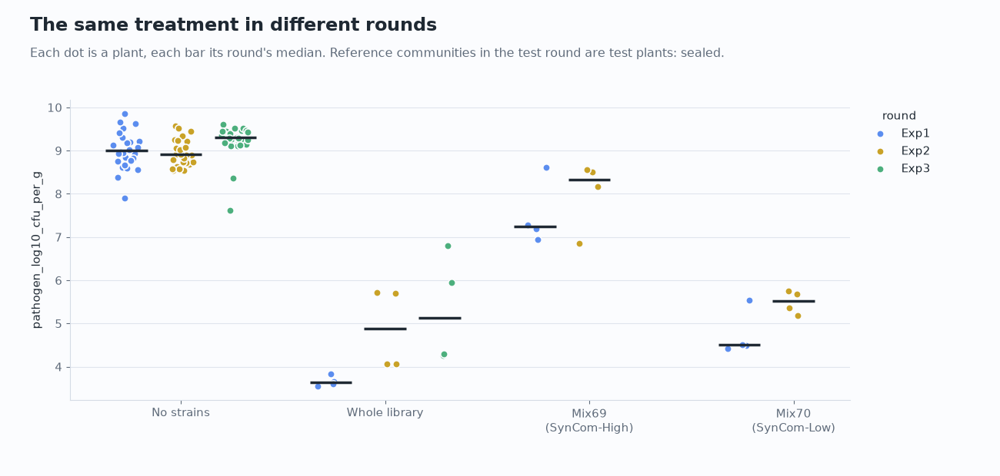
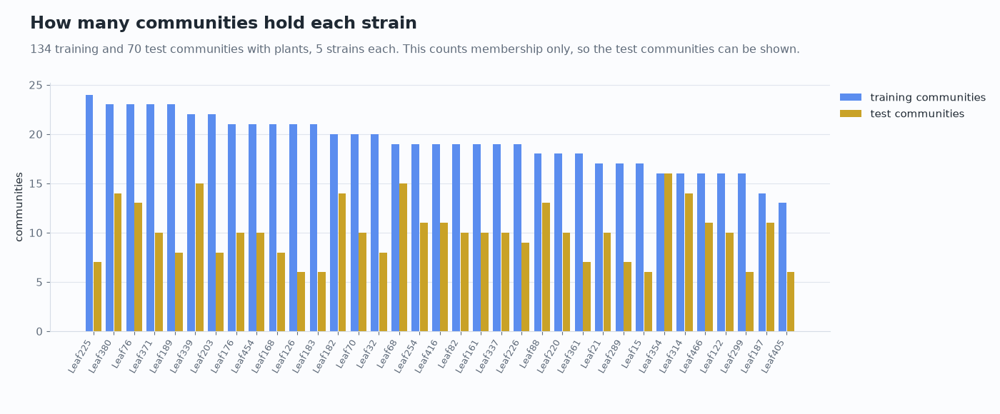
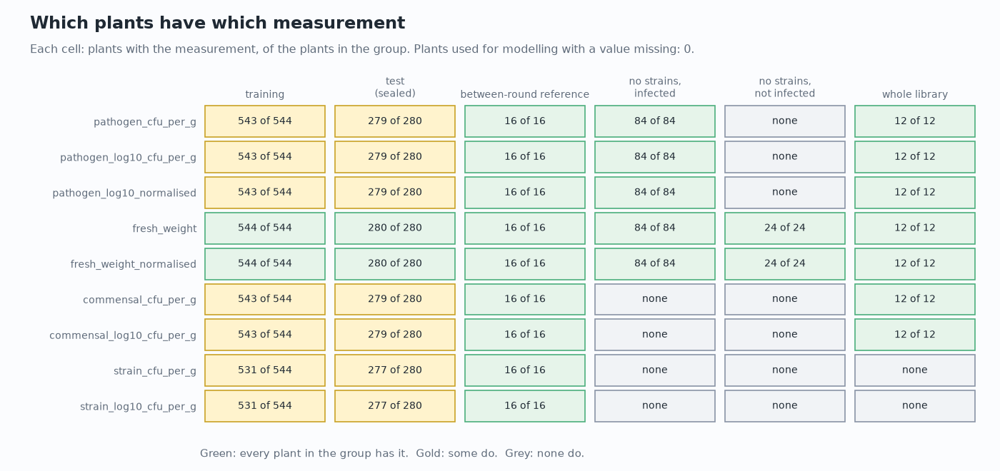
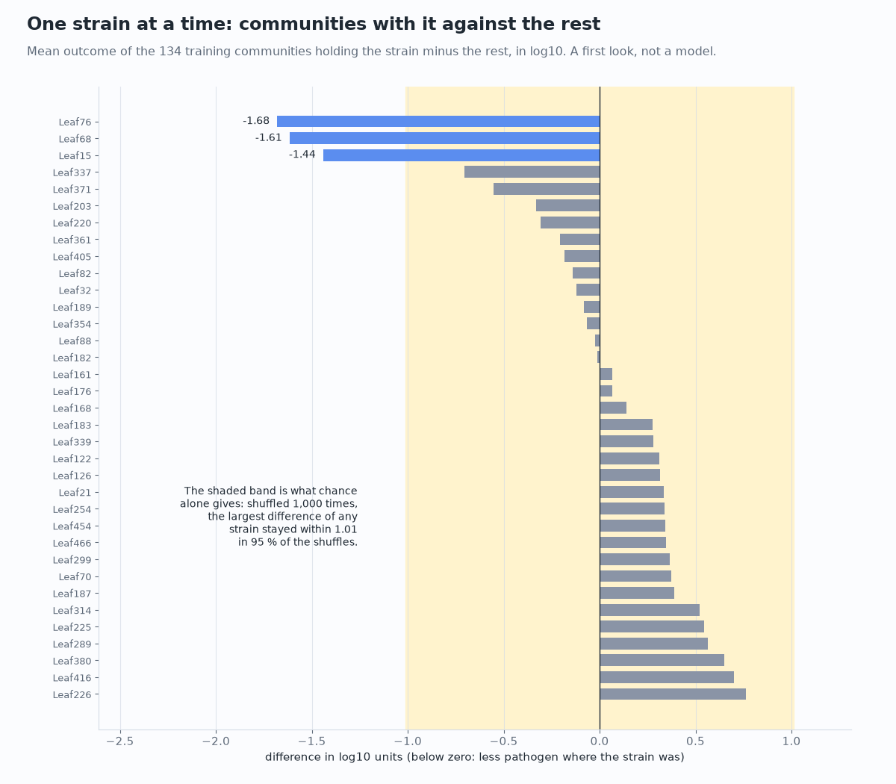

[Handbook](HANDBOOK.md) · [README](../README.md) · [Glossary](GLOSSARY.md) · [Architecture](00-architecture.md) · [Roadmap](ROADMAP.md)

# 05 · Phase 4: explore the data before modelling it

**Prerequisites:** Phase 3 done ([`docs/04-phase-3-harmonisation.md`](04-phase-3-harmonisation.md)): `python scripts/load_raw.py` and `dbt build` (inside `dbt/`) have run on this computer, so `data/warehouse/realsignal.duckdb` holds the marts. You're in the project folder, `(.venv)` shows in your prompt, and `git status` says you're on `develop`.

**Learning goal:** after this phase you'll be able to describe a set of numbers with a median, quartiles and a histogram, and say why the mean misleads for bacterial counts; read two humps in a distribution and count what falls on each side; tell a difference between rounds from a difference between communities; find missing values and outliers without deleting anything; estimate how much of the variation a model that knows only which strains a plant got could explain; check a difference against what chance alone produces, with a shuffle test; and keep a test set sealed so that the score it gives later still means something. You'll have a data-quality report that one script rebuilds byte for byte, and the project's first five pictures drawn from measured values.

**Time:** about an hour and a half, most of it reading output and pictures. **Download:** nothing; this phase needs no new packages. **Disk space:** under 1 MB.

**Where this sits:** Stage 6 of the [Handbook](HANDBOOK.md#stage-6-phase-4-explore-the-data).

---

## Contents

- [1. The ideas behind this phase](#1-the-ideas-behind-this-phase)
- [2. The files for this phase](#2-the-files-for-this-phase)
- [3. Step 1: run the explorer](#3-step-1-run-the-explorer)
- [4. Question 1: the shape of the outcome](#4-question-1-the-shape-of-the-outcome)
- [5. Question 2: how much the rounds differ](#5-question-2-how-much-the-rounds-differ)
- [6. Question 3: the design](#6-question-3-the-design)
- [7. Question 4: missing values, undecided plants and outliers](#7-question-4-missing-values-undecided-plants-and-outliers)
- [8. Question 5: how much plants of one community differ](#8-question-5-how-much-plants-of-one-community-differ)
- [9. Question 6: one strain at a time](#9-question-6-one-strain-at-a-time)
- [10. Question 7: how the other layers relate](#10-question-7-how-the-other-layers-relate)
- [11. Step 2: draw the pictures](#11-step-2-draw-the-pictures)
- [12. Step 3: write the data-quality report](#12-step-3-write-the-data-quality-report)
- [13. What this means for Phase 5](#13-what-this-means-for-phase-5)
- [14. Try it: another outcome, and a broken seal](#14-try-it-another-outcome-and-a-broken-seal)
- [15. Checkpoint: did the phase work?](#15-checkpoint-did-the-phase-work)
- [16. Notes from the build](#16-notes-from-the-build)
- [17. The tests](#17-the-tests)
- [18. Two ways to run everything](#18-two-ways-to-run-everything)
- [19. Same task, different language (optional, 10 minutes)](#19-same-task-different-language-optional-10-minutes)
- [20. What could go wrong (mini-FAQ)](#20-what-could-go-wrong-mini-faq)
- [21. Save your work](#21-save-your-work)
- [22. What you learned, and what's next](#22-what-you-learned-and-whats-next)

---

## 1. The ideas behind this phase

Phase 3 checked that the warehouse holds what the sources say. It didn't ask what the numbers look like. **Exploratory data analysis** (EDA) is that step: describing the data with a few summary numbers and pictures before any model touches it. Before buying a used car you walk round it, look under the bonnet and check the tyres; nothing is decided yet, but a worn tyre found in the car park costs less than one found on the motorway. A model trained on data nobody looked at fails in ways that look like modelling bugs: a skewed outcome, one batch of plants grown in a bad week, a strain that's in too few communities to learn anything about.

This phase asks seven questions, each answered by one function in `src/realsignal/exploration.py`:

1. What does the outcome look like, and what does its shape mean for a model?
2. How much do the three rounds of the experiment differ?
3. How does the design spread the 35 strains over the communities?
4. What's missing, do the undecided plants look different, and which plants sit far from the rest?
5. How much do plants that got the same community differ from each other?
6. One strain at a time: which strains go with less pathogen?
7. Do the strains' genomes, gene clusters and interactions line up with that?

### The test set stays sealed

Phase 5 trains its models on the 134 training communities and scores them once on the 70 test communities. That score answers "how well does this work on communities it has never seen?" only if nothing chosen before it was influenced by those communities. Looking at the test plants' pathogen counts now, and then picking a cut-off, a transformation or which plants to drop, would let the test set leak into the choices a little at a time (*data leakage*, in the [Glossary](GLOSSARY.md#group-9-evaluation)), and the final score would come out better than it should. A teacher who glances at the exam paper while writing the revision sheet does the same thing without meaning to.

So I sealed the test set for this phase. Test plants are **counted**: how many there are, their marks, which measurements exist for them. That's about the records, not the results. Their **values** are never read. Every query in `src/realsignal/exploration.py` that reads a value leaves `split = 'test'` out in its SQL, so a test value never reaches Python, and [a test](#17-the-tests) changes every test value in a made-up warehouse to 999 and checks that nothing printed or reported moves.

The seal covers test plants, and two things outside it are worth knowing. The reference communities `Mix69` and `Mix70` are two of the 70 test communities, and they were also grown in rounds 1 and 2. Their round-3 plants are test plants and stay sealed; their earlier plants are open, which is why Phase 3 kept them, and this phase uses them only to describe the rounds. And round 3's control plants (no strains, or the whole library) aren't test plants either, so question 2 shows them.

### Communities, not plants, when the question is about strains

Each community went to the four plants of one box. Those four plants share their strains, so for anything about strains (questions 6 and 7) they'd be four looks at one experiment, not four experiments. Counting them separately would be like asking one person the same survey question four times and reporting four answers. Each community's plants are averaged first, and then the communities are compared.

### What this phase doesn't do

It trains no model and decides nothing about which plants count as "protected" (Phase 5 takes the definition the authors published). It removes no plant: outliers are listed, with the rule that found them. And it doesn't open the authors' R code, which waits for Phase 6. Where this phase works out what one of their numbers means, it does so from the numbers alone, and says so.

---

## 2. The files for this phase

New:

| File | What it does |
|---|---|
| `src/realsignal/exploration.py` | the seven questions, one function each, plus the seal ([section 1](#the-test-set-stays-sealed)) |
| `notebooks/explore_marts.py` | prints every answer in the terminal ([section 3](#3-step-1-run-the-explorer)) |
| `figures/make_phase4_figures.py` | draws five pictures from the same functions ([section 11](#11-step-2-draw-the-pictures)) |
| `scripts/make_quality_report.py` | writes `docs/reports/data-quality.md` ([section 12](#12-step-3-write-the-data-quality-report)) |
| `docs/reports/data-quality.md` | the report, written by that script and committed |
| `tests/test_exploration.py` | 11 tests, most of them on a made-up warehouse ([section 17](#17-the-tests)) |

Changed: `tests/test_docs.py` (it now also checks the links in `docs/reports/`), `figures/make_illustrations.py` (Stage 6 done on the journey map, Stage 7 next), `figures/make_concept_figures.py` (the range of the pathogen counts under `figures/log_scale.png`, corrected to what question 1 measured), `src/realsignal/__init__.py` (its description), the comment on scipy in `requirements.txt`, and the Handbook, README, roadmaps, glossary, changelog, architecture guide, `docs/index.html` and two passages of the Phase 3 guide, which describe the phase. No package is added: pandas, numpy, scipy, matplotlib and DuckDB are already installed.

### Why the questions live in `src/realsignal/`

Three programs show the same numbers: the explorer in the terminal, the report on GitHub and the pictures. If each one computed its own, a small difference in one of them (a different way of counting plants, a forgotten filter) would sooner or later make the picture disagree with the report. So the calculations live once, in `src/realsignal/exploration.py`, and the three programs only format what it returns. The [architecture guide](00-architecture.md#14-what-lives-where-and-why) gives the rule: exploration scripts go in `notebooks/`, and anything worth keeping moves into `src/realsignal/` with a test.

---

## 3. Step 1: run the explorer

1. From the project folder:

   ```bash
   python notebooks/explore_marts.py
   ```

   **You should see** (it takes a couple of seconds):

   ```
   EXPLORING THE MARTS: data/warehouse/realsignal.duckdb
   Test plants are counted, but their values are never read: sealed.

   The plants
     group                       plants  used for modelling  communities
     training                      544                 531          134
     test (sealed)                 280                 277           70
     between-round reference        16                   0            0
     no strains, infected           84                   0            0
     no strains, not infected       24                   0            0
     whole library                  12                   0            0

   1. The outcome: pathogen_log10_cfu_per_g, training plants only
     531 plants in 134 communities, rounds Exp1 and Exp2
     median 6.97, middle half 5.50 to 7.93, range 3.39 to 9.37
     mean 6.70, standard deviation 1.44
     two humps, near 4.91 and 7.81, with the dip between them at 5.71
     on the ordinary scale (per gram): median 9.4 million, mean 102.1 million
     that mean is 8.01 on the log scale, higher than 77 % of the plants: the
       tenth of plants with the most hold 68 % of all the pathogen counted
     plants at least this far below their round's plants with no strains:
       reduction                    plants   share    Exp1    Exp2
       1 log10 (10 times)              401    76 %    78 %    73 %
       2 log10 (100 times)             262    49 %    51 %    47 %
       3 log10 (1,000 times)           175    33 %    33 %    32 %
     below the dip (5.71): 151 of 531 (28 %)

   2. How much the rounds differ (outcome per round)
     group                              round  plants  median  middle half
     no strains, infected               Exp1       28    9.00  8.77 to 9.20
     no strains, infected               Exp2       28    8.91  8.73 to 9.23
     no strains, infected               Exp3       28    9.30  9.23 to 9.45
     whole library                      Exp1        4    3.64  3.59 to 3.71
     whole library                      Exp2        4    4.88  4.07 to 5.70
     whole library                      Exp3        4    5.12  4.29 to 6.16
     Mix69 (SynCom-High)                Exp1        4    7.24  7.13 to 7.62
     Mix69 (SynCom-High)                Exp2        4    8.33  7.84 to 8.52
     Mix70 (SynCom-Low)                 Exp1        4    4.51  4.48 to 4.77
     Mix70 (SynCom-Low)                 Exp2        4    5.52  5.31 to 5.70
     training (different communities)   Exp1      263    6.94  5.61 to 7.88
     training (different communities)   Exp2      268    6.98  5.19 to 7.96
     the reference communities' test-round plants are test plants: sealed
     how far each median moved from the first round
       no strains, infected               Exp1 to Exp2  -0.09
       no strains, infected               Exp1 to Exp3  +0.30
       whole library                      Exp1 to Exp2  +1.24
       whole library                      Exp1 to Exp3  +1.49
       Mix69 (SynCom-High)                Exp1 to Exp2  +1.10
       Mix70 (SynCom-Low)                 Exp1 to Exp2  +1.02
       training (different communities)   Exp1 to Exp2  +0.04
     fresh weight per round, median in mg
       no strains, not infected    Exp1 35.3  Exp2 27.4  Exp3 41.4
       no strains, infected        Exp1 18.4  Exp2 13.0  Exp3 12.7
     the authors' normalised values, worked out from the numbers:
       pathogen: the log10 count minus the median of the round's infected plants
         with no strains; 655 of 655 plants match
       weight: every weight divided by one number, 35.30 mg, the median of the
         plants with neither strains nor pathogen in Exp1 (the other rounds: Exp2
         27.42, Exp3 41.35)

   3. The design: strains per community
     35 strains, communities of 5; 134 training and 70 test communities with plants
     each strain is in 13 to 24 training communities (average 19.1)
     each strain is in 6 to 16 test communities (average 10.0)
     rarest in training: Leaf405; most common: Leaf225
     pairs of strains never in one training community: 53 of 595
     the most training communities one pair shares: 8
     test communities, by the most strains they share with any one training
       community: 13 share 2, 54 share 3, 3 share 4

   4. Missing values (plants with each measurement)
                                  train    test     ref  none+P    none   all35
     plants in the group            544     280      16      84      24      12
     pathogen_cfu_per_g             543     279      16      84       0      12
     pathogen_log10_cfu_per_g       543     279      16      84       0      12
     pathogen_log10_normalised      543     279      16      84       0      12
     fresh_weight                   544     280      16      84      24      12
     fresh_weight_normalised        544     280      16      84      24      12
     commensal_cfu_per_g            543     279      16       0       0      12
     commensal_log10_cfu_per_g      543     279      16       0       0      12
     strain_cfu_per_g               531     277      16       0       0       0
     strain_log10_cfu_per_g         531     277      16       0       0       0
     train, test: training and test plants; ref: between-round reference; none+P
       and none: no strains, with and without the pathogen; all35: the whole
       library
     plants used for modelling: 808, missing values among them: 0
     ...with fewer strain counts than strains: 0
     strain counts shared by two strains (training): 255 of 2,655
     the undecided (TBD) plants, from dropped boxes, against the rest:
       Exp1 training               TRUE 6.80 (188)  TBD 7.20 (75)
       Exp1 no strains, infected   TRUE 9.16 (12)  TBD 8.94 (16)
         its 7 boxes have medians from 8.59 to 9.53
     plants more than 2 log10 from the others of their community: 22
       in 17 communities (listed in the report, none removed)
     outside 1.5 times the middle half (1.85 to 11.58): 0

   5. Plants of one community: how much they differ
     standard deviation, all training plants: 1.44
     standard deviation within a community  : 0.81
     share of the variation between communities: 0.69
     communities with plants on both sides of the dip: 47 of 134
       all plants below it: 15, all above it: 72

   6. One strain at a time (training communities, a first look)
     difference: mean of the communities with the strain minus the rest,
     in log10 units; below zero means less pathogen where the strain was
     chance alone (shuffled 1,000 times) reaches 1.01
     strain     with  difference
     Leaf76       23       -1.68  stands out
     Leaf68       19       -1.61  stands out
     Leaf15       17       -1.44  stands out
     Leaf337      19       -0.71
     Leaf371      23       -0.55
     ... 27 more in the report
     Leaf380      23       +0.65
     Leaf416      19       +0.70
     Leaf226      19       +0.76
     standing out: Leaf76, Leaf68, Leaf15

   7. How the other layers relate (rank correlation with question 6)
     chance alone (shuffled 1,000 times) reaches 0.45
     genome length (Layer 2)                     34   -0.49  stands out
     GC content (Layer 2)                        34   +0.31
     gene clusters (Layer 3)                     34   +0.00
     possibly inhibitory clusters (Layer 3)      34   -0.02
     strains it held back (Layer 4)              35   -0.25
     strains that held it back (Layer 4)         35   +0.39
     plant by plant, total commensal load against the outcome: +0.43 (531
       training plants)

   All of it, with every list, in docs/reports/data-quality.md:
     python scripts/make_quality_report.py
   ```

That's a lot at once. Sections 4 to 10 read it part by part, with a picture for most parts. The pictures already in this guide are the ones you'll draw yourself in [section 11](#11-step-2-draw-the-pictures).

**The plants.** The same 960 plants as Phase 3, sorted into six groups by what they got: the training and test plants, the 16 reference plants from rounds 1 and 2, and three kinds of control. Controls are recognised by their community (no strains at all, or the whole library of 35), not by a name typed into the code. Only the first two groups are used for modelling (544 training plants become 531 because 13 are marked `FALSE`, [section 7](#7-question-4-missing-values-undecided-plants-and-outliers)); the other four are what makes questions 2 and 4 answerable.

---

## 4. Question 1: the shape of the outcome


The outcome is `pathogen_log10_cfu_per_g`: how much of the pathogen grew in a gram of leaf, as a log10 number (the [Glossary](GLOSSARY.md#group-2-the-experiment) explains log scales, and [`figures/log_scale.png`](../figures/log_scale.png) draws one). Only the 531 training plants are described here.

**Median and quartiles.** Sort the 531 values. The **median** is the one in the middle: half the plants had less pathogen, half had more. Here it's 6.97, about 9.4 million bacteria per gram. The **quartiles** cut the sorted list into quarters; between the first (5.50) and the third (7.93) sits the **middle half** of the plants. The width of that band, 2.43, is called the **interquartile range** (IQR). These numbers don't care how extreme the most extreme plants are, which is why they come first.

**Mean and standard deviation.** The **mean** (6.70) is the ordinary average, and the **standard deviation** (1.44) is the typical distance of a plant from it. On the log scale they're reasonable. On the ordinary scale they aren't: the mean count is 102 million per gram against a median of 9.4 million, because the tenth of plants with the most pathogen hold 68 % of all the pathogen counted. It's the average wealth of the people in a café when a billionaire walks in: the average jumps, and nobody else got richer. That mean, 8.01 on the log scale, is higher than 77 % of the plants. This is the practical reason the outcome is analysed as a log10 number: on that scale, a few heavily infected plants can't drown out everything else. The left half of the picture shows it: about seven plants in ten fall in the first bar.

**Two humps.** The right half is a **histogram**: the log scale cut into steps of 0.25, with a bar for how many plants fall in each step. The smooth line over it is a **kernel density estimate**, the same histogram with every plant replaced by a small bell curve and the bells added up, so the shape doesn't depend on where the bars happen to start. It has two humps, near 4.91 and 7.81, and a dip at 5.71. A **bimodal** shape like this says the plants come in two kinds rather than along one smooth scale: compared with the plants with no strains (near 9.0), on some leaves the community held the pathogen back about ten thousand times, on others only about fifteen times. The pale red band near 9 is where the plants with no strains sit (each round's median), so the right-hand hump is still well below doing nothing.

**Class balance.** Phase 5 predicts the outcome as a number (**regression**) and as protected or not (**classification**). Classification needs a cut-off, and Phase 5 takes it from the authors' definition. What can be checked now is whether any reasonable cut-off would leave one class very rare (**class imbalance**, where a model that always guesses the common class looks good). The table counts plants by how far below their own round's plants with no strains they are: at least 1 log10 below (ten times fewer bacteria) are 76 %, at least 2 below 49 %, at least 3 below 33 %; and 28 % fall below the dip. So at each of these cut-offs the smaller class holds between a quarter and a half of the plants, and the two training rounds agree to within five points. That's workable without special measures, and worth knowing before the first model is trained.

---

## 5. Question 2: how much the rounds differ



The screen was grown in three rounds, `Exp1`, `Exp2` and `Exp3`, at different times. Round 3 is the test round. Every round also had control plants, and the two reference communities were grown in rounds 1 and 2 as well as in round 3. Plants that got the same treatment in different rounds are the only way to see the round itself: when the same thing comes out differently, the difference belongs to the round. Laboratories call this a **batch effect**. The same recipe baked on different days comes out a little differently: the oven, the flour and the weather change each time.

**What the controls show.** The infected plants with no strains came out at 9.00, 8.91 and 9.30: on its own, the pathogen grew about equally well in all three rounds, a little more in round 3. The protective groups didn't stay put. The whole library went from 3.64 in round 1 to 4.88 in round 2, `Mix69` from 7.24 to 8.33 and `Mix70` from 4.51 to 5.52. All three rose by about one log unit, about ten times more pathogen, in round 2. So the round changed how well communities protected the plants rather than how well the pathogen grew. Each of those medians comes from four plants, so any single one could be a chance result, but three groups moving the same way by the same amount is harder to explain away. The whole library is the one protective group whose round-3 plants aren't test plants, and in round 3 it came out at 5.12, closer to round 2 than to round 1.

**What the training plants show.** Their medians are 6.94 and 6.98: no shift. But each training community was grown in one round only, so round 1 and round 2 hold different communities, and this comparison can't separate the round from the luck of which communities landed where. (Their lower quartiles even go the other way, 5.61 and 5.19.) A one-log shift for every community would have shown up even so, so whatever the rounds did to the reference communities, it didn't push all of the training communities up by the same amount. That's as far as this data goes, and [section 13](#13-what-this-means-for-phase-5) says what Phase 5 does with it.

**Weights.** The plants with neither strains nor pathogen weighed 35.3, 27.4 and 41.4 mg (medians): round 3's healthy plants were about half as heavy again as round 2's. Infected plants with no strains weighed between a third and a half as much as healthy ones in every round.

**The authors' normalised values, worked out from the numbers.** Phase 3 kept two measurements as the authors published them, `pathogen_log10_normalised` and `fresh_weight_normalised`, without knowing how they were made. The authors' R code waits for Phase 6, so that the Phase 5 rebuild is written without it (the [Glossary](GLOSSARY.md#group-10-science-and-reproducibility) explains *hindsight fitting*), but the numbers in their data files are fair to read. Two guesses, each checked on every plant outside the test set:

- The normalised pathogen is the log10 count minus the median of the round's infected plants with no strains (9.00, 8.91, 9.30). All 655 plants match to the ninth decimal place. (The mean instead of the median was also tried, and was off by up to 0.07.) So the normalisation removes the rounds' differences for plants with no strains, and leaves the protective communities' shift of about one log unit in place (from round 1 to round 2 it even grows by 0.09, the amount the plants with no strains fell).
- The normalised weight is every plant's weight divided by one number, 35.30 mg, the median of the healthy plants in round 1 only. The other rounds' healthy medians (27.42 and 41.35 mg) play no part, so this one doesn't adjust for rounds at all.

Phase 6 reads the authors' code and confirms or corrects both. Writing the guesses down now, with the evidence, means that comparison has something definite to check.

---

## 6. Question 3: the design



This question reads only which strains each community holds, never a measurement, so it covers the test communities too without breaking the seal.

**How often each strain appears.** With 134 training communities of 5 strains from a library of 35, each strain would be in 134 × 5 / 35 = 19.1 communities if they were spread perfectly evenly. They're close: from 13 (`Leaf405`) to 24 (`Leaf225`). That matters because a model learns about a strain from the communities that hold it, and 13 is the least any strain gets. In the test communities it's 6 to 16.

**Pairs.** 35 strains make 595 possible pairs. 53 of them never share a training community, so nothing in the training data says how those two behave together; the most any pair shares is 8 communities. A random design of this size is expected to leave gaps like this, and they're one reason a test on communities the models haven't seen matters.

**New combinations in the test set.** No test community repeats a training one. 54 of the 70 share three strains with some training community, 3 share four, and 13 share no more than two: the test set asks about new combinations of familiar strains.

---

## 7. Question 4: missing values, undecided plants and outliers



**Missing values.** Every grey or gold cell in the picture has a reason, and none of them is a gap in the data:

- the 24 plants with neither strains nor pathogen have no pathogen count, because nothing was put there to count;
- the 108 plants with no strains have no commensal count (the commensals are the community's own bacteria, and there were none);
- the 12 whole-library plants have no strain-by-strain counts in the published files;
- one training plant (`25_2`) and one test plant (`194_4`) have no pathogen or commensal count: both are marked `FALSE` as missing plants (they still have a weight, because the empty tube was weighed, as Phase 3 found, which is why every plant has a weight);
- all 13 training and 3 test plants marked `FALSE`, those two included, have no strain-by-strain counts.

Among the 808 plants used for modelling nothing is missing, and every one has as many strain counts as its community has strains. One detail for later: 255 of the 2,655 strain counts on training plants are shared by two strains that couldn't be told apart on the plate (the `is_ambiguous` flag Phase 3 kept). That's about one in ten, and it matters when Phase 8 uses the strain counts.

**The undecided plants.** Choice 1 in Phase 3 kept the 120 `TBD` plants, whose boxes were dropped and recovered. Do they look different? All 75 training `TBD` plants are in round 1, where they have a median of 7.20 against 6.80 for the rest. That comparison can't settle anything: each community grew in one box, so the `TBD` plants are also 20 particular communities, and communities differ. Round 1 has a cleaner comparison: four of its seven boxes of infected plants with no strains were dropped too. Same treatment, dropped or not: 8.94 for the dropped plants against 9.16, while the seven boxes on their own range from 8.59 to 9.53. Dropping a box didn't move the pathogen count beyond the ordinary difference between boxes, which supports keeping them.

**Outliers.** An **outlier** is a value far from the others it should resemble. The usual rule for a whole column (more than 1.5 times the middle half beyond the quartiles) finds none here: with two humps, a plant at 4 or at 9 isn't unusual for the column as a whole. What can be unusual is a plant that differs from its own siblings, so the rule used here compares each plant with the median of the other plants of its community (in communities with at least three plants) and lists it when they're more than 2 log10 units apart (a hundred times). That finds 22 plants in 17 communities, all listed in the report. `Mix88` is the clearest case: two plants near 7.5 and two near 4.2, a community split down the middle. None of them is removed. A plant that wasn't protected while its siblings were is part of what the experiment measured, and deciding otherwise would be a modelling choice that needs its own reason.

---

## 8. Question 5: how much plants of one community differ

The standard deviation of all training plants is 1.44; between plants that got the same community it's 0.81. The **intraclass correlation** puts the two together: 0.69 of the variation lies between communities, the rest between plants that got the same strains. Two classes sitting the same test show it: some of the spread in marks comes from which class a pupil is in, the rest from the pupils within each class.

This sets a rough ceiling for Phase 5. A model that only knows which strains a plant got gives all four plants of a community the same prediction, so the part of the variation that lies within communities is out of its reach. If a model explained much more than about 70 % of the plant-to-plant variation on communities it hadn't seen (in cross-validation or on the test set), something would be wrong, most likely leakage. On its own training communities it can reach about 77 % just by learning each community's mean, so that number says nothing. Somewhat less than 70 % on unseen communities is the realistic goal. It's also an argument for scoring the models on community means as well as on single plants.

The same thing shows up around the dip of question 1: 47 of the 134 communities have plants on both sides of it, 15 have all their plants below it and 72 all above. For about a third of the communities, protection wasn't all or nothing.

---

## 9. Question 6: one strain at a time



For each strain, take the training communities that hold it and those that don't, and compare their mean outcomes (each community's plants averaged first, [section 1](#communities-not-plants-when-the-question-is-about-strains)). A difference below zero means less pathogen where the strain was.

Three strains stand out: `Leaf76` (-1.68), `Leaf68` (-1.61) and `Leaf15` (-1.44). Comparing averages on the log scale, communities holding one of them had about 30 to 50 times less pathogen than the others (10 to the power of 1.44 is about 28, of 1.68 about 48).

**Why "stand out" needs a test.** With 35 strains, some difference will look impressive by luck alone; statisticians call this the problem of [multiple comparisons](GLOSSARY.md#group-9-evaluation). Toss 35 coins ten times each and one of them will probably come up heads at least eight times; that coin isn't special, you just looked at 35. The **shuffle test** (also called a permutation test) measures how big a difference luck produces here. It keeps the design as it is and hands the community means out to the communities at random, as if the strains made no difference at all, then works out all 35 differences again and notes the largest. After 1,000 shuffles, 95 % of those largest differences were within 1.01. A strain stands out only beyond that, so the test accounts for having looked at every strain at once. The shuffles use a fixed random seed, 2026 (a seed in the [machine-learning sense](GLOSSARY.md#group-8-machine-learning), the starting number for the random draws, not a dbt seed), so every run gets the same numbers. In the picture, the shaded band is the range chance alone covers.

**Why it's only a first look.** Strains share communities, so their effects are [confounded](GLOSSARY.md#group-9-evaluation): a strain that often shares a community with `Leaf76` borrows some of its effect, and one that rarely does looks worse than it is; that's why so many of the other bars sit a little above zero. Untangling this, all strains at once, is what Phase 5's models are for. The models should find these three strains among the most important; if they didn't, that would be the first thing to check.

---

## 10. Question 7: how the other layers relate

Layers 2 to 4 describe each strain on its own, apart from the screen: its genome, its gene clusters and which strains it held back on a plate. Do those properties line up with question 6? **Spearman's rank correlation** answers it for each property: put the strains in order by the property and in order by their difference, and compare the two orders (1: the same order, -1: reversed, 0: no relation). The same kind of shuffle test as in question 6, this time shuffling the strains' differences among the strains and taking the largest correlation over all six properties, says chance alone reaches 0.45.

- Genome length, -0.49, beyond the shuffle threshold: strains with larger genomes tended to come with less pathogen. It's 34 strains (`Leaf21` has no genome), it only just clears the threshold, and genome size goes together with other things, such as which family a strain belongs to. Phase 8 tests it properly; until then it's a hint.
- Holding other bacteria back doesn't line up (-0.25), and one example shows why: `Leaf182` held back 111 strains in the interaction screen, the most of the 35, and its difference is -0.01. `Leaf76` and `Leaf68` held back one and two; `Leaf15`, the third strain that stands out, held back 47. Strains that others held back tended to come with more pathogen (+0.39), just inside what chance gives.
- Gene clusters, including those that might make an inhibiting compound, show nothing (+0.00 and -0.02). [GC content](GLOSSARY.md#group-1-the-biology) (+0.31) stays inside what chance gives.

**Commensal load.** Plant by plant, the total count of the community's own bacteria against the outcome gives +0.43: plants carrying more of the community's bacteria also carried more pathogen, not less. This one asks about single leaves, not about strains, so plants are the right unit; averaging each community's plants first gives much the same, +0.41 over 134 communities. The data doesn't say why (both are counts from the same leaf, so anything that makes a leaf a better home for bacteria would raise both).

---

## 11. Step 2: draw the pictures

1. From the project folder:

   ```bash
   python figures/make_phase4_figures.py
   ```

   **You should see:**

   ```
     drew figures/outcome_shape.png
     drew figures/rounds_compared.png
     drew figures/strain_frequency.png
     drew figures/missing_values.png
     drew figures/one_strain_at_a_time.png
   ```

2. Open the five files in `figures/` and compare them with the ones in this guide.

They're drawn from the same functions as the explorer, so they change when the data or a choice in `dbt/dbt_project.yml` changes ([section 14](#14-try-it-another-outcome-and-a-broken-seal) changes a choice and runs the explorer again). The colours are the project's own: the three rounds use blue, gold and green, a set that passes a colour-blindness check, and every series also carries a label. No test value is drawn; the two pictures that count test communities (strain frequency and missing values) count records, not results.

---

## 12. Step 3: write the data-quality report

The explorer prints a summary; the report, [`docs/reports/data-quality.md`](reports/data-quality.md), keeps everything, with the full lists (all 35 strains, all 22 outliers), as a page anyone can read on GitHub without running anything.

1. From the project folder:

   ```bash
   python scripts/make_quality_report.py
   ```

   **You should see** (`new` the first time the report is written on this computer; in a fresh clone of the repository, which already holds the report, the first run says `unchanged`):

   ```
   Wrote docs/reports/data-quality.md (266 lines, new)
     source files' fingerprint: 0e6ad6442e90
     outcome: pathogen_log10_cfu_per_g, 531 training plants; test plants sealed
   ```

2. Run it again:

   ```bash
   python scripts/make_quality_report.py
   ```

   **You should see** the same three lines, with `unchanged` instead of `new`.

3. Open `docs/reports/data-quality.md` in VS Code and show the formatted version with **Cmd+Shift+V** (Windows: **Ctrl+Shift+V**).

**Why it holds no date.** A report stamped with the time it was written changes every time it's written, so `git diff` would show a change even when nothing in the data had changed. This one holds only what the data gives, and the second run proves it by writing the same bytes. When the report does change, `git diff docs/reports/data-quality.md` shows exactly which numbers moved.

**The fingerprint** identifies the data the warehouse was loaded from. It's a checksum of the checksums that the loader recorded in `raw.load_log` in Phase 3 for the tables read from one file each: the archive's tables and the two journal workbooks. The same files give `0e6ad6442e90`, and a changed one gives a different fingerprint. The genomes, 34 files loaded as one table, have no checksum there (Phase 2 checked each against NCBI's), so they aren't part of it, and neither are the registers in `sources/`, because Git on Windows can change their line endings without changing their content.

---

## 13. What this means for Phase 5

Each finding, and what Phase 5 does with it:

- Keep the log scale. On the ordinary scale a tenth of the plants carry two thirds of the pathogen ([section 4](#4-question-1-the-shape-of-the-outcome)).
- Both kinds of model make sense. The two humps give classification something real to separate, and at any of the cut-offs checked the smaller class holds a quarter to a half of the plants, so no rebalancing is needed to start with.
- Report errors by round where possible. Round 2's reference and whole-library plants came out about ten times worse protected than round 1's, while the plants with no strains didn't move, and the authors' normalised value doesn't remove that ([section 5](#5-question-2-how-much-the-rounds-differ)). The test set is round 3, and the whole library's round-3 plants look like round 2's. A shift between rounds would show up in the test score as error no model trained on rounds 1 and 2 can fix, so the score needs reading with that in mind. Phase 6 shows how the authors handled rounds.
- Expect a ceiling. About 0.69 of the plant-to-plant variation lies between communities ([section 8](#8-question-5-how-much-plants-of-one-community-differ)); score community means as well as plants, and judge it on communities the model hasn't seen.
- Keep every plant, and check the outliers' influence. The 22 listed plants stay; refitting without them shows whether any conclusion depends on them.
- Keep the undecided plants. The dropped boxes look like the others ([section 7](#7-question-4-missing-values-undecided-plants-and-outliers)), which supports Choice 1.
- Something to compare against. `Leaf76`, `Leaf68` and `Leaf15` stand out one at a time; the models should agree, and the published ranking gets compared in Phases 5 and 6.
- Hints for Phase 8, not features yet. Genome length lines up with protection, inhibition on plates and gene-cluster counts don't, and commensal load goes the other way ([section 10](#10-question-7-how-the-other-layers-relate)).

---

## 14. Try it: another outcome, and a broken seal

Two experiments, each undone at the end.

### Explore the authors' normalised outcome

Phase 3 made the outcome a setting. Point it at the normalised pathogen value and look at the rounds again.

1. Go into the dbt folder and rebuild with the other outcome:

   ```bash
   cd dbt
   dbt build --vars "{outcome_measurement: pathogen_log10_normalised}"
   ```

   **You should see** it end with `Done. PASS=223 WARN=0 ERROR=0 SKIP=0`.

2. Back in the project folder, run the explorer:

   ```bash
   cd ..
   python notebooks/explore_marts.py
   ```

   **You should see** the outcome named `pathogen_log10_normalised`, its median at -1.96, the humps and the dip moved with it (below the dip: 161 plants instead of 151), no line about the ordinary scale (a normalised value is a difference from something else, so there's no count per gram to show), and in question 2:

   ```
     how far each median moved from the first round
       no strains, infected               Exp1 to Exp2  +0.00
       no strains, infected               Exp1 to Exp3  +0.00
       whole library                      Exp1 to Exp2  +1.33
       whole library                      Exp1 to Exp3  +1.18
       Mix69 (SynCom-High)                Exp1 to Exp2  +1.18
       Mix70 (SynCom-Low)                 Exp1 to Exp2  +1.10
       training (different communities)   Exp1 to Exp2  +0.13
   ```

   The plants with no strains don't move at all now (that's what the normalisation does), and the protective communities still move by more than one log unit. The class-balance table hasn't changed either: it already measured every plant against its own round's plants with no strains.

3. Go back to the setting in `dbt/dbt_project.yml` with a plain build:

   ```bash
   cd dbt
   dbt build
   cd ..
   ```

   **You should see** `Done. PASS=223`, and `python notebooks/explore_marts.py` shows `pathogen_log10_cfu_per_g` again.

### Break the seal, and watch the test catch it

1. Open `src/realsignal/exploration.py` in VS Code and find this line in the function `values()`:

   ```python
           where plants.split <> 'test'
   ```

2. Change it to the line below and save:

   ```python
           where true
   ```

3. Run the exploration tests:

   ```bash
   pytest -q tests/test_exploration.py
   ```

   **You should see** two failures, named at the end (how much of each line's end shows depends on the width of your terminal window):

   ```
   FAILED tests/test_exploration.py::test_the_test_set_stays_sealed - AssertionE...
   FAILED tests/test_exploration.py::test_no_query_hands_over_a_test_value - Ass...
   2 failed, 9 passed in 19.21s
   ```

   One test asks the function directly and finds test plants in its answer; the other changes every test value and finds that a number in the report moved.

4. Undo the change (**Cmd+Z**, Windows **Ctrl+Z**), save, and run the tests again: `11 passed`.

---

## 15. Checkpoint: did the phase work?

- [ ] `python notebooks/explore_marts.py` reports 531 training plants in 134 communities, two humps near 4.91 and 7.81 with the dip at 5.71, and `standing out: Leaf76, Leaf68, Leaf15`
- [ ] in its question 2, the normalised pathogen check says `655 of 655 plants match`
- [ ] `python figures/make_phase4_figures.py` draws five pictures
- [ ] `python scripts/make_quality_report.py` writes `docs/reports/data-quality.md`, and a second run says `unchanged`
- [ ] after the experiments of [section 14](#14-try-it-another-outcome-and-a-broken-seal), a plain `dbt build` passes and `src/realsignal/exploration.py` has `where plants.split <> 'test'` again
- [ ] `pytest -q` passes (65 tests)
- [ ] `git status` shows the new files and nothing under `data/`

---

## 16. Notes from the build

Things that really happened while this phase was built:

- **Working out the normalised pathogen value took a few guesses.** The round's mean of the infected plants with no strains was off by up to 0.07; the median of only the plants marked `TRUE` by up to 0.16; the median of all of them, whatever their mark, matched every plant. The weight was harder: no per-round median fitted (off by up to 0.55), and dividing each weight by its normalised value gave 35.3 for every plant, which turned out to be round 1's median for healthy plants.
- **A missing-value count of 3,232.** The first version of the check "how many plants used for modelling lack each measurement" reported 3,232 for the strain counts. It counted rows of a join instead of plants: each plant has five strain counts, so the join had five rows per plant. Counting distinct plants gives 0.
- **The first sealing test passed with the seal removed.** To see the test fail, the seal was taken out on purpose, and the test still passed. The made-up warehouse computed its normalised values from the test values after they had been changed, so the two still agreed and no answer moved. The stand-in now changes every test value last, normalised ones included, and a second test asks `values()` directly. Both fail without the seal ([section 14](#break-the-seal-and-watch-the-test-catch-it)).
- **A column called `from`.** The table of round shifts first had columns named `from` and `to`. `from` is a word Python reserves: `row.from` isn't valid Python, and pandas renames such a column (to `_2`) when it hands out rows one at a time, so the explorer couldn't read it by name. Reading the code before running it caught it; the columns are `first_round` and `later_round`.
- **"Above 23 %" should have been "higher than 77 %".** The first draft of the explorer printed the share of plants above the mean instead of below it, in a sentence that said the opposite. Reading the output against the histogram caught it.
- **A 103-character line, and labels on top of bars.** Checking the explorer's output for the 80-character limit found the test-overlap line at 103 characters; it now wraps. In the first draft of `figures/outcome_shape.png` the hump labels sat on the bars and the median label on the first bar; they now sit above, with thin lines pointing at what they name.
- **The same versions as the Mac.** The shuffle tests depend on numpy's random-number generator, so before writing down any expected output the packages on the Linux build machine were set to the versions in `requirements.lock.txt`, the ones on the MacBook Pro.
- **Same versions, a different threshold.** Even so, the first run on the MacBook Pro printed 0.45 for question 7's shuffle threshold where the Linux machine had printed 0.44. The query that reads the strains' properties had no `ORDER BY`, so DuckDB was free to hand the 35 strains back in any order, and the shuffles, which pair values by their position, came out differently; on Linux, two runs had already given 0.436 and 0.439 without anyone noticing, because both print as 0.44. The strains are now put in one fixed order before shuffling, the threshold is 0.4497 on every run (printed as 0.45), and genome length still stands out. Two tests now insert the rows in the opposite order and check that nothing changes; the one on 20 strains failed before the fix and passes after it.

---

## 17. The tests

```bash
pytest -q
```

**You should see:**

```
.................................................................        [100%]
65 passed in 52.96s
```

(The time varies. The new tests don't need Git Bash, and only one of them needs a package that comes with dbt, so from Windows PowerShell expect 58 passed and the same 7 skipped as before.) This phase adds 11 tests in `tests/test_exploration.py`.

The real warehouse is never committed, so most of the tests build a small stand-in with the marts' own columns: six strains in communities of two (not 35 in fives, so nothing that assumes the real screen's size can pass), three rounds, plants with no strains with and without the pathogen, the whole library, a community grown in every round, and two dropped boxes (one of training plants, one of plants with no strains). Its numbers are chosen so the answers are known in advance.

The first test checks that every column the stand-in invents is listed in `dbt/models/marts/_marts.yml`, so it can't drift away from the real marts unnoticed. The second asks all seven questions of it and gets the answers that were built in: `Leaf1`, the only strain built to protect, is the only one that stands out; the one plant built to sit far from its community is the only outlier; the three test pairs are the pairs never seen together in training; nothing is missing; both normalisations are recognised; and the whole library moves by the +0.2 built in between rounds 1 and 2.

Two tests hold the seal. One builds the stand-in twice, the second time with every value on a test plant set to 999, and checks that the report and the explorer's output come out identical. The other asks `values()` for every measurement and checks that no test plant comes back. [Section 14](#break-the-seal-and-watch-the-test-catch-it) shows both failing when the seal is removed.

Two more check that no answer depends on the order in which the database hands rows back, which can differ between computers ([section 16](#16-notes-from-the-build) tells how that came up). One builds the stand-in a second time with every table's rows inserted the other way round and compares the reports; the other runs question 7's shuffle test on 20 made-up strains, inserted in one order and then in the other, and compares the threshold and the correlations.

The rest check the report (two runs, the second says `unchanged`, the same bytes, plain line endings), the explorer's output (no line over 80 characters, no spaces at the end of a line), the message when there's no warehouse, the humps (found where they are on numbers drawn from two bell curves), and the five pictures, drawn from the stand-in's screen of another size.

---

## 18. Two ways to run everything

| Capability | By hand, one step at a time | In one go |
|---|---|---|
| every answer, in the terminal | one function from a Python session ([below](#asking-one-question-by-hand)) | `python notebooks/explore_marts.py` |
| the pictures | one function, such as `outcome_shape_figure(con)`, from a session ([below](#asking-one-question-by-hand)) | `python figures/make_phase4_figures.py` |
| the report | `render(ex.answers(con))` from a session, to see the text without writing it ([below](#asking-one-question-by-hand)) | `python scripts/make_quality_report.py` |
| a question of your own | `dbt show --inline "select ..."` inside `dbt/` ([section 19](#19-same-task-different-language-optional-10-minutes)) | n/a |

### Asking one question by hand

Start a Python session from the project folder with `python`, then:

```python
import sys
sys.path.insert(0, "src")
from realsignal import exploration as ex
con = ex.open_warehouse()                  # read-only: nothing here can change it
ex.outcome_name(con)                       # 'pathogen_log10_cfu_per_g'
plants = ex.training_outcomes(con)         # the 531 training plants, as a table
plants.head()
plants["outcome"].describe()               # count, mean, quartiles in one go
strains = ex.one_strain_at_a_time(con)
strains["table"].head(3)                   # Leaf76, Leaf68, Leaf15
sys.path.insert(0, "figures")
import make_phase4_figures as fig
fig.outcome_shape_figure(con)              # redraws figures/outcome_shape.png only
sys.path.insert(0, "scripts")
from make_quality_report import render
text = render(ex.answers(con))             # the whole report as text; nothing is written
print(text[:300])
con.close()
exit()
```

`describe()` is pandas' quick summary: count, mean, standard deviation, minimum, the three quartiles and maximum. Its `50%` row is the median, 6.97. The two `sys.path.insert` lines further down do for `figures/` and `scripts/` what the first one does for `src/`: those folders aren't packages, so Python has to be told where to look.

---

## 19. Same task, different language (optional, 10 minutes)

The histogram of [section 4](#4-question-1-the-shape-of-the-outcome), drawn as text: first in SQL, then in Python.

1. Inside `dbt/`, ask the warehouse (one long line; copy all of it):

   ```bash
   dbt show --inline "select floor(outcome * 2) / 2 as log10_from, count(*) as plants, repeat('#', count(*) // 5) as bar from marts.model_plants where split = 'training' group by 1 order by 1" --limit 20
   ```

   **You should see**, after a few lines about connecting:

   ```
   Previewing inline node:
   | log10_from | plants | bar              |
   | ---------- | ------ | ---------------- |
   |        3.0 |      1 |                  |
   |        3.5 |     12 | ##               |
   |        4.0 |     19 | ###              |
   |        4.5 |     70 | ##############   |
   |        5.0 |     30 | ######           |
   |        5.5 |     46 | #########        |
   |        6.0 |     39 | #######          |
   |        6.5 |     53 | ##########       |
   |        7.0 |     67 | #############    |
   |        7.5 |     71 | ##############   |
   |        8.0 |     83 | ################ |
   |        8.5 |     29 | #####            |
   |        9.0 |     11 | ##               |
   ```

   `floor(outcome * 2) / 2` rounds each value down to the nearest half (6.97 becomes 6.5), so plants fall into steps of 0.5; `count(*) // 5` divides with no remainder, one `#` for every five plants. The two humps are there in plain characters, at 4.5 and 8.0.

2. Back in the project folder (`cd ..`), start Python with `python` and paste:

   ```python
   import duckdb
   import numpy as np

   con = duckdb.connect("data/warehouse/realsignal.duckdb", read_only=True)
   y = con.execute("select outcome from marts.model_plants where split = 'training'").df()["outcome"]
   counts, edges = np.histogram(y, bins=np.arange(3.0, 10.0, 0.5))
   for edge, n in zip(edges, counts):
       print(f"{edge:4.1f} {n:4d}  {'#' * (n // 5)}".rstrip())

   con.close()
   exit()
   ```

   **You should see** the same thirteen rows, without the table lines:

   ```
    3.0    1
    3.5   12  ##
    4.0   19  ###
    4.5   70  ##############
    5.0   30  ######
    5.5   46  #########
    6.0   39  #######
    6.5   53  ##########
    7.0   67  #############
    7.5   71  ##############
    8.0   83  ################
    8.5   29  #####
    9.0   11  ##
   ```

The counts agree. SQL groups the rows where they are, inside the database, and hands back only thirteen lines; Python fetches all 531 values first and counts them itself. For millions of rows the database way would send far less across; for a few thousand either way is fine, which is why `src/realsignal/exploration.py` fetches the rows it needs and counts in pandas. Reshaping whole tables stays in dbt's SQL, and Python goes on from the counts to a picture (`figures/make_phase4_figures.py` does that with matplotlib), which SQL can't do.

---

## 20. What could go wrong (mini-FAQ)

**`No warehouse yet`, or `dbt hasn't built the marts yet`.** Phase 3 hasn't run on this computer, or not completely: `python scripts/load_raw.py`, then `dbt build` inside `dbt/`, then the command again.

**`The warehouse is open in another program`.** DuckDB lets a file be written by one program at a time, and reading needs the writer gone. Close the other one: a `dbt build` still running in another terminal, or a Python session that opened the warehouse without `read_only=True`.

**`ModuleNotFoundError: No module named 'realsignal'`.** In a Python session of your own, the line `sys.path.insert(0, "src")` must come first, and the session must be started from the project folder ([section 18](#asking-one-question-by-hand)). The scripts do this themselves.

**The explorer shows a different outcome, or different numbers in question 1.** The warehouse was last built with the var from the experiment in [section 14](#explore-the-authors-normalised-outcome): run a plain `dbt build` inside `dbt/` and try again.

**The shuffle thresholds differ slightly (1.00 instead of 1.01, say).** The shuffles depend on numpy's random-number generator, which can change between numpy versions. The numbers in this guide come from the versions in `requirements.lock.txt`. The strains that stand out don't change with a difference that small.

**The report says `changed` though you changed nothing.** Then something under it did: compare with `git diff docs/reports/data-quality.md`. Usually it's a var left over from an experiment, or a rebuilt warehouse from different files (the fingerprint line would show that).

**`pytest -q` fails in `tests/test_docs.py` with `missing file ../figures/outcome_shape.png`, or a missing file ending in `data-quality.md`.** The guides link to files that the figure and report scripts write, and they haven't been written on this computer yet. Run [section 11](#11-step-2-draw-the-pictures) and [section 12](#12-step-3-write-the-data-quality-report) first, then the tests.

**A picture looks squashed or its labels overlap.** The figure sizes are fixed in pixels, and fonts differ a little between systems. Compare with the picture in this guide. If text is cut off, make the picture wider: each function in `figures/make_phase4_figures.py` sets its size in a `figsize=(width, height)` line, in inches of 100 pixels.

---

## 21. Save your work

This phase earns no version tag: v0.3.0 comes with Phase 5, the reproduction. The changelog's `[Unreleased]` entry holds Phase 4 until then. Two blocks, in order, from the project folder.

**1. Check.** The pictures and the report first, because the guides link to them, then the tests and the safety gate. Stop here if anything fails:

```bash
python figures/make_phase4_figures.py   # the five Phase 4 pictures
python scripts/make_quality_report.py   # docs/reports/data-quality.md
pytest -q                               # 65 passed
./check-public-safe.sh                  # must end with: SAFE TO PUSH (Windows: bash check-public-safe.sh in Git Bash)
```

**2. Save,** with the ritual from [`docs/GIT_WORKFLOW.md` section 6](GIT_WORKFLOW.md#6-the-end-of-phase-ritual):

```bash
git switch develop
git add -A
git commit -m "feat: explore the harmonised data, first figures and a data-quality report"
git push origin develop develop:beta develop:master
## --tags is optional, only when required: not this time, v0.3.0 comes with Phase 5
## then switch back to local master and pull in the remote changes
git switch master
git pull --ff-only origin master
git switch develop
```

**Check it worked:** `git log --oneline -1` shows your commit with `origin/master`, `origin/develop` and `origin/beta` beside it.

---

## 22. What you learned, and what's next

- Exploratory data analysis, and why it comes before any model
- Median, quartiles, the middle half and the IQR; mean and standard deviation, and when the mean misleads
- Histograms and kernel density estimates, and what two humps say
- Class balance, checked at several cut-offs before choosing one
- Batch effects, and how controls grown in every round reveal them
- Working out what a published number means from the numbers alone, and writing the guess down to be checked
- Missing values that are gaps and missing values that are design; outliers listed by a stated rule and kept
- The intraclass correlation, and the ceiling it sets for any model
- The shuffle test, and why looking at 35 strains needs it
- Rank correlation, and reading a hint as a hint
- Keeping a test set sealed, and a test that proves it stays that way
- A report that rebuilds byte for byte, so its history in Git means something

**Next: Phase 5, reproduce the published models in Python.** Random forests and elastic nets, for both classification and regression, with repeated cross-validation over several random seeds, every run recorded with MLflow, and a single score on the 70 test communities, unsealed for the first time. That phase completes v0.3.0. See [Stage 7 in the Handbook](HANDBOOK.md#stage-7-phase-5-reproduce-the-published-models-in-python).
