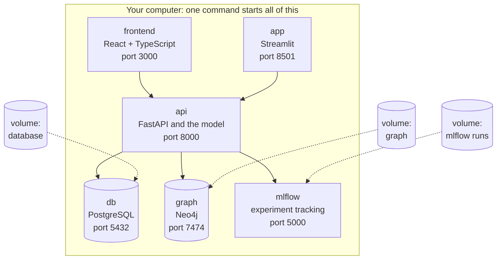

[Handbook](HANDBOOK.md) · [README](../README.md) · [Architecture](00-architecture.md) · [Roadmap](ROADMAP.md) · [Glossary](GLOSSARY.md)

# Containers: running the whole project with one command

**Prerequisites:** [`docs/01-setup.md`](01-setup.md) read at least once. Docker and Podman don't need to be installed; this guide starts from nothing.

**Learning goal:** after this you'll know what a container is (and isn't), why containers exist, how Docker and Podman differ and when that matters, how to install either on Windows, macOS or RHEL 8, and how this project's files are written so the same ones work with both.

**Time:** about 40 minutes to read; 20 to 40 minutes to install an engine, once per computer.

**Where this sits:** containers first appear in Phase 10 (one database in a container) and carry the whole system in Phase 17, Stages 12 and 19 of the [Handbook](HANDBOOK.md#stage-19-phase-17-the-whole-system-in-containers-docker-or-podman). You can read this guide any time; there's nothing to run for this project before Phase 10. Sections 7 to 10 describe files that Phase 17 will add, so they're the plan, and the Phase 17 guide will show the real output.

---

## Contents

- [1. The problem containers solve](#1-the-problem-containers-solve)
- [2. What a container is](#2-what-a-container-is)
- [3. The words, in one table](#3-the-words-in-one-table)
- [4. Docker or Podman, and why this project supports both](#4-docker-or-podman-and-why-this-project-supports-both)
- [5. Installing a container engine](#5-installing-a-container-engine)
- [6. Your first container, in five minutes](#6-your-first-container-in-five-minutes)
- [7. How this project will be containerised](#7-how-this-project-will-be-containerised)
- [8. Writing files that work with both engines](#8-writing-files-that-work-with-both-engines)
- [9. Three RHEL 8 details worth knowing in advance](#9-three-rhel-8-details-worth-knowing-in-advance)
- [10. Running the whole system](#10-running-the-whole-system)
- [11. What could go wrong](#11-what-could-go-wrong)
- [12. Saving container work](#12-saving-container-work)
- [What you learned](#what-you-learned)

---

## 1. The problem containers solve

### The situation

You spend a weekend getting a project working on your laptop. You send it to a friend and it doesn't run. Three evenings later the answer turns out to be a different version of Python, or a library that needs a system package they don't have, or a PostgreSQL that's version 12 where yours is 16. Programmers have a resigned phrase for it: "it works on my machine".

### Why the virtual environment isn't enough

The **virtual environment** from [`docs/01-setup.md` section 8](01-setup.md#8-create-the-virtual-environment) seals the project's Python packages. It doesn't seal:

- Python itself;
- the system libraries those packages rely on;
- separate programs such as PostgreSQL, Neo4j or Node.js;
- the operating system underneath.

A virtual environment packs your own tools. You're still working in someone else's workshop, on their wiring, with their power supply.

### What a container adds

Before standard shipping containers, every cargo was loaded differently: sacks, barrels and crates, packed by hand for each ship. Then came one box of fixed size that every ship, crane, train and lorry could handle without knowing what was inside. Software containers borrowed the name and the idea: a program, its language, its libraries and its start-up instructions, packed into one standard unit that runs the same way wherever a container engine runs.

For this project that's concrete. **From Phase 17, one command starts PostgreSQL, Neo4j, the API, the Streamlit prototype, the React web app and MLflow, set up and connected, on Windows, macOS or RHEL 8**, with none of them installed by hand. Without containers, [`docs/01-setup.md`](01-setup.md) would need installation and configuration steps for each of those programs on three operating systems, every one with its own version quirks.

---

## 2. What a container is

### Compared with a virtual machine

A **virtual machine** (VM) is a whole simulated computer running inside a real one. VMs work, and they're heavy: each carries a complete operating system, takes gigabytes and takes minutes to start.

A container is lighter. It shares the host computer's **kernel** (the core of the operating system, which talks to the hardware) and packs only what sits above it. A VM is a separate house with its own foundations, plumbing and wiring; a container is a flat in a shared building, with its own door, furniture and locks, sharing the foundations and the water supply.

| | Virtual machine | Container |
|---|---|---|
| holds | a whole operating system | an application and what it needs |
| size | gigabytes | tens to hundreds of megabytes |
| starts in | minutes | seconds |
| isolation | very strong | strong |
| like | a separate house | a flat in a shared building |

### What a container isn't

- **A virtual machine.** It shares the host's kernel.
- **A security boundary to bet everything on.** The isolation is strong, not absolute. Don't run code you don't trust and assume a container makes it safe.
- **Permanent.** Anything written inside a container disappears when the container is removed. That's by design: you don't repair a container, you delete it and start a fresh one from the same image, which is why every one is identical. Data that must survive lives in a **volume** (section 3).

---

## 3. The words, in one table

| Word | What it is | Like |
|---|---|---|
| **image** | a read-only template: files plus instructions for starting | a flat-pack kit with the instructions in the box |
| **container** | a running copy of an image | the assembled piece of furniture |
| **Dockerfile** (also **Containerfile**) | the text file describing how to build an image | the instruction leaflet |
| **registry** | a website that stores images for download; Docker Hub and quay.io are the big ones | the warehouse the kits come from |
| **volume** | storage that survives when a container is deleted | a storage unit you rent separately from the flat |
| **Compose** | a file describing several containers that run together | the floor plan saying which furniture goes in which room |

Two more you'll meet all the time:

- **Port mapping.** A container has its own private network. To reach a program inside it from your browser, you connect an outside port to an inside one: `-p 8000:8000` means "port 8000 on my computer leads to port 8000 in the container".
- **Bind mount.** A folder on your computer made visible inside the container, so code you edit is seen without rebuilding.

---

## 4. Docker or Podman, and why this project supports both

### They build and run the same things

**Docker** and **Podman** both follow the **OCI** standard (Open Container Initiative), an agreed specification for what an image is and how it runs. So an image built with one runs under the other. Podman's commands were also made to match Docker's: nearly every `docker` command works with `podman` written in its place.

### Where they differ

| | Docker | Podman |
|---|---|---|
| background service | a **daemon**, a program always running in the background with administrator rights | **daemonless**: commands do the work directly |
| runs as | root (administrator) by default | **rootless**: your ordinary user |
| on RHEL 8 | not shipped or supported by Red Hat | shipped and supported |
| on Windows and macOS | Docker Desktop | Podman Desktop, or the command line |
| licence | Docker Desktop is free for personal use, education and small organisations; larger organisations need a paid subscription | open source, no commercial restriction |

**What "daemonless" means.** Docker keeps a service running in the background with administrator rights; your `docker` command sends it instructions and it does the work. Podman does the work itself, in your own account. On a managed work computer you may not be allowed to run an administrator service, and then rootless Podman, which needs no special rights, is the difference between using containers and not.

### Why it matters here

Red Hat doesn't ship Docker with RHEL 8 or support it there; Podman is the engine it ships and supports. (Docker publishes its own packages for RHEL, but on a managed RHEL machine Podman is what you'll usually find.) A project that runs on Windows, macOS and RHEL 8 therefore has to work with Podman, and supporting Docker as well costs almost nothing.

### Which to use

**Whichever you already have, or whichever your system favours.** The same files work with both.

| System | Suggested | Why |
|---|---|---|
| RHEL 8, Rocky, AlmaLinux | **Podman** | shipped and supported |
| Fedora | **Podman** | the default |
| Ubuntu, Debian | either | Docker is the common choice; Podman works too |
| macOS | either | Podman Desktop avoids the Docker Desktop licence question |
| Windows | either | both use WSL2 underneath |

---

## 5. Installing a container engine

Do **one** of these, once per computer. Installers change, so the Phase 10 guide checks these steps again when it's written.

> **RHEL 8, Rocky, AlmaLinux: Podman**
>
> On RHEL 8, Podman comes in a **module**, a bundle of packages Red Hat versions and tests together, so it's installed with `dnf module install`:
>
> ```bash
> sudo dnf module install -y container-tools
> podman --version
> ```
>
> **You should see** a version line such as `podman version 4.9.4`.
>
> Optional: the compatibility package makes `docker` run `podman`, so instructions written for Docker work as they are:
>
> ```bash
> sudo dnf install -y podman-docker
> ```

> **Fedora: Podman**
>
> ```bash
> sudo dnf install -y podman
> ```

> **Ubuntu, Debian: Podman**
>
> ```bash
> sudo apt update
> sudo apt install -y podman
> ```
>
> Or Docker, following <https://docs.docker.com/engine/install/ubuntu/>.

> **macOS: Podman**
>
> 1. Install Podman Desktop from <https://podman-desktop.io/>, or the command line only with `brew install podman`.
> 2. Containers are a Linux technology, so on macOS Podman runs a small hidden Linux virtual machine for them. Create and start it once:
>
>    ```bash
>    podman machine init
>    podman machine start
>    ```
>
>    You won't use that machine directly, but knowing it's there explains why file paths and networking sometimes behave unexpectedly.
> 3. Check: `podman --version`, then `podman info`.

> **macOS: Docker**
>
> Install Docker Desktop from <https://www.docker.com/products/docker-desktop/>, start it, and wait for the whale icon in the menu bar to stop moving. Then `docker --version`.

> **Windows: either**
>
> Both engines need **WSL2** (Windows Subsystem for Linux), a real Linux kernel running inside Windows. Install it once, in PowerShell **run as administrator**, and restart when asked:
>
> ```powershell
> wsl --install
> ```
>
> **Podman:** install Podman Desktop from <https://podman-desktop.io/>, then in PowerShell:
>
> ```powershell
> podman machine init
> podman machine start
> podman --version
> ```
>
> **Docker:** install Docker Desktop from <https://www.docker.com/products/docker-desktop/>, start it, wait for the whale icon to settle, then `docker --version`.

**About Docker Desktop's licence.** It's free for personal use, education and small organisations, and larger organisations need a paid subscription. The thresholds have changed more than once, so check <https://www.docker.com/pricing/> before installing it on a work computer. Podman has no such restriction.

---

## 6. Your first container, in five minutes

Run something small before this project's containers; one small container makes the whole system easier to follow later.

> Write `podman` or `docker`, whichever you installed. The commands are otherwise the same.

### Step 1: run a container

```bash
podman run --rm hello-world
```

**You should see** a few download lines, then:

```
Hello from Docker!
This message shows that your installation appears to be working correctly.
```

(It says Docker under Podman too: it's the same image.) What happened: you asked for an image called `hello-world` that you didn't have; the engine downloaded it from a registry (Docker Hub), started a container from it, the container printed its message and exited, and `--rm` removed the container.

### Step 2: run something that keeps running

```bash
podman run --rm -d -p 8080:80 --name my-web docker.io/library/nginx
```

| Part | Meaning |
|---|---|
| `run` | start a new container |
| `--rm` | remove it when it stops |
| `-d` | **detached**: run in the background and give the prompt back |
| `-p 8080:80` | port 8080 on this computer leads to port 80 in the container |
| `--name my-web` | a name to refer to it by |
| `docker.io/library/nginx` | the image: a web server |

Open <http://localhost:8080> in a browser: a web server you never installed and won't have to uninstall. Then:

```bash
podman ps            # what's running
podman logs my-web   # what it has printed
podman stop my-web   # stop it (and --rm removes it)
```

Nothing is left behind on your computer.

### Step 3: six commands worth knowing

```bash
podman ps                 # what's running now
podman ps -a              # everything, stopped ones too
podman images             # the images on disk
podman logs <name>        # what a container has printed
podman stop <name>        # stop it
podman rm <name>          # remove a stopped container
```

`podman ps` is to containers what `git status` is to Git: it changes nothing and answers most "what's going on?" questions.

---

## 7. How this project will be containerised

From Phase 17, RealSignal runs as **six containers** started together:



**Why several containers instead of one?** One job per container. The database container runs the database and nothing else, so the API can be restarted after a code change without touching the database, and PostgreSQL 16 can become 17 by changing one line. Airflow, from Phase 12, runs in containers of its own and joins this picture as an optional extra in Phase 17.

**Why the volumes.** Containers are thrown away and recreated; a database that lost its data at every restart would be useless. Volumes live outside the containers and survive them.

**What stays outside containers.** The scripts you run while learning (`scripts/fetch_data.py`, the exploration, the modelling) stay ordinary Python in your virtual environment. Containers are for running the finished system. Editing code inside a container is slower and more confusing, and the early phases are about seeing every step.

---

## 8. Writing files that work with both engines

Four small decisions avoid keeping two sets of files.

### Decision 1: name the build file `Dockerfile`

Podman prefers the name `Containerfile`, Docker only looks for `Dockerfile`, and Podman reads `Dockerfile` without complaint. One file called `Dockerfile` serves both.

### Decision 2: call the Compose file `compose.yaml`

The **Compose Specification** is an open standard, and `compose.yaml` is its current file name (the older `docker-compose.yml` still works). `docker compose` and `podman compose` both read it.

### Decision 3: a small script that finds your engine

Instead of every instruction existing twice, `container.sh` (and `container.ps1` for Windows) checks which engine is installed and passes everything on. A first version looks like this:

```bash
#!/usr/bin/env bash
# container.sh: run compose with whichever container engine is installed.
#
# The project supports Docker and Podman. Detecting the engine once, here,
# keeps every other instruction the same for everyone.
#
# To choose one when both are installed:
#     RS_ENGINE=podman ./container.sh up -d

set -e

# An explicit choice wins. Otherwise Podman is tried first, because on
# RHEL it's the supported engine.
if [ -n "$RS_ENGINE" ]; then
    ENGINE="$RS_ENGINE"
elif command -v podman >/dev/null 2>&1; then
    ENGINE="podman"
elif command -v docker >/dev/null 2>&1; then
    ENGINE="docker"
else
    echo "Neither podman nor docker was found."
    echo "Install one: docs/CONTAINERS.md, section 5."
    exit 1
fi

echo "Using container engine: $ENGINE"
exec "$ENGINE" compose "$@"
```

Then the instructions are the same for everyone:

```bash
./container.sh up -d      # start everything
./container.sh ps         # what's running
./container.sh logs -f    # follow the output
./container.sh down       # stop everything
```

### Decision 4: stay away from the corners where they differ

- **Ports above 1024.** Rootless Podman can't use ports below 1024 (such as 80 or 443) without extra setup, because Unix systems reserve them for administrators. This project uses 3000, 5000, 5432, 7474, 8000 and 8501.
- **Named volumes for data, not folders from your computer.** They behave the same everywhere and avoid file-ownership differences between rootless and root containers.
- **Full image names.** `docker.io/library/postgres:16`, not `postgres:16`. Docker assumes Docker Hub; Podman may ask which registry you mean. Writing it out removes the difference and records where the software came from.
- **Fixed versions.** `postgres:16`, never `postgres:latest`, which changes underneath you. A database that upgraded itself overnight isn't reproducible. It's the same reason `requirements.txt` gives version ranges and `requirements.lock.txt` records exact versions.

---

## 9. Three RHEL 8 details worth knowing in advance

### SELinux and mounted folders

RHEL runs **SELinux**, a security system that labels every file and decides which programs may touch which labels. It will stop a container reading a mounted folder, with a `Permission denied` that `chmod` can't fix. Think of a building where each room needs a pass of the right colour, and a key alone doesn't get you in.

The fix is a `:Z` at the end of a mount, which relabels that folder for the container:

```yaml
volumes:
  - ./data:/app/data:Z
```

A lower-case `:z` shares the label between several containers; `:Z` gives the folder to one. macOS and Windows ignore it, so the project writes `:Z` everywhere and stays portable.

### Containers that stop when you log out

Rootless Podman containers belong to your login session, and they can stop when you disconnect. To keep them running after logout, once per user:

```bash
sudo loginctl enable-linger $USER
```

### Getting `podman compose`

Newer Podman versions have `podman compose`, which hands the work to a separate compose program, and that program has to be installed. On RHEL 8 the usual one, `podman-compose`, comes from **EPEL** (Extra Packages for Enterprise Linux), or from pip:

```bash
python3.12 -m pip install --user podman-compose
```

The Phase 17 guide sets this up step by step and checks the current route, because it has changed between Podman versions. `container.sh` can be pointed at `podman-compose` (with a hyphen) if `podman compose` isn't available.

---

## 10. Running the whole system

From Phase 17, starting everything on any of the three systems will be:

```bash
git clone https://github.com/akannan2987/realsignal.git
cd realsignal
./container.sh up -d          # Windows PowerShell: .\container.ps1 up -d
```

The first start downloads and builds images and takes a while; later starts take seconds. Then:

| Address | What's there |
|---|---|
| <http://localhost:3000> | the React web app |
| <http://localhost:8501> | the Streamlit prototype |
| <http://localhost:8000/docs> | the API's interactive documentation |
| <http://localhost:5000> | MLflow |
| <http://localhost:7474> | the Neo4j graph browser |

To stop:

```bash
./container.sh down          # stop, keep the data
./container.sh down -v       # stop and delete the volumes too
```

**`-v` deletes the databases.** It's the right command when you want a clean start and the wrong one at any other time.

---

## 11. What could go wrong

**"command not found: podman" (or docker).** Not installed, or the terminal was opened before installing. Close the terminal, open a new one, and check section 5.

**"Cannot connect to the Docker daemon".** Docker Desktop isn't running. Start it and wait for the whale icon to settle.

**Podman on macOS or Windows: "cannot connect to Podman machine".** The hidden Linux machine isn't running: `podman machine start` (and `podman machine init` first if it was never created).

**"Permission denied" reading a mounted folder on RHEL.** SELinux: add `:Z` to the mount (section 9).

**"port is already allocated".** Something else is using the port, often an earlier run that didn't stop. `podman ps` shows it; `./container.sh down` stops this project's containers. If another program owns the port, change the outside number in `compose.yaml`: `"8001:8000"` moves it to 8001.

**"no such image", or a question about which registry.** Write the full image name: `docker.io/library/postgres:16` (section 8).

**The first build is slow.** Expected: base images are hundreds of megabytes. Later builds reuse **cached layers** and take seconds.

**The disk fills up.** Images and stopped containers pile up:

```bash
podman system df       # what's using space
podman system prune    # remove stopped containers and unused data
```

Adding `-a` also removes images not in use; anything removed can be downloaded or rebuilt.

**Containers stop when you log out of RHEL.** `sudo loginctl enable-linger $USER` (section 9).

---

## 12. Saving container work

The ritual from [`docs/GIT_WORKFLOW.md` section 6](GIT_WORKFLOW.md#6-the-end-of-phase-ritual), with the commit message the Handbook gives Phase 17 and its version tag. First the checks, and stop if either fails:

```bash
pytest -q                     # all tests pass
./check-public-safe.sh        # must end with: SAFE TO PUSH (Windows: bash check-public-safe.sh in Git Bash)
```

Then the save:

```bash
git switch develop
git add -A
git commit -m "feat: run the whole system in containers with Docker or Podman"
git push origin develop develop:beta develop:master

## --tags is optional, only when required: Phase 17 completes v0.9.0
git tag -a v0.9.0 -m "v0.9.0: the whole system with one command, Docker or Podman"
git push origin develop develop:beta develop:master --tags

## then switch back to local master and pull in the remote changes
git switch master
git pull --ff-only origin master
git switch develop
```

**Never commit a `.env` file holding database passwords.** `.gitignore` already lists `.env`, `*.env.local` and `.container-data/`, and the safety gate refuses a push that would publish them. A secret that reaches GitHub once has to be treated as known to others: change it, don't just delete the file.

---

## What you learned

- Why "it works on my machine" happens, and what a virtual environment does and doesn't fix
- What a container is, how it differs from a virtual machine, and why it's meant to be thrown away
- Images, containers, registries, volumes, port mapping and Compose
- How Docker and Podman differ (a background service or none, root or rootless), and why RHEL 8 leans towards Podman
- How to install either engine on each of the three systems
- Four decisions that keep one set of files working with both
- The RHEL 8 details: SELinux labels, lingering, and getting compose

---

**Back to:** the [Handbook](HANDBOOK.md) · **Plan:** [`docs/ROADMAP.md`](ROADMAP.md) · **Architecture:** [`docs/00-architecture.md`](00-architecture.md)
