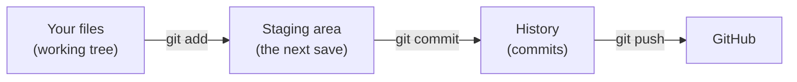
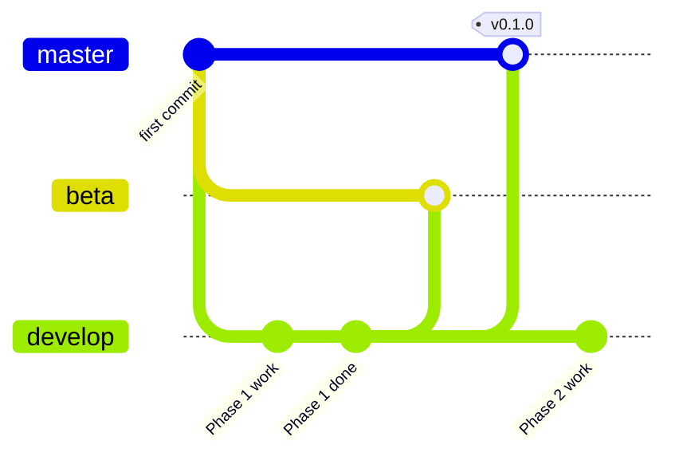

[Handbook](HANDBOOK.md) · [README](../README.md) · [Setup](01-setup.md) · [Glossary](GLOSSARY.md)

# Git workflow: how changes reach GitHub

**Prerequisites:** none to read it. To run the commands you need Git installed and the repository created, both covered in [`docs/01-setup.md`](01-setup.md).

**Learning goal:** after this you'll know what Git is, what a branch is, why this project keeps three of them, and what every line of the end-of-phase ritual does, so you can run it knowing what will happen.

**Where this sits:** Stage 2 of the [Handbook](HANDBOOK.md#stage-2-version-control-the-three-branches-and-the-safety-gate) introduces it, and every later stage ends with the ritual from [section 6](#6-the-end-of-phase-ritual). Every term is also in the [Glossary](GLOSSARY.md#group-5-git-and-github).

---

## Contents

- [1. What Git is, if you've never used it](#1-what-git-is-if-youve-never-used-it)
- [2. The three places a change can be](#2-the-three-places-a-change-can-be)
- [3. What a branch is](#3-what-a-branch-is)
- [4. This project's three branches](#4-this-projects-three-branches)
- [5. Creating the three branches (one time only)](#5-creating-the-three-branches-one-time-only)
- [6. The end-of-phase ritual](#6-the-end-of-phase-ritual)
- [7. Tags and version numbers](#7-tags-and-version-numbers)
- [8. Five situations that confuse everyone, and their fixes](#8-five-situations-that-confuse-everyone-and-their-fixes)
- [9. Writing commit messages worth reading](#9-writing-commit-messages-worth-reading)
- [10. Quick reference card](#10-quick-reference-card)

---

## 1. What Git is, if you've never used it

Git is a save-game system for files. In a video game you save before the hard level, and if it goes badly you reload.

Git does that for a project. You decide when to save (a **commit**); each save is permanent, dated and labelled with a message, and you can go back to any of them. So you can try the risky change, delete the chunk of code you suspect is unused, rewrite a guide from the top. If it goes wrong, the last save is still there.

Most people have done version control by hand at least once:

```
analysis.py
analysis_v2.py
analysis_v2_fixed.py
analysis_FINAL.py
analysis_FINAL_use_this_one.py
```

That records no reasons and no dates, can't show what changed between two of the files, and can't combine work from two places. Git does all four.

**GitHub** is a website that keeps a copy of a Git repository online. Git works without it (the whole history lives in a hidden `.git` folder inside the project); GitHub adds a backup, a public home for the work and a way to share it.

---

## 2. The three places a change can be

A change passes through three places on its way to GitHub. Mixing them up is the most common source of confusion, so here they are once:



- **Working tree:** the files as they are on disk right now. You edit here.
- **Staging area:** the changes you've picked for the next commit. Items on the conveyor belt at a supermarket till: chosen, not paid for yet.
- **History:** the permanent record of commits, the receipts.

The middle step exists because you often change five things and only three belong together. Staging lets you commit those three with one clear message and the other two separately. In this project you'll usually stage everything at once with `git add -A`, which is normal for one person working alone.

---

## 3. What a branch is

A branch is an independent line of work. A writer keeps a clean copy of a chapter that anyone could read, plus a draft where whole sections get rewritten and sometimes made worse. When the draft is better, it becomes the clean copy. A branch is that arrangement, built into Git.

**A branch isn't a folder.** There's only ever one set of files in the project folder. Switching branches (`git switch`) rewrites those files to match the branch you switch to. People new to Git often expect three folders for three branches; there's one folder whose contents change.

---

## 4. This project's three branches

| Branch | What it holds | In a bakery |
|---|---|---|
| `develop` | where all the work happens, including things half done | the kitchen |
| `beta` | a checkpoint copy, what a tester would try | the tasting plate |
| `master` | the published state, what the public sees | the shop window |

At the end of each phase all three get the same, tested state, in one push.



### Why three branches for one person?

Three reasons, and they hold even for a solo project:

1. **Working and published stay apart.** What you're fiddling with today isn't what someone opening the repository sees.
2. **It's how most team repositories work.** Learning the habit on your own project costs one line per phase.
3. **Two fallbacks.** If `develop` gets into a mess, `beta` and `master` still hold the last good state.

### Why `master` and not `main`

New GitHub repositories default to `main`; the older convention, still very common, is `master`. Neither is more correct. This project uses `master` everywhere, and what matters is that the guides say so, so nobody following them hits a branch that doesn't exist.

---

## 5. Creating the three branches (one time only)

[`docs/01-setup.md` section 12](01-setup.md#12-connect-to-github-and-create-the-three-branches) walks through this in context. This is the reference version.

```bash
# 1. Inside the project folder, start tracking it with Git.
git init

# 2. Call the first branch master instead of the default.
git branch -M master

# 3. Make the first commit, so the branches have something to point at.
#    (A branch points at a commit, so it can't start from nothing.)
git add -A
git commit -m "chore: initial project structure, documentation and environment"

# 4. Connect the folder to your empty GitHub repository (use your own name).
git remote add origin https://github.com/<you>/realsignal.git

# 5. Send master and remember the connection (-u), so later pushes are shorter.
git push -u origin master

# 6. Create beta and develop, both starting where master is.
git branch beta
git branch develop

# 7. Send both to GitHub.
git push -u origin beta
git push -u origin develop

# 8. Move onto develop. From now on, this is where you work.
git switch develop
```

**You should see** after the last command:

```
Switched to branch 'develop'
Your branch is up to date with 'origin/develop'.
```

**Check all three exist,** on your computer and on GitHub:

```bash
git branch -a
```

```
  beta
* develop
  master
  remotes/origin/beta
  remotes/origin/develop
  remotes/origin/master
```

The `*` marks the branch you're on. Six lines means the setup is right.

---

## 6. The end-of-phase ritual

This ends every phase, in two steps. **First check**, and read the result before going on:

```bash
pytest -q                     # every test passes
./check-public-safe.sh        # must end with: SAFE TO PUSH (Windows: bash check-public-safe.sh in Git Bash)
```

If a test fails or the gate says NOT SAFE, stop and fix that first. Only then **save**:

```bash
git switch develop
git add -A
git commit -m "feat: what this phase added, in one line"
git push origin develop develop:beta develop:master
## --tags is optional, only when required (see section 7)
## then switch back to local master and pull in the remote changes
git switch master
git pull --ff-only origin master
git switch develop
```

The lines starting with `##`, and anything after a `#`, are notes: the terminal ignores them, so the block can be pasted as it is. (On a Mac using the zsh shell, this needs the one-time setting in [`docs/01-setup.md` section 2](01-setup.md#macos-only-let-the-terminal-skip-the-notes-in-commands).) The checks are a separate block on purpose: a pasted block runs every line, even after one fails, so a failing test wouldn't stop the push. Each phase guide gives its own commit message.

### What each line does

**`pytest -q` and `./check-public-safe.sh`** come first, on their own, because a push to `master` is public. The tests show the code still does what the guides say; the gate ([`docs/01-setup.md` section 13](01-setup.md#13-the-safety-gate)) shows nothing private is about to be published.

**`git switch develop`** moves you to the working branch. If you're already there it says so and does nothing. Running it every time means you never have to wonder which branch you're on.

**`git add -A`** stages every change: new files, changed files and deleted files (the `-A` is for "all").

**`git commit -m "..."`** creates the save point. The message is what you, or anyone reading the history, will see in a year when wondering why something changed. [Section 9](#9-writing-commit-messages-worth-reading) has the conventions.

**`git push origin develop develop:beta develop:master`** sends one state to three branches in a single command:

- `develop` sends your local `develop` to `develop` on GitHub.
- `develop:beta` sends your local `develop` to `beta` on GitHub. The colon reads "take what's on the left, put it on the branch named on the right".
- `develop:master` does the same for `master`.

So at every checkpoint the three branches on GitHub say the same thing.

**`git switch master` and `git pull --ff-only origin master`** deal with something easy to miss. The push moved `master` **on GitHub**, but the `master` branch on your computer still points at the old commit; it doesn't follow along by itself. These two lines bring it up to date.

`--ff-only` means "fast-forward only": update only if it's a clean step forward, and otherwise stop and say why. A bookmark that may only move forward through the same book is the idea. If your local `master` had somehow gone its own way, Git refuses instead of quietly creating a merge you didn't ask for, and you get to look at what happened first.

**`git switch develop`** puts you back on the working branch, so the next session starts in the right place. Editing while on `master` by accident is the most common way a one-person history gets tangled, and always ending on `develop` prevents it.

### Check it worked

```bash
git log --oneline -1
```

**You should see** your commit with all the branch names next to it, something like:

```
1a2b3c4 (HEAD -> develop, origin/master, origin/develop, origin/beta, master) feat: ...
```

(The seven characters at the start differ for every commit. Your local `beta` won't be in the list, because you never work on it locally, and `origin/HEAD` may appear too.)

---

## 7. Tags and version numbers

A **tag** is a permanent name pinned to one commit, such as `v0.1.0`. Branches move forward with every commit; a tag stays put, so `v0.1.0` always means exactly the state the project was in when it was released.

Tags are only for milestones, not every phase:

```bash
git tag -a v0.1.0 -m "v0.1.0: verified data, documentation and a reproducible setup"
git push origin develop develop:beta develop:master --tags
```

`-a` makes an annotated tag, which records who made it, when, and the message. `--tags` sends tags along with the push; without it, the tag stays on your computer.

### What the numbers mean

The project follows **semantic versioning**: `MAJOR.MINOR.PATCH`.

- **MAJOR** goes to 1 at the first complete release (Phase 18). Before that, `0.x` says "still being built".
- **MINOR** goes up at each milestone.
- **PATCH** goes up for a fix that adds nothing new.

| Tag | Reached at | What it means |
|---|---|---|
| v0.1.0 | Phase 1 | verified data, documentation and a reproducible setup |
| v0.2.0 | Phase 3 | every source harmonised in a tested dbt project |
| v0.3.0 | Phase 5 | the published result reproduced in Python |
| v0.4.0 | Phase 6 | the three-way comparison with the authors' R code |
| v0.5.0 | Phase 7 | first app anyone can open |
| v0.6.0 | Phase 9 | the science is complete |
| v0.7.0 | Phase 12 | database, API, web app and a scheduled pipeline |
| v0.8.0 | Phase 16 | the AI features |
| v0.9.0 | Phase 17 | runs in Docker or Podman |
| v1.0.0 | Phase 18 | first complete release |

The full list, with what each milestone contains, is in [`docs/ROADMAP.md`](ROADMAP.md#4-milestones-and-version-tags). Every tag gets an entry in [`CHANGELOG.md`](../CHANGELOG.md).

---

## 8. Five situations that confuse everyone, and their fixes

Everyone runs into these. None of them loses work if you stop and read what Git printed.

### "I edited files, but I'm on the wrong branch"

You made changes while on `master` instead of `develop`:

```bash
git stash          # put the changes to one side
git switch develop # go where you meant to be
git stash pop      # bring the changes back, now on develop
```

### "It says my branch is behind, or has diverged"

GitHub has commits your computer doesn't, usually because a file was edited on the GitHub website. The website edits `master` unless you picked another branch, so bring the changes into `develop` from the branch that was edited:

```bash
git switch develop
git pull --ff-only origin master      # or origin develop, if that's the branch edited on the website
```

If `--ff-only` refuses, the two have really gone separate ways and you need to decide which changes to keep. Read the message: it names the branches and commits involved. Don't guess.

### "It won't let me push"

Nearly always because GitHub has something you don't. Pull first (as above), then push again. **Never use `--force` to make the error go away:** a forced push overwrites the history on GitHub, and the overwritten commits are gone.

### "I committed something I shouldn't have"

If it's **not pushed yet**:

```bash
git reset --soft HEAD~1   # undo the last commit, keep the changes in your files
```

Then add the file to `.gitignore` (or take it out with `git rm --cached <file>`, which keeps it on disk) and commit again.

If it **is pushed** and it's a secret (a password, an API key), assume someone has it: revoke it with the service that issued it and make a new one. Removing it from the history is possible but fiddly, and revoking is what actually protects you. This is why `.gitignore` lists `data/` and `.env` before the first commit, and why the safety gate runs before every push.

### "Git asks me to tell it who I am"

Once per computer:

```bash
git config --global user.name "Your Name"
git config --global user.email "your-email@example.com"
```

Every commit records who made it, so Git needs to know.

---

## 9. Writing commit messages worth reading

A commit message answers "what changed, and why?". The what is usually visible in the files; the why almost never is.

This project starts each message with a short type:

| Type | Use it for |
|---|---|
| `feat:` | a new capability |
| `fix:` | correcting something that was broken |
| `docs:` | documentation only |
| `test:` | adding or changing tests |
| `chore:` | housekeeping: packages, folders, settings |
| `refactor:` | restructuring code without changing what it does |

Good:

```
feat: download and checksum-verify the published dataset
fix: keep strains recorded as ambiguous instead of dropping the row
docs: explain why the raw data folder is never edited
```

Not useful:

```
update
stuff
fixed it
```

The test is whether someone reading the history, without opening the files, would understand why the commit exists. Commit messages stay plain keyboard characters (no long dashes, no curly quotes), so they paste into any terminal.

---

## 10. Quick reference card

```bash
git status                 # what has changed? (changes nothing, so run it often)
git switch develop         # move to the working branch
git branch -a              # every branch, on this computer and on GitHub
git add -A                 # stage all changes
git commit -m "msg"        # save them
git log --oneline -10      # the last ten commits, one line each
git diff                   # changes not staged yet
git push origin develop develop:beta develop:master
git switch master
git pull --ff-only origin master
git switch develop
```

`git status` is the most useful of them. It shows the branch you're on, what has changed, what's staged, and usually suggests the next command. It changes nothing, so it can't do harm.

---

**Next:** back to the [Handbook](HANDBOOK.md), at the stage you're on.
