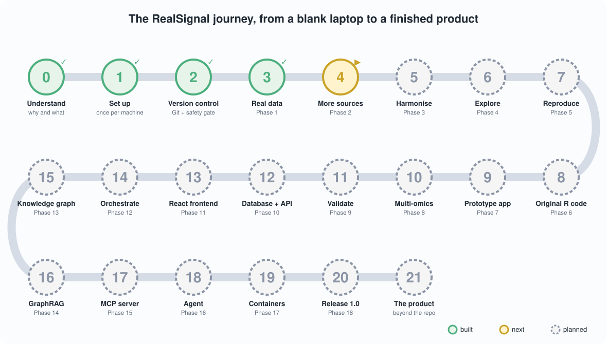
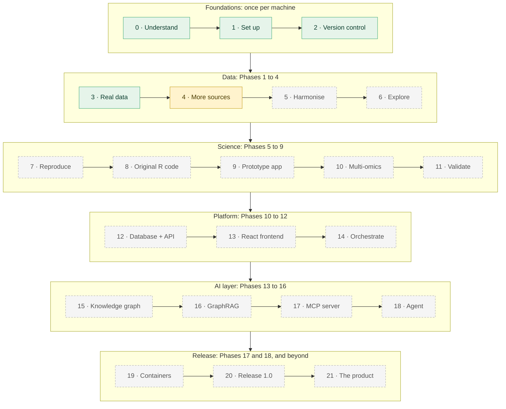
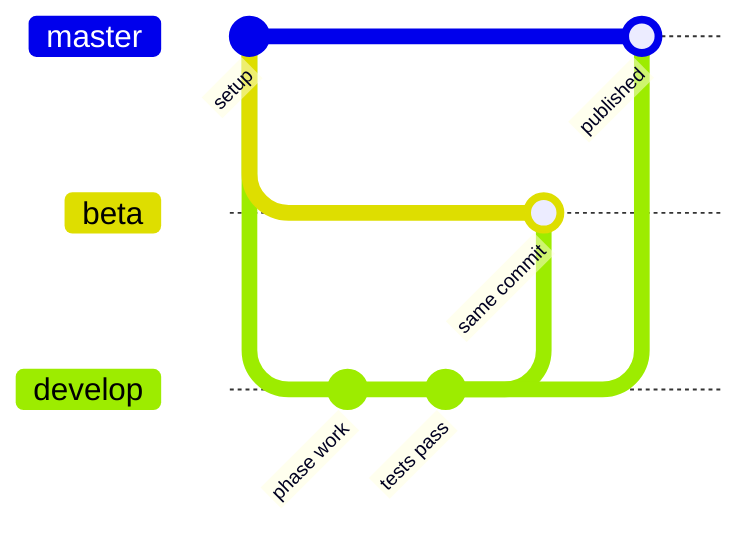
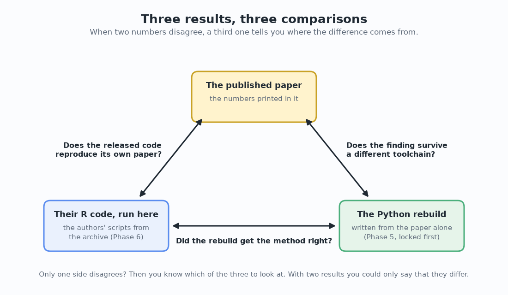

[README](../README.md) · [Glossary](GLOSSARY.md) · [Architecture](00-architecture.md) · [Roadmap](ROADMAP.md) · [Product roadmap](PRODUCT_ROADMAP.md) · [Changelog](../CHANGELOG.md)

# The RealSignal Handbook: from day 0 to the finished product

**Handbook revision:** 2 · **Last updated:** 2026-10-12 · **Repository state it describes:** Stages 0 to 3 are done: the plan, the setup on a blank computer, the repository with its three branches and the safety gate, and Phase 1, the published dataset downloaded and verified (342 files, version v0.1.0). Stage 4, Phase 2, is next. 19 automated tests.

**Read this document first, and come back to it whenever you wonder what to do next.** It walks the whole journey in order: understanding the project, preparing a blank computer, building each of the 18 phases, releasing version 1.0, and what lies beyond. At every step it explains *why*, and it links to the guide that holds the detail. If you ever have to hunt through the repository to find your next step, the Handbook has a gap, and that counts as a bug.

**Who it's for.** Someone with no background in microbiology, statistics, programming, Git or the command line, who wants to end up able to build, run, explain and extend RealSignal. Every term used anywhere in the repository is defined in plain language in the [Glossary](GLOSSARY.md). Keep it open in a second browser tab.

**How to use it.** Stages are numbered and follow each other. Each one says what you'll do, why it exists, which guide to open, roughly how long it takes, how you know you're done (the *Checkpoint*) and the commit message that saves the work. **Don't move on until the checkpoint is met.** Every stage ends at a natural stopping point, with your work safely on GitHub.

**Paths.** Every file is named by its path from the project folder (the folder that holds `README.md`), for example `scripts/fetch_data.py` or `docs/01-setup.md`. Files that sit in the project folder itself (`README.md`, `CHANGELOG.md`, `check-public-safe.sh`) have no folder in front of them.

**Every stage has the same parts:** *What* (what you do, with the commands), *Why* (the reason it exists), a *Checkpoint* (how you know it worked, with real numbers once the stage is built) and the *commit message* that saves it. Stages that haven't been built yet say *planned* next to those words. The phase guides hold every step with its expected output; the Handbook is the thread that ties them together. [The whole build, command by command](#the-whole-build-command-by-command) lists every command in order on one page.

### Short on time?

Three things give you the project in twenty minutes, with nothing installed:

1. The README sections [What is a plant microbiome?](../README.md#what-is-a-plant-microbiome-start-here) and [The problem this project tackles](../README.md#the-problem-this-project-tackles).
2. The picture of the experiment, [`figures/screening_design.png`](../figures/screening_design.png), and of the plan, [`docs/img/journey_map.svg`](img/journey_map.svg).
3. The interactive page [`docs/interactive/combinations.html`](interactive/combinations.html), which shows why nobody tests every possible community. Download it and open it in a browser; it works offline. (Once GitHub Pages is switched on, Stage 3 step 6, the interactive pages also open from a link.)


---

## The journey at a glance



*Would you rather click? [`docs/interactive/journey.html`](interactive/journey.html) is the same journey as a page: pick any stage to read what you do, why, and how you know it worked. `figures/make_illustrations.py` builds it from this Handbook, so the two always say the same thing. Download it and open it in a browser; it works offline.*



*Green: built and tested. Gold: in progress. Dashed grey: planned.* The Prototype app (Stage 9) sits inside the science group on purpose: a first clickable version halfway through the science keeps asking "who would use this, and for what?" while there's still time to act on the answer.

| Stage | Area | What you do | Guide | Hands-on time | Status |
|---|---|---|---|---|---|
| 0 | Orientation | Understand what you are building and why | [README](../README.md), [Architecture](00-architecture.md), [Roadmap](ROADMAP.md) | 1-2 h reading | ✅ done |
| 1 | Setup | Set up your workshop (once per machine) | [`docs/01-setup.md`](01-setup.md) sections 1 to 11 | 60-90 min | ✅ done |
| 2 | Git | Version control, the three branches and the safety gate | [`docs/01-setup.md`](01-setup.md) sections 12 to 14, [`docs/GIT_WORKFLOW.md`](GIT_WORKFLOW.md) | 30-45 min | ✅ done |
| 3 | Data | Phase 1: get the real data, verified | [`docs/02-phase-1-data-acquisition.md`](02-phase-1-data-acquisition.md) | about 1 h | ✅ done |
| 4 | Data | Phase 2: the other four layers, or a record of why not | `docs/03-phase-2-more-sources.md` | ~8 h | ⏳ next |
| 5 | Data | Phase 3: harmonise everything with dbt | `docs/04-phase-3-harmonisation.md` | ~10 h | ⬜ planned |
| 6 | Data | Phase 4: explore the data | `docs/05-phase-4-exploration.md` | ~6 h | ⬜ planned |
| 7 | Science | Phase 5: reproduce the published models in Python | `docs/06-phase-5-reproduction.md` | ~12 h | ⬜ planned |
| 8 | Science | Phase 6: run the authors' R code, the three-way comparison | `docs/07-phase-6-original-r-code.md` | ~8 h | ⬜ planned |
| 9 | Product | Phase 7: the prototype app, online | `docs/08-phase-7-prototype-app.md` | ~10 h | ⬜ planned |
| 10 | Science | Phase 8: multi-omics integration | `docs/09-phase-8-multi-omics.md` | ~12 h | ⬜ planned |
| 11 | Science | Phase 9: external validation and the data-efficiency curve | `docs/10-phase-9-validation.md` | ~10 h | ⬜ planned |
| 12 | Platform | Phase 10: PostgreSQL and FastAPI, the first container | `docs/11-phase-10-database-api.md` | ~12 h | ⬜ planned |
| 13 | Platform | Phase 11: the React and TypeScript frontend | `docs/12-phase-11-react-frontend.md` | ~16 h | ⬜ planned |
| 14 | Platform | Phase 12: orchestration with Airflow | `docs/13-phase-12-orchestration.md` | ~10 h | ⬜ planned |
| 15 | AI | Phase 13: the knowledge graph and its ontology | `docs/14-phase-13-knowledge-graph.md` | ~12 h | ⬜ planned |
| 16 | AI | Phase 14: GraphRAG, answers with sources | `docs/15-phase-14-graphrag.md` | ~10 h | ⬜ planned |
| 17 | AI | Phase 15: the MCP server | `docs/16-phase-15-mcp-server.md` | ~6 h | ⬜ planned |
| 18 | AI | Phase 16: the recommendation agent | `docs/17-phase-16-agent.md` | ~8 h | ⬜ planned |
| 19 | Release | Phase 17: the whole system in containers, Docker or Podman | `docs/18-phase-17-containers.md`, [`docs/CONTAINERS.md`](CONTAINERS.md) | ~12 h | ⬜ planned |
| 20 | Release | Phase 18: tests on three systems, release 1.0 | `docs/19-phase-18-release.md` | ~8 h | ⬜ planned |
| 21 | Product | Beyond the repository: the product | [`docs/PRODUCT_ROADMAP.md`](PRODUCT_ROADMAP.md) | reading | ⬜ planned |

Guide names in plain text (not links) are the files each phase will add; they don't exist yet. For built stages, the time is what following the guide takes; for planned stages it's my estimate for building and documenting the phase, which takes far longer than following it later. At four to five hours a week, the whole journey is eight to ten months of evenings and weekends, and [`docs/ROADMAP.md`](ROADMAP.md#5-effort-and-schedule) explains where that estimate comes from.

---

## Stage 0: Understand what you are building and why

**What.** Read, in this order:

1. The [README](../README.md), up to and including *How it works*. It explains, without any biology background, what a plant's microbiome is, why some bacteria protect plants, and why choosing which ones to test is a data problem.
2. [`docs/00-architecture.md`](00-architecture.md): every part of the finished system, what it does and why it exists, including the three words most software leans on (frontend, backend, database).
3. [`docs/ROADMAP.md`](ROADMAP.md): the 18 phases, the order they come in, and the tools left out on purpose.

**Why.** Everything you type later only makes sense if you can say in one sentence what RealSignal is for: *rebuilding a published machine-learning result about plant-protecting bacteria, checking it against evidence the model never saw, and turning it into a tool that helps choose which experiments are worth running.* With that sentence in mind, each command has a reason you can follow.

**Checkpoint.** Without notes, you can explain to a friend: what a strain is; what the 136 random five-strain communities were for (the [screening picture](../figures/screening_design.png) helps); the difference between reproducing and replicating a study; why the original R code gets run as well as rebuilt ([`figures/three_way.png`](../figures/three_way.png)); and why nobody tests every possible community ([`figures/combinations.png`](../figures/combinations.png)).

---

## Stage 1: Set up your workshop (once per machine)

**What.** Follow [`docs/01-setup.md`](01-setup.md) sections 1 to 11. Each step shows the exact command for Windows, macOS or RHEL 8 (and other Linux). **Do the one for your machine and skip the others.**

1. Open a terminal and learn the four commands that move you around (section 2).
2. Install Python 3.11 or newer, Git and VS Code (sections 3 to 5).
3. Create a GitHub account and an **empty** repository called `realsignal` (section 6).
4. Create the project folder, the virtual environment `.venv`, and install the packages from `requirements.txt` (sections 7 to 9).
5. Prove it works: `python scripts/check_env.py` (section 10).

On a Mac whose terminal prompt ends with `%` (the zsh shell), also switch on one setting so that notes after `#` in pasted commands are skipped (section 2, *macOS only*). A prompt ending with `$` (the bash shell) needs nothing.

**Why.** You install the language everything is written in (Python), the program that records every change (Git), a comfortable editor, an online home for the project (GitHub), and a sealed box of packages for this project only (the virtual environment). All of the setup sits at the front on purpose: after this stage, daily work is the same handful of short commands on every operating system.

**Platform promise.** The code builds every file path with Python's `pathlib`, so the same commands work on Windows, macOS and RHEL 8. Where an operating system really differs (installing Python, activating the environment, deleting a file), the guides show each version side by side.

**Checkpoint.** Your terminal prompt shows `(.venv)`, and `python scripts/check_env.py` ends with `ALL CHECKS PASSED. Your workshop is ready.` On the MacBook Pro this project was built on, that was Python 3.14 with pandas 3.0.5, scikit-learn 1.9.0 and DuckDB 1.5.5.

---

## Stage 2: Version control, the three branches and the safety gate

**What.** [`docs/01-setup.md`](01-setup.md) sections 12 to 14, with [`docs/GIT_WORKFLOW.md`](GIT_WORKFLOW.md) for the full explanation.

1. Turn the folder into a Git repository, connect it to GitHub, and create the branches `master`, `beta` and `develop` (section 12).
2. Meet the safety gate, `check-public-safe.sh`, which runs before every push (section 13).
3. Learn why commands must be typed with plain keyboard characters (section 14).

**Why.** Git records every change, so nothing is ever lost and every step can be looked at later. The three branches give the work a steady rhythm:



(The picture draws the updates as merges. In practice one push moves `beta` and `master` forward to the very same commit as `develop`, which Git calls a *fast-forward*.) You only ever work on **`develop`**. One push line updates all three branches on GitHub, and then your own copy of `master` is brought in step. The safety gate runs before that, every time: it refuses to give the all-clear if a secret, downloaded data, a private note, a database file, a path from your own computer, a macOS `.DS_Store` file or a picture carrying hidden records is about to become public. It checks the files Git already tracks **and** the new files `git add -A` is about to add, so you can run it before staging.

> **Copy commands safely.** Every command, commit message and tag message in this repository uses plain keyboard characters. Look-alike characters from word processors and web pages (a long dash, curly quotes) can break a command when pasted into a terminal. [`docs/01-setup.md` section 14](01-setup.md#14-copy-commands-safely) has the details.

**The end-of-phase ritual**, used at the end of every stage from here on. Each stage names its own commit message. First check, and read the result; stop if either fails:

```bash
pytest -q                     # all tests pass
./check-public-safe.sh        # must end with: SAFE TO PUSH (Windows: bash check-public-safe.sh in Git Bash)
```

Then save:

```bash
git switch develop
git add -A
git commit -m "<the stage's commit message>"
git push origin develop develop:beta develop:master
## --tags is optional, only when required (the stage says when it earns a version tag)
## then switch back to local master and pull in the remote changes
git switch master
git pull --ff-only origin master
git switch develop
```

The checks are a block of their own because a pasted block runs every line even after one fails, so a failing test inside it wouldn't stop the push.

**Checkpoint.** `git branch -a` lists `master`, `beta` and `develop`, and the same three under `remotes/origin/`. `./check-public-safe.sh` ends with `SAFE TO PUSH`. Your README shows on the repository's page on GitHub.
**Commit messages used:** `chore: initial project structure, documentation and environment` · `docs: architecture overview and roadmap` · `docs: add the R reproduction phase and the generalisable problem`. (In this repository's own history the gate arrived with Stage 3's commit; if you're following along from scratch, you have it from the start.)

---

## Stage 3: Phase 1, get the real data, verified

**What.** Follow [`docs/02-phase-1-data-acquisition.md`](02-phase-1-data-acquisition.md).

1. Read the guide's sections 1 to 4 first: the study, the experiment, and three ideas (checksums, read-only raw data, provenance).
2. Look before you leap: `python scripts/fetch_data.py --probe` asks Zenodo about the file without downloading it.
3. Download, verify, unpack and list: `python scripts/fetch_data.py` (about 239 MB, several minutes).
4. Run the same command again and watch it check the copy instead of downloading it twice.
5. Look at what arrived: `python notebooks/explore_raw.py`, and write down which files hold the communities, the outcomes and the authors' R code.
6. Optional: switch on GitHub Pages so the interactive pages open from a link (the guide's section 9).


**Why.** Getting data is where many projects go quietly wrong: a download stops at 94 % and still opens, a spreadsheet gets "fixed" by hand and the original is lost, and a year later nobody knows where a number came from. Phase 1 builds three habits that prevent all three. It verifies the download against the checksum the authors published, so you hold exactly their bytes. It never edits the raw copy. And it writes down where the data came from, automatically. It also finds out what is actually in the archive before any code assumes it, because Phase 2 reads files by their real names.

**Checkpoint.** The probe reports `Server reports: 239.2 MB` and `Reachable     : yes`. The download ends with `MATCH. This is the published archive, byte for byte.` (the MD5 checksum is `f8061f230b621703f0f11be454c5167e`); the archive holds 368 entries, of which 342 are files, with no macOS clutter and nothing unsafe. A second run says `The archive is already here` and checks it again without downloading. `data/raw/manifest.csv` lists the 342 files and `data/raw/fetch_log.json` records the download (239,154,876 bytes). `python notebooks/explore_raw.py` finds 53 data files the authors started from (in `Data/`), 183 their code wrote (in `Output/`) and 22 R scripts (in `Rscripts/`). `pytest -q` passes 19 tests (run from Windows PowerShell, 12 pass and the 7 safety-gate tests are skipped, because they need Git Bash). `git status` shows nothing from `data/`.
**Save it.** This stage completes **v0.1.0**, the first version. Two one-off steps come first, because this is the commit that adds the safety gate: take the two `.DS_Store` files that reached an early commit out of Git (they stay on your disk), and record the gate and the setup script as runnable.

```bash
git switch develop
git rm --cached --ignore-unmatch .DS_Store src/.DS_Store
chmod +x check-public-safe.sh setup.sh   # Windows PowerShell: git update-index --chmod=+x check-public-safe.sh setup.sh
```

Then check, and stop if either fails:

```bash
pytest -q                                # 19 passed
./check-public-safe.sh                   # must end with: SAFE TO PUSH
```

Then save:

```bash
git switch develop
git add -A
git commit -m "feat: verified download of the published dataset, Handbook, safety gate and illustrations"
git push origin develop develop:beta develop:master
## --tags is optional, only when required: this stage completes v0.1.0
git tag -a v0.1.0 -m "v0.1.0: verified data, documentation and a reproducible setup"
git push origin develop develop:beta develop:master --tags
## then switch back to local master and pull in the remote changes
git switch master
git pull --ff-only origin master
git switch develop
```

---

## Stage 4: Phase 2, the other four layers (or a record of why not)

**What (planned).** `docs/03-phase-2-more-sources.md`. It starts with Layer 1: open the tables Phase 1 listed, find where the 136 training and 70 test communities sit and what each column means (the authors' R code stays closed until Stage 8), and look at the file in `Data/MetaData/AtSPHERE/` whose name points to Layer 5's paper. Then check whether the other data layers can be obtained (the strains' genomes, their predicted gene clusters, the network of which strain holds back which, and every strain tested alone), then fetch each available one with the same discipline as Phase 1: verified, logged, never edited. A *source register* records each source's licence, access route and outcome, including any source that turns out to be unobtainable.

**Why.** One dataset answers one question. These layers add *why* (the chemistry a strain could make), *how* (which strains hold each other back) and an independent check (each strain measured alone), as [`figures/data_layers.png`](../figures/data_layers.png) shows. Some of the papers sit behind journal subscriptions, so access is an open question, and a source that can't be obtained gets recorded with the reason. Layer 1 alone still supports a complete reproduction.

**Checkpoint (planned).** Every source in the register has a status, a licence and a date; every fetched file has a checksum in the provenance log; `pytest -q` passes.
**Commit message (planned):** `feat: add the source register and fetchers for the remaining data layers`.

---

## Stage 5: Phase 3, harmonise everything with dbt

**What (planned).** `docs/04-phase-3-harmonisation.md`. Install dbt Core, then write a layered set of SQL models (staging, intermediate, marts) that join every source onto one strain name and one community name, with automated data tests and generated documentation.

**Why.** Sources written by different laboratories years apart spell the same strain differently and shape their tables differently. Making them agree is usually the biggest single job in multi-source work, and doing it in dbt keeps every decision visible and tested instead of buried in a script. One rule is set here because it's free now and expensive later: nothing hard-codes 35 strains, five per community, one pathogen or one measurement. The pool size, the community size and the outcome are data, so the same tables could take another strain library.

**Checkpoint (planned).** `dbt build` runs every model and every test without a failure; the lineage graph shows each final table's ancestry; a query lists 136 training and 70 test communities.
**Commit message (planned):** `feat: harmonise all sources with dbt models and data tests`, tagged **v0.2.0**.

---

## Stage 6: Phase 4, explore the data

**What (planned).** `docs/05-phase-4-exploration.md`. Distributions, the two-humped shape of the pathogen counts, how often each strain appears, missing values and outliers, with the first figures from the real data and a short data-quality report.

**Why.** Looking comes before modelling. A problem spotted in a histogram costs minutes; the same problem found after training a model costs days, because by then it looks like a modelling bug. This stage also shows why bacterial counts are read on a log scale ([`figures/log_scale.png`](../figures/log_scale.png)).

**Checkpoint (planned).** Every number in the data-quality report can be regenerated by one script, and the two humps of the outcome are visible in a figure.
**Commit message (planned):** `feat: explore the harmonised data, first figures and a data-quality report`.

---

## Stage 7: Phase 5, reproduce the published models in Python

**What (planned).** `docs/06-phase-5-reproduction.md`. Random forests and elastic nets, for both classification (protected or not) and regression (how much pathogen), with repeated cross-validation over several random seeds, scored once on the 70 test communities the models never saw. Every run is recorded with MLflow. Then the comparison table: these numbers next to the published ones.

**Why.** This is the reproduction itself, written from the paper alone. Its evaluation guards against the usual ways a model fools its maker: a held-out test set from a separate experiment, cross-validation that keeps all plants of one community together, a baseline for every score, and results across several seeds instead of the best one.

**Checkpoint (planned).** The comparison table lists each published metric beside the rebuilt one; `pytest -q` includes a test that fails if plants of one community ever land on both sides of a split.
**Commit message (planned):** `feat: reproduce the published models in Python, with MLflow tracking`, tagged **v0.3.0**. **Commit this before opening any of the authors' R code**: that commit is the timestamped record that the rebuild was written independently.

---

## Stage 8: Phase 6, run the authors' R code, the three-way comparison

**What (planned).** `docs/07-phase-6-original-r-code.md`. Install R and RStudio, give the project its own R package library with `renv`, run the authors' original scripts from the archive (reading `data/raw/`, writing elsewhere), and put three results side by side.



**Why.** If the rebuild and the paper disagree, three different things could explain it: a mistake in the rebuild, the released code not reproducing its own paper, or a result that depends on the software used. With only two numbers you can't tell which. Running the original code adds the third number and pins the difference down. Someone else's research code often needs small fixes to run on a new computer; every fix is logged, and that log is part of the result.

**Checkpoint (planned).** The three-way table has a written explanation for every difference; `renv.lock` records the exact R packages.
**Commit message (planned):** `feat: run the original R analysis and add the three-way comparison`, tagged **v0.4.0**.

---

## Stage 9: Phase 7, the prototype app, online

**What (planned).** `docs/08-phase-7-prototype-app.md`. A Streamlit app: choose a community, see the predicted outcome with its uncertainty and which strains drove it, in plain words, with the model's limits stated on screen. Then put it online on Streamlit Community Cloud and the interactive figures on GitHub Pages.

**Why.** Until now, only someone who can run Python can see a result. A working tool at this point keeps the rest of the science grounded in what someone would actually do with it.

**Checkpoint (planned).** The app runs locally with one command and online from a link; every number it shows matches the tables from Stages 7 and 8.
**Commit message (planned):** `feat: add the Streamlit prototype and put it online`, tagged **v0.5.0**.

---

## Stage 10: Phase 8, multi-omics integration

**What (planned).** `docs/09-phase-8-multi-omics.md`. Add features from the genome, gene-cluster and network layers to the community data, and test whether they improve prediction over which strains are present.

**Why.** This is where the data layers earn their place: do the strains the model ranks highly carry more antibiotic-producing gene clusters, or hold back the pathogen's relatives? The original study found that strain identity alone predicted well, so the extra layers may add nothing. That would be a real result, and it gets reported as one.

**Checkpoint (planned).** A table compares models with and without each layer, all scored the same way, with intervals.
**Commit message (planned):** `feat: integrate the genomic and network layers and compare models by layer`.

---

## Stage 11: Phase 9, external validation and the data-efficiency curve

**What (planned).** `docs/10-phase-9-validation.md`. Compare the strain ranking the model learned from communities with each strain's protection measured alone in a separate published experiment. Then retrain on smaller and smaller random subsets of the 136 communities to see how many were needed to reach the same conclusion.

**Why.** The first check tests the conclusion against evidence the model never touched. (It's a separate experiment and dataset from the same research group, and the guide says so.) The second answers the first question anyone planning a screen like this asks: *how many communities do I need to test?* Each one costs weeks of glasshouse time.

**Checkpoint (planned).** A rank-agreement figure with its interval, the disagreements discussed one by one, and a curve of result stability against the number of communities.
**Commit message (planned):** `feat: validate against single-strain results and add the data-efficiency curve`, tagged **v0.6.0** (the science is complete).

---

## Stage 12: Phase 10, PostgreSQL and FastAPI, the first container

**What (planned).** `docs/11-phase-10-database-api.md`. PostgreSQL as the application's database, started in a container with Docker or Podman, and a FastAPI backend that serves predictions and data with automatic documentation.

**Why.** Analysis and applications need different kinds of database (the architecture guide explains the difference), and an API is the clean doorway between the model and anything that wants to use it. Containers make PostgreSQL one command on all three operating systems; [`docs/CONTAINERS.md`](CONTAINERS.md) explains them from zero, and why RHEL 8 uses Podman.

**Checkpoint (planned).** The API's documentation page opens in a browser; its tests pass; the database container starts the same way on macOS, Windows and RHEL 8.
**Commit message (planned):** `feat: add the PostgreSQL store and the FastAPI backend`.

---

## Stage 13: Phase 11, the React and TypeScript frontend

**What (planned).** `docs/12-phase-11-react-frontend.md`. A React app written in TypeScript that talks to the API: a community designer, prediction views and a network view. Streamlit stays as the quick internal tool.

**Why.** This is how larger applications are built: a frontend and a backend that can change independently. TypeScript catches whole classes of mistakes before the code runs.

**Checkpoint (planned).** The frontend builds without type errors and shows the same numbers as the API for the same community.
**Commit message (planned):** `feat: add the React and TypeScript frontend`.

---

## Stage 14: Phase 12, orchestration with Airflow

**What (planned).** `docs/13-phase-12-orchestration.md`. First a plain Python runner that calls every step in order, then the same pipeline as an Airflow workflow (ingest, transform, model, publish) with retries and a monitoring view. The pipeline also takes new results: a new file of measured communities goes in and the models retrain.

**Why.** Up to here every step is a command someone remembers to type. Orchestration runs them in the right order, on a schedule, and makes failures visible. Starting with the plain runner shows exactly what Airflow takes over.

**Checkpoint (planned).** One command (or one Airflow run) rebuilds everything from the raw data, and the result matches the committed tables.
**Commit message (planned):** `feat: orchestrate the pipeline, plain runner first, then Airflow`, tagged **v0.7.0**.

---

## Stage 15: Phase 13, the knowledge graph and its ontology

**What (planned).** `docs/14-phase-13-knowledge-graph.md`. Write down the ontology (what kinds of thing exist: strains, gene clusters, compound classes, communities, plants, and how they may relate), then build the graph, first in memory with NetworkX to show the idea, then in Neo4j, and ask questions that follow chains of relationships.

**Why.** The interaction layer is already a network of measured strain-against-strain effects. Squeezing it into tables loses structure; a graph keeps it, and makes questions such as "which strains hold back the pathogen's relatives *and* carry antibiotic gene clusters?" natural to ask.

**Checkpoint (planned).** Every relationship in the graph is allowed by the written ontology (a test checks it), and a set of example graph queries returns the expected answers.
**Commit message (planned):** `feat: add the ontology and the Neo4j knowledge graph`.

---

## Stage 16: Phase 14, GraphRAG, answers with sources

**What (planned).** `docs/15-phase-14-graphrag.md`. A question-answering page that looks things up in the knowledge graph and the project's documents before a language model writes an answer, and cites where each statement came from.

**Why.** In science an answer without a source can't be checked. Retrieval keeps the model to what the project actually contains, and the citations let a reader verify every claim. It runs without any language model too (search only), and with a local model nothing leaves the computer.

**Checkpoint (planned).** A set of test questions with known answers scores as expected, and questions the project can't answer are refused instead of guessed.
**Commit message (planned):** `feat: add GraphRAG question answering with cited sources`.

---

## Stage 17: Phase 15, the MCP server

**What (planned).** `docs/16-phase-15-mcp-server.md`. A small server that offers the project's predictions, data queries and graph lookups as read-only tools through the Model Context Protocol, so an AI assistant app can use them.

**Why.** MCP is a shared standard for connecting tools to assistant apps. Once the API of Stage 12 exists, this is a thin, well-checked layer on top: read-only tools, checked inputs, and a log of every call.

**Checkpoint (planned).** The server lists its tools, refuses anything that would change data, and logs every call; its tests talk to it the way an assistant app does.
**Commit message (planned):** `feat: add the MCP server with read-only tools`.

---

## Stage 18: Phase 16, the recommendation agent

**What (planned).** `docs/17-phase-16-agent.md`. An agent that takes a goal ("suggest three untested communities most likely to protect"), decides which tools to call, checks the candidates against the model and the graph, and returns a shortlist with its reasons.

**Why.** A chatbot answers; an agent takes steps. Here the steps are narrow and safe: a fixed set of read-only tools, a limit on the number of steps, and a full log of every action, so anyone can see how a shortlist was reached.

**Checkpoint (planned).** The agent's shortlist beats random choice on the held-out communities, and its log replays every step.
**Commit message (planned):** `feat: add the recommendation agent with logged, read-only steps`, tagged **v0.8.0**.

---

## Stage 19: Phase 17, the whole system in containers, Docker or Podman

**What (planned).** `docs/18-phase-17-containers.md`, with [`docs/CONTAINERS.md`](CONTAINERS.md) for the concepts. Every service (database, graph, API, Streamlit, frontend, MLflow) in its own container, started together with one command by a small script that finds Docker or Podman, whichever is installed.

**Why.** It turns "install six programs and wire them together" into one command that behaves the same on Windows, macOS and RHEL 8. Red Hat doesn't ship Docker on RHEL 8 (Podman is its container engine), so the same files are written to work with both.

**Checkpoint (planned).** On each of the three systems, one command starts all services, and the app's numbers match the tests.
**Commit message (planned):** `feat: run the whole system in containers with Docker or Podman`, tagged **v0.9.0**.

---

## Stage 20: Phase 18, tests on three systems, release 1.0

**What (planned).** `docs/19-phase-18-release.md`. Automated tests on Windows, macOS and Linux at every push (GitHub Actions), container images built automatically, a licence check, a citation file, a contribution guide and issue templates, an uninstall guide, an accessibility check of the apps, the changelog brought to 1.0, and the **v1.0.0** tag.

**Why.** Tests that run on three operating systems at every push show the project works beyond the computer it was built on, and keep showing it after every change.

**Checkpoint (planned).** The test run is green on all three systems for the release commit, and a fresh clone on a new computer follows the README to a working system.
**Commit message (planned):** `chore: release 1.0`, tagged **v1.0.0**.

---

## Stage 21: Beyond the repository, the product

**What (planned).** Read [`docs/PRODUCT_ROADMAP.md`](PRODUCT_ROADMAP.md).

**Why.** It describes what a larger RealSignal would add (other strain libraries, other assays, many users, scheduled retraining as new results come in, running inside an organisation's own network) and gives each technology a verdict with the event that would change it. The design choices made along the way (an assay-agnostic schema, containers, read-only tools) mean that list can be built on top of what exists.

**Checkpoint (planned).** You can explain which parts of RealSignal are specific to this study and which would carry over unchanged to another strain library.

---

## The whole build, command by command

Every command from a set-up computer to today, in order, on one page. Run them from the project folder with `(.venv)` showing in your prompt. Stage 1, the setup itself, differs by operating system, so it stays in [`docs/01-setup.md`](01-setup.md). After each stage: `pytest -q`, `./check-public-safe.sh`, then the ritual of Stage 2.

```bash
# Stage 1: check the workshop                              (docs/01-setup.md section 10)
python scripts/check_env.py

# Stage 3, Phase 1: get the real data, verified            (docs/02-phase-1-data-acquisition.md)
python scripts/fetch_data.py --probe
python scripts/fetch_data.py
python scripts/fetch_data.py                               # again: checks, doesn't download twice
python notebooks/explore_raw.py
python figures/make_concept_figures.py                     # the concept pictures and combinations.html
python figures/make_illustrations.py                       # logo, journey map, journey.html

# Every stage ends with
pytest -q
./check-public-safe.sh                                     # Windows: bash check-public-safe.sh in Git Bash
```

Each new phase adds its block here, in order. The order matters, because each stage reads what the stage before it wrote. One-off clean-up steps that belong to this repository's own history (such as Stage 3's `git rm --cached`) stay in their stage's *Save it* block.

## Every session, after setup

```bash
cd ~/projects/realsignal                  # wherever your project folder is; Windows PowerShell: cd $HOME\projects\realsignal
source .venv/bin/activate                 # Windows PowerShell: .\.venv\Scripts\Activate.ps1
git switch develop
git pull --ff-only origin develop
pytest -q                                 # is everything still green?
# ... work on the current stage ...
```

Then the end-of-phase ritual (Stage 2) when the stage is complete.

## When something goes wrong

| Symptom | Look in |
|---|---|
| a command "is not recognized" or "not found" | is `(.venv)` in your prompt? [`docs/01-setup.md` section 17](01-setup.md#17-troubleshooting) |
| `ModuleNotFoundError: No module named ...` | the virtual environment isn't active, or the packages went elsewhere: activate it, then `python -m pip install -r requirements.txt` |
| `python scripts/check_env.py` says something needs attention | it names the fix on its last lines; the details are in [`docs/01-setup.md` section 17](01-setup.md#17-troubleshooting) |
| the probe says `Could not reach the archive` | the internet connection, a company network that blocks the request, or Zenodo down for maintenance ([Phase 1 mini-FAQ](02-phase-1-data-acquisition.md#15-what-could-go-wrong-mini-faq)) |
| the download stops halfway | run the same command again; a leftover `.part` file is replaced |
| `MISMATCH` after the download | delete the archive and download again; if it happens twice, the archive may have changed ([Phase 1 mini-FAQ](02-phase-1-data-acquisition.md#15-what-could-go-wrong-mini-faq)) |
| Windows: `The filename or extension is too long` | move the project closer to `C:\`, or switch on long paths ([Phase 1 mini-FAQ](02-phase-1-data-acquisition.md#15-what-could-go-wrong-mini-faq)) |
| `git status` lists files under `data/` | stop: `.gitignore` isn't working ([`docs/01-setup.md` section 11](01-setup.md#11-keep-things-out-of-git-with-gitignore)) |
| the safety gate says NOT SAFE | read the line marked ✗; it names the file and the fix. Never weaken the check ([`docs/01-setup.md` section 13](01-setup.md#13-the-safety-gate)) |
| the gate lists `.DS_Store` | `git rm --cached <path>` for each file it names; they stay on your disk and `.gitignore` keeps them out from then on |
| the gate says a picture carries hidden records | redraw it: `python figures/make_concept_figures.py` and `python figures/make_illustrations.py` ([`docs/01-setup.md` section 13](01-setup.md#13-the-safety-gate)) |
| `permission denied: ./check-public-safe.sh` (the exact wording depends on the shell) | the file lost its "runnable" mark: `chmod +x check-public-safe.sh`, or run it as `bash check-public-safe.sh` |
| macOS: `zsh: command not found: #`, or pytest complains about arguments such as `all` | the zsh shell is reading the notes after `#` as commands: the one-time setting in [`docs/01-setup.md` section 2](01-setup.md#macos-only-let-the-terminal-skip-the-notes-in-commands) |
| a pasted command prints strange characters | a look-alike character (long dash, curly quote) came along; retype it ([`docs/01-setup.md` section 14](01-setup.md#14-copy-commands-safely)) |
| `git push` is rejected | GitHub has commits your computer doesn't; pull first ([`docs/GIT_WORKFLOW.md` section 8](GIT_WORKFLOW.md#8-five-situations-that-confuse-everyone-and-their-fixes)) |
| you edited files on the wrong branch | [`docs/GIT_WORKFLOW.md` section 8](GIT_WORKFLOW.md#8-five-situations-that-confuse-everyone-and-their-fixes) |
| a word you don't know | the [Glossary](GLOSSARY.md) |
| a figure looks wrong or is missing | run the script that draws it again: `python figures/make_concept_figures.py` or `python figures/make_illustrations.py` |

## Every file in the repository, and where it is explained

Every file in the repository is listed here with the guide that explains it. Paths are relative to the project folder.

| Path | What it is | Explained in |
|---|---|---|
| `README.md` | the front page | n/a |
| `CHANGELOG.md` | what changed, version by version | this Handbook |
| `LICENSE` | the MIT licence for the code and documentation (the data keeps its own CC-BY licence) | [README, Credits and licence](../README.md#credits-and-licence) |
| `requirements.txt` | the Python packages, with version ranges | [`docs/01-setup.md`](01-setup.md) section 9 |
| `requirements.lock.txt` | the exact package versions installed on the computer the project was built on | [`docs/01-setup.md`](01-setup.md) section 9 |
| `setup.sh`, `setup.ps1` | one-command setup for macOS/Linux and for Windows PowerShell, once Python is installed | [`docs/01-setup.md`](01-setup.md) section 16 |
| `.gitignore` | what Git must never record | [`docs/01-setup.md`](01-setup.md) section 11 |
| `check-public-safe.sh` | the safety gate, run before every push | [`docs/01-setup.md`](01-setup.md) section 13 |
| `pytest.ini` | tells the tests where to look (only in `tests/`) | [`docs/02-phase-1-data-acquisition.md`](02-phase-1-data-acquisition.md) section 12 |
| `scripts/check_env.py` | proves the setup works | [`docs/01-setup.md`](01-setup.md) section 10 |
| `scripts/fetch_data.py` | probe, download, verify, unpack, list and log the published archive | [`docs/02-phase-1-data-acquisition.md`](02-phase-1-data-acquisition.md) |
| `notebooks/explore_raw.py` | a first look at what the archive contains | [`docs/02-phase-1-data-acquisition.md`](02-phase-1-data-acquisition.md) section 8 |
| `src/realsignal/__init__.py` | marks the folder as a Python package; the reusable code grows here from Phase 3 | [`docs/00-architecture.md`](00-architecture.md) section 14 |
| `tests/test_fetch_data.py` | checks the download script offline, with a tiny stand-in archive | [`docs/02-phase-1-data-acquisition.md`](02-phase-1-data-acquisition.md) section 12 |
| `tests/test_safety_gate.py` | checks that the safety gate refuses what it should | [`docs/01-setup.md`](01-setup.md) section 13 |
| `tests/test_docs.py` | every link between the documents works, no look-alike characters, the Handbook and the journey map agree | [`docs/02-phase-1-data-acquisition.md`](02-phase-1-data-acquisition.md) section 12 |
| `figures/make_concept_figures.py`, `figures/*.png` | the concept pictures and the combinations page | [`docs/02-phase-1-data-acquisition.md`](02-phase-1-data-acquisition.md) section 9 |
| `figures/make_illustrations.py` | the logo, icon, wordmark, journey map and the interactive journey | [How this Handbook is maintained](#how-this-handbook-is-maintained) |
| `docs/*.md` | the guides, glossary, roadmaps and this Handbook | this table |
| `docs/img/*.svg` | the logo, icon, wordmark and journey map | `figures/make_illustrations.py` |
| `docs/interactive/journey.html` | this Handbook's journey as a page you can click, built from this file | `figures/make_illustrations.py` |
| `docs/interactive/combinations.html` | how many communities exist, and how long testing them all would take | `figures/make_concept_figures.py` |
| `docs/index.html`, `docs/.nojekyll` | the front page of the optional GitHub Pages site, and the marker that publishes the folder as it is | [`docs/02-phase-1-data-acquisition.md`](02-phase-1-data-acquisition.md) section 9 |
| `R/`, `dbt/`, `api/`, `app/`, `frontend/`, `airflow/`, `mcp/` | empty folders kept by a `.gitkeep` file, one for each phase that will fill it | [`docs/00-architecture.md`](00-architecture.md) section 14 |
| `data/` | the downloaded archive and everything made from it: **never in Git**, rebuilt by `scripts/fetch_data.py` | [`docs/02-phase-1-data-acquisition.md`](02-phase-1-data-acquisition.md) |

## How this Handbook is maintained

It's a living document, and the **first** one to update. At the end of every phase, in the same commit as the phase itself:

1. Change the stage's status in the table at the top, and write the real checkpoint numbers into the stage. (Stage headings carry no status marks, so their link addresses never change.)
2. Turn the planned guide name into a link to the guide that now exists.
3. Update the version, date and repository state at the top.
4. Make the same status change in [`docs/ROADMAP.md`](ROADMAP.md), the README's build status, and the `STAGES` list in `figures/make_illustrations.py`, then run `python figures/make_illustrations.py`. It redraws the journey map and rebuilds `docs/interactive/journey.html` from this Handbook. (`tests/test_docs.py` fails if the table and the list disagree.)
5. Add the stage's commands to [The whole build, command by command](#the-whole-build-command-by-command).
6. Add the change to `CHANGELOG.md`.

Small changes between phases (a fix, a renamed command, a new troubleshooting row) update the Handbook in the same commit too, as a "Stage N.1" when they deserve their own stage. **If the Handbook falls behind the code, treat it as a bug.**

**One house rule for every document in the repository:** whenever a document names a file, it gives the file's full path from the project folder (`scripts/fetch_data.py`, not `fetch_data.py`), so a reader always knows where it lives.
