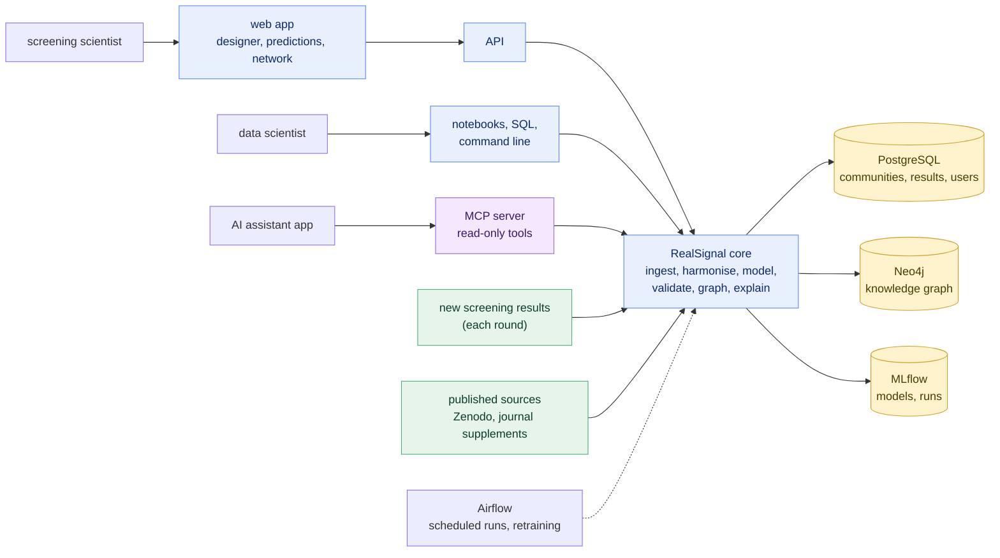

[Handbook](HANDBOOK.md) · [README](../README.md) · [Roadmap](ROADMAP.md) · [Architecture](00-architecture.md) · [Glossary](GLOSSARY.md)

# Product and technology roadmap: beyond the repository

**Prerequisites:** [`docs/00-architecture.md`](00-architecture.md) (the parts of the system) and [`docs/ROADMAP.md`](ROADMAP.md) (what this repository builds, phase by phase).

**Learning goal:** know what a larger RealSignal, used by a research team on its own strains, would consist of; be able to explain each technology in it to someone with no background; and know for each one whether it's needed now, later, optionally or not at all, and what would change that answer.

**Where this sits:** Stage 21 of the [Handbook](HANDBOOK.md#stage-21-beyond-the-repository-the-product). It's reading, not building, and it can be read at any point.

---

## Contents

- [How to read this document](#how-to-read-this-document)
- [Who the finished product is for](#who-the-finished-product-is-for)
- [The finished product in one picture](#the-finished-product-in-one-picture)
- [A. How people use it](#a-how-people-use-it)
- [B. Where data lives and how it moves](#b-where-data-lives-and-how-it-moves)
- [C. The AI features](#c-the-ai-features)
- [D. Running it: containers, cloud and operations](#d-running-it-containers-cloud-and-operations)
- [E. Security, licences and limits](#e-security-licences-and-limits)
- [F. Reusing the method on another strain library](#f-reusing-the-method-on-another-strain-library)
- [G. Every technology, one table](#g-every-technology-one-table)
- [How this document is maintained](#how-this-document-is-maintained)

---

## How to read this document

[`docs/ROADMAP.md`](ROADMAP.md) covers this repository: a complete, documented product that runs on one computer, and online from a link for anyone who wants to try it. This document looks further, at what a team running its own screening programme would need. If the repository is one allotment plot, grown carefully with every step written down, this document is about the farm: more people, more fields, deliveries, inspections, and which of those a farm needs on its first day.

Each technology gets one verdict:

| Verdict | Meaning |
|---|---|
| **Built in this repository** | part of the 18 phases; version 1.0 isn't complete without it |
| **Recommended later** | not needed to run or prove the method; needed for many users, other strain libraries or live laboratory data |
| **Optional** | adopt only when a real user asks for it |
| **Not needed** | adds cost without benefit at any scale in sight, or is the wrong tool |

Each verdict comes with a **trigger**: the event that would change it. The rule throughout is to add a technology only when it solves a problem someone has. The repository is built so the "later" items can be added without rewriting what exists: data flows one way, every step is a function with a thin command on top, results live in a database with a documented schema, and nothing assumes this particular strain library.

---

## Who the finished product is for

| User | Their problem | What RealSignal gives them |
|---|---|---|
| **Screening scientist**, who designs and runs the community experiments | hundreds of thousands of possible communities, room for a few dozen per round | a ranked shortlist of untested communities, each with its predicted outcome, its uncertainty and the strains behind it |
| **Data scientist** in a microbial products team | community, genome and interaction data in separate files and formats | one harmonised, tested data model; models that are reproducible and judged on held-out data |
| **Research lead** | how many communities to fund in the next screen, and whether the last one was big enough | the data-efficiency curve (Phase 9): how quickly conclusions settled as communities were added |
| **Methods or reproducibility researcher** | does a published result hold, and if not, why not | the three-way comparison (Phase 6) as a reusable pattern, with every fix to the original code logged |
| **An AI assistant app** working for any of them | needs safe, structured access to the data and models | the MCP server (Phase 15): read-only tools, checked inputs, every call logged |

---

## The finished product in one picture

Everything in this picture is built in the repository by version 1.0. What changes in a larger version is scale, the number of users and strain libraries, and where it runs, which the sections below go through one part at a time.

---

## A. How people use it

### A1. Web app (React with TypeScript)

**Built in this repository (Phase 11).** The screen most users see: a community designer, prediction views with uncertainty, a network view. Streamlit (Phase 7) stays as the quick internal tool, because changing a Streamlit page takes minutes and changing a React app takes a build. **Trigger for more:** several teams using it daily, at which point it needs accounts (A4).

### A2. API (FastAPI)

**Built in this repository (Phase 10).** Every other surface (web app, MCP server, agent, notebooks) goes through the same API, so a rule changed in one place applies everywhere. **Trigger for more:** a laboratory system that needs to push results in automatically (A3).

### A3. Closing the loop: new results in, better suggestions out

**Partly built (Phase 12); the full loop is recommended later.** The repository's pipeline takes a new file of measured communities and retrains. A screening team would want more: the app suggests the next round, the laboratory runs it, the results come back through the API, and the next suggestions are chosen to learn as much as possible, a method called **active learning** or **Bayesian experimental design**. The arithmetic of [`docs/interactive/combinations.html`](interactive/combinations.html) is the reason this matters: when you can test a few dozen of hundreds of thousands, each round should be chosen to teach the most. **Trigger:** a team that runs more than one round of screening with the tool.

### A4. Accounts, teams and permissions

**Recommended later.** One computer needs no logins. A shared server does: who can see which strain library, who can upload results, an audit log of who changed what. **Trigger:** a second team, or any confidential strain library on a shared server.

### A5. Connections to laboratory systems

**Optional.** Plate readers, colony counters and laboratory information systems (LIMS) produce result files. A small importer per system saves retyping. **Trigger:** the same file format arriving every week.

### A6. Desktop or phone apps

**Not needed.** A browser does everything these users need. **Trigger:** work in places without a network, such as a field station, which nothing here currently suggests.

---

## B. Where data lives and how it moves

### B1. Other strain libraries, other measurements

**The most important later item.** The method is useful beyond these 35 strains only if a new library, a different community size or a different measurement (plant weight, a different pathogen, a chemical readout) can go in without a rewrite. Phase 3 sets that up from the start by treating the library, the community size and the outcome as data, and one of its tests runs the whole pipeline on a made-up screen of four strains in communities of two. [Section F](#f-reusing-the-method-on-another-strain-library) lists what changes and what doesn't. **Trigger:** the first dataset that isn't this study's.

### B2. DuckDB for analysis, PostgreSQL for the application

**Built in this repository (Phases 3 and 10).** DuckDB is a whole analytical database in one file, fast for one person scanning columns; PostgreSQL serves many users making small reads and writes. [`docs/00-architecture.md`](00-architecture.md) explains the difference in full. **Trigger for more:** a managed PostgreSQL service once the application moves to a server (D2).

### B3. dbt for harmonisation

**Built in this repository (Phase 3).** Every rule that makes the sources agree lives in a tested, version-controlled SQL model, and every known disagreement between sources is a row in a small committed table the tests compare with. **Trigger for more:** none expected; dbt scales from one file to a warehouse unchanged.

### B4. Airflow for orchestration

**Built in this repository (Phase 12).** Runs the pipeline in order, on a schedule, with retries. Prefect would do the same job with less setup; Airflow is used here because it's widely used, so what's learned carries over to many teams. **Trigger for change:** none at this scale.

### B5. Cloud warehouses (Snowflake, Databricks)

**Optional, not built.** Most of the dbt models could be pointed at a cloud warehouse through a second connection profile; a few DuckDB conveniences they use would need their equivalents ([Phase 3 guide, section 7](04-phase-3-harmonisation.md#the-same-models-on-another-database-not-built-here)). At this data size it's portability practice, not a need. **Trigger:** a team whose data already lives in one, or tens of millions of measurements.

### B6. MLflow for models and runs

**Built in this repository (Phase 5).** Every model, its settings and scores are recorded, so any prediction can be traced back to the run that made it. **Trigger for more:** a model registry with approval steps, once predictions decide what gets funded.

### B7. Data versioning (DVC)

**Optional.** The raw data here is a fixed, checksummed archive, so a script that rebuilds everything from it is enough. **Trigger:** raw data that changes over time, such as results arriving every round (A3), at which point each round's data needs its own version.

### B8. Object storage (S3-compatible)

**Recommended later.** Genomes, model files and large result files belong in object storage once they outgrow a disk or need sharing between servers. **Trigger:** more than one server, or files over a few gigabytes.

### B9. A data-quality report for every new round

**Built in this repository for this study (Phase 4).** `scripts/make_quality_report.py` writes every number from the warehouse, never from typed-in values, and comes out byte for byte the same for the same data, so the report changes only when the data does. The controls grown in every round make differences between rounds visible: in this study, the reference communities protected about ten times less well in round 2 than in round 1. A team screening round after round (A3) would want that report on each new round before its results go into a model, with a warning when the controls move. **Trigger for more:** the first new round, at which point the report runs on it automatically (Phase 12's pipeline) and the warning becomes a check that can stop the run.

---

## C. The AI features

### C1. Plain-language explanations

**Built in this repository (Phase 7).** Every prediction comes with a sentence saying which strains drove it and how sure the model is. Written from the numbers by code, so it can't invent anything.

### C2. Ontology and knowledge graph (Neo4j)

**Built in this repository (Phase 13).** The ontology says what kinds of thing exist and how they may relate; the graph holds the strains, gene clusters, interactions and communities. **Trigger for more:** linking to public ontologies (taxonomy, chemical classes) once other libraries arrive (B1).

### C3. GraphRAG: answers with sources

**Built in this repository (Phase 14).** Answers questions by looking things up in the graph and the documents first, and cites every source. Runs with no language model (search only), a local one, or a hosted one. **Trigger for change:** a team that needs everything kept inside its own network, which the local-model option already covers.

### C4. MCP server

**Built in this repository (Phase 15).** Offers the project's tools to AI assistant apps through a shared standard. Read-only on purpose. **Trigger for more:** write tools (uploading results) only after accounts and an audit log exist (A4).

### C5. Recommendation agent

**Built in this repository (Phase 16).** Takes a goal, calls read-only tools within a step limit, and logs every action. **Trigger for more:** the full experiment-design loop (A3), where the agent's shortlist becomes the next screening round.

### C6. Genome language models

**Optional.** Large models trained on DNA and protein sequences can turn a genome into features. With a few dozen strains, simple counts of gene clusters are easier to interpret and probably as useful. **Trigger:** a library of thousands of strains where simple features stop being enough.

---

## D. Running it: containers, cloud and operations

### D1. Containers (Docker or Podman)

**Built in this repository (Phase 17).** One command starts every service on Windows, macOS or RHEL 8. [`docs/CONTAINERS.md`](CONTAINERS.md) explains them from zero.

### D2. A server or the cloud

**Recommended later.** The same containers run unchanged on one server inside an organisation, or on a cloud provider. The order to do it in: one server inside the organisation first (confidential strain libraries stay inside), cloud only when several sites need it. **Trigger:** more than one person needing it at the same time.

### D3. Kubernetes

**Not needed.** It manages containers across many machines; this system fits on one. **Trigger:** many teams, many libraries and a need to keep running through a machine failure.

### D4. Monitoring, backups and costs

**Recommended later, together with D2.** On one computer, the person running it notices failures. On a server, something must watch it: health checks (Phase 17 adds them), a daily database backup, and, in the cloud, a spending limit set before anything else. **Trigger:** the first deployment to a server.

---

## E. Security, licences and limits

- **Data licences.** Layer 1 is CC-BY 4.0: reusable, including commercially, with credit to its authors. The genomes come from NCBI, which places no restrictions of its own on them. The supplementary tables behind Layers 3 to 5 come under their publisher's terms, without an open licence, so a product that passed the files on to its users would need the publisher's permission, and any commercial use of them is worth checking with the publisher first. The repository never stores any of them: the scripts download each file from its source, and `sources/register.csv` records the terms of every source.
- **Confidential strain libraries.** A company's strain library is valuable and secret. Everything in RealSignal runs on its own computer or inside its own network, with nothing uploaded, and the GraphRAG feature can use a local model. That's a design choice made for reproducibility, and it's what a confidential user needs.
- **Secrets.** Keys for optional services live in a `.env` file that Git never records, and the safety gate refuses any push that would publish one.
- **No personal data.** The data describes bacteria and plants. Accounts (A4) would add names and email addresses, and with them data-protection duties.
- **What the predictions are not.** Results from sterile plants in sealed boxes with five known strains. Not advice for fields or crops, and not a claim about any commercial product. The apps say so on screen.

---

## F. Reusing the method on another strain library

What stays the same and what changes when someone brings their own screen:

| Part | Changes? | How |
|---|---|---|
| fetching and verifying | new fetcher | one function per source, same checks and provenance log |
| harmonisation (dbt) | new staging model | the strain library, community size and outcome are already data, so only the first layer of models changes |
| models and evaluation | no | the same grouped cross-validation, baselines and held-out test |
| exploration and data-quality report | no | the questions read the marts and find the controls by what they hold, not by name; a test runs them on six strains in pairs |
| data-efficiency curve | no | runs on any number of communities |
| knowledge graph | new nodes | the ontology already allows any strain, cluster and interaction |
| apps, API, MCP server, agent | no | they read from the database, not from this study |

The trained model is specific to this study. The pipeline around it isn't, and that's what a team with its own strains would reuse.

---

## G. Every technology, one table

| Technology | Verdict | Where | Trigger to change |
|---|---|---|---|
| Python, pandas, scikit-learn | built | Phases 1 to 9 | n/a |
| R, RStudio, renv | built | Phase 6 | n/a |
| DuckDB | built | Phase 3 | n/a |
| dbt Core | built | Phase 3 | n/a |
| data-quality report | built | Phase 4 | a new round each time (B9) |
| MLflow | built | Phase 5 | a model registry with approvals |
| Streamlit | built | Phase 7 | n/a |
| PostgreSQL | built | Phase 10 | a managed service on a server |
| FastAPI | built | Phase 10 | n/a |
| React, TypeScript | built | Phase 11 | n/a |
| Airflow | built | Phase 12 | n/a |
| Neo4j | built | Phase 13 | public ontologies linked in |
| GraphRAG | built | Phase 14 | n/a |
| MCP server | built | Phase 15 | write tools, after accounts |
| agent | built | Phase 16 | the full experiment-design loop |
| Docker, Podman | built | Phase 17 | n/a |
| GitHub Actions | built | Phase 18 | n/a |
| active learning loop | later | A3 | a second screening round |
| accounts and permissions | later | A4 | a second team, or confidential data on a server |
| server or cloud hosting | later | D2 | several people at once |
| object storage | later | B8 | more than one server |
| Snowflake, Databricks | optional | B5 | data already there, or far more of it |
| DVC | optional | B7 | raw data that changes over time |
| genome language models | optional | C6 | thousands of strains |
| LIMS importers | optional | A5 | the same file format every week |
| Kubernetes | not needed | D3 | many teams, failover |
| desktop or phone apps | not needed | A6 | work without a network |

---

## How this document is maintained

When a phase builds something listed here, its verdict line says so in the same commit. When a trigger happens, the verdict changes and the changelog records why. The [Handbook's maintenance rules](HANDBOOK.md#how-this-handbook-is-maintained) list everything else that changes with each phase.
