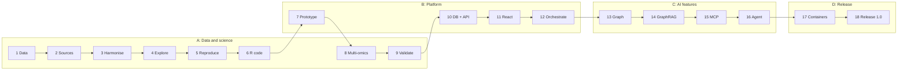

[Handbook](HANDBOOK.md) · [README](../README.md) · [Architecture](00-architecture.md) · [Product roadmap](PRODUCT_ROADMAP.md) · [Glossary](GLOSSARY.md)

# Roadmap: the full build plan

**What this document is.** The whole plan for RealSignal, from the verified download that exists today to a released, containerised product: what each phase builds, what it teaches, roughly how long it takes, which version tag it earns, and, for the tools left out, why. The [Handbook](HANDBOOK.md) walks the same phases as stages, with the commands; this document holds the reasoning and the overview.

**Why write the plan down.** A plan written in advance can't quietly shrink to whatever got finished, and it shows the reasoning behind each choice, including the tools that could have been used and weren't ([section 6](#6-tools-left-out-on-purpose-and-why)).

**Current status: Phases 1 to 3 done (v0.2.0).** The published archive is downloaded and verified, Layer 1's tables are read and understood, the other four layers are fetched and checked (34 genomes against the checksums NCBI publishes, two journal workbooks against checksums pinned on first use), and all five are harmonised in one DuckDB warehouse by a dbt project with 187 data tests. Phase 4 is next. Everything after Phase 3 is planned and marked as planned everywhere in the repository.

---

## Contents

- [1. The shape of the plan](#1-the-shape-of-the-plan)
- [2. What "finished" means](#2-what-finished-means)
- [3. The phases, in build order](#3-the-phases-in-build-order)
- [4. Milestones and version tags](#4-milestones-and-version-tags)
- [5. Effort and schedule](#5-effort-and-schedule)
- [6. Tools left out on purpose, and why](#6-tools-left-out-on-purpose-and-why)
- [7. What could derail this](#7-what-could-derail-this)
- [8. How this roadmap is maintained](#8-how-this-roadmap-is-maintained)

---

## 1. The shape of the plan

The work falls into four tracks. The first two are built **interleaved**, so there's always something working to show and the science and the software keep correcting each other.

| Track | What it covers | What it shows |
|---|---|---|
| **A: Data and science** | five data layers, harmonisation, exploration, modelling, the R comparison, validation | that the analysis is sound and correctly evaluated |
| **B: Platform** | the prototype app, database, API, web frontend, orchestration | that the analysis becomes a system people can use |
| **C: AI features** | knowledge graph, GraphRAG, MCP server, agent | that the domain is modelled carefully and can be queried by people and programs |
| **D: Release** | containers, tests on three operating systems, packaging, release | that someone other than its author can run and maintain it |

**Why interleave.** Building all the science first means months with nothing to click and no feedback on whether the outputs are usable. Building all the platform first means an application serving nothing. Alternating means every few weeks bring either a new finding or a new capability.

---

## 2. What "finished" means

Version 1.0.0 is the finished product. It's reached when every box below is ticked, each one checked on a fresh computer, not just on the one it was built on.

**The science**

- ✅ All five data layers fetched and verified, or recorded as unobtainable with the reason (Phase 2: all five fetched; Leaf21 has no genome, and the register says so)
- ✅ One harmonised data model, with every data test passing (Phase 3: 35 models, 187 data tests, and a test that runs it on a made-up screen of another size)
- ⬜ The published models reproduced in Python, compared with the published numbers
- ⬜ The authors' R code run, and the three-way comparison explained difference by difference
- ⬜ The genome and network layers tested for added value, whatever the answer
- ⬜ The strain ranking compared with single-strain results, and the data-efficiency curve drawn

**The product**

- ⬜ A prototype app online, from a link, with the model's limits on screen
- ⬜ A PostgreSQL database and a FastAPI backend with documented, tested endpoints
- ⬜ A React and TypeScript web app on top of the API
- ⬜ The whole pipeline rebuilt from raw data by one command or one Airflow run, and able to retrain when new results arrive
- ⬜ A knowledge graph with a written ontology, GraphRAG answers with sources, a read-only MCP server and a logged recommendation agent
- ⬜ Every service started together with one command, with Docker or with Podman

**The release**

- ⬜ Automated tests passing on Windows, macOS and Linux at every push
- ⬜ An accessibility check of both apps, a licence check of every dependency, a citation file, a contribution guide, issue templates and an uninstall guide
- ⬜ The changelog complete to 1.0.0, every guide in the Handbook linked, and nothing in the documentation describing work as planned that has been built

---

## 3. The phases, in build order

Each phase ends at a working, committed checkpoint; the Handbook stage for each one has the commands and the commit message. Headings carry no status marks, so links to them never change; the status sits in the line under each heading.

### Phase 1: Data acquisition

**Track A · about 4 hours (estimate) · ✅ done · v0.1.0 · Handbook [Stage 3](HANDBOOK.md#stage-3-phase-1-get-the-real-data-verified) · Guide [`docs/02-phase-1-data-acquisition.md`](02-phase-1-data-acquisition.md)**

A verified download of Layer 1: probe first, then download, check against the published MD5 checksum, unpack (skipping macOS clutter and any entry that would land outside its folder), list every file, and log where it came from. Safe to run again. Also in this phase: the safety gate that runs before every push, offline tests for the download script, a test that keeps the documentation's links working, the concept figures, the logo, the interactive journey and combinations pages, and the optional GitHub Pages site.

**Builds:** `scripts/fetch_data.py`, `notebooks/explore_raw.py`, `check-public-safe.sh`, three test files, the figures and illustrations, the Handbook. **Teaches:** permanent archives, DOIs, checksums, read-only raw data, provenance, streaming large files, idempotent scripts, testing without the network.

### Phase 2: The other data layers, or a record of why not

**Track A · about 8 hours (estimate) · ✅ done · Handbook [Stage 4](HANDBOOK.md#stage-4-phase-2-the-other-four-layers-or-a-record-of-why-not) · Guide [`docs/03-phase-2-more-sources.md`](03-phase-2-more-sources.md)**

It starts with Layer 1: open the tables Phase 1 listed and find where the 136 training and 70 test communities sit (rounds 1 and 2, and round 3 with two reference communities grown in every round), which plants were set aside and why, and how the authors' machine-learning tables were made from the plant file, all without opening the authors' R code, which waits for Phase 6. Then fetch Layers 2 to 5 with the same discipline as Layer 1: verified, logged, never edited. A **source register** records each source's terms, where its files come from, its status and a date, including anything that couldn't be had. Genomes are checked against the checksums NCBI publishes; the journal workbooks, which come with no checksum, against one pinned on first use; and Layer 5's workbook also against the copy found in the Phase 1 archive.

**Builds:** `sources/register.csv` and `sources/files.csv`, `scripts/fetch_sources.py` (one fetcher driven by the register), `notebooks/explore_layer1.py`, `notebooks/explore_sources.py`, three figures and the interactive communities page, 17 offline tests. **Teaches:** reading tables you didn't write; a paper's data-availability statement; supplementary information; the difference between *open access* (free to read) and an *open licence* (free to reuse); accessions, RefSeq and FASTA files; checksums published, pinned and compared; recording what you could not get.

### Phase 3: Harmonisation with dbt

**Track A · about 10 hours (estimate) · ✅ done · v0.2.0 · Handbook [Stage 5](HANDBOOK.md#stage-5-phase-3-harmonise-everything-with-dbt) · Guide [`docs/04-phase-3-harmonisation.md`](04-phase-3-harmonisation.md)**

Sources written years apart by different laboratories spell the same strain differently and shape their tables differently. This phase loads every raw table into a DuckDB warehouse unchanged, then joins them onto one strain name and one community name in a layered set of SQL models (staging, intermediate, marts), with automated data tests and generated documentation. The three choices Phase 2 left about Layer 1 are made here, each with its reason and a test: the undecided plants are kept, as a setting that can be switched; the two reference communities are test communities, their earlier plants kept only for comparing rounds; the two communities with no plants left keep their rows.

**dbt** turns a folder of SQL files into a pipeline with an order, tests and documentation: loose recipe cards become a cookbook with a contents page, an index and a note on each recipe saying which others must be made first. dbt Core is free and runs here against DuckDB on your own computer.

**One rule set here, because it's cheap now and expensive later:** nothing hard-codes 35 strains, five per community, one pathogen or one measurement. The strain library, the community size and the outcome are data, so the same tables could take a library of 400 strains, communities of three and a different measurement without a rewrite.

**Optional, as a portability exercise (not built in Phase 3):** the same dbt models pointed at a cloud warehouse (Snowflake or Databricks) by adding a second connection profile. The guide says which DuckDB conveniences in the models would need their equivalents. If it's built, it will come with free-trial steps checked at the time, because those terms change, and how to avoid any cost.

**Builds:** `sources/tables.csv` and `scripts/load_raw.py` (the load), the dbt project in `dbt/` (21 staging, 6 intermediate and 8 mart models, three macros, a seed of known disagreements between sources, 170 generic and 17 singular data tests), the shared helpers in `src/realsignal/helpers.py`, `notebooks/explore_warehouse.py`, three figures drawn from dbt's own records and the warehouse, and 18 more tests, one of which runs the loader and the whole dbt project on a made-up screen of four strains in communities of two. **Teaches:** ETL and ELT, a warehouse, dbt from zero (models, `ref()` and `source()`, macros, views and tables, seeds, vars), dimensions and facts, generic and singular data tests and seeing them fail, lineage, decisions about data as settings with reasons, why transformations belong in version control.

### Phase 4: Exploration

**Track A · about 6 hours · ⬜ planned · Guide (planned) `docs/05-phase-4-exploration.md`**

The first proper look: distributions, the two-humped shape of the pathogen counts, how often each strain appears, missing values, outliers, and how the layers relate.

**Builds:** an exploration script, the first figures from the real data, a data-quality report that one script regenerates. **Teaches:** exploratory analysis, log scales, class imbalance, finding problems before modelling instead of after.

### Phase 5: Reproduce the published models in Python

**Track A · about 12 hours · ⬜ planned · earns v0.3.0 · Guide (planned) `docs/06-phase-5-reproduction.md`**

Random forests and elastic nets, for classification (protected or not) and regression (how much pathogen), with repeated cross-validation over several random seeds, scored once on the 70 test communities. Then the table that matters: these numbers beside the published ones.

**MLflow** records every training run's settings, scores and model, a laboratory notebook that fills itself in, so "which settings gave that number?" always has an answer.

**Builds:** the modelling code in `src/realsignal/`, an MLflow log, the comparison table, tests including one that fails if plants of one community ever land on both sides of a split. **Teaches:** supervised learning, cross-validation, keeping groups together to prevent leakage, baselines, results across seeds, experiment tracking, and not adjusting settings until a known number appears.

**Commit this before opening the authors' R code.** That commit is the dated record that the rebuild was written from the paper alone.

### Phase 6: The original R analysis, and the three-way comparison

**Track A · about 8 hours · ⬜ planned · earns v0.4.0 · Guide (planned) `docs/07-phase-6-original-r-code.md`**

The authors wrote their analysis in **R**, a language built by statisticians for statistics, and their scripts are inside the archive downloaded in Phase 1 (`notebooks/explore_raw.py` lists them). Most reproductions have only the paper and the data. This one can run the code that produced the published numbers.

**Why three results beat two.** Sailors used to say: never go to sea with two clocks; take one or three. With two that disagree you can't tell which is wrong. If the paper and the Python rebuild disagree, there are three possible reasons: a mistake in the rebuild, released code that doesn't reproduce its own paper, or a result that depends on the software. Running the original code is the third clock.

| Comparison | The question it answers |
|---|---|
| the paper and their R code, run here | does the released code reproduce its own paper? |
| their R code and the Python rebuild | was the method rebuilt correctly? |
| the paper and the Python rebuild | does the finding survive a change of language and libraries? |

**Why it comes after Phase 5.** Doing the exercise before looking at the answers at the back of the book: once you've seen the number you're aiming for, you can't help steering towards it.

**Builds:** R and RStudio installed (on Windows, macOS and RHEL 8), an RStudio project file `realsignal.Rproj`, a per-project R package library with **renv** and its `renv.lock` (R's version of the virtual environment and the lock file), a runner that executes the authors' scripts read-only and writes elsewhere, the three-way table with every difference explained, a log of every change needed to make their code run, and one small *same task, three languages* walkthrough (the same summary in pandas, R's dplyr and SQL). **Teaches:** R from zero, RStudio, renv, reading someone else's code in an unfamiliar language, telling "my code disagrees" apart from "the original doesn't reproduce".

Someone else's research code often needs small fixes to run on a new computer (a folder path, a package that has moved on). That's normal, and the log of fixes is part of the result.

### Phase 7: The prototype app, online

**Track B · about 10 hours · ⬜ planned · earns v0.5.0 · Guide (planned) `docs/08-phase-7-prototype-app.md`**

A **Streamlit** app: pick a community, see the predicted outcome with its uncertainty and which strains drove it, in plain words, with the model's limits stated on screen. Then online: the app on Streamlit Community Cloud and the interactive figures on GitHub Pages, so anyone can try it from a link.

Placed halfway through the science on purpose: a working tool at this point keeps asking "who would use this, and for what?" while there's still time to act on the answer.

**Builds:** `app/`, the first screenshots, the online copy. **Teaches:** turning an analysis into a tool, showing uncertainty in an interface, putting an app online for free.

### Phase 8: Multi-omics integration

**Track A · about 12 hours · ⬜ planned · Guide (planned) `docs/09-phase-8-multi-omics.md`**

Add features from the other layers to the community data and test whether they predict better than which strains are present:

- **community features** (Layer 1): which strains are present;
- **genome features** (Layers 2 and 3): what chemistry the strains could make, as counts of gene clusters by type;
- **network features** (Layer 4): how much the members hold each other back, and how strongly they hold back the pathogen's relatives.

**Builds:** the combined feature tables, a model comparison layer by layer with intervals, a cross-layer correlation network. **Teaches:** multi-omics integration, feature engineering across layers, testing whether added complexity helps instead of assuming it does.

The original study found that strain identity alone predicted well, so the extra layers may add nothing. That would be a result, and it gets reported as one.

### Phase 9: External validation and the data-efficiency curve

**Track A · about 10 hours · ⬜ planned · earns v0.6.0, the science complete · Guide (planned) `docs/10-phase-9-validation.md`**

Two questions:

1. **Does the ranking hold up outside the training data?** Compare the strain ranking learned from communities with each strain's protection measured alone (Layer 5): rank correlation with an interval, and each disagreement looked at in turn, because a strain that only protects in company is a different finding from one that protects alone. Layer 5 comes from the same research group, so this is an independent dataset, not an independent laboratory, and the guide says so.
2. **How many communities were needed?** Retrain on smaller and smaller random subsets of the 136 and watch when the conclusion stops changing. Anyone planning a screen like this asks that first, because every community costs weeks of growth-chamber time.

**Builds:** the validation analysis, a rank-agreement figure, the data-efficiency curve. **Teaches:** external validation, rank correlation, learning curves, reading disagreement instead of hiding it.

### Phase 10: PostgreSQL and FastAPI, the first container

**Track B · about 12 hours · ⬜ planned · Guide (planned) `docs/11-phase-10-database-api.md`**

The serving layer. **PostgreSQL** is the application's database; **FastAPI** is the backend that answers requests.

**Why a second database?** DuckDB is built for analysis, one person scanning whole columns; PostgreSQL is built for applications, many small reads and writes from many people at once. An **API** is the set of addresses other programs call to ask the system for something. Both ideas are explained from zero in [`docs/00-architecture.md` sections 6 and 9](00-architecture.md#6-box-4-storage-and-why-there-are-two-databases-and-a-graph).

**First contact with containers.** PostgreSQL arrives as a container, one command on every operating system, with Docker or Podman. One service with an obvious benefit, before the whole system in Phase 17. [`docs/CONTAINERS.md`](CONTAINERS.md) explains containers from zero.

**Builds:** `api/`, the database in a container, endpoints with automatic interactive documentation, API tests. **Teaches:** analytical and transactional databases (OLAP and OLTP), REST APIs, request validation, what a container is.

### Phase 11: The React and TypeScript frontend

**Track B · about 16 hours · ⬜ planned · Guide (planned) `docs/12-phase-11-react-frontend.md`**

A web app for people outside the project: a community designer, prediction views and a network view, all talking to the API. Streamlit stays as the quick internal tool.

**TypeScript** is JavaScript with types, which catch whole classes of mistakes in the editor, before the code runs ([`docs/00-architecture.md` section 9](00-architecture.md#9-box-7-serving-it-and-three-words-explained)).

**Builds:** `frontend/`. **Teaches:** frontend and backend, components, calling an API, typed JavaScript, why larger applications keep the two apart.

### Phase 12: Orchestration with Airflow

**Track B · about 10 hours · ⬜ planned · earns v0.7.0 · Guide (planned) `docs/13-phase-12-orchestration.md`**

Until here, every step is a command someone remembers to type. Orchestration runs them in the right order, on a schedule, and makes failures visible. **Airflow** is an alarm clock crossed with a checklist that knows which tasks depend on which. It's introduced gently: first a plain Python runner that calls every step in order, so you see exactly what Airflow takes over, then the same pipeline as an Airflow workflow running on your own computer.

The pipeline also takes **new results**: a new file of measured communities goes in, the models retrain, and the predictions and the app update. That's the loop the product is built around.

**Builds:** the plain runner, `airflow/` with the workflow (ingest, transform, model, publish), retries and a monitoring view. **Teaches:** orchestration, dependencies, idempotent tasks, scheduling, retraining on new data.

### Phase 13: The knowledge graph and its ontology

**Track C · about 12 hours · ⬜ planned · Guide (planned) `docs/14-phase-13-knowledge-graph.md`**

An **ontology** is an agreed vocabulary for a domain: which kinds of thing exist and how they may relate ([`docs/00-architecture.md` section 10](00-architecture.md#10-box-8-the-ai-features)). Here: a *strain* CARRIES a *gene cluster*, a gene cluster PRODUCES a *compound class*, a strain INHIBITS a strain, a *community* CONTAINS strains and is TESTED ON a *plant*. The data is loaded into **Neo4j**, a graph database (a first version in NetworkX shows the idea with no database at all).

The inhibition layer is already a network of measured strain-against-strain effects, and squeezing it into tables loses its structure. A graph makes questions like "which strains hold back the pathogen's relatives *and* carry antibiotic gene clusters?" short to ask.

**Builds:** the written ontology, the graph, a test that every relationship is one the ontology allows, example graph queries. **Teaches:** graph data models, ontologies, Cypher, when a graph beats a table and when it doesn't.

### Phase 14: GraphRAG, answers with sources

**Track C · about 10 hours · ⬜ planned · Guide (planned) `docs/15-phase-14-graphrag.md`**

Questions in plain English, answered from the knowledge graph and the project's own documents, with every statement citing where it came from. **RAG** (retrieval-augmented generation) means the system looks things up in the project's data before a language model writes the answer. **GraphRAG** walks the graph as part of the lookup, so questions about relationships ("why might Leaf76 protect?") can follow the chain.

It works without any language model too (search only), and with a local model nothing leaves the computer. Questions the project can't answer are refused instead of guessed.

**Builds:** the question-answering page, a set of test questions with known answers. **Teaches:** RAG, embeddings, grounding, citations, why an answer without a source is no use in science.

### Phase 15: The MCP server

**Track C · about 6 hours · ⬜ planned · Guide (planned) `docs/16-phase-15-mcp-server.md`**

The **Model Context Protocol** is a shared standard for connecting tools and data to AI assistant apps ([`docs/00-architecture.md` section 10](00-architecture.md#10-box-8-the-ai-features)). This phase offers the project's predictions, data queries and graph lookups as read-only tools through a small MCP server.

**Builds:** `mcp/`, the tools, input checks, a log of every call, tests that talk to the server the way an assistant app does. **Teaches:** MCP, designing tools for programs to call, keeping them safe. It's a short phase because the API from Phase 10 does the real work.

### Phase 16: The recommendation agent

**Track C · about 8 hours · ⬜ planned · earns v0.8.0 · Guide (planned) `docs/17-phase-16-agent.md`**

A chatbot answers; an agent takes steps. Given a goal ("suggest three untested communities most likely to protect"), the agent decides which tools to call, checks candidates against the model and the graph, and returns a shortlist with its reasons.

**Builds:** an agent with a fixed set of read-only tools, a limit on steps, and a full log that replays every action. **Teaches:** agent loops, tool use, guardrails, measuring an agent (does its shortlist beat random choice on held-out communities?).

### Phase 17: The whole system in containers, Docker or Podman

**Track D · about 12 hours · ⬜ planned · earns v0.9.0 · Guide (planned) `docs/18-phase-17-containers.md`, with [`docs/CONTAINERS.md`](CONTAINERS.md)**

Every service (PostgreSQL, Neo4j, the API, Streamlit, the React app and MLflow) in its own container, all started with one command on any of the three operating systems, installing none of them by hand. The files work with **Docker or Podman**: Red Hat doesn't ship Docker on RHEL 8, where Podman is the supported engine, and both follow the same open image standard (OCI), so one set of files serves both.

**Builds:** a `Dockerfile` per service (multi-stage builds, no root user), `compose.yaml` with named volumes and health checks, and `container.sh` and `container.ps1`, which find whichever engine is installed. **Teaches:** images and containers, volumes, ports, one job per container, rootless containers, and the RHEL 8 details (SELinux labels on mounted folders, containers that stop at logout, getting compose).

It comes late because containers package a working system; boxing it before knowing what goes in means boxing it twice.

### Phase 18: Tests on three systems, release 1.0

**Track D · about 8 hours · ⬜ planned · earns v1.0.0 · Guide (planned) `docs/19-phase-18-release.md`**

**GitHub Actions** runs the tests on Windows, macOS and Linux at every push and builds the container images, so a broken change is caught by a machine instead of a user. Then the release work: a licence check of every dependency, a `CITATION.cff` so others can cite the project, `CONTRIBUTING.md`, issue templates, `docs/UNINSTALL.md`, an accessibility check of both apps, the changelog brought to 1.0.0, a last pass over every guide, and the **v1.0.0** tag.

**Builds:** `.github/workflows/`, the release files. **Teaches:** continuous integration, automated image builds, semantic versioning, what a release involves.

---

## 4. Milestones and version tags

Each tag is a stopping point where the project is complete in itself. Projects get interrupted, so every one of these leaves something coherent behind.

| Tag | After | What exists |
|---|---|---|
| **v0.1.0** ✅ | Phase 1 | verified data, the documentation and a reproducible setup |
| **v0.2.0** ✅ | Phase 3 | every available source fetched and harmonised in a tested dbt project |
| v0.3.0 | Phase 5 | the reproduction: the rebuilt numbers beside the published ones |
| v0.4.0 | Phase 6 | the three-way comparison with the authors' R code |
| v0.5.0 | Phase 7 | a prototype app, online |
| v0.6.0 | Phase 9 | multi-omics and external validation: the science is complete |
| v0.7.0 | Phase 12 | database, API, web app, and a pipeline that runs and retrains itself |
| v0.8.0 | Phase 16 | the AI features: graph, GraphRAG, MCP server, agent |
| v0.9.0 | Phase 17 | the whole system with one command, Docker or Podman |
| v1.0.0 | Phase 18 | tested on three operating systems, released |

The numbers follow semantic versioning ([`docs/GIT_WORKFLOW.md` section 7](GIT_WORKFLOW.md#7-tags-and-version-numbers)). Each tag gets an entry in [`CHANGELOG.md`](../CHANGELOG.md).

---

## 5. Effort and schedule

| Track | Phases | Hours |
|---|---|---|
| A: Data and science | 1, 2, 3, 4, 5, 6, 8, 9 | about 70 |
| B: Platform | 7, 10, 11, 12 | about 48 |
| C: AI features | 13, 14, 15, 16 | about 36 |
| D: Release | 17, 18 | about 20 |
| **Total** | | **about 174** |

Per phase: 4, 8, 10, 6, 12, 8, 10, 12, 10, 12, 16, 10, 12, 10, 6, 8, 12 and 8 hours for Phases 1 to 18. These are my estimates for building **and** documenting each phase; following a finished guide takes much less.

At four to five hours a week that's **eight to ten months**. The science (Phases 1 to 9, about 80 hours) is complete after four to five months, at v0.6.0; that's where the project's main claim is fully supported. Tracks C and D add a lot, but the project stands without them.

If time runs short, the plan is to ship a smaller version well and keep the rest marked as planned, never to describe a phase as built before it is.

---

## 6. Tools left out on purpose, and why

Deciding not to use a tool is a design decision too, so each one gets a reason.

**Databricks and Apache Spark: not used (except as an optional target in Phase 3).** Spark spreads computation over many machines when data won't fit on one. This dataset has a few hundred rows. Spark would be slower than pandas here and add a great deal of setup. The useful piece of that family, **MLflow** for experiment tracking, is used, locally and free, from Phase 5.

**Snowflake: optional, as a portability exercise.** A cloud warehouse is far bigger than this data needs. The skill worth showing is that the same dbt models run against DuckDB locally or a cloud warehouse by switching one profile, so "could this run in the cloud?" has a documented answer. If built, it's an optional module with free-trial steps checked at the time of writing.

**Deep learning: not used.** With 136 training communities a neural network would overfit and be hard to interpret, and the scientific question is *which strains matter*, which needs an interpretable model. Random forests and elastic nets are the right tools here, and they're also what the original study used.

**Kubernetes: not used.** Compose runs the whole system on one computer, which is all this project needs. Kubernetes coordinates containers across a fleet of machines, with scaling and rolling updates; that's the management system of a supermarket chain, and this is one corner shop. The images from Phase 17 are standard OCI images, so they'd be the right starting point if a fleet were ever needed.

**A feature store, a message queue, a data lake: not used.** Sensible at scale, and each would add setup without teaching anything this project needs. [`docs/PRODUCT_ROADMAP.md`](PRODUCT_ROADMAP.md) says when each would become worth it.

---

## 7. What could derail this

Written down in advance, so nothing looks like a surprise later.

**Layers 2 to 5 may not be freely obtainable.** Layer 1 alone supports a complete reproduction; the others add to it. Phase 2 found all four obtainable: the genomes from NCBI, the two supplementary workbooks from the publisher's site. The one gap is Leaf21, which has no genome.

**The authors' R code may not run unchanged.** Old package versions, fixed folder paths. Every fix is logged, and if something can't be made to run, that's recorded as a finding of the three-way comparison.

**The extra layers may not improve prediction.** Quite possible: the original found strain identity alone predicted well. A negative result, reported as one.

**Joining the sources may be harder than it looks.** Strain names across four papers won't match perfectly. In Phase 3 the names turned out easy (only one table writes bare numbers); the harder parts were elsewhere: two tables of one paper that count gene clusters differently for three strains, two strain lists that name 10 genera differently, and three decisions about Layer 1's plants. Each is written down and tested rather than settled quietly.

**Phases may take longer than estimated.** They usually do. The estimates get replaced with actual hours as phases are finished, in [section 5](#5-effort-and-schedule) and in the changelog.

---

## 8. How this roadmap is maintained

At the end of every phase, in the same commit as the phase: change the status line under its heading, the tag table in section 4 and the checklist in section 2; replace the estimate with the actual hours; and turn the planned guide name into a link. The [Handbook's maintenance rules](HANDBOOK.md#how-this-handbook-is-maintained) list everything else that changes in the same commit.

---

**See also:** [`docs/00-architecture.md`](00-architecture.md) for how the finished system fits together · [`docs/PRODUCT_ROADMAP.md`](PRODUCT_ROADMAP.md) for what lies beyond 1.0 · [`docs/GLOSSARY.md`](GLOSSARY.md) for every term in plain language.
